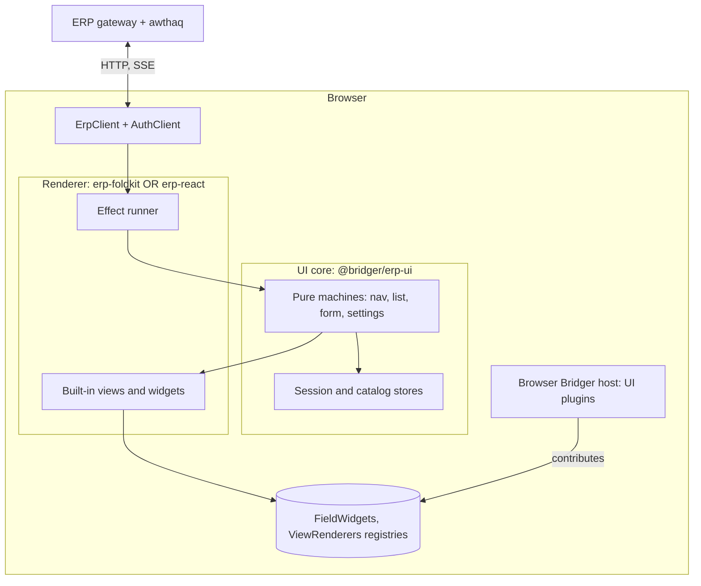
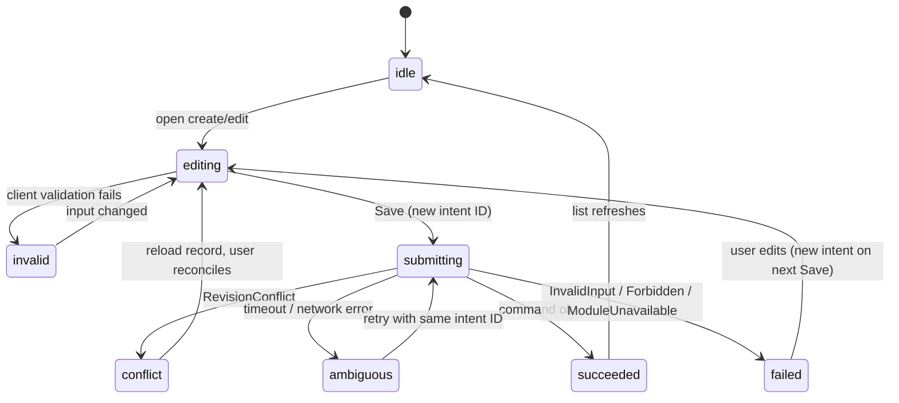
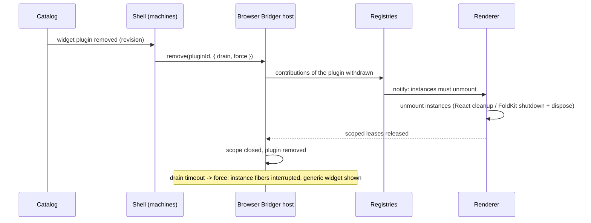

# Bridger ERP: the browser UI (FoldKit or React), catalog and custom UI artifacts

Status: **proposal for review, not implemented or type-checked**. Date: 2026-10-02. `@bridger/erp-ui`, `@bridger/erp-foldkit`, `@bridger/erp-react`, catalog schemas, endpoints and widget contracts are proposed. FoldKit facts (Model/Message/update/Command/Subscription loop, `Runtime.embed`, Ports, Story/Scene tests) are cited from the [knowledge catalog](knowledge/README.md) entries F01–F16, E16, E42, A30, O09–O10 and from [FOLDKIT-API.md](FOLDKIT-API.md); nothing was run. awthaq client behavior is from reading `@awthaq/client`'s README *(inferred)*. Policy: all packages target the latest stable Effect 4.x (4.0.0 at the time of writing). This document refines [ERP-SPEC.md](ERP-SPEC.md) §8 and [ERP-TODO-WALKTHROUGH.md](ERP-TODO-WALKTHROUGH.md) §8.

## 1. Decision

The ERP browser UI is **framework-neutral at its core and renders with either FoldKit or React.** A deployment chooses a renderer; both are built on the same logic and must pass the same conformance suite.

| Layer | Package | Responsibility |
| --- | --- | --- |
| Typed client | `@bridger/erp/client` | HTTP access to the operation gateway (session, catalog, query, command), CSRF handling. Already framework-neutral. |
| **UI core** | `@bridger/erp-ui` (new) | Everything except drawing: session and catalog stores, **pure state machines** for navigation, list, form and settings, the filter model, intent and idempotency keys, context-generation handling, error mapping, widget descriptors, formatting and i18n, and the UI conformance fixtures. No dependency on FoldKit or React. |
| Renderers | `@bridger/erp-foldkit`, `@bridger/erp-react` | Draw the built-in views and widgets and run the UI core's effects. Built on the Bridger browser adapters [`@bridger/foldkit`](FOLDKIT-API.md) and [`@bridger/react`](REACT-API.md). |
| Browser plugin host | `@bridger/core` in the browser | Hosts **UI plugins** (custom widgets and view renderers) with the same lifecycle, lease and drain rules as server plugins ([SPEC.md](SPEC.md)). |

| Concern | Decision |
| --- | --- |
| Rendering | Metadata-driven: catalog → views → widgets. Visible UI is a convenience, never authorization ([ERP-ACCESS.md](ERP-ACCESS.md) §8). |
| Data contracts | Public field schemas only. Policies, migrations and handlers never reach the browser ([ERP-SPEC.md](ERP-SPEC.md) §1). |
| Authentication | awthaq cookie session with CSRF; `@awthaq/client` ([ERP-IDENTITY.md](ERP-IDENTITY.md)). |
| Server contact | HTTP + JSON only. The browser's Effect copy never needs to match the server's. |
| Custom code | Approved, content-addressed **UI plugins** installed into the browser host; one implementation per framework (or a neutral one); torn down by the core's lease and drain rules (§9). |
| Choosing a renderer | Per deployment. Mixing both in one page is not supported. A deployment may ship one renderer only. |

## 2. Modules and seams



| Module | Small public interface | Owns |
| --- | --- | --- |
| UI core machines | `Machine<S, E, F>`: `init`, `update` | All UI state transitions, as data (§3). |
| Effect runner | `run(effect) → Effect<event>` | Executing the core's effect descriptors against `ErpClient`; one per renderer. |
| Widget registries | `FieldWidgets`, `ViewRenderers` (`ContributionRegistry` from [SPEC.md](SPEC.md)) | Mapping widget IDs and view kinds to framework components, including UI plugins' contributions. |
| Browser host | `Host` from `@bridger/core` | Lifecycle of UI plugins. |

## 3. The UI core: pure machines and effect descriptors

All screen logic is written once as **pure state machines**. A machine never performs I/O, timers or navigation itself; it returns descriptions of the effects it wants.

```ts
interface Machine<State, Event, Effect> {
  readonly init: (input: unknown) => readonly [State, readonly Effect[]]
  readonly update: (state: State, event: Event) => readonly [State, readonly Effect[]]
}

type UiEffect =
  | { _tag: "LoadSession" } | { _tag: "LoadCatalog" } | { _tag: "SelectCompany"; companyId: string }
  | { _tag: "RunQuery"; op: string; input: unknown; token: string; generation: number }
  | { _tag: "RunCommand"; op: string; input: unknown; idempotencyKey: string; token: string; generation: number }
  | { _tag: "Navigate"; to: string } | { _tag: "Cancel"; token: string }
  | { _tag: "SubscribeCatalog" } | { _tag: "Schedule"; afterMs: number; event: unknown }
```

- **Machines in the core:** `Session`, `Catalog`, `Navigation`, `List` (filters, sort, cursor pages), `Form` (§6), `Settings`, `Widget lifecycle` (§9).
- **Results come back as events** that echo the request's `token` and `generation`; a machine ignores any result whose token or generation is stale (§7).
- **The effect runner** is the only impure part. It maps each `UiEffect` to `ErpClient`/`AuthClient` calls and returns the result event. Cancellation is by `token`.
- **Determinism.** Given the same event sequence, a machine produces the same states and effects in any framework. The conformance suite replays recorded event sequences against both renderers (§11).

### How each renderer runs the machines

| | FoldKit (`@bridger/erp-foldkit`) | React (`@bridger/erp-react`) |
| --- | --- | --- |
| State | A machine's state is the FoldKit Model (or a Submodel); events are Messages. | `useMachine(machine)` holds state in a store read with `useSyncExternalStore`. |
| Update | The machine's `update` is the FoldKit `update` function. | The same `update`, called from a dispatcher. |
| Effects | Each `UiEffect` becomes a named FoldKit Command with interrupt keys; catalog changes arrive through a Subscription ([FOLDKIT-API.md](FOLDKIT-API.md)). | Effects run in the client's Effect runtime from `BridgerProvider` ([REACT-API.md](REACT-API.md)); unmount interrupts the pending ones. |
| Application | `ErpFoldkit.application({ container, baseUrl, credentials, locale? })` | `<ErpApp baseUrl credentials locale />` inside `BridgerProvider`; `ErpReact.mount(element, options)` for non-React hosts. |
| Routes | FoldKit typed routes under `/app/...`. | Any router; the package provides a minimal history router and a `useRoute` hook. |

Routes: `/` (landing: first navigation item), `/app/<viewId>` and `/app/<viewId>/<recordId>`, plus `/sign-in`, `/accept-invite`. UI routes use the `/app` prefix; `/erp/*` and `/auth/*` are reserved for the server API, so a view called `session` or `catalog` cannot collide. An unknown view ID shows an unavailable-module state after the next catalog refresh rather than an error.

Machines and Messages are not extensible at run time: UI plugins add widgets and view renderers through registries, never new machine events ([§8](#8-custom-executable-ui-artifacts)).

## 4. Catalog

### Snapshot

```ts
interface Catalog {
  readonly revision: number                 // monotonic per tenant
  readonly generation: number               // context generation under which it was filtered
  readonly modules: readonly { id: string; version: string; apiVersion: string }[]
  readonly models: readonly CatalogModel[]
  readonly views: readonly CatalogView[]
  readonly navigation: readonly { label: LocalizedText; viewId: string; order: number }[]
  readonly widgets: readonly CatalogWidget[] // custom browser artifacts (§8)
}

interface CatalogModel {
  readonly id: string                       // todo.task
  readonly projection: string               // base or composed projection ID
  readonly fields: readonly {
    readonly id: string                     // qualified: planning.task.priority
    readonly path: readonly string[]        // transport path: ["extensions","planning.task","priority"]
    readonly label: LocalizedText
    readonly schema: SchemaRepresentation   // portable representation of the public schema
    readonly widget: string                 // widget ID from the widget catalog
    readonly required: boolean
    readonly readOnly: boolean
  }[]
  readonly operations: { list: OperationRef; get: OperationRef; create?: OperationRef; update?: OperationRef; delete?: OperationRef }
}

type LocalizedText = string | Readonly<Record<string, string>> // locale -> text
```

- The server builds the snapshot per request from the active registry generation, **filtering by the caller's grants and field policies** ([ERP-ACCESS.md](ERP-ACCESS.md) §8). It never includes live server values, policy code, handler functions, migration data or fields the caller cannot read. Operations the caller cannot perform are omitted so actions are hidden, but a hidden action is not a security control.
- Only supported codecs are serialized. A field whose schema needs a codec the shell does not know is delivered as `widget: "unsupported"`, read-only, and reported by the server in diagnostics; closures are never serialized.
- The snapshot is validated in the browser against the catalog schema before use. An invalid snapshot is rejected (`CatalogInvalid`) and the previous catalog stays in place.

### Endpoints

| Endpoint | Behavior |
| --- | --- |
| `GET /erp/catalog` | Returns the snapshot. `ETag` is the revision; `If-None-Match` returns 304. |
| `GET /erp/catalog/changes` | `text/event-stream`. Events `{ "revision": n }`. Heartbeat comment every 25 s. On reconnect, `Last-Event-ID` is honored; if the revision advanced while disconnected, a change event is sent immediately. |

The stream carries only revisions. On any change the shell fetches the full snapshot (small, filtered, cached by revision). If `EventSource` is unavailable or fails repeatedly, the shell polls `GET /erp/catalog` with `If-None-Match` every 30 s and shows `catalogStatus: "stale"` in the meantime. The server increments the revision on generation publish, module enable/disable, grant changes that alter visibility, and company changes (via the generation).

## 5. Collection renderer and widget catalog

`View.collection` descriptors ([ERP-SPEC.md](ERP-SPEC.md) §8) render a screen with: toolbar (new, refresh), table of the declared `columns`, cursor pagination (`nextCursor`; "load more" appends), sort on declared sortable fields, row actions (edit, delete), a create/edit form from `form`, delete confirmation, empty/loading/error states and revision-conflict refresh.

`View.settings` descriptors render a generic settings form from a settings schema ([ERP-RECORDS.md](ERP-RECORDS.md) §9): grouped fields, secret values masked, optimistic revision, and the same validation and error placement as record forms. Collection filters use the `Filter` language of [ERP-RECORDS.md](ERP-RECORDS.md) §5 (field-aware operators per widget kind), and decimal/money fields use the string-based decimal widget.

### Supported widgets

| Field kind (from schema metadata) | Input widget | Display widget |
| --- | --- | --- |
| text | Text input; multiline when `ui.multiline` | Text, truncated |
| boolean | Checkbox | Check/uncheck icon with label |
| literals / enum | Select | Label |
| integer | Number input | Right-aligned number |
| decimal (`BigDecimal`) | Decimal input held as a string with fixed scale; never a JS float | Locale-formatted with scale |
| instant (`DateTime`) | Date-time picker (UTC transport) | Locale-formatted |
| date only | Date picker | Locale-formatted date |
| relation (model reference) | Lookup: queries the related model's `list` with search | Linked label |
| unsupported | Read-only placeholder with error note | "Unsupported" marker |

Widgets are registered by ID; `Widget.register("money", …)` lets an application extend the catalog with built-in (not artifact) widgets before `application()` is called. Client-side validation uses the same portable schema representation as the server, so errors match; server validation remains authoritative. Normalization (for example `trim`) is applied on the client for UX and again on the server.

Accessibility and locale: labels come from `LocalizedText`; the shell supplies translated chrome for `en` and `ar` initially, RTL layout, keyboard-operable tables and forms, focus management on dialog open/close, and live regions for pending/error states. The shell locale comes from `ErpFoldkit.application({ locale })` or the session's preferred locale.

## 6. Form and command state



- **Intent and idempotency key.** The key is generated when the user first presses Save (`crypto.randomUUID()`), stored in the form machine's state and reused for every transport retry of the same input. Editing the input after a failure creates a new intent.
- **Ambiguous results.** A network failure or timeout after sending is *ambiguous* ([ERP-SPEC.md](ERP-SPEC.md) §10), not a failure: the UI shows "saving…", retries with the original key, and only reports failure after a definitive server answer.
- **Errors.** `InvalidInput` field paths (including `extensions[<id>][<field>]`) attach to the matching inputs. `Forbidden` shows a denial and does not retry. `RevisionConflict` reloads the record and presents the user's values beside the current ones. `ModuleUnavailable` / `ContractMismatch` refresh the catalog and preserve unsent input. `InternalError` shows the correlation ID.
- **Optimistic updates** are not applied: the list updates from the server result to keep revisions authoritative.

## 7. Session, company and context generation

- Startup: `LoadSession` → on success `LoadCatalog`; on `Unauthenticated` route to `/sign-in` preserving the return path.
- Company selector in the header lists `session.companies`. Choosing one runs `SelectCompany` (`POST /erp/session/company`, [ERP-IDENTITY.md](ERP-IDENTITY.md) §4). On success: `generation` is replaced by the server's value, all scoped screens reset, in-flight Commands are interrupted, the catalog is reloaded, and any response carrying a different generation is discarded.
- Every `/erp/query` and `/erp/command` request carries the header `X-Bridger-Context-Generation` with the session machine's current generation.
- A server `ContextChanged` error (another tab switched company) triggers a session reload and shows a notice.
- Session expiry: a 401 anywhere routes to sign-in and keeps the form machine's unsent input in memory only for the current tab.

### Authentication screens and CSRF

The shell includes minimal screens (sign-in using the methods the server reports from `GET /erp/session/methods`, sign-out, accept-invite, change company) built on `@awthaq/client`'s `AuthClient` (Effect `HttpApiClient` with its self-bootstrapping CSRF client middleware). A CSRF failure (403 with the CSRF error tag) triggers one token refresh and one retry; a second failure surfaces as an error. Native or third-party clients use bearer tokens and are outside the shell.

## 8. Custom executable UI artifacts

A module may ship browser code (manifest `entries.browser`, [ERP-DISTRIBUTION.md](ERP-DISTRIBUTION.md) §3). It is the only way module code runs in the browser. Each browser entry is a **UI plugin**: a `@bridger/core` plugin installed into the browser host.

### Manifest entry

```ts
interface BrowserEntry {
  readonly id: string                                     // plugin ID in the browser host
  readonly entry: string                                  // single-file ESM bundle
  readonly framework: "foldkit" | "react" | "neutral"     // which renderer can load it
  readonly contributes: readonly string[]                 // e.g. "fieldWidget:money", "viewRenderer:kanban"
  readonly requires?: readonly string[]                   // service IDs it needs from the host (e.g. ErpClient capability)
}
```

A module that supports both renderers lists one entry per framework with the same `contributes`; the shell installs the entry matching its renderer. `neutral` entries contain no framework code (for example pure value formatters or validators).

### Artifact rules

- A single self-contained ESM file per entry, content-addressed and served immutable from `GET /erp/artifacts/<digest>/<file>`.
- Externals come from an **import map the shell provides**: `effect` always; `foldkit` for FoldKit entries; `react` and `react-dom` for React entries. Bundles that include their own copy of an external are rejected at publish. This keeps one React (or FoldKit) instance per page.
- The shell downloads the bytes, verifies SHA-256 with WebCrypto against the catalog digest and only then imports them (via a `Blob` URL, which is why entries are single-file). The deployment's Content Security Policy allows `script-src 'self' blob:` and nothing else for modules.
- Plugins get no ambient authority. They receive an `ErpClient` capability service scoped to the current context generation, plus whatever services the host provides; they cannot call the server another way.

### What a UI plugin contributes

A UI plugin's `build` registers contributions in the host's registries and returns:

```ts
// widget (framework-neutral descriptor + framework implementation)
FieldWidgets.add("money", {
  descriptor: { id: "money", valueSchema, supports: ["decimal", "money"] },     // neutral, used by UI core
  react:   (props: WidgetProps) => ReactNode,                                    // React entries
  foldkit: { element, toWidget, fromWidget },                                    // FoldKit entries (Ports)
})
ViewRenderers.add("kanban", { descriptorSchema, react: …, foldkit: … })

interface WidgetProps { value: unknown; onChange(v: unknown): void; readOnly: boolean; invalid?: string; locale: string; field: FieldDescriptor }
```

Widgets exchange only schema-validated data with the form machine; the form machine, not the widget, owns validity, errors, pending state and idempotency. The shell's machines and Message/event types are never modified at run time.

## 9. Teardown through the core's lease rules

A UI plugin is torn down with the same guarantees as a server plugin ([SPEC.md](SPEC.md), "Leases"). This replaces an ad hoc handshake with the core's lease and drain rules.



1. **Instances hold leases.** Mounting a widget or view takes a scoped lease on its UI plugin (`Host.lease`). The lease is released when the instance unmounts.
2. **Removal.** A catalog revision that removes the plugin, or a module disable or upgrade, makes the shell call `host.remove(pluginId, { drain })`. The core hides the plugin from new consumers (registries stop returning its contributions, so new mounts fall back to the generic widget) and waits for leases.
3. **Unmount.** Registries notify the renderer that affected instances must unmount; the form machine keeps the last value so the generic widget can take over.
   - **React:** unmount runs effect cleanup, which releases the lease. React runs cleanup before any re-mount, and leases are scoped to the effect lifecycle, so StrictMode's double mount neither leaks nor releases early.
   - **FoldKit:** the embedded runtime receives `Shutdown` on its Port, finalizes, replies `Closed`; the renderer then disposes the `EmbedHandle` and releases the lease. FoldKit disposal is not an awaitable barrier ([FOLDKIT-API.md](FOLDKIT-API.md)), so `Closed` is the barrier; the lease is released on `Closed` or at the unmount timeout.
4. **Drain limit.** If instances do not unmount within the drain limit (default 5 seconds), `force` interrupts the instances' fibers, the generic widget replaces them, and a `ForcedTeardown` event is recorded for administrators. The UI never blocks on a plugin.
5. **Server disable never waits for browsers.** Browsers hold no server leases; stale calls fail with `ModuleUnavailable` or `ContractMismatch`, the shell refreshes the catalog, and the process above runs locally.

## 10. Error and offline behavior

| Condition | Shell behavior |
| --- | --- |
| Catalog stream drops | `catalogStatus: "stale"`, backoff reconnect, fall back to polling; actions still work with the last catalog. |
| `ModuleUnavailable` on a call | Refresh catalog; hide the screen if the module is gone; keep unsent input. |
| `ContractMismatch` | Reload catalog; if a widget artifact is required, remount the newer one through §9. |
| Offline | Banner; reads show last page marked stale; submits are held with their intent ID and retried on reconnect (never silently dropped). |
| Unsupported field | Read-only placeholder; editing that field is disabled. |
| Widget load or digest failure | Falls back to the generic widget when available; otherwise a visible error; never evaluates unverified bytes. |

## 11. Testing

**Machine tests (once, framework-free):** replay recorded event sequences against the pure machines: form transitions, duplicate-click suppression, stale token and generation discard, catalog refresh, widget lifecycle. These run without a browser. **Renderer conformance (per renderer):** the same recorded sequences and screens are replayed through each renderer and must produce the same visible states: FoldKit Story and Scene tests for `@bridger/erp-foldkit`, React Testing Library (with a DOM environment) for `@bridger/erp-react`. **UI plugin tests:** a fake widget exercises the lease-based teardown, including a plugin that ignores shutdown and React StrictMode double mounting. Integration scenarios use the storage-backed test kit ([ERP-DX.md](ERP-DX.md)). UI stories do not prove authorization or accounting correctness.

## 12. Acceptance checks

- A newly enabled declarative module appears after a catalog revision without rebuilding the shell; a disabled one disappears and its screen shows unavailable.
- Catalog snapshots never contain fields the caller cannot read; policy and handler code are absent from the payload.
- Switching company discards stale responses (including ones that arrive after the switch) and cancels in-flight queries.
- A lost create response followed by retry produces one record (same intent key); changed input creates a new intent.
- `RevisionConflict` presents both versions without overwriting.
- A widget with a tampered bundle is never evaluated; a widget that does not unmount within the drain limit is forced out within the timeout and recorded; React StrictMode double mounting leaks no lease.
- The same recorded event sequence yields the same visible states in the FoldKit and React renderers (UI conformance suite).
- A module offering only a FoldKit UI plugin falls back to generic widgets in a React deployment, and vice versa; the deployment never fails to render a form.
- Bundles that include their own FoldKit, React or Effect copy are rejected at publish.
- Offline submit is retried with its original key and never duplicated.
- The shell works with RTL and keyboard-only navigation for list and form flows.

These are design acceptance scenarios, not tests already executed.

## 13. Decisions and remaining items

| # | Item | Decision |
| --- | --- | --- |
| 1 | Sharing FoldKit and Effect with widgets | **Import map provided by the shell**, for evergreen browsers. A bundler-level approach (module federation) is the fallback if a supported browser fails the widget acceptance test. |
| 2 | View AST with named slots | **Deferred.** The first release has collection and form descriptors; extension is through widgets. Trigger: a second view kind is needed. |
| 3 | SSR/SSG | **Out of scope** for both renderers (experimental in FoldKit; the React renderer is client-rendered, see [REACT-API.md](REACT-API.md)). |
| 4 | Offline queue persistence | **In tab memory only.** Persisting intents beyond the tab could replay stale intent after a policy or grant change; the retry-with-same-key rule covers the tab lifetime. |
| 5 | Sign-in screens | **Fixed components per method type** (password, OAuth/OIDC, passkey later), shown according to `GET /erp/session/methods`, a Bridger endpoint that reports the methods enabled in the awthaq configuration. No generated forms. |
| 6 | Renderer choice | **Per deployment, FoldKit or React,** on one shared UI core; both must pass the UI conformance suite (§11). |
| 7 | UI plugin teardown | **Core leases and drain** (§9), not a custom handshake. |

No remaining open items in this document.
