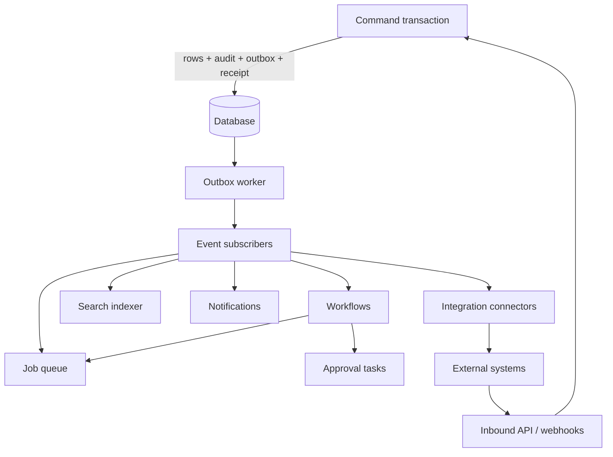

# Bridger ERP: platform services for business capabilities

Status: **proposal for review, not implemented or type-checked**. Date: 2026-10-02. Interfaces and names are proposed. Effect APIs (`effect/workflow`, `effect/http-api`, `effect/persistence`, `Schedule`, `Cron`, `PartitionedSemaphore`) and Odoo/Sage/SAP evidence are cited from the [knowledge catalog](knowledge/README.md): workflow and jobs E19–E20, E33–E37, A24, B10; events and integrations E17, E38–E41, A22–A23, R15, R25, B13; finance and trade R11–R24, B11, B16; attachments, search, reporting R26–R28, B14, E18, E22; security R07–R08, B06. Nothing here was run. Policy: all packages target the latest stable Effect 4.x (4.0.0 at the time of writing). Country-specific accounting, tax and payroll rules need locale selection and domain validation; this document defines contracts, not compliance.

## 1. Decision

Business capability is delivered by **modules** on top of platform services. The platform defines *how* events, jobs, workflows, integrations, attachments, search, reports, notifications, imports and APIs behave; modules define *what* they do. Domain modules (accounting, tax, stock, sales, purchasing) are specified here at the contract level only: invariants, events and \1(§14). Detailed domain designs need target country, industry and company-size decisions (B16) and are separate documents.

Four lifetimes stay separate ([knowledge/ARCHITECTURE.md](knowledge/ARCHITECTURE.md)): infrastructure, runtime activation, durable execution and business data. Disabling a module must not delete its data or cancel durable executions it owns (§5).



## 2. Domain events

An event is a stable, versioned fact written to the outbox in the originating command's transaction ([ERP-STORAGE.md](ERP-STORAGE.md) §12).

```ts
interface DomainEvent<P> {
  readonly type: string            // "<module>.<model>.<fact>", e.g. todo.task.created
  readonly version: number         // payload contract version
  readonly tenantId: string
  readonly companyId?: string
  readonly dedupeKey: string       // stable per business fact
  readonly occurredAt: string      // ISO instant
  readonly actorId: string
  readonly correlation: string
  readonly payload: P              // schema-defined, serializable
}

Event.define("todo.task.created", { version: 1, payload: Task.Row /* or a dedicated Schema */ })
Module.define({ events: [TaskCreated], subscribers: [IndexTask] /* … */ })
```

- Standard model events (`created`, `updated`, `deleted`) are emitted by `Records` for every model; custom events are emitted by commands with `ctx.emit(event, payload)`, which appends to the outbox in the same transaction.
- Payload schemas are public contracts. Subscribers decode with the **event's declared version**, so delivery does not require the emitting module's code to remain loaded ([ERP-MODELS.md](ERP-MODELS.md) §4). Adding optional fields is compatible; removing or retyping a field requires a new version, and the emitter keeps emitting the old version until all subscribers declare support.
- Payloads omit values of fields marked sensitive; subscribers needing them read through `Records` under their own authorization.

### Subscribers

```ts
Subscriber.define("todo.index", {
  on: [TaskCreated, TaskUpdated],          // event definitions
  concurrency: { perTenant: 4 },
  execute: (event) => Effect.gen(function* () { /* idempotent work */ }),
})
```

Delivery is at least once. The runtime records `(tenant_id, subscriber_id, dedupe_key)` in `bridger_event_handled` ([ERP-STORAGE.md](ERP-STORAGE.md) §12) **in the transaction in which the subscriber's own database work commits**, which makes database-only subscribers effectively once. A subscriber that calls an external system is not covered by a database transaction and must follow §6. A subscriber runs under a *system actor* context for its tenant (`Records.asSystem`, [ERP-RECORDS.md](ERP-RECORDS.md) §2) with the explicit system permissions listed in the module manifest, never under the original user's grants unless the event carries a delegation record.

## 3. Jobs and scheduling

```ts
Job.define("search.reindex", {
  input: Schema.Struct({ model: Schema.String }),
  permission: SearchPerms.admin,         // who may enqueue manually
  execute: (input) => Effect.gen(function* () { /* idempotent */ }),
  retry: Schedule.exponential("2 seconds").pipe(Schedule.compose(Schedule.recurs(8))),
  timeout: "10 minutes",
  concurrency: { perTenant: 2, global: 8 },
})

JobSchedule.define("todo.cleanup", { cron: "0 3 * * *", timezone: "tenant", job: Cleanup, input: () => ({}) })
```

- **Durable queue.** Enqueue is a row in `bridger_jobs` (id, tenant, job id, input, state, attempt, run-at, lease, last error) written in the caller's transaction, so a job exists if and only if its cause committed. Workers claim rows through the storage adapter's `claim` operation (native skip-locked leasing where available, otherwise the optimistic claim; [ERP-STORAGE.md](ERP-STORAGE.md) §3.2). `effect/persistence` `PersistedQueue` may carry fan-out but is not exactly-once; the job table is the source of truth.
- **Scheduling.** A single scheduler per deployment (leader chosen by the storage adapter's named lock) enqueues due schedule entries. An in-memory `Schedule` alone is not durable; missed runs after downtime follow a declared policy (`catchUp: "all" | "latest" | "skip"`).
- **Fairness.** `PartitionedSemaphore` gives per-tenant concurrency inside one process; the global limit is enforced by the lease query across processes.
- **Idempotency and timeouts.** Job handlers must be idempotent (at-least-once). A job timed out is retried; exhausted retries move to `dead` with the last error, visible and replayable in the admin surface ([ERP-OPERATIONS.md](ERP-OPERATIONS.md) §8).
- Jobs run with a tenant (and optional company) context and a system subject; the job declares the permissions it needs, reviewed at approval ([ERP-DISTRIBUTION.md](ERP-DISTRIBUTION.md) §3).

## 4. Workflows and approvals

Built on `effect/workflow` (`Workflow`, `WorkflowEngine`, `Activity`, `DurableClock`, `DurableDeferred`).

```ts
const Approval = Workflow.define("sales.approve-order", {
  payload: Schema.Struct({ orderId: Order.Id, requestedBy: Schema.String }),
  success: Schema.Literals(["approved", "rejected"]),
  idempotencyKey: (p) => p.orderId,
})
```

Platform contracts:

- **Engine storage** is the ERP database through the storage adapter (workflow instances, activity results, timers). Workflow input includes tenant and company; the engine namespaces by tenant.
- **Activities** wrap each side effect. An activity has a recorded result; the crash window *between performing an external effect and recording it* remains: external activities must carry an idempotency key or support reconciliation (§6).
- **Versioning (B10).** A workflow definition belongs to the module version that registered it. Running instances are **pinned** to the definition version they started on. Disabling or upgrading a module does not cancel running instances: the engine keeps the old definition loaded (resident artifact, [ERP-DISTRIBUTION.md](ERP-DISTRIBUTION.md) §5) until its last instance finishes, or the administrator explicitly migrates or terminates them. A module with live workflows cannot be removed; `disable` stops *starting* new instances and leaves running ones draining, reported in `modules.status`.
- **Compensation is not rollback.** Compensation covers top-level workflow effects only; completed business actions are corrected by new documents (e.g. credit notes), not undone by finalizers.
- **Approvals** are a platform workflow pattern:

```ts
ApprovalPolicy.define("sales.order", {
  trigger: { model: Order, when: Policy.expression(/* total > 10_000 */) },
  steps: [
    { id: "manager", approvers: Approver.role(SalesRoles.manager), quorum: 1, due: "2 days", escalateTo: Approver.role(SalesRoles.director) },
    { id: "finance", approvers: Approver.role(FinRoles.controller), quorum: 1, condition: /* amount > … */ },
  ],
  onApproved: Command.ref(ConfirmOrder),
  onRejected: Command.ref(CancelOrder),
})
```

- A tenant administrator can adjust thresholds and approvers within the module-declared limits.
- Each approval task is a record with assignee set, due date, decision, comment, and delegation chain. Decisions are commands with idempotency and audit.
- Rules: the requester cannot approve their own request unless the policy states so explicitly; a decision is bound to the document revision it reviewed — if the document changes after approval, the approval is invalidated; an approved action's effect still runs through the normal command pipeline and its policy checks.
- Delegation and absence rules produce explicit delegation records; they never grant permissions implicitly.
- AI assistance (E45) may summarize or suggest but **never decides** authorization or approvals.

## 5. Module lifecycle and durable work

| Event | Effect on durable work |
| --- | --- |
| Module `disable` | No new jobs/workflows/subscriber leases start for it; running ones drain up to a configured grace; remaining ones are suspended with state `suspended-module-disabled`. |
| Module `enable` (same or newer compatible artifact) | Suspended work resumes; subscribers resume from their outbox cursor. |
| Upgrade | In-flight workflows stay pinned (§4); new instances use the new definition. |
| Retire (no compatible artifact exists) | Administrator must drain, migrate or terminate remaining work explicitly; the manager refuses to retire otherwise. |

## 6. Integrations

```ts
Connector.define("payments.stripe", {
  config: Schema.Struct({ accountId: Schema.String, apiKey: Schema.Redacted(Schema.String) }),
  outbound: { charge: Operation.schema({ input: ChargeRequest, output: ChargeResult }) },
  inbound: { webhook: Webhook.signed({ header: "Stripe-Signature", verify: stripeVerify }) },
})
```

- **Credentials** are tenant-level secrets referenced by name; they are stored encrypted (awthaq `Encryption`/`KeyProvider` ports) and surfaced as `Redacted` values; they never appear in catalog snapshots, logs or events.
- **Outbound effects use recorded intent.** A command writes an `integration_intent` row and an outbox event in its transaction; a connector subscriber performs the call using the intent's idempotency key and records the outcome (`succeeded`, `failed`, `unknown`). External calls never run inside a database transaction or a retried transaction.
- **Ambiguous results** (timeout after sending, `ExecutionPlan` fallback to another provider) are state `unknown`: a **reconciliation job** queries the provider by the idempotency key until it resolves; payment retries never create a second charge without reconciliation. Fallback providers are only used when the first is known not to have accepted the request.
- **Inbound** webhooks and API calls verify signatures, are rate limited, deduplicate by provider event ID, and enter the system through ordinary commands under a connector principal with declared permissions.
- Each connector exposes health (last success, backlog, unknown count) to operations ([ERP-OPERATIONS.md](ERP-OPERATIONS.md) §4).

## 7. Attachments

```ts
interface BlobStore {                               // port: local disk (dev), S3-compatible (prod)
  readonly put: (key: string, body: Stream<Uint8Array>, meta: BlobMeta) => Effect<BlobRef, BlobError>
  readonly get: (ref: BlobRef) => Stream<Uint8Array, BlobError>
  readonly delete: (ref: BlobRef) => Effect<void, BlobError>
  readonly sign: (ref: BlobRef, options: { for: Duration }) => Effect<URL, BlobError>
}
```

- `Attachment` is a platform model (`bridger.attachment`) with parent model ID, parent record ID, name, content type, size, SHA-256, blob reference, `scanState` (`pending | clean | infected | error`), and standard scope columns. **Access follows the parent record**: reading or downloading requires read access to the parent under the caller's policy; add/remove requires update access.
- Upload: the client requests an upload (`bridger.attachment.create` command with metadata, idempotency key) and streams the bytes to a size-limited endpoint; the server verifies size and hash, stores the blob, then creates the row. Unattached blobs (crash between put and row) are removed by an orphan sweep job after a grace period.
- A scan hook (`Scanner` port) runs asynchronously; downloads of `pending`/`infected` files are blocked according to policy. Downloads use short-lived signed URLs or streaming through the server; the URL never grants access beyond its lifetime.
- Quotas per tenant and company; content types allowlist; filenames are never used as paths.

## 8. Search

```ts
interface SearchIndex {                              // port: adapter full-text when the `fullText` capability exists, otherwise an external engine
  readonly upsert: (doc: IndexDoc) => Effect<void, SearchError>
  readonly remove: (key: DocKey) => Effect<void, SearchError>
  readonly query: (q: SearchQuery) => Effect<readonly Hit[], SearchError>
}
```

- Fields are indexed only when the model marks them `searchable`. Indexing runs from outbox events (eventually consistent; lag exposed as a metric).
- **Authorization at query time.** The index returns candidate IDs; Records re-reads them with the caller's scope and row policy and drops anything not visible. Index documents carry tenant and company; a query without them is rejected. Snippets are generated from the re-read, authorized, field-projected row, not from the index, so a snippet cannot leak an unreadable field.
- Reindex is a job per model; disabled extensions' fields are removed from documents on the next reindex.

## 9. Third-party API and OpenAPI

Built on `effect/http-api` (E40, E41).

- Public API under `/api/v1/...` with generated OpenAPI per tenant and principal: models and operations that modules mark `api: { expose: true }`. Authentication via awthaq API keys or OAuth bearer tokens (`ApiKeyPrincipal`, `ServicePrincipal`; [ERP-IDENTITY.md](ERP-IDENTITY.md)). API scopes map to permissions; scopes can only narrow a principal's grants.
- **Dynamic registration seam.** Routes are not added to a running server one by one. The API surface is part of the immutable registry generation ([SPEC.md](SPEC.md) `Generation`); a published generation swaps the route table atomically. Route collisions (same method and path from two modules) fail compilation; removal drains in-flight requests through the generation lease. The OpenAPI document is derived from the same generation.
- Pagination, error shapes and idempotency headers mirror the operation gateway; list endpoints are bounded.
- Rate limits per principal and tenant (awthaq `RateLimiter` port); request/response size limits; versioning by path with a deprecation policy per operation.

## 10. Reports and exports

```ts
Report.define("todo.open-by-owner", {
  permission: TodoPerms.read,
  parameters: Schema.Struct({ from: Schema.optionalKey(Schema.DateTimeUtc) }),
  query: (params) => /* uses read interfaces only */,
  columns: [/* typed columns with formats */],
  maxRows: 100_000,
})
```

- Reports are read-only queries using the same scope, row policy and field policy as operations. Cross-company reporting is a separate permission and an explicit report scope; ordinary filters cannot widen scope ([ERP-SPEC.md](ERP-SPEC.md) §3).
- Large exports run as a **job**: the job opens the strongest read-only snapshot the adapter offers (reporting which isolation it obtained) for a consistent view, streams rows into a file attachment (CSV, XLSX), and notifies the requester. Authorization is re-checked when the file is downloaded.
- Exports include only fields the requester may read; unauthorized fields are rejected, not silently omitted.

## 11. Notifications

```ts
Notification.define("todo.assigned", {
  channels: ["inApp", "email"],
  template: { subject: LocalizedTemplate, body: LocalizedTemplate },
  recipients: (event) => /* resolved actors */,
})
```

- Channels: in-app (record + catalog-visible inbox), email and SMS via awthaq `Mailer`/`SmsSender` ports. Templates are localized with the recipient's locale and rendered with escaped variables.
- Delivery is driven by events and uses the integration pattern (§6): intent recorded, send performed by a subscriber, outcome recorded; duplicates suppressed by dedupe key. Per-user preferences (opt-out per channel and type, quiet hours) are honored except for mandatory notices flagged by the module.
- Notifications never include data the recipient cannot read; they carry links, and the destination re-authorizes.

## 12. Imports

- Import flow: upload file → parse into a **staging table** (`bridger_import_rows`, with row number, raw values, parsed values, errors) → map columns → validate with the target model's `Create` schema and constraints, row by row → show an error report → commit in batches via ordinary create/update commands under the importer's grants.
- Each row has a stable import key (row hash or user-chosen key column) so re-running a batch is idempotent. A dry-run mode validates without writing. Large imports run as jobs with progress; partial failure leaves a resumable import with its error file.
- Imports never bypass policy, constraints, audit or the outbox.

## 13. Locale and compliance extension points

A **locale pack** is a module declaring: fiscal calendar and period rules, number and date formats, currencies and rounding rules, chart-of-accounts templates, tax regime tables, legal document numbering rules, mandatory reports and e-invoicing formats. Packs are selected per company at company creation (not changed silently afterwards). The platform supplies the extension contracts; the content of any pack, and its legal correctness, is outside this document and requires domain validation. Sage Intacct and SAP S/4HANA evidence in the catalogs is product-scope reference, not entitlement.

## 14. Domain capability contracts

Each domain module declares models, commands, events and invariants through the same Module API. The platform **invariants** (R-series, nine invariants in [knowledge/ERP-CAPABILITIES.md](knowledge/ERP-CAPABILITIES.md)) apply to all of them; the table lists the contract-level essentials.

| Domain | Owns (models, indicative) | Emits | Consumes | Contract-level invariants |
| --- | --- | --- | --- | --- |
| Accounting | Ledger, account, journal, journal line, period, currency, rate | `acct.journal.posted`, `acct.period.closed` | Sales/purchasing/stock posting requests | Entries balance per currency; posted entries are immutable (corrections are reversal entries); closed periods reject postings; amounts are `BigDecimal` with explicit scale and a declared rounding stage; a post is atomic with its sequence number allocation. |
| Tax | Tax code, rule, jurisdiction, return | `tax.calculated`, `tax.return.filed` | Sales/purchasing lines | Rules are versioned with effective dates; a calculation result is stored with the rule version used; reconciliation to ledger must hold. |
| Stock | Item, location, lot/serial, move, reservation, valuation layer | `stock.moved`, `stock.reserved`, `stock.valued` | Sales/purchasing/manufacturing | Moves are an append-only ledger; on-hand is derived from moves; a reservation cannot exceed available quantity (serialized by item/location lock); valuation changes post through accounting. |
| Sales | Customer, quote, order, delivery, invoice, credit note | `sales.order.confirmed`, `sales.invoice.posted` | Stock/accounting/tax results | Document numbering is gapless where required by locale; confirmed orders are changed only by explicit amendment documents. |
| Purchasing | Vendor, request, order, receipt, vendor bill | `purch.order.approved`, `purch.bill.posted` | Stock/accounting/tax | Three-way match rules are explicit; approvals bind to document revision (§4). |

Extension points all domains expose: model extensions ([ERP-MODELS.md](ERP-MODELS.md)), approval policies, numbering schemes, calculation hooks as *pure* registered functions, and events. Cross-domain coordination uses events and workflows, never direct table access to another module's storage.

### First vertical slice (proposed)

Order → reserve stock → invoice → post to ledger → reconcile payment, with an approval rule on orders above a threshold. It exercises events, workflows, idempotent commands, external payment intent and reconciliation, locale rounding and period locking, and is the acceptance vehicle for this document's platform services. It requires a chosen target locale and chart-of-accounts template (B16).

## 15. Errors

| Error | Meaning | Mapping |
| --- | --- | --- |
| `SubscriberFailed`, `JobFailed`, `JobTimeout`, `WorkflowFailed` | Durable work failed after retries | Visible in admin; replayable. Never surfaced to the original caller as failure of an already-committed command. |
| `ApprovalRequired`, `ApprovalInvalidated` | Action awaits or lost approval | `Forbidden`-class with a link to the task. |
| `IntegrationUnknown` | External result ambiguous | Command already committed; reconciliation pending. |
| `AttachmentRejected`, `ScanBlocked` | Upload or download refused | `InvalidInput` / `Forbidden`. |
| `ImportRejected` | Staged import has blocking errors | Error report. |
| `RouteConflict` | Two modules claim one API route | Activation error. |

## 16. Acceptance checks

- A command that rolls back leaves no outbox event, job or workflow; a committed one produces exactly one event row per dedupe key.
- Kill a worker mid-delivery: the event is redelivered after lease expiry; a database-only subscriber produces one effect.
- Disable a module with a running workflow: new instances are refused, the running one completes under its pinned definition; re-enable resumes suspended work.
- An ambiguous payment result never produces a second charge; reconciliation resolves it.
- An attachment is unreadable by a user who cannot read its parent record.
- Search results never include a record or snippet the caller cannot read, including with a stale index.
- A large export uses one consistent snapshot and fails if a field is unauthorized.
- An approval invalidates when the document revision changes; a requester cannot self-approve by default.
- Two modules registering the same API path fail activation; removing a module drains its in-flight API requests.
- Re-running an import batch does not duplicate rows.
- A notification email contains no field the recipient cannot read.

These are design acceptance scenarios, not tests already executed.

## 17. Decisions and remaining items

| # | Item | Decision |
| --- | --- | --- |
| 1 | Target countries, industries, company scale, accounting scope (B16) | **Needs your decision before any domain module is specified in detail.** The platform contracts here do not depend on it. Needed: first target country or countries (locale pack content), first industry (retail, services, manufacturing), expected company size, whether statutory reporting or e-invoicing is in scope, and the chart-of-accounts approach. |
| 2 | Workflow engine | **`effect/workflow` with storage in the ERP database** as sketched in §4. An external engine can be reached as a connector (§6) but is not a core dependency. |
| 3 | Search engine | **Behind the `SearchIndex` port.** Adapters that provide the `fullText` capability supply a native implementation (for PostgreSQL: `tsvector` with a GIN index and trigram matching); dialects without it require an external search adapter. Trigger for moving to an external engine anyway: about one million documents per tenant, or a need for relevance tuning or multilingual analyzers the database cannot provide. |
| 4 | Multi-currency and consolidation | **Multi-currency is in the first contracts:** every monetary field carries its currency, each company has a functional currency, rates live in a dated rate table, and a posting records the rate used. **Consolidation is deferred**; it needs a group entity above the company (the tenant is the isolation boundary and is not a consolidation unit). |
| 5 | Malware scanning | **`Scanner` port with a ClamAV reference adapter.** Policy default in production: downloads blocked until `scanState = clean`; scan failures keep the file blocked and alert. Development allows `pending`. Commercial scanners plug in through the port. |
| 6 | Payroll, manufacturing, CRM, POS, advanced warehouse | **Out of scope for now.** Each needs a process catalog before design. |

Only item 1 remains open and needs input from you.
