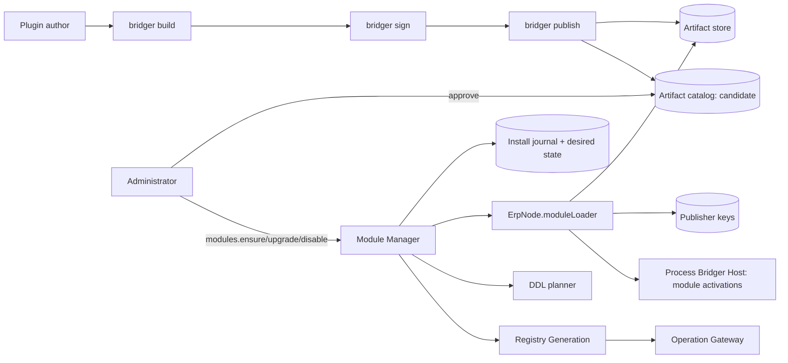
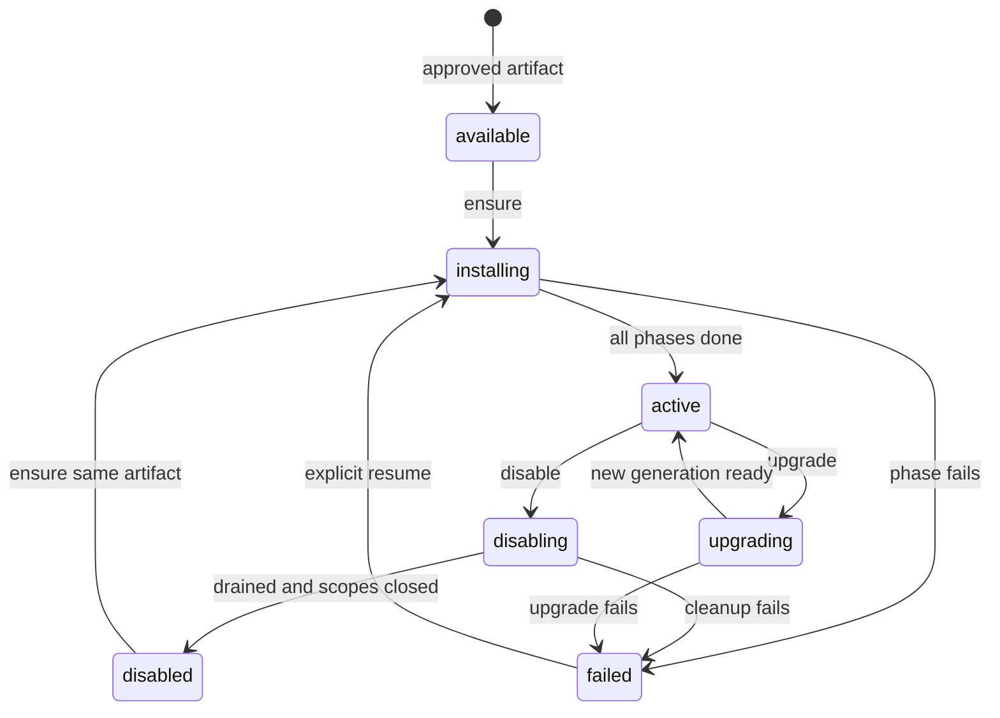

# Bridger ERP: module distribution, loading and the durable Module Manager

Status: **proposal for review, not implemented or type-checked**. Date: 2026-10-02. Package names, tables, manifest fields and signatures are proposed. Platform facts (Node ESM loading, Effect `Scope`/`Layer`) are cited from the [knowledge catalog](knowledge/README.md) entries E02–E10, E12, A12–A13, A28–A29, B02, B04, F16 and were not executed. Policy: all packages target the latest stable Effect 4.x (4.0.0 at the time of writing). This document refines [ERP-SPEC.md](ERP-SPEC.md) §5–6 and uses core's `Generation` ([SPEC.md](SPEC.md)).

## 1. Decision

Production modules are **approved, immutable, signed artifacts** installed by trusted administrative orchestration. The server loads an artifact only after verifying its digest, its signature against an active publisher key and its approved status in the catalog. Source-defined (inline) modules are a development convenience and are refused in production mode.

| Concern | Decision |
| --- | --- |
| Identity of a module build | The artifact digest (SHA-256 over a canonical manifest that lists every file's SHA-256). A URL or version string is not identity. |
| Trust | In-process plugins run with process privileges. Signing and approval establish *who authorized* the code, not a sandbox ([ERP-OPERATIONS.md](ERP-OPERATIONS.md) §5). |
| Shared dependencies | `effect`, `@bridger/*`, `@qadi/*`, `@awthaq/*` are **externals**: modules never bundle their own copy. The host provides the single instance. |
| Durability | Desired and observed module state, the install journal and the artifact catalog live in the ERP database (any certified storage adapter). Runtime state is rebuilt from them. |
| Replacement | Importing new code never replaces old code; a new version is a new file URL. Old behavior stops by closing scopes and generations, not by unloading modules. |

## 2. Modules and seams



| Module | Small public interface | Owns |
| --- | --- | --- |
| Artifact pipeline (CLI) | `build`, `sign`, `publish` | Producing and registering a candidate artifact. |
| Artifact catalog | `candidates`, `approve`, `revoke`, `get` | Approval state and provenance. |
| Module loader | `load(descriptor)` | Verification, shared-dependency check, evaluation, validation. |
| Module Manager | `ensure`, `disable`, `upgrade`, `status`, `recover` | Desired/observed state, journal, ordering, publication. |

## 3. Manifest

```ts
interface ModuleManifest {
  readonly manifestVersion: 1
  readonly id: string                       // "todo"
  readonly version: string                  // semver of this build
  readonly apiVersion: string               // client operation contract version
  readonly dependsOn: readonly { id: string; range: string; optional?: boolean }[]
  readonly platform: {
    readonly bridger: string                // semver range of @bridger/erp
    readonly effect: string                 // semver range the build was made against
  }
  readonly storage: {
    readonly requires: readonly string[]    // capabilities, e.g. "exactDecimal" (ERP-STORAGE.md §3.2)
    readonly dialects?: readonly string[]   // only if the module contains dialect-specific code
  }
  readonly externals: readonly string[]     // must include effect, @bridger/*, @qadi/*, @awthaq/*
  readonly entries: {
    readonly server: string               // path to server entry (ESM)
    readonly contracts: string            // browser-safe contract module
    readonly ui?: string                  // serialized UiModule descriptors
    readonly browser?: readonly { id: string; entry: string; framework: "foldkit" | "react" | "neutral"; contributes: readonly string[] }[] // UI plugins ([ERP-BROWSER.md](ERP-BROWSER.md) §8)
  }
  readonly schema: {
    readonly migrations: readonly { id: string; checksum: string }[]
    readonly compatible: { min: number; max: number } // schema versions this build can run against
  }
  readonly contractHash: string             // canonical hash of models, operations, UI contracts
  readonly permissions: readonly string[]   // declared permission tokens, for approval review
  readonly system: {                        // authority beyond requests, reviewed at approval
    readonly permissions: readonly string[] // held by the module's system subject (seeds, jobs, subscribers)
    readonly elevatedServices: readonly string[] // inter-module services that run with module authority
    readonly demoData: boolean
  }
  readonly files: readonly { path: string; sha256: string; bytes: number }[]
}
```

The manifest is generated by `bridger build` from the module definition; authors do not write it. `permissions` and `contractHash` exist so reviewers approving an artifact see what it grants and what contract it exposes.

## 4. Artifact pipeline

1. **`bridger build`**: bundles server, contracts, UI and browser entries; marks `externals`; refuses to bundle a copy of an external; runs the module definition validation from [ERP-SPEC.md](ERP-SPEC.md) §3 (duplicate IDs, missing permissions, unresolved references) and a static side-effect check (§6); emits `dist/` and the manifest.
2. **`bridger sign`**: computes the artifact digest and writes a detached Ed25519 signature with a publisher key (`--key-id`). Keys are held by the publisher; Bridger stores only public keys.
3. **`bridger publish`**: uploads files to the artifact store under a content-addressed path (`sha256-<digest>/…`) and registers a **candidate** in the catalog. `(module id, version)` is unique: re-publishing a different digest for an existing version is `VersionImmutable`.
4. **Approval**: an administrator with `bridger.artifact:approve` reviews the manifest (permissions, contract diff against the currently approved build, migration list) and calls `artifacts.approve`. Deployments can require two approvers (`approvals.required = 2`; the approver must differ from the publisher).
5. **Revocation**: `artifacts.revoke` marks an artifact unusable (§9).

> Table definitions in this document are shown with PostgreSQL types for brevity. The portable column types (`instant`, `json`, `binary`, `identity`, …) are defined in [ERP-STORAGE.md](ERP-STORAGE.md) §5 and each adapter maps them.

```sql
CREATE TABLE bridger_publisher_keys (
  key_id      text PRIMARY KEY,
  publisher   text NOT NULL,
  public_key  bytea NOT NULL,
  status      text NOT NULL,                   -- active | retired | revoked
  created_at  timestamptz NOT NULL,
  revoked_at  timestamptz
);

CREATE TABLE bridger_artifacts (
  digest       text PRIMARY KEY,               -- "sha256:<hex>"
  module_id    text NOT NULL,
  version      text NOT NULL,
  manifest     jsonb NOT NULL,
  signature    bytea NOT NULL,
  key_id       text NOT NULL REFERENCES bridger_publisher_keys,
  storage_url  text NOT NULL,                  -- immutable, content addressed
  status       text NOT NULL,                  -- candidate | approved | revoked
  approvals    jsonb NOT NULL DEFAULT '[]',    -- [{by, at}]
  created_at   timestamptz NOT NULL,
  UNIQUE (module_id, version)
);
```

Artifact store port: `put(path, bytes)`, `get(path)`, `exists(path)`; implementations: local directory (development), S3-compatible object storage (production). The store is untrusted for integrity: the loader verifies every byte it reads.

## 5. Loader: `ErpNode.moduleLoader()`

```ts
interface ModuleLoader {
  readonly load: (descriptor: ApprovedArtifact) =>
    Effect.Effect<LoadedModule, LoadError, ArtifactStore | PublisherKeys | HostRuntimeInfo>
}

type LoadError =
  | ArtifactUnavailable | DigestMismatch | SignatureInvalid | KeyRevoked | ArtifactNotApproved
  | PlatformIncompatible | SharedDependencyMismatch | EntryInvalid | ModuleInvalid
```

`load` is the only place artifact code is evaluated. Order:

1. Check the catalog row: `status = approved` (and the signing key `active` or `retired`, not `revoked`).
2. Fetch the manifest and every file by content-addressed path; recompute each file's SHA-256 and the artifact digest; compare with the catalog digest. Any mismatch → `DigestMismatch`. **Nothing is evaluated before this passes.**
3. Verify the Ed25519 signature over the digest with the key's public key → `SignatureInvalid`.
4. Check `platform`: the host's `@bridger/erp` and Effect versions must satisfy the manifest ranges (`PlatformIncompatible`); check that `externals` includes the required list and that no file declares its own copy (`SharedDependencyMismatch`).
5. Materialize the files into `<app>/.bridger/artifacts/<digest>/` (read-only after write). Placing the directory inside the application tree makes Node's ESM resolution find `effect`, `@bridger/*`, `@qadi/*` and `@awthaq/*` from the host's own `node_modules`, so the module uses **the host's single instances**. A module graph that resolves a second copy is detected by the identity check in step 7.
6. Evaluate the server entry with a dynamic `import()` of the materialized file URL. Entries have no import-time side effects (§6); evaluation only creates descriptors.
7. Validate the exported value: it is a `Module` created by the host's `@bridger/erp` (a registry brand set by `Module.define` and checked by the host), its `id`, `version`, `apiVersion`, `dependsOn` and `contractHash` match the manifest, and its schemas are decodable by the host's Effect. Mismatch → `ModuleInvalid` or `SharedDependencyMismatch`.
8. Return `LoadedModule { manifest, definition, digest }`. It has not been activated.

Honest limits:

- Node cannot unload an ES module. Each build has a distinct URL, so a new version loads beside the old one. Old code stays in memory until restart; the deployment sets `maxResidentVersions` and logs a warning (and a readiness hint to restart) when exceeded.
- A module whose externals resolve to different copies cannot always be detected statically; the identity brand check in step 7 is the backstop, and the CI install test ([ERP-DX.md](ERP-DX.md)) exercises it.
- Signing proves authorization, not safety. A malicious but signed module has process privileges.
- Dynamic `import()` of a materialized path assumes a Node/Bun server; a Worker Loader adapter would use a different loading path and a capability transport (later, [ERP-OPERATIONS.md](ERP-OPERATIONS.md) §5).

Development mode accepts an inline `{ module: TodoModule }`. Its identity is the digest of the canonical *definition* (not the code), tagged `dev`. Re-running `ensure` with the same version and a changed definition fails with `ArtifactMismatch` unless `{ dev: { replace: true } }` is passed, which performs an upgrade-style replacement. Production mode (`NODE_ENV=production` or `erp.mode = "production"`) refuses inline modules (`InlineModuleForbidden`).

## 6. Import-time side effects

An entry must not perform work at import. The build enforces what it can:

- No top-level `await`.
- A static scan rejects top-level calls to known side-effect APIs (`fetch`, `fs`, `child_process`, timers, `process.on`).
- A dry evaluation in the publish pipeline loads the entry with stubs and fails if any stub is touched.

This is a safety net, not a guarantee; runtime work belongs in scoped `build` effects and in Layers ([SPEC.md](SPEC.md)).

## 7. Durable Module Manager

### Tables

```sql
CREATE TABLE bridger_module_desired (
  tenant_id       text NOT NULL,
  module_id       text NOT NULL,
  desired         text NOT NULL,                   -- enabled | disabled
  artifact_digest text NOT NULL,                   -- target artifact when enabled
  requested_by    text NOT NULL,
  requested_at    timestamptz NOT NULL,
  target_generation bigint NOT NULL,               -- bumped on every desired change
  admission       text NOT NULL DEFAULT 'open',    -- open | fenced (set during incompatible changes, per tenant)
  PRIMARY KEY (tenant_id, module_id)
);

CREATE TABLE bridger_module_observed (
  tenant_id        text NOT NULL,
  module_id        text NOT NULL,
  phase            text NOT NULL,                  -- see state machine
  artifact_digest  text,
  schema_version   integer,
  runtime_generation bigint,
  failure          jsonb,                          -- {phase, message, cause ref}
  updated_at       timestamptz NOT NULL,
  PRIMARY KEY (tenant_id, module_id)
);

CREATE TABLE bridger_install_journal (
  id               bigint GENERATED ALWAYS AS IDENTITY PRIMARY KEY,
  tenant_id        text NOT NULL,
  module_id        text NOT NULL,
  artifact_digest  text NOT NULL,
  attempt          integer NOT NULL,
  phase            text NOT NULL,                  -- artifact | schema | data | catalog | runtime | ui | active
  state            text NOT NULL,                  -- running | done | failed
  error            jsonb,
  started_at       timestamptz NOT NULL,
  updated_at       timestamptz NOT NULL
);
```

`bridger_module_nodes (node_id, tenant_id, module_id, observed_generation, phase, ready_at, heartbeat_at)` is added in [ERP-OPERATIONS.md](ERP-OPERATIONS.md) §3 for multi-replica rollout.

### Four states

| State | Where it lives | Meaning |
| --- | --- | --- |
| Installed | `bridger_artifacts` approved, migrations applied in `bridger_migration_journal` | The build exists and its schema is in the shared database. |
| Tenant-enabled | `bridger_module_desired.desired = enabled` | An administrator wants it for this tenant. |
| Process-active | Tenant generation published on a node (`bridger_module_nodes` row for that node and `bridger_module_observed.phase = active` for the tenant) | This process serves the module. |
| User-available | Authorized catalog (grants and policies) | A given user sees the screens and may call operations. |

Only process-active modules serve operations. A user is never offered something that is not process-active on the serving node.

### Phase machine (observed)



This is the state machine of [ERP-SPEC.md](ERP-SPEC.md) §6; this document adds the journal and recovery.

### Install procedure and journal

`ensure(tenant, artifact)`:

1. Write `bridger_module_desired` (enabled, digest, bumped `target_generation`), then return control to the **reconciler**.
2. **artifact** phase: `load` the artifact (§5). Journal `artifact/done`.
3. **dependency check**: every `dependsOn` module must be `active` for the tenant at a compatible version, else `DependencyMissing` (the module is not installed; `ensure` does not install dependencies implicitly. `modules.plan` returns the missing list for the administrator).
4. **schema** phase: `Planner.plan` + `apply` for unapplied migrations ([ERP-STORAGE.md](ERP-STORAGE.md) §7), holding the physical-model locks. Journal `schema/done`.
5. **data** phase: required seeds, `onEnable` hooks and data migrations ([ERP-RECORDS.md](ERP-RECORDS.md) §6), run as the module's system subject; resumable with their own cursors. Journal `data/done`.
6. **catalog** phase: tenant activation/backfill for extensions; compile models, operations, UI into the next immutable registry value.
7. **runtime** phase: ensure the module's activation exists in the process host, then build and publish the tenant generation ([ERP-RUNTIME.md](ERP-RUNTIME.md) §5): validate the assembled registry; `closeAdmission` if the change is incompatible; `publish`; await the old generation's `drained`.
8. **ui** phase: publish the authorized catalog revision and notify browsers ([ERP-BROWSER.md](ERP-BROWSER.md)).
9. Set `observed.phase = active`; return an installation receipt `{ tenantId, moduleId, version, digest, generation }` only now.

Each phase writes `running` before work and `done` after in the same transaction as the observed-state update, except `runtime`, which is rebuilt from durable state. A failed `data` phase leaves the previous generation active ([ERP-RECORDS.md](ERP-RECORDS.md) §6).

### Crash recovery

`recover()` runs at startup after platform migrations, before admission opens. It handles **journals that are in flight** (`running` or `failed`) and tenants whose desired-state `target_generation` is newer than their last observed generation; all other tenants load lazily on first use ([ERP-RUNTIME.md](ERP-RUNTIME.md) §5):

| Journal state at crash | Recovery |
| --- | --- |
| Nothing for a desired module | Start the reconciler for the desired state. |
| `artifact/running` | Re-run `load` (idempotent: verification and materialization are repeatable). |
| `schema/running` | `Planner.resume`; steps are idempotent. |
| `schema/done`, `data` not done | Resume seeds, `onEnable` and data migrations from their cursors; each is idempotent. |
| `data/done`, `catalog` not done | Re-run catalog/backfill resume from the tenant cursor. |
| `runtime` or `ui` not done | Rebuild the registry from durable state and publish; no duplicate migration runs. |
| `disabling` | Continue toward the durable desired state (disabled) and close scopes. |
| `failed` | Stay failed until `resume`; status shows the phase and cause. |

Startup order: platform migrations → verify artifact store reachability → `recover()` for every tenant in dependency order → open admission module by module → mark the node ready. Admission for a module stays closed until its phase is `active` on this node.

### `disable`, `upgrade`, `status`

- **`disable(tenant, module, { cascade? })`** writes desired `disabled` first (so a crash resumes toward it), then publishes a generation without the module, awaits the old generation's `drained`, closes activation scopes, records `disabled`. Dependents active without `cascade` → `DependentsActive`. Data, migrations, receipts and audit remain.
- **`upgrade(tenant, module, targetArtifact)`**: requires the target to be approved and its `platform` and `schema.compatible` windows to include the current schema version or the plan to expand it. Runs the contract compatibility check below, then the install procedure with a controlled generation switch. Incompatible behavior changes use `closeAdmission` → drain → `publish` → `reopenAdmission` ([ERP-MODELS.md](ERP-MODELS.md) §4). No automatic schema rollback: a failed activation leaves expanded schema and the previous runtime generation active.
- **`status`** reads the durable rows only; it never waits.

### Contract compatibility check

On upgrade the manager compares the new `contractHash` and a structured contract diff with the installed build and each installed dependent's declared use ([ERP-MODELS.md](ERP-MODELS.md) §6): removed or retyped fields, narrowed operation inputs, removed operations and permission changes. Incompatible dependents block the upgrade (`DependentContractBroken`) unless they are upgraded in the same reviewed plan.

### Rollback

Runtime rollback to the previous artifact is allowed when its `schema.compatible` window includes the current schema version. It is performed as an `upgrade` to the older digest. Schema is never rolled back by the manager; destructive reversal is a separate maintenance plan.

## 8. Dependencies and dynamic registration

- `dependsOn` uses semver ranges on module versions; the manager picks the installed version of a dependency in the tenant and checks the range.
- Module activation order is a topological sort of the tenant's enabled modules; cycles are rejected at `plan` time.
- Contributions that affect shared structures (routes, catalog entries, model extensions, event subscribers) are registered through the next registry generation; partial publication is impossible by construction.
- HTTP API routes for modules (OpenAPI) follow the dynamic registration seam in [ERP-BUSINESS.md](ERP-BUSINESS.md) §9.

## 9. Revocation and key rotation

- `artifacts.revoke(digest)` sets `status = revoked`. Modules running a revoked artifact are handled by policy `onRevoked`: `quarantine` (default: new `ensure`/`upgrade` is blocked; running instances are disabled at the next health sweep and flagged), `block-new` (only prevents new installs), or `none`. A revoked key marks all its artifacts `revoked` unless re-signed.
- Publisher key rotation: add a new active key, mark the old `retired` (can still verify existing approved artifacts) or `revoked` (cannot).
- Approval records and revocations are written to `bridger_audit` with action `custom`, model `bridger.artifact`.

### Tamper-evident approval log

Approvals, revocations and key changes are appended to `bridger_artifact_events (id, kind, digest, actor_id, at, detail, prev_hash, hash)`. Each row stores the SHA-256 of its canonical content plus `prev_hash`; the table is revoke-protected from update and delete. `artifacts.verifyLog` recomputes the chain and reports the first break. This gives tamper evidence without an external transparency service.

### Software bill of materials and vulnerability checks

`bridger publish` generates a CycloneDX SBOM from the build, includes it as a manifest file (so it is covered by the digest), and runs a dependency audit. Known critical vulnerabilities block approval unless an approver records a time-limited waiver with a reason (audited).

### Tenant-specific versions

Tenants may run different builds of a module only within one `apiVersion` major and the manifest's `schema.compatible` window. The manager rejects enabling a build for any tenant whose schema requirement falls outside the window currently satisfied by the shared database. Different tenants on different patch or minor builds are therefore allowed; incompatible majors are rolled out as a coordinated upgrade.

## 10. Errors

| Error | Meaning |
| --- | --- |
| `ArtifactUnavailable`, `DigestMismatch`, `SignatureInvalid`, `KeyRevoked`, `ArtifactNotApproved` | Verification failures; never evaluated. |
| `PlatformIncompatible`, `SharedDependencyMismatch`, `EntryInvalid`, `ModuleInvalid` | Loader failures. |
| `VersionImmutable`, `ArtifactMismatch`, `InlineModuleForbidden` | Publication or ensure policy violations. |
| `DependencyMissing`, `DependentsActive`, `DependentContractBroken` | Dependency graph violations. |
| `MigrationFailed`, `ActivationFailed`, `CleanupFailed` | Installation phase failures with durable status ([ERP-SPEC.md](ERP-SPEC.md) §10). |

All are administrative errors returned with durable status; none are accepted from ordinary operation requests.

## 11. Acceptance checks

- A tampered file, tampered manifest or wrong signature is rejected before any code evaluates (verified by a loader that counts evaluations).
- A module that bundles its own `effect` is rejected at build and at load.
- Re-publishing a different digest for an existing `(module, version)` fails.
- Kill the process after `schema/done`: restart completes without rerunning migrations and without a falsely active module.
- `ensure` returns a receipt only after the generation is published and the UI catalog revision is live.
- Disable with an in-flight command: the command settles before activation scopes close; later requests get `ModuleUnavailable`.
- Upgrade that breaks a dependent's contract is refused; a compatible upgrade switches generation without mixing validators and storage mappings.
- A revoked artifact cannot be newly installed; a running instance is quarantined per policy.
- Inline module is refused in production mode.
- Memory/readiness reports the number of resident versions after repeated upgrades.

These are design acceptance scenarios, not tests already executed.

## 12. Decisions and remaining items

| # | Item | Decision |
| --- | --- | --- |
| 1 | Resolving shared dependencies | **Directory placement** inside the application tree (§5 step 5). Node `module.register` hooks are the fallback if placement proves insufficient; the install test in [ERP-DX.md](ERP-DX.md) §7 is the gate. |
| 2 | Transparency log | **Hash-chained approval log** (above) instead of an external service. |
| 3 | Tenant-specific artifact versions | **Allowed within one `apiVersion` major and the schema window** (above). |
| 4 | Destructive migration workflow | **Specified** in [ERP-STORAGE.md](ERP-STORAGE.md) §7a. |
| 5 | SBOM and vulnerability checks | **In `bridger publish`** (above). |

No remaining open items in this document.
