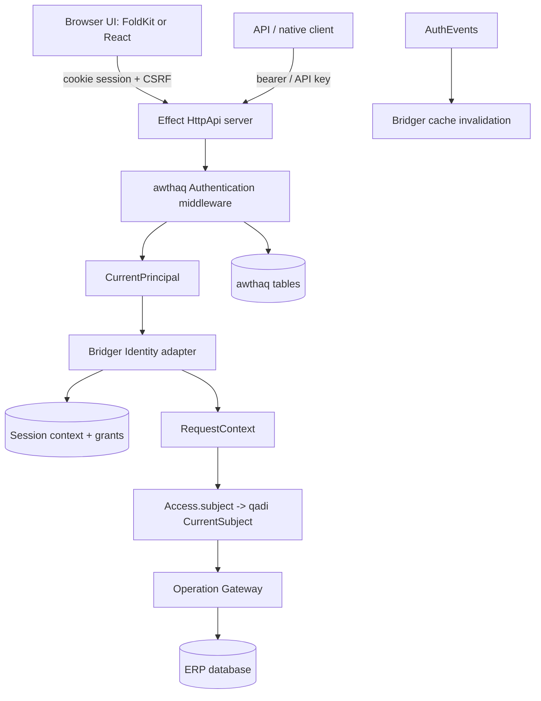

# Bridger ERP: identity, tenants, companies and grants

Status: **proposal for review, not implemented or type-checked**. Date: 2026-10-02. Everything under `@bridger/*` and every table or endpoint name below is proposed. The awthaq facts (packages, services, cookie and CSRF behavior) come from reading the repository at `/Users/mohammadalmechkor/Projects/Perso/effect-auth` (README text, `packages/*/src` file names, specs); the code was not executed. Items inferred from README text rather than source are marked *(inferred)*. Policy: all packages target the latest stable Effect 4.x (4.1 at the time of the 2026-11-08 revision; this replaces the earlier 4.0 target). This document refines [ERP-SPEC.md](ERP-SPEC.md) §4–5 and [ERP-ACCESS.md](ERP-ACCESS.md).

> **Status banner (2026-11-08): example application, not normative.** This document describes an example ERP application built on Bridger with a server CRUD design: a database row is the source of truth and one server transaction commits each write. It is **not normative** for `@bridger/core` or any companion package, and it is **not the domain layer for local-first or event-sourced systems**; its row-as-truth write path conflicts with event-sourced, offline-first write paths. Such systems build on the [core specification](../references/core/README.md) and the companion specs ([command](../references/command/README.md), [durable-bus](../references/durable-bus/README.md), [federation](../references/federation/README.md), [loader](../references/loader/README.md), [audit-chain](../references/audit-chain/README.md)), and on the event-sourcing companions ([event-store](../references/event-store/README.md), [sequence](../references/sequence/README.md), [keyring](../references/keyring/README.md); Drafts like the others). Where this document and a spec disagree, the spec governs; the [supersession table](ERP-INDEX.md#supersession-table) maps each ERP concept to the spec that now governs it. Nothing here is implemented.

## 1. Decision

| Concern | Owner |
| --- | --- |
| Authentication (passwords, OAuth/OIDC, sessions, cookies, CSRF, API keys, JWT, impersonation, auth audit) | **awthaq** (`@awthaq/*`). Bridger does not implement authentication. |
| Tenant | An awthaq **organization**. The tenant ID is the organization ID. |
| Company | **Bridger-owned** table `bridger_companies`. awthaq has no company concept; its teams are authority structure, not legal entities. |
| Role grants | Bridger-owned table `bridger_grants`, scoped to (actor, tenant, company). |
| Selected company | Bridger-owned side table keyed by awthaq session ID. |
| Authorization | `@qadi/core` through `@bridger/qadi` ([ERP-ACCESS.md](ERP-ACCESS.md)). |

The boundary rule: awthaq answers *who is this and which tenant are they in*. Bridger answers *which company are they acting in and what may they do there*. awthaq roles and organization roles are not copied into Bridger grants; platform and tenant administration may use them (§7).

awthaq's plugin tuple is static (`Auth.make([...])`), so the authentication feature set is chosen at deployment. ERP modules never add authentication plugins at runtime; they interact only through permissions, roles, grants, events and hooks defined here.

### Packages used

| Package | Used for |
| --- | --- |
| `@awthaq/core` | `Auth.make`, `Users`, `Sessions`, `SessionCookie`, `AuthEvents`, `AuditLog`, `EventRelay`. |
| `@awthaq/server` | `Authentication`, `Csrf`, `AuthHttp.routes`, `SecurityHeaders`, `BodyLimit`, `RequestContext`. |
| `@awthaq/api` | `CurrentPrincipal` and principal variants; HTTP contracts. |
| `@awthaq/sql` | Core tables and migrations, `TenantScope`. |
| `@awthaq/password`, `@awthaq/oauth` | Sign-in methods (deployment choice). |
| `@awthaq/organization` | Tenant = organization, `TenantResolver`, `tenantMiddleware`. |
| `@awthaq/admin`, `@awthaq/roles` | Platform administration and platform roles. |
| `@awthaq/qadi` | Bridge from principal to qadi subject; Bridger replaces its subject resolver (§6). |
| `@awthaq/client` | Browser/native HTTP client with CSRF bootstrap ([ERP-BROWSER.md](ERP-BROWSER.md)). |
| `@awthaq/jwt`, `api-key`, `webhooks`, `scim` | Optional: machine access, outbound auth events, directory provisioning. |

awthaq packages are currently private and unpublished (v0.1.0). Until they are published, Bridger consumes them through workspace or git links; this is a release-process item, not an API one. `@awthaq/react` and `@awthaq/next` are not used (FoldKit shell).

## 2. Modules and seams

**Storage note.** Bridger's own identity tables (`bridger_companies`, `bridger_grants`, `bridger_session_context`) live in the ERP database and use portable types ([ERP-STORAGE.md](ERP-STORAGE.md) §5); the SQL shown uses PostgreSQL types for brevity, and the `'*'` sentinel (never the empty string) is used because some dialects treat `''` as null. awthaq's SQL layer currently supports PostgreSQL and SQLite only. On any other ERP dialect, awthaq runs on a separate PostgreSQL or SQLite database. In that case there is no shared transaction between an ERP command and awthaq rows; Bridger never needs one, because identity rows are changed only through awthaq's own services and Bridger reacts to its events. When both live in the same supported database, they may share a transaction through the `Tx` service.



| Module | Small public interface | Owns |
| --- | --- | --- |
| `Identity` adapter | `resolve(request)` | Turning an awthaq principal into an ERP request context. |
| Company registry | `companies.*` | Company lifecycle and lookup per tenant. |
| Grants | `grants.*` | Role grants per actor, tenant, company; resolution to a subject. |
| Session context | `context.select`, `context.current` | The selected company and context generation per session. |
| Admin commands | `admin.*` | Authorized management commands, not public RPC. |
| `@bridger/qadi` | `Access.*` | Permission tokens, roles, model policies, subject building. |

## 3. Request context

```ts
interface RequestContext {
  readonly actorId: string
  readonly tenantId: string
  readonly companyId: string | undefined      // undefined only for tenant-scoped sessions
  readonly principalKind: "user" | "apiKey" | "service"
  readonly sessionId: string | undefined
  readonly impersonatedBy: string | undefined // awthaq actingAs; actor is the target
  readonly amr: readonly string[]             // authentication methods, from awthaq
  readonly generation: number                 // context generation (§4)
  readonly correlation: string
}

class ErpRequestContext extends Context.Service<ErpRequestContext, RequestContext>()(
  "bridger/RequestContext") {}

interface Identity {
  readonly resolve: Effect.Effect<RequestContext, Unauthenticated | Forbidden | ContextUnavailable,
    HttpServerRequest | Api.CurrentPrincipal | Storage>
}

Identity.awthaq(options): Layer.Layer<Identity, never, AwthaqRuntime | Storage>
Identity.development(fixed): Layer.Layer<Identity>   // loopback + development mode only
```

`Identity.awthaq` resolution:

1. Read `Api.CurrentPrincipal` (set by awthaq's `Authentication` middleware: session cookie first, then bearer or API key). No principal → `Unauthenticated`.
2. Tenant: from the principal's session `tenantId`, which the awthaq `Organization.tenantMiddleware` sets from the request's `TenantResolver` (§8). A principal whose tenant does not match the resolved tenant → `Forbidden`.
3. Company: for a user session, read `bridger_session_context` by session ID. For an API key or service principal, the company is the one fixed when the key was created (there is no header override). If none is selected and the actor has exactly one company grant in the tenant, that company is selected and stored; otherwise `companyId` is undefined and company-scoped operations fail with `ContextRequired`.
4. Verify that the actor still has at least one active grant in that company. A selected company the actor lost access to is cleared and the request continues without a company.
5. Impersonation: if awthaq reports `actingAs`, the actor is the target user and `impersonatedBy` is the administrator. Impersonated requests are denied management commands (§7) and every audit row records both IDs.

Request actor and company are **immutable Effect context values** for the request, never mutable fields on a Host ([ERP-SPEC.md](ERP-SPEC.md) §5). A browser-provided actor ID, tenant ID or company ID in an operation body is ignored; only the validated header and session context count.

## 4. Companies and the selected company

### Tables

```sql
CREATE TABLE bridger_companies (
  tenant_id  text NOT NULL,
  id         text NOT NULL,
  name       text NOT NULL,
  status     text NOT NULL,                -- active | disabled
  timezone   text NOT NULL,                -- IANA name; drives the company-local business date
  default_locale text NOT NULL,            -- fallback chain end for translatable data and formatting
  functional_currency text NOT NULL,       -- ISO 4217 code of a bridger.currency row (ERP-RECORDS.md §10); money rounding default
  created_at timestamptz NOT NULL,
  PRIMARY KEY (tenant_id, id)
);

CREATE TABLE bridger_session_context (
  session_id  text PRIMARY KEY,            -- awthaq session ID
  tenant_id   text NOT NULL,
  company_id  text,
  generation  integer NOT NULL,
  updated_at  timestamptz NOT NULL
);
```

Rows in `bridger_session_context` are deleted when awthaq emits `auth.session.revoked` (and by retention cleanup for expired sessions).

### Endpoints

| Endpoint | Purpose |
| --- | --- |
| `GET /erp/session` | Actor summary, tenant, **selected company**, the list of companies the actor holds grants in, and the current context generation. |
| `GET /erp/session/methods` | Public, unauthenticated: the sign-in methods enabled in the awthaq configuration (for the shell's sign-in screen). No secrets or user data. |
| `POST /erp/session/company` | Body `{ companyId }`. Validates an active grant, updates the side table, increments `generation`, returns the new session summary. CSRF-protected. |

These are the endpoints added to the HTTP table in [ERP-TODO-WALKTHROUGH.md](ERP-TODO-WALKTHROUGH.md) §8.

### Generation rule

Clients declare their context generation on every `/erp/query` and `/erp/command` request in the header `X-Bridger-Context-Generation`; the server compares it with the stored value and rejects an older one with `ContextChanged`.

Every operation response and catalog response carries the context generation it was produced under. The browser keeps its own current generation; on `POST /erp/session/company` it cancels in-flight queries, clears scoped data, and discards any response whose generation differs from the current one ([ERP-BROWSER.md](ERP-BROWSER.md)). The server independently rejects an operation whose declared generation is older than the stored one with `ContextChanged` (client reloads session and retries as a new intent).

Companies are administered through `companies.ensure`, `companies.disable`, `companies.list` (§7). `companies.ensure` takes every column the row requires; none has a default:

```ts
erp.companies.ensure({
  tenantId: "demo", id: "main", name: "Main",
  timezone: "Europe/Paris",        // IANA name
  defaultLocale: "en",             // BCP 47 tag
  functionalCurrency: "EUR",       // must exist in bridger.currency
}) // Effect<Company, CompanyConflict | InvalidInput | Forbidden>
```

It creates the row when absent, returns it unchanged when every value matches, and updates `name` and `default_locale` when only those differ. `timezone` and `functional_currency` decide business dates and money rounding of rows already written, so `ensure` never changes them: a different value fails with `CompanyConflict { field }`. Changing either is a separate reviewed migration, outside this proposal. An unknown time zone, locale or currency fails with `InvalidInput`. Tenant and company IDs are 1 to 63 characters from `[A-Za-z0-9._-]`; `tenants.ensure` and `companies.ensure` reject another ID with `InvalidInput`. The rule keeps an ID safe in a command receipt partition (`<tenant>/<company>`, [ERP-STORAGE.md](ERP-STORAGE.md) §10). Disabling a company closes admission for it (operations return `Forbidden`), retains all data, and clears it from sessions.

## 5. Grants

```sql
CREATE TABLE bridger_grants (
  tenant_id   text NOT NULL,
  company_id  text NOT NULL DEFAULT '*',  -- '*' = tenant-wide grant, for tenant-scoped models only
  actor_id    text NOT NULL,
  role_name   text NOT NULL,              -- qualified, e.g. todo.user (no ':')
  granted_by  text NOT NULL,
  granted_at  timestamptz NOT NULL,
  expires_at  timestamptz,
  revoked_at  timestamptz,
  PRIMARY KEY (tenant_id, company_id, actor_id, role_name)
);
CREATE INDEX bridger_grants_actor ON bridger_grants (tenant_id, actor_id) WHERE revoked_at IS NULL;
```

```ts
interface Grants {
  readonly assign: (g: GrantInput) => Effect.Effect<void, GrantRejected | Forbidden, AdminContext>
  readonly revoke: (g: GrantKey) => Effect.Effect<void, GrantNotFound | Forbidden, AdminContext>
  readonly forActor: (tenantId: string, actorId: string, companyId: string | undefined) =>
    Effect.Effect<readonly ActiveGrant[]>
  readonly list: (filter: GrantFilter) => Effect.Effect<Page<ActiveGrant>>
}
```

- A grant names a **role**, not permissions. Roles come from qadi `role()` values declared by modules ([ERP-ACCESS.md](ERP-ACCESS.md) §2) and are resolved from the active module registry at request time.
- If the module that declares a role is disabled or the role name is unknown, that grant contributes **no permissions** (fail closed). The grant row is retained, and re-enabling the module restores the effect.
- Company-scoped grants apply only inside that company. A tenant-wide grant (`company_id = '*'`) applies to tenant-scoped models and to administrative permissions, never to company-scoped model data. Roles do not bypass owner or scope rules ([ERP-ACCESS.md](ERP-ACCESS.md) §2).
- `assign` verifies the actor is a member of the awthaq organization (tenant) and the company is active. A grant cannot exceed the assigner's own authority: the assigner must hold the permission `bridger.grant:manage` in that company (or tenant-wide), and may assign only roles whose permissions are a subset of their own (`GrantEscalation` otherwise), unless they hold platform administration.
- Revocation takes effect on the next request. Sessions keep their selected company; if the last grant in it is revoked, step 4 of §3 clears the context.
- Expired grants are ignored at resolution time and removed by a cleanup job.

`erp.access.grantRole({ tenantId, actorId, role, companyIds })` in the other specs is shorthand that calls `grants.assign` once per company id; `role` is the qualified role name (a `Role` object is accepted and reduced to its name).

Every grant change writes an audit row (`bridger_audit`, action `custom`, model `bridger.grant`) and emits `bridger.grant.changed`.

## 6. Subject construction

```ts
Access.subject(context: RequestContext, grants: readonly ActiveGrant[], roles: RoleCatalog):
  Effect.Effect<AuthSubject, never>
```

Built with qadi's `fromRoles({ id, roles, attributes })`:

- `id`: `context.actorId`.
- `roles` / permissions: the qadi `Role` values for the actor's active grants in `(tenant, company)` plus tenant-wide grants **that apply only to tenant-scoped models and administrative permissions** (company-scoped data ignores them, §5), flattened through the role DAG by qadi.
- `attributes`: `tenantId`, `companyId`, `principalKind`, `amr`, `impersonatedBy` (when present). Email and profile attributes are resolved lazily by qadi's `AttributeResolver` from awthaq when a policy references them (awthaq's `UserAttributes` resolver).

The subject is provided to the request with `currentSubjectLayer(subject)`. `Access.subject` replaces awthaq-qadi's default `SubjectResolver` slot (which resolves identity only; the awthaq `roles` plugin overrides it with platform roles). Platform roles from `@awthaq/roles` can be mixed in for platform administration only: they are added as roles on the subject but never grant company data permissions unless a module declares them.

Decision caching: the default per-request cache is used. An application-scoped decision cache is **not** enabled in the first release; if enabled later it must be invalidated on `bridger.grant.changed`, `auth.roles.assigned`, `auth.session.revoked` and module generation changes (qadi's `DecisionCacheInvalidationLive`).

## 7. Administration

Administrative operations are **server composition interfaces and authorized management commands**, not part of the public operation gateway ([ERP-SPEC.md](ERP-SPEC.md) §5).

| Command | Authority | Backed by |
| --- | --- | --- |
| `tenants.ensure`, `tenants.suspend` | Platform administrator (`canAdministerTenants` in awthaq `AdminTenants`) | Creates/updates the awthaq organization and Bridger tenant state. |
| `companies.ensure`, `companies.disable`, `companies.list` | `bridger.company:manage` (tenant-wide) | `bridger_companies`; `ensure` takes the required fields of §4. |
| `grants.assign`, `grants.revoke`, `grants.list` | `bridger.grant:manage` | `bridger_grants`. |
| `members.invite`, `members.remove` | `bridger.member:manage` | Delegates to awthaq `Organization` and `Password`/`OAuth` flows; no Bridger table. |
| `users.ban`, `sessions.revokeAll` | Platform administrator | awthaq `Admin` / `Sessions`. |
| `modules.*` | Platform administrator | [ERP-DISTRIBUTION.md](ERP-DISTRIBUTION.md). |

- The permissions above are declared with `Access.permissions` by a built-in `bridger.platform` module and granted through the same `bridger_grants` mechanism, so administration uses the same authorization pipeline as business data.
- Impersonated sessions are refused every command in this table (`ImpersonationForbidden`).
- Events: Bridger subscribes to `AuthEvents` for `auth.session.revoked`, `auth.organization.memberRemoved`, `auth.roles.assigned`, `auth.user.claimsUpdated`. Member removal revokes that actor's tenant grants and context rows in one transaction. Ban/delete revokes all grants.

## 8. HTTP assembly

Server composition (illustrative; `ErpNode.routes` and `ErpNode.serve` are specified with the wire format in [ERP-SPEC.md](ERP-SPEC.md) §5):

```ts
const auth = Auth.make([Password.plugin(), OAuth.plugin(providers), Organization.plugin(), Roles.plugin()])

const app = HttpRouter.empty.pipe(
  AuthHttp.routes(auth.api),               // /auth/* sign-in, sign-out, sessions, org APIs
  ErpNode.routes({ erp, identity: Identity.awthaq({ auth }) }), // /erp/*
)
// Layers: SecurityHeaders, BodyLimit, Csrf, Authentication, tenantMiddleware(resolver)
```

- **Cookie mode**: awthaq default `Host` (`__Host-session`, `SameSite=Strict`, Secure, Path=/). The browser UI (either renderer) and the API are same-origin (a reverse proxy serves the built site and `/auth`, `/erp`). `HostLax` is allowed if an email-link flow needs top-level cross-site navigation. `SecureDomain` is only for multi-subdomain tenants.
- **CSRF**: awthaq's signed double-submit `__Host-csrf` cookie echoed in `x-csrf-token`, with a `Sec-Fetch-Site` and `Origin` check against `allowedOrigins`. All `/erp` endpoints that change state or read through POST (`/erp/command`, `/erp/query`, `/erp/session/company`) are under `CsrfProtection`. `GET /erp/session`, `/erp/catalog` and `/erp/catalog/changes` are safe methods. Bearer or API-key calls are exempt, as in awthaq.
- **CORS**: off by default (same-origin). Native or third-party clients use bearer tokens and an explicit `AuthHttp.cors` allowlist.
- **Tenant resolution**: Bridger supplies the awthaq `TenantResolver`: subdomain → tenant ID by default; optional custom domain table `bridger_tenant_hosts(host, tenant_id)`; a fixed tenant in single-tenant deployments. awthaq has no domain table, so this one is Bridger's. An unknown host returns 404 before authentication.
- **Rate limiting and security headers**: awthaq `RateLimiter` port and `SecurityHeaders`; Bridger adds per-actor limits on `/erp/command` ([ERP-OPERATIONS.md](ERP-OPERATIONS.md)).
- **Sign-in methods** are a deployment choice (password, OAuth/OIDC). Two-factor, magic link, SAML and an OIDC provider are not available in awthaq yet *(inferred from README: placeholders or specified-only)* and are therefore out of scope for the first Bridger release.

## 9. `@bridger/qadi` wrapper contract

```ts
Access.permissions(resource: string, actions: readonly string[]): PermissionGroup
Access.role(name: string, config: { permissions: Permission[]; inherits?: Role[] }): Role
Access.owner(perms: PermissionGroup, ops: OwnerOps): ModelAccess
Access.model(ops: { read; create; update; delete: Policy }): ModelAccess
Access.fields(map: Record<string, Policy>): FieldAccess
Access.subject(context, grants, roles): Effect<AuthSubject>

// Internal, produced at module compile time:
interface CompiledAccess {
  readonly gate:   (op: Operation) => Policy                  // operation-level, no resource
  readonly row:    (op: Operation) => Policy                  // translatable to a predicate
  readonly fields: (op: Operation) => Policy | undefined      // visible/writable columns
  readonly columns: ReadonlyMap<string, ColumnRef>            // attribute path -> catalog column
}
```

Rules:

1. **Column mapping.** `toPredicate` emits `column: "<path>"`. The compiler maps `<path>` through the physical model catalog ([ERP-STORAGE.md](ERP-STORAGE.md) §6). Base fields map by name, extension fields by qualified ID, reserved fields (`createdBy`, `companyId`, …) by their standard columns. An unknown path or a path to an inactive field rejects module compilation (`UnknownAttributePath`).
2. **Row/field split.** A `Policy` carrying a `fields` clause is refused by `toPredicate`. The compiler partitions each operation's policy into a row policy (no `fields`) and a field policy (the `fields` projections, evaluated after fetch with `decide` + `project`, and applied to filters, sorts, exports and writes by field name). The split must preserve meaning: the conjunction of row and field policies is equivalent to the original.
3. **Untranslatable rows.** `PolicyNotTranslatable` at compile time fails activation unless the model declares `rowFallback: "load-and-enforce"`, in which case Records loads a write lock (`rowLocking`) and calls `enforce(policy, { resource: row })`; lists using a fallback are rejected unless a bounded scan limit is declared.
4. **Scope is outside qadi.** Tenant and company predicates are added by the storage layer, never expressed as plugin policy.
5. **Errors** map per [ERP-ACCESS.md](ERP-ACCESS.md) §6.

### Test matrix (acceptance)

| Area | Check |
| --- | --- |
| Column mapping | Owner rule on `createdBy` and a rule on an extension field compile to the catalog columns; renamed physical column keeps working; unknown path rejected. |
| Inactive extension | A policy on `planning.task.priority` fails compile while Planning is disabled and works when re-enabled. |
| Row/field split | For generated policies (property test), `row ∧ fields` decisions equal the unsplit policy on a sample table. |
| One-statement composition | The update SQL contains scope, row predicate and `revision = $n` in one parameterized `WHERE`; a `False` predicate issues no query. |
| Fail closed | Missing subject, unwired attribute resolver, unknown role: every policy denies; a broken attribute lookup is `InternalError`, not `Forbidden`. |
| Grants | Revoking a grant changes the next request's decisions; disabling a module removes its roles' effect without deleting grants. |
| Isolation | Alice/Bob in company A, Alice in company B: list and write results match [ERP-TODO-WALKTHROUGH.md](ERP-TODO-WALKTHROUGH.md) §13 in SQL, not only post-filter. |
| Escalation | An assigner cannot grant a role with permissions beyond their own. |
| Impersonation | Impersonated requests are audited with both IDs and refused administrative commands. |
| Decision cache | No application-scoped cache; per-request cache never survives a context-generation change. |

## 10. Errors

| Error | Meaning | Public mapping |
| --- | --- | --- |
| `Unauthenticated` | No valid principal or session | As [ERP-SPEC.md](ERP-SPEC.md) §10. |
| `Forbidden` | Tenant mismatch, no grant, disabled company, impersonation restriction | `Forbidden`. |
| `ContextRequired` | Company-scoped operation without a selected company | `InvalidInput`-class: client selects a company. |
| `ContextChanged` | Operation carried an older context generation | Client reloads `/erp/session`, re-submits as a new intent. |
| `GrantRejected`, `GrantEscalation`, `GrantNotFound` | Administrative grant failures | Typed management errors. |
| `CompanyConflict` | `companies.ensure` asked to change a company's `timezone` or `functional_currency` (§4) | Typed management error carrying `field`. |
| `ImpersonationForbidden` | Admin command during impersonation | `Forbidden`. |
| `ContextUnavailable` | Side-table or grants lookup failed | `InternalError` (a lookup failure is never a denial). |

## 11. Acceptance checks

- A request with a valid cookie but a different tenant host is `Forbidden`; an unknown host is 404 before authentication.
- State-changing `/erp` requests without the CSRF token fail; bearer clients work without it.
- Switching company clears in-flight client state; stale responses are ignored; the server rejects an old generation.
- Removing a user from the organization revokes grants and context; their next request is `Unauthenticated` or `Forbidden`.
- Role defined by a disabled module contributes no permission; re-enabling restores it.
- A tenant admin cannot grant a role beyond their own authority.
- `Identity.development` refuses to start unless bound to loopback in development mode.
- Auth events and ERP audit rows for one action share a correlation ID.
- `companies.ensure` without a time zone, locale or currency is rejected before any write; called again with a different time zone it fails with `CompanyConflict` and leaves the row unchanged.

These are design acceptance scenarios, not tests already executed.

## 12. Decisions and remaining items

| # | Item | Decision |
| --- | --- | --- |
| 1 | Where the selected company lives | **Side table keyed by session ID** (§4). A cookie claim would make revocation and cross-tab changes harder. |
| 2 | Company concept in awthaq | **Bridger owns it.** No change is requested from awthaq; revisit if awthaq adds a first-class legal-entity concept. |
| 3 | Application-scoped decision cache | **Deferred.** The per-request cache is used. Trigger: measured policy-evaluation latency above budget. Prerequisites are already listed in §6 (invalidate on grant change, role assignment, session revocation, module generation change). |
| 4 | Service-to-service principals | **A service account is an actor with grants.** An API key is bound to **exactly one tenant and one company, fixed at creation**; rebinding means issuing a new key. Keys carry scopes that can only narrow the account's grants. Default maximum age 90 days; rotation is create-new, then revoke-old, with two keys valid in the overlap. Keys are shown once and stored hashed (awthaq `api-key`). |
| 5 | SCIM provisioning | **Explicit group map.** A table `bridger_scim_group_map (tenant_id, group_id, company_id, role_name)` maps directory groups to company-scoped roles. Sync adds or removes only grants it created (`granted_by = 'scim'`); manual grants are never removed by sync; deactivation revokes all grants and sessions. |

**Status (2026-11-08): open items remain.** The decisions above date from October 2026. Open: the awthaq packages must become consumable (link or publish) and move off their exact Effect pin; the actor and grant model is to be reconciled with the core plugin principal and capability grants ([28](../references/core/behaviors/28-plugin-principal-and-mandatory-policy.md), [29](../references/core/behaviors/29-capability-grants-and-call-log.md)); nothing here is implemented.

Change log: 2026-11-08, round-2 agent review fixes — status banner links the event-store, sequence and keyring companions instead of calling event-store "planned, not yet drafted" (R5-20).

Change log: 2026-11-09, audit fixes — §4, §7, §10 and §11: `companies.ensure` takes the three required company columns (time zone, default locale, functional currency), may not change the first or the last, and fails with `CompanyConflict` if asked to (E-07); `functional_currency` refers to the platform's `bridger.currency` (E-12). §4 states the tenant and company ID rule the receipt partition relies on (E-01). §8 points to ERP-SPEC §5 for `ErpNode` (E-07).
