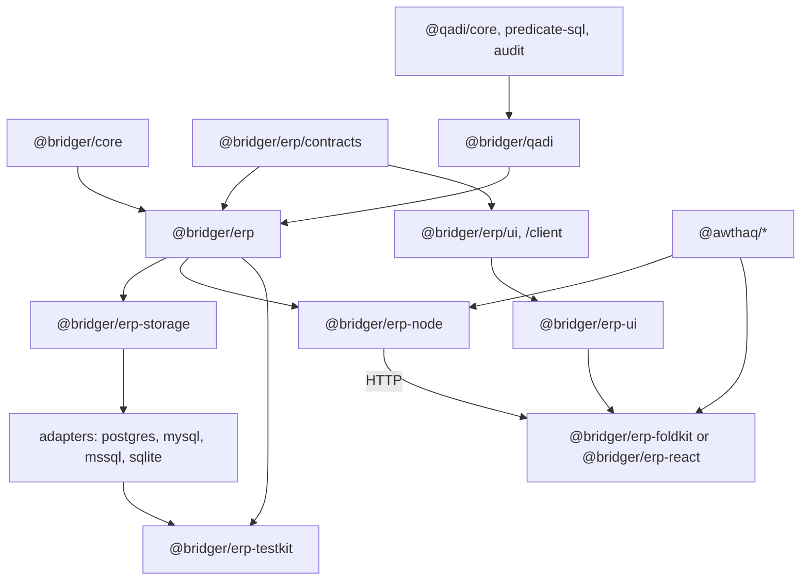

# Bridger ERP: documentation index, package map and status

Status: **index of proposals**. Date: 2026-10-02. Nothing listed here is implemented or type-checked. Policy: all packages target the latest stable Effect 4.x (4.1 at the time of the 2026-11-08 revision; this replaces the earlier 4.0 target); the exact-pin mismatches between third-party packages are not designed around in these documents.

> **Status banner (2026-11-08): example application, not normative.** This document describes an example ERP application built on Bridger with a server CRUD design: a database row is the source of truth and one server transaction commits each write. It is **not normative** for `@bridger/core` or any companion package, and it is **not the domain layer for local-first or event-sourced systems**; its row-as-truth write path conflicts with event-sourced, offline-first write paths. Such systems build on the [core specification](../references/core/README.md) and the companion specs ([command](../references/command/README.md), [durable-bus](../references/durable-bus/README.md), [federation](../references/federation/README.md), [loader](../references/loader/README.md), [audit-chain](../references/audit-chain/README.md)), and on the event-sourcing companions ([event-store](../references/event-store/README.md), [sequence](../references/sequence/README.md), [keyring](../references/keyring/README.md); Drafts like the others). Where this document and a spec disagree, the spec governs; the [supersession table](ERP-INDEX.md#supersession-table) maps each ERP concept to the spec that now governs it. Nothing here is implemented.

## Supersession table

Added 2026-11-08 (reconciliation of the ERP documents with the specification trees). Each row names an ERP concept, the documents where it appears, and the specification that now governs it. Where an ERP document and the governing specification disagree, the specification governs. All governing documents are themselves Drafts; nothing in either is implemented.

| ERP concept | Appears in | Now governed by | What remains in the ERP documents |
| --- | --- | --- | --- |
| `Command.contract` / `Command.implement` and the Operation Gateway | [ERP-SPEC.md](ERP-SPEC.md) §2, §4, §8; [ERP-TODO-WALKTHROUGH.md](ERP-TODO-WALKTHROUGH.md); [ERP-RECORDS.md](ERP-RECORDS.md) §2 | [`@bridger/command`](../references/command/README.md): [01 — Command definition](../references/command/behaviors/01-command-definition.md) (BEH-CM-001–005), [02 — Dispatch](../references/command/behaviors/02-dispatch.md) (BEH-CM-009–016), [06 — Receipts, wrappers and breakers](../references/command/behaviors/06-receipts-wrappers-and-breakers.md) (BEH-CM-041–043) | The gateway is an application adapter over the one command dispatch path. The ERP-specific steps around the handler (transaction, audit, outbox) are handler wrappers (BEH-CM-042) and idempotency receipts (BEH-CM-041) configured by the application. [ERP-STORAGE.md](ERP-STORAGE.md) §10 is the ERP's implementation of the `CommandReceipts` port. |
| `ModuleManifest` and the single Ed25519 publisher signature | [ERP-DISTRIBUTION.md](ERP-DISTRIBUTION.md) §3–§5, §9 | Core [27 — Manifest and lazy activation](../references/core/behaviors/27-manifest-and-lazy-activation.md) (BEH-BR-241–249); [`@bridger/loader`](../references/loader/README.md) [03 — Signature policy](../references/loader/behaviors/03-signature-policy.md) (BEH-LD-017–024), N-of-M with no default ([ADR-LD-003](../references/loader/decisions/003-n-of-m-signature-policy-with-no-default.md)) | ERP-only manifest fields (models, migrations, storage capabilities, UI artifacts) as an extension of the core manifest. |
| `apiVersion` | [ERP-DISTRIBUTION.md](ERP-DISTRIBUTION.md) §3, §9, §12; [ERP-SPEC.md](ERP-SPEC.md) | Core [26 — Versioned contracts](../references/core/behaviors/26-versioned-contracts.md) (BEH-BR-225–232) | The tenant-version window, restated over contract majors. |
| Record hooks and `ApprovalRequired` | [ERP-RECORDS.md](ERP-RECORDS.md) §3.3; [ERP-BUSINESS.md](ERP-BUSINESS.md) §4, §15 | Core [31 — Hook points](../references/core/behaviors/31-hook-points.md) (BEH-BR-297–308); core [32 — Generic gate and plan](../references/core/behaviors/32-generic-gate-and-plan.md) (`Defer` with a draft, BEH-BR-313–321); command gate (BEH-CM-011) | Which hooks and approval rules a model declares, approval tasks and their storage. |
| System subject | [ERP-RECORDS.md](ERP-RECORDS.md) §2; [ERP-BUSINESS.md](ERP-BUSINESS.md) §2–§3; [ERP-DISTRIBUTION.md](ERP-DISTRIBUTION.md) §3 | Core [28 — Plugin principal and mandatory policy](../references/core/behaviors/28-plugin-principal-and-mandatory-policy.md) (BEH-BR-257–266); core [29 — Capability grants and call log](../references/core/behaviors/29-capability-grants-and-call-log.md) (BEH-BR-273–278) | The ERP permission tokens a module declares for system use. |
| Tenant generations | [ERP-RUNTIME.md](ERP-RUNTIME.md) §5; [ERP-SPEC.md](ERP-SPEC.md) §5 | Core [33 — Realm families](../references/core/behaviors/33-realm-families.md) (BEH-BR-329–338) | The ERP registry content per tenant. Re-expressing it over a realm family is open. |
| ERP outbox (leases, retries, dead letters, handled-keys table) | [ERP-STORAGE.md](ERP-STORAGE.md) §12; [ERP-BUSINESS.md](ERP-BUSINESS.md) §2; [ERP-SPEC.md](ERP-SPEC.md) §4; [ERP-OPERATIONS.md](ERP-OPERATIONS.md) §3–§4 | [`@bridger/durable-bus`](../references/durable-bus/README.md) (all behaviours, including the storage-adapter obligations BEH-DB-054 and BEH-DB-055) | The adapter's implementation of the durable-bus storage ports, the tenant-to-stream mapping and the admin surface (ERP-STORAGE §12). |
| Multi-node rollout | [ERP-OPERATIONS.md](ERP-OPERATIONS.md) §3; [ERP-RUNTIME.md](ERP-RUNTIME.md) §9 | [`@bridger/federation`](../references/federation/README.md) (host manifest, BEH-FD-001–008; sync and offline, BEH-FD-009–016) | Per-node schema single-flight against the shared database. |
| Audit | [ERP-STORAGE.md](ERP-STORAGE.md) §11; [ERP-DISTRIBUTION.md](ERP-DISTRIBUTION.md) §9 | Core [22 — Attributable operations](../references/core/behaviors/22-attributable-operations.md), [23 — Audit sink and record](../references/core/behaviors/23-audit-sink-and-record.md), [24 — Time, identifiers and sequence](../references/core/behaviors/24-time-ids-and-sequence.md) (BEH-BR-185–216); [`@bridger/audit-chain`](../references/audit-chain/README.md) (all behaviours, including the generic `ChainSink<R>` of [04](../references/audit-chain/behaviors/04-generic-chain.md)) | The ERP business audit table as one consumer-owned store, and its field-level change records. |
| Sequences | [ERP-RECORDS.md](ERP-RECORDS.md) §8 | [`@bridger/sequence`](../references/sequence/README.md) for per-host series on offline or multi-host deployments: one owning origin per series, numbers reserved in the local transaction, a new series per incarnation after a restore, verification at the authority | The ERP's server-side design (a central row lock, a rollback giving the number back, formats and period resets) stays a valid application choice for deployments with one shared database; formats are the application's in both (ADR-SQ-004). Its series is the durable-bus incarnation, the only restore epoch (sequence overview, limit 5): after a restore it closes the open series of a lower incarnation and continues in a new one, as ADR-SQ-003 does ([ERP-RECORDS.md](ERP-RECORDS.md) §8). |
| Generic runtime (the former single-file specification) | All ERP documents | [`references/core/`](../references/core/README.md); the [migration map](../references/core/appendices/spec-md-migration-map.md) says where each former section went | Nothing. ERP documents cite core behaviours, not the former file, which is kept only as design history. |

An event-sourced domain layer is specified by [`@bridger/event-store`](../references/event-store/README.md) (streams, deciders, offline facts, projections), with [`@bridger/sequence`](../references/sequence/README.md) for per-host number series and [`@bridger/keyring`](../references/keyring/README.md) for per-subject field encryption and shredding. No ERP document describes them; the ERP's row-as-truth write path is not built on them.

## Reading order

1. [references/core/](../references/core/README.md): the normative generic plugin runtime. It supersedes the former single-file specification, which is kept as design history; the [migration map](../references/core/appendices/spec-md-migration-map.md) relates the two.
2. [ERP-TODO-WALKTHROUGH.md](ERP-TODO-WALKTHROUGH.md): the author experience, end to end.
3. [ERP-SPEC.md](ERP-SPEC.md): core ERP contracts, packages, execution, lifecycle.
4. [ERP-ACCESS.md](ERP-ACCESS.md): permissions and policies with `@qadi/core`.
5. [ERP-MODELS.md](ERP-MODELS.md) and [ERP-SCHEMA-DESIGN.md](ERP-SCHEMA-DESIGN.md): shared models, Effect Schema foundation.
6. Platform area specs:
   - [ERP-RUNTIME.md](ERP-RUNTIME.md): how the ERP runs on the core: shared module activations, tenant generations, scaling.
   - [ERP-RECORDS.md](ERP-RECORDS.md): `Records`, constraints, computed fields, hooks, relations, queries, module data, services, sequences, settings, money, translations.
   - [ERP-STORAGE.md](ERP-STORAGE.md): storage adapters (dialect-neutral core), capabilities, catalog, DDL planner, write path, receipts, audit, outbox, conformance.
   - [ERP-IDENTITY.md](ERP-IDENTITY.md): awthaq integration, tenants, companies, grants, `@bridger/qadi`.
   - [ERP-DISTRIBUTION.md](ERP-DISTRIBUTION.md): artifacts, signing, loader, durable Module Manager.
   - [ERP-BROWSER.md](ERP-BROWSER.md): neutral UI core with FoldKit and React renderers, catalog, UI plugins, teardown.
   - [ERP-BUSINESS.md](ERP-BUSINESS.md): events, jobs, workflows, integrations, attachments, search, reports, imports, API, domain contracts.
   - [ERP-OPERATIONS.md](ERP-OPERATIONS.md): deployment, replicas, observability, backup, administration.
   - [ERP-DX.md](ERP-DX.md): CLI, test kit, CI.
7. Adapters: [REACT-API.md](REACT-API.md), [REACT-UI-PLUGINS.md](REACT-UI-PLUGINS.md), [FOLDKIT-API.md](FOLDKIT-API.md).
8. Research: [knowledge/README.md](knowledge/README.md).

## Package map

| Package | Kind | Status | Specified in |
| --- | --- | --- | --- |
| `@bridger/core` | Generic plugin runtime | Draft specification | [references/core/](../references/core/README.md) |
| `@bridger/react`, `@bridger/foldkit` | UI adapters over core | Proposed | [REACT-API.md](REACT-API.md), [REACT-UI-PLUGINS.md](REACT-UI-PLUGINS.md), [FOLDKIT-API.md](FOLDKIT-API.md) |
| `@bridger/erp/contracts` | Browser-safe model/command/permission contracts | Proposed | [ERP-SPEC.md](ERP-SPEC.md) |
| `@bridger/erp` | Server: Module, Model.serve, Records, Erp | Proposed | [ERP-SPEC.md](ERP-SPEC.md) |
| `@bridger/erp/ui`, `@bridger/erp/client` | Browser-safe UI descriptors and client | Proposed | [ERP-SPEC.md](ERP-SPEC.md) (`ErpClient` and the wire format in §5), [ERP-BROWSER.md](ERP-BROWSER.md) |
| `@bridger/qadi` | Wrapper over `@qadi/core` | Proposed | [ERP-ACCESS.md](ERP-ACCESS.md), [ERP-IDENTITY.md](ERP-IDENTITY.md) |
| `@bridger/erp-storage` | Adapter interface, capabilities, statement/DDL IR, planner, conformance suite | Proposed | [ERP-STORAGE.md](ERP-STORAGE.md) |
| `@bridger/erp-postgres` (reference), `-sqlite` (Tier 2), `-mysql`, `-mssql`, … | Dialect adapters, delivered in that order | Proposed | [ERP-STORAGE.md](ERP-STORAGE.md) |
| `@bridger/erp-node` | HTTP hosting, identity adapter, loader | Proposed | [ERP-SPEC.md](ERP-SPEC.md) §5 (`ErpNode`, wire format), [ERP-IDENTITY.md](ERP-IDENTITY.md), [ERP-DISTRIBUTION.md](ERP-DISTRIBUTION.md) |
| `@bridger/erp-ui` | Framework-neutral UI core (state machines, stores, conformance) | Proposed | [ERP-BROWSER.md](ERP-BROWSER.md) |
| `@bridger/erp-foldkit`, `@bridger/erp-react` | Renderers for the ERP UI, one per deployment, on `@bridger/foldkit` / `@bridger/react` | Proposed | [ERP-BROWSER.md](ERP-BROWSER.md) |
| `@bridger/erp-testkit`, `bridger` CLI | Developer tooling | Proposed | [ERP-DX.md](ERP-DX.md) |
| `@qadi/core`, `@qadi/predicate-sql`, `@qadi/audit` | Authorization | Exists (0.8.0 on npm) | [ERP-ACCESS.md](ERP-ACCESS.md) |
| `@awthaq/*` | Authentication, organizations, admin | Exists in `/Users/mohammadalmechkor/Projects/Perso/effect-auth`; private, unpublished (v0.1.0) | [ERP-IDENTITY.md](ERP-IDENTITY.md) |
| Effect v4, FoldKit, Alchemy | Runtime, UI, provisioning | External | [knowledge/README.md](knowledge/README.md) |

## Dependency overview

## Glossary

| Term | Meaning |
| --- | --- |
| Tenant | An awthaq organization; the isolation boundary. |
| Company | A Bridger-owned legal/operational entity inside a tenant; company-scoped data and grants. |
| Module | The unit of installation: models, migrations, UI, commands, access; an approved signed artifact in production. |
| Contract | Browser-safe, pure description of a model or operation; separate from its server binding. |
| Generation | Immutable published registry value; swapped atomically; old generation drains. |
| Grant | A role assigned to an actor within a tenant and company. |
| Module activation | The process-wide Bridger plugin for one module dependency closure, shared by tenants ([ERP-RUNTIME.md](ERP-RUNTIME.md)). |
| Closure digest | Hash identifying a module build together with its resolved dependencies. |
| Tenant generation | The small immutable per-tenant registry value that references module activations; swapped atomically. Superseded in part by core realm families (see the supersession table). |
| System subject | The permission-limited identity a module uses for seeds, jobs and subscribers. Superseded in part by the core plugin principal and capability grants (see the supersession table). |
| Intent | One user action with one idempotency key. |
| Receipt | The record of one idempotency key for one command: in flight while its first request runs, then completed with the stored outcome, success or typed failure (BEH-CM-041; [ERP-STORAGE.md](ERP-STORAGE.md) §10). |
| Outbox | Events committed with the business change. Governed by `@bridger/durable-bus` (see the supersession table). |

## Status by area

"Designed" below means a proposal was written for this example application. No area has been reviewed, prototyped or implemented, and the areas named in the [supersession table](#supersession-table) are superseded in part. Several documents end with a "Decisions and remaining items" table; those tables record the decisions taken in October 2026, not the absence of open work.

| Area | State | Blocking items before implementation |
| --- | --- | --- |
| Core runtime (`Host`, leases, `Generation`, supervision, shutdown, testing) | Draft specification in [references/core/](../references/core/README.md) | Its own open items ([roadmap](../references/core/roadmap.md)). The former single-file specification is design history only ([migration map](../references/core/appendices/spec-md-migration-map.md)). |
| ERP runtime (shared activations, tenant generations, scaling) | Designed ([ERP-RUNTIME.md](ERP-RUNTIME.md)) | Prototype lease chain and eviction; tune defaults. |
| Records and model logic (hooks, relations, queries, seeds, services, sequences, settings, money, translations) | Designed ([ERP-RECORDS.md](ERP-RECORDS.md)) | Prototype the write pipeline and relation/aggregate rendering on two dialects. |
| Model, schema, extension | Designed | Pin Effect Schema/Model import paths and type-check examples. |
| Access (`@bridger/qadi`) | Designed | Prototype column mapping, row/field split, one-statement composition ([ERP-IDENTITY.md](ERP-IDENTITY.md) §9). |
| Storage | Designed (dialect-neutral) | Prototype DDL planner crash recovery and write path on the reference adapter (PostgreSQL), then certify further dialects with the conformance suite. Capability profiles were checked against vendor docs ([ERP-STORAGE.md](ERP-STORAGE.md) §3.5); per-version minimums remain. Adapter order decided: PostgreSQL, SQLite, MySQL/MariaDB, SQL Server ([ERP-STORAGE.md](ERP-STORAGE.md) §3.5). |
| Identity | Designed | awthaq packages must be consumable (link or publish); company concept is Bridger's. |
| Distribution | Designed | Prototype loader verification and shared-Effect resolution; import mechanism ([ERP-DISTRIBUTION.md](ERP-DISTRIBUTION.md) §12). |
| Browser | Designed | Prototype catalog sync and the widget teardown handshake against a real FoldKit version. |
| Business platform | Designed at contract level | **Your decision:** target countries, industry, company scale and accounting scope for domain modules. |
| Operations | Designed | Multi-node rollout prototype; **your decision:** hosting provider for the Alchemy stack. |
| Developer experience | Designed | Create the monorepo and the first test kit slice. |
| Domain modules (accounting, tax, stock, sales, purchasing) | Contract-level only | Separate detailed specs after locale decisions. |
| Implementation | **None** | Start with the Todo vertical slice ([ERP-DX.md](ERP-DX.md) §4). |

Change log: 2026-11-08, round-2 agent review fixes — status banner links the event-store, sequence and keyring companions; supersession table: command row cites BEH-CM-041–043 (no longer an open item), durable-bus and audit-chain rows cite the companions without stale ranges, new "Sequences (ERP-RECORDS §8)" row; closing paragraph names the three event-sourcing companions (R5-20, R5-21).

Change log: 2026-11-09, audit fixes — supersession table: the command row names ERP-STORAGE §10 as the `CommandReceipts` implementation (E-01); the sequences row records series closing after a restore (E-06); the generic-runtime row, reading order, package map and status table cite the core reference and its migration map instead of SPEC.md (E-04). Package map cites ERP-SPEC §5 for `ErpNode` and `ErpClient` (E-07). Glossary: receipt (E-01).
