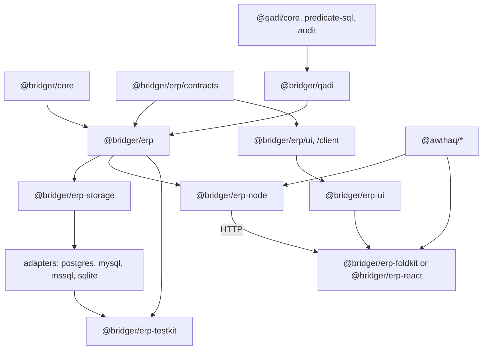

# Bridger ERP: documentation index, package map and status

Status: **index of proposals**. Date: 2026-10-02. Nothing listed here is implemented or type-checked. Policy: all packages target the latest stable Effect 4.x (4.0.0 at the time of writing); the exact-pin mismatches between third-party packages are not designed around in these documents.

## Reading order

1. [SPEC.md](SPEC.md): generic plugin runtime (`Host`, `Generation`, snapshots).
2. [ERP-TODO-WALKTHROUGH.md](ERP-TODO-WALKTHROUGH.md): the author experience, end to end.
3. [ERP-SPEC.md](ERP-SPEC.md): core ERP contracts, packages, execution, lifecycle.
4. [ERP-ACCESS.md](ERP-ACCESS.md): permissions and policies with `@qadi/core`.
5. [ERP-MODELS.md](ERP-MODELS.md) and [ERP-SCHEMA-DESIGN.md](ERP-SCHEMA-DESIGN.md): shared models, Effect Schema foundation.
6. Platform area specs:
   - [ERP-RUNTIME.md](ERP-RUNTIME.md): how the ERP runs on the core: shared module activations, tenant generations, scaling.
   - [ERP-RECORDS.md](ERP-RECORDS.md): `Records`, constraints, computed fields, hooks, relations, queries, module data, services, sequences, settings, money, translations.
   - [ERP-STORAGE.md](ERP-STORAGE.md): storage adapters (dialect-neutral core), capabilities, catalog, DDL planner, write path, receipts, audit, outbox, conformance.
   - [ERP-IDENTITY.md](ERP-IDENTITY.md): awthaq integration, tenants, companies, grants, `@bridger/qadi`.
   - [ERP-DISTRIBUTION.md](ERP-DISTRIBUTION.md): artifacts, signing, loader, durable Module Manager.
   - [ERP-BROWSER.md](ERP-BROWSER.md): neutral UI core with FoldKit and React renderers, catalog, UI plugins, teardown.
   - [ERP-BUSINESS.md](ERP-BUSINESS.md): events, jobs, workflows, integrations, attachments, search, reports, imports, API, domain contracts.
   - [ERP-OPERATIONS.md](ERP-OPERATIONS.md): deployment, replicas, observability, backup, administration.
   - [ERP-DX.md](ERP-DX.md): CLI, test kit, CI.
7. Adapters: [REACT-API.md](REACT-API.md), [REACT-UI-PLUGINS.md](REACT-UI-PLUGINS.md), [FOLDKIT-API.md](FOLDKIT-API.md).
8. Research: [knowledge/README.md](knowledge/README.md).

## Package map

| Package | Kind | Status | Specified in |
| --- | --- | --- | --- |
| `@bridger/core` | Generic plugin runtime | Proposed | [SPEC.md](SPEC.md) |
| `@bridger/react`, `@bridger/foldkit` | UI adapters over core | Proposed | [REACT-API.md](REACT-API.md), [REACT-UI-PLUGINS.md](REACT-UI-PLUGINS.md), [FOLDKIT-API.md](FOLDKIT-API.md) |
| `@bridger/erp/contracts` | Browser-safe model/command/permission contracts | Proposed | [ERP-SPEC.md](ERP-SPEC.md) |
| `@bridger/erp` | Server: Module, Model.serve, Records, Erp | Proposed | [ERP-SPEC.md](ERP-SPEC.md) |
| `@bridger/erp/ui`, `@bridger/erp/client` | Browser-safe UI descriptors and client | Proposed | [ERP-SPEC.md](ERP-SPEC.md), [ERP-BROWSER.md](ERP-BROWSER.md) |
| `@bridger/qadi` | Wrapper over `@qadi/core` | Proposed | [ERP-ACCESS.md](ERP-ACCESS.md), [ERP-IDENTITY.md](ERP-IDENTITY.md) |
| `@bridger/erp-storage` | Adapter interface, capabilities, statement/DDL IR, planner, conformance suite | Proposed | [ERP-STORAGE.md](ERP-STORAGE.md) |
| `@bridger/erp-postgres` (reference), `-sqlite` (Tier 2), `-mysql`, `-mssql`, … | Dialect adapters, delivered in that order | Proposed | [ERP-STORAGE.md](ERP-STORAGE.md) |
| `@bridger/erp-node` | HTTP hosting, identity adapter, loader | Proposed | [ERP-IDENTITY.md](ERP-IDENTITY.md), [ERP-DISTRIBUTION.md](ERP-DISTRIBUTION.md) |
| `@bridger/erp-ui` | Framework-neutral UI core (state machines, stores, conformance) | Proposed | [ERP-BROWSER.md](ERP-BROWSER.md) |
| `@bridger/erp-foldkit`, `@bridger/erp-react` | Renderers for the ERP UI, one per deployment, on `@bridger/foldkit` / `@bridger/react` | Proposed | [ERP-BROWSER.md](ERP-BROWSER.md) |
| `@bridger/erp-testkit`, `bridger` CLI | Developer tooling | Proposed | [ERP-DX.md](ERP-DX.md) |
| `@qadi/core`, `@qadi/predicate-sql`, `@qadi/audit` | Authorization | Exists (0.8.0 on npm) | [ERP-ACCESS.md](ERP-ACCESS.md) |
| `@awthaq/*` | Authentication, organizations, admin | Exists in `/Users/mohammadalmechkor/Projects/Perso/effect-auth`; private, unpublished (v0.1.0) | [ERP-IDENTITY.md](ERP-IDENTITY.md) |
| Effect v4, FoldKit, Alchemy | Runtime, UI, provisioning | External | [knowledge/README.md](knowledge/README.md) |

## Dependency overview

## Glossary

| Term | Meaning |
| --- | --- |
| Tenant | An awthaq organization; the isolation boundary. |
| Company | A Bridger-owned legal/operational entity inside a tenant; company-scoped data and grants. |
| Module | The unit of installation: models, migrations, UI, commands, access; an approved signed artifact in production. |
| Contract | Browser-safe, pure description of a model or operation; separate from its server binding. |
| Generation | Immutable published registry value; swapped atomically; old generation drains. |
| Grant | A role assigned to an actor within a tenant and company. |
| Module activation | The process-wide Bridger plugin for one module dependency closure, shared by tenants ([ERP-RUNTIME.md](ERP-RUNTIME.md)). |
| Closure digest | Hash identifying a module build together with its resolved dependencies. |
| Tenant generation | The small immutable per-tenant registry value that references module activations; swapped atomically. |
| System subject | The permission-limited identity a module uses for seeds, jobs and subscribers. |
| Intent | One user action with one idempotency key. |
| Receipt | Stored result of an idempotent command. |
| Outbox | Durable events committed with the business change. |

## Status by area

| Area | State | Blocking items before implementation |
| --- | --- | --- |
| Core runtime (`Host`, leases, `Generation`, supervision, shutdown, testing) | Designed, operation semantics and failure handling specified in [SPEC.md](SPEC.md) | Prototype leases/drain ordering and concurrent builds. The earlier open questions in [SPEC.md](SPEC.md) are resolved. |
| ERP runtime (shared activations, tenant generations, scaling) | Designed ([ERP-RUNTIME.md](ERP-RUNTIME.md)) | Prototype lease chain and eviction; tune defaults. |
| Records and model logic (hooks, relations, queries, seeds, services, sequences, settings, money, translations) | Designed ([ERP-RECORDS.md](ERP-RECORDS.md)) | Prototype the write pipeline and relation/aggregate rendering on two dialects. |
| Model, schema, extension | Designed | Pin Effect Schema/Model import paths and type-check examples. |
| Access (`@bridger/qadi`) | Designed | Prototype column mapping, row/field split, one-statement composition ([ERP-IDENTITY.md](ERP-IDENTITY.md) §9). |
| Storage | Designed (dialect-neutral) | Prototype DDL planner crash recovery and write path on the reference adapter (PostgreSQL), then certify further dialects with the conformance suite. Capability profiles were checked against vendor docs ([ERP-STORAGE.md](ERP-STORAGE.md) §3.5); per-version minimums remain. Adapter order decided: PostgreSQL, SQLite, MySQL/MariaDB, SQL Server ([ERP-STORAGE.md](ERP-STORAGE.md) §3.5). |
| Identity | Designed | awthaq packages must be consumable (link or publish); company concept is Bridger's. |
| Distribution | Designed | Prototype loader verification and shared-Effect resolution; import mechanism ([ERP-DISTRIBUTION.md](ERP-DISTRIBUTION.md) §12). |
| Browser | Designed | Prototype catalog sync and the widget teardown handshake against a real FoldKit version. |
| Business platform | Designed at contract level | **Your decision:** target countries, industry, company scale and accounting scope for domain modules. |
| Operations | Designed | Multi-node rollout prototype; **your decision:** hosting provider for the Alchemy stack. |
| Developer experience | Designed | Create the monorepo and the first test kit slice. |
| Domain modules (accounting, tax, stock, sales, purchasing) | Contract-level only | Separate detailed specs after locale decisions. |
| Implementation | **None** | Start with the Todo vertical slice ([ERP-DX.md](ERP-DX.md) §4). |
