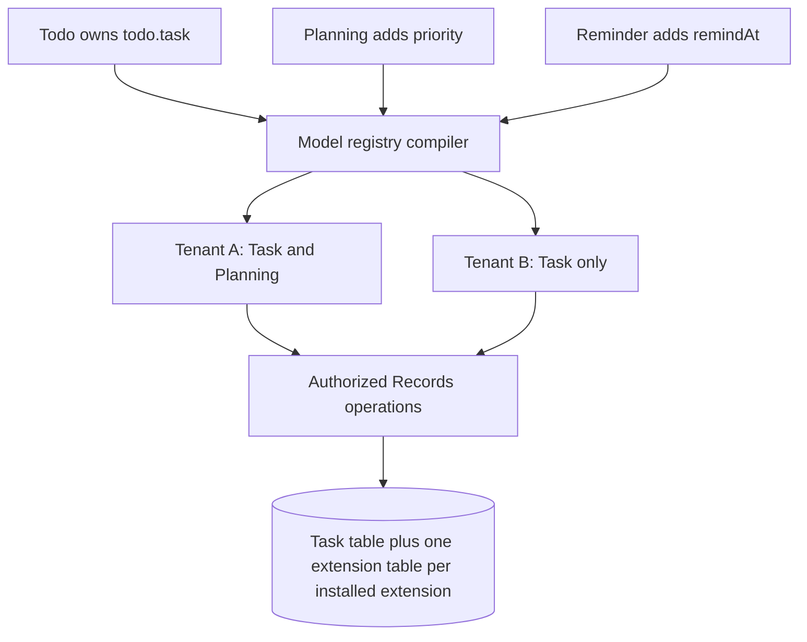
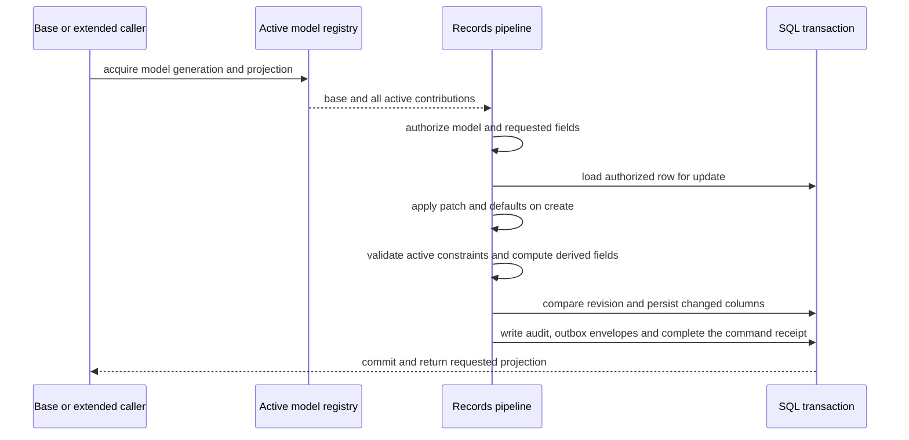
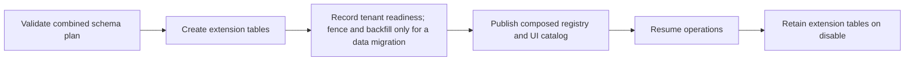

# Bridger ERP: shared models and database ownership

Status: proposed API, not implemented or type-checked. This document refines [ERP-SPEC.md](ERP-SPEC.md). Examples use the [Todo model](ERP-TODO-WALKTHROUGH.md). Bridger core remains independent of persistence.

> **Status banner (2026-11-08): example application, not normative.** This document describes an example ERP application built on Bridger with a server CRUD design: a database row is the source of truth and one server transaction commits each write. It is **not normative** for `@bridger/core` or any companion package, and it is **not the domain layer for local-first or event-sourced systems**; its row-as-truth write path conflicts with event-sourced, offline-first write paths. Such systems build on the [core specification](../references/core/README.md) and the companion specs ([command](../references/command/README.md), [durable-bus](../references/durable-bus/README.md), [federation](../references/federation/README.md), [loader](../references/loader/README.md), [audit-chain](../references/audit-chain/README.md)), and on the event-sourcing companions ([event-store](../references/event-store/README.md), [sequence](../references/sequence/README.md), [keyring](../references/keyring/README.md); Drafts like the others). Where this document and a spec disagree, the spec governs; the [supersession table](ERP-INDEX.md#supersession-table) maps each ERP concept to the spec that now governs it. Nothing here is implemented.

Schema foundation: [Effect Schema integration](ERP-SCHEMA-DESIGN.md) defines `Field.make(schema, metadata)` and how to compile storage, create, patch and public representations. The shorthand fields below compile through that same schema machinery.

## 1. Decision: one model, one base table, one extension table per contributor

A model has one owning module. Other modules extend that model through `Model.extend`; they do not redefine its table or obtain private CRUD semantics. Contributions are compiled into one immutable model registry per active tenant generation.

| Concept | Identity and ownership | Responsibility |
| --- | --- | --- |
| Model | `todo.task`, owned by `todo` | Base fields, identity, scope and invariants. |
| Extension | `planning.task`, owned by `planning` | Additional fields and restrictions on `todo.task`. |
| Field | Stable qualified identity, e.g. `planning.task.priority` | Type, storage mapping, permissions, validation and migration history. |
| Physical tables | The base table of `todo.task`, plus one extension table per extension (for example `x_planning__todo_task`) | The base table stores only base fields and is never altered by an extension. Each extension table stores that extension's fields for records of the base model, across tenants. |
| Active model | Tenant + model + registry generation | Base definition plus that tenant's enabled contributions. |
| Typed projection | Base model or explicit composition of known extensions | What a particular caller can read and submit. |

Module ownership is validated against the manifest: an extension's ID must belong to its declaring module namespace. Registering the same model ID twice is an error. No installation order decides which definition wins.



**The tables are shared; field visibility, validation and behavior depend on the active registry.** A disabled extension's table may still exist physically, with its rows. That does not make it addressable through the ERP interface.

## 2. Authoring an extension

The original `Task` definition is unchanged. A planning plugin adds priority to its existing rows:

```ts
import { Field, Model, Module, Migration } from "@bridger/erp"
import { Task } from "@example/todo/contracts"

export const TaskPlanning = Model.extend(Task, "planning.task", {
  fields: {
    priority: Field.text({
      label: "Priority",
      values: ["low", "normal", "high"],
      default: "normal",
    }),
  },
})

// A typed projection; this does not install or activate anything.
export const PlannedTask = Model.compose(Task, [TaskPlanning])

// Frozen historical snapshot. Do not import live TaskPlanning.fields here.
const AddPriority = Migration.extendModel("001-task-priority", {
  model: "todo.task",
  extension: "planning.task",
  fields: {
    priority: Field.text({
      values: ["low", "normal", "high"], default: "normal",
    }),
  },
  // The value a record with no extension row reads as. Explicit: the snapshot's
  // `default` above is the create default, never this value. No row is written
  // for existing records.
  backfill: { priority: "normal" },
})

export const PlanningModule = Module.define({
  id: "planning",
  version: "1.0.0",
  apiVersion: "1",
  dependsOn: [{ id: "todo", range: "^1.0.0" }],
  extensions: [TaskPlanning],
  migrations: [AddPriority],
})
```

`values` is the proposed finite-value form of `Field.text`. All definitions above are pure metadata. The imported contracts package contains descriptors, not a database connection or server handlers. The installer verifies the target model's owner and compatible contract version against `dependsOn`. `Migration.extendModel` compiles to the creation of the extension table (§5); it never alters the table of `todo.task`.

The extension's fields inherit the base model's row and CRUD policies by default. Additional field permissions (`Access.fields`, a `@qadi/core` field policy; see [ERP-ACCESS.md](ERP-ACCESS.md)) can restrict access; declaring a field never grants access. Row policies referencing extension fields compile to an expression over the extension table (§5), and only while that extension is active. A separate extension of the UI view is needed to show the new field in an existing form. Model contribution does not silently rearrange screens.

### Typed usage

```ts
const records = yield* Records

const task = yield* records.create(PlannedTask, {
  title: "Review the plan",
  extensions: {
    "planning.task": { priority: "high" },
  },
})

const changed = yield* records.update(PlannedTask, {
  id: task.id,
  expectedRevision: task.revision,
  changes: {
    extensions: {
      "planning.task": { priority: "normal" },
    },
  },
})

// changed.title and changed.extensions["planning.task"].priority are typed.
```

These operations run inside a gateway command's transaction. The gateway owns the idempotency key and receipt. There is one row ID and one revision for the entire row, including extension fields: they are stored in the extension table, but a write that changes only them still raises the base row's revision in the same transaction. Updating priority conflicts with a concurrent title change at the same revision. Partial updates merge only explicitly supplied fields; they never replace the entire extension object or null omitted columns.

Generated client references also exist on `PlannedTask.commands` and `.queries`. They identify the same model operations with an explicit projection contract and required extension IDs; they do not register duplicate handlers. Server validation checks that the requested projection is a supported subset of the current registry.

### Why extension fields are nested

Two plugins can both add a `status` field without colliding: `extensions["planning.task"].status` and `extensions["review.task"].status` are distinct. The API nesting does **not** imply JSON storage. The adapter maps each qualified field to an ordinary typed column of the extension's table and records that mapping durably. SQL identifiers are allocated once with length/collision handling; never derive them afresh from display labels.

## 3. TypeScript contracts versus runtime composition

`Task.Row` keeps its base shape. Installing a plugin cannot retroactively change already compiled TypeScript types. `PlannedTask.Row` includes the base fields plus the known Planning fields. Unknown hot-installed extensions are described by runtime schemas in the authorized catalog and rendered by FoldKit's metadata renderer.

| Caller | Reads | Writes and invariants |
| --- | --- | --- |
| Base `Task` caller | Base projection only | Base fields; **all active model restrictions still run**. |
| `PlannedTask` caller | Base + Planning projection | Allowed base/Planning fields; every active restriction runs. |
| Dynamic FoldKit form | Authorized catalog projection | Runtime schema-validated input and current contract reference. |
| Caller requesting a disabled extension | No silent partial result | `ExtensionUnavailable` before execution. |

A read projection requesting a forbidden field fails with `Forbidden`; it does not silently omit a required property from a statically promised result. Dynamic clients can first obtain an authorized projection. Writes cannot set unrequested, unknown, disabled, computed or forbidden fields.

A base command creating a task still applies defaults for **all active extensions** before validation and persistence. It returns only its declared base projection. A required extension field without a default is an explicit breaking create-contract change: activation must reject it unless a reviewed contract upgrade also updates every affected creator. The initial design accepts additive required fields only with deterministic defaults and completed backfill.

## 4. One write pipeline for all contributors



Every admitted command acquires a lease on the current model generation (core's `Generation` helper; core [20 — Generation](../references/core/behaviors/20-generation.md), BEH-BR-172), an immutable value that already contains the base model and all active contributions' validators, computed functions and storage mappings. An extension plugin therefore needs no separate lease. Its scope is closed only after the generation that referenced it has been retired and drained with a bound (`retired.drain({ timeout, force })`, BEH-BR-173): publish the generation without the extension, drain the old one, then remove the plugin (BEH-BR-176). A request admitted against an old generation completes under that immutable value; publication cannot mix validators from one generation with storage mappings from another.

For behavior changes on a shared model, the first implementation calls `closeAdmission` on the tenant's generation, publishes the new generation, drains the retired value with a bound (`retired.drain({ timeout, force })`, BEH-BR-173, BEH-BR-174; at the limit without `force` it fails with `DrainTimeout` and the change is reported, not completed), and calls `reopenAdmission` (admission is per tenant, [ERP-RUNTIME.md](ERP-RUNTIME.md) §5). This prevents an old validator committing after a new invariant is declared active. Compatible parallel generations require a separately proven protocol.

Constraints are side-effect-free checks, combined with logical AND. Plugins cannot overwrite another constraint or override CRUD by registration order. Computed fields declare qualified dependencies; the compiler topologically orders them and rejects cycles. Only the owner of a computed field writes its value. External side effects are delivered through a transactional outbox after commit.

Row-wide audit and change events record qualified changed fields, command identity and the active registry generation. Event subscribers use versioned payload contracts; delivery does not require the contributing code to remain loaded merely to decode the event. Any change of an event's encoded payload, an added optional field included, raises its version ([ERP-BUSINESS.md](ERP-BUSINESS.md) §2).

## 5. Physical schema versus tenant enablement

| Storage object | Applies to | Durable content |
| --- | --- | --- |
| Model/field ownership catalog | Physical database | Model owner, field contributor, stable field ID, extension table and column mapping. |
| Migration journal | Physical database + module | Immutable migration ID/checksum, completed steps, failure and resume state. |
| Module desired state | Tenant + module | Approved artifact/version and enabled/disabled intent. |
| Activation/backfill journal | Tenant + extension version | Tenant initialization progress and readiness conditions. |
| Runtime registry | Process + tenant + generation | Executable validated composition; reconstructed from durable state. |

Installing Planning for tenant A creates its extension table once. Enabling it later for tenant B reuses the table but performs B's required initialization. A record with no row in the extension table (created before the extension was enabled, or while it was disabled for its tenant) reads as each field's **absent value** (below). Therefore an extension's logical `required` is **not a SQL NOT NULL constraint on any base column**; in the extension table a column may be NOT NULL, because a row exists only when the extension wrote one.

For the example, `Migration.extendModel` creates the extension table `x_planning__todo_task` (primary key `(tenant_id, company_id, id)`, or `(tenant_id, id)` for a tenant-scoped model, where `id` is the base record's id; no foreign key to the base table) and records the field mapping. The migration's `backfill` entry is the field's **absent value**: what a record with no extension row reads as. It is decoded against the field's schema when the migration compiles, is part of the checksummed descriptor, and is never taken from the snapshot's `default`, which is the create default ([ERP-SCHEMA-DESIGN.md](ERP-SCHEMA-DESIGN.md) §2), so changing a field's create default later cannot change what an old migration means. No row is written for existing records, so enabling needs no fenced catch-up and no write to the base table. A field the extension declares `required` still needs a `backfill` entry, or compilation fails with `BackfillRequired`. A value that must be stored for each existing record, such as a derived one, is a separate resumable data migration (`bridger_data_migrations`, [ERP-RECORDS.md](ERP-RECORDS.md) §12) with the fenced catch-up described in [ERP-STORAGE.md](ERP-STORAGE.md) §7. Values stored in the extension table are preserved on re-enable. The journal distinguishes database DDL completion from tenant readiness.

SQL constraints must remain valid for every tenant and every retained generation. Constraints on an extension table (types, checks, tenant-scoped unique indexes) affect only writes to that table, which only the extension's own code issues, so they cannot block a base-model write whether the extension is enabled or not. The planner rejects a foreign key from an extension table to the base table or to another module's table, restrictive or not, and a trigger on any table. A reference into another module is checked by a model constraint inside the write transaction, and its delete behaviour is declared by `onDelete` ([ERP-RECORDS.md](ERP-RECORDS.md) §4). Runtime uniqueness across base and extension tables requires transactional serialization, not a check-then-insert query.

Schema changes lock the physical tables they create or alter. An extension's migration touches only that extension's tables, so two plugins extending one model never share a DDL plan and neither locks the base table. A planner orders dependency operations, checks ownership and compatibility, then records progress. Different plugin versions cannot reinterpret an existing extension column with incompatible SQL types across tenants.



## 6. Conflicts, upgrades and removal

| Change | Rule |
| --- | --- |
| Two owners define `todo.task` | Reject `ModelOwnershipConflict`. |
| Two contributions claim the same qualified field | Reject `FieldOwnershipConflict`, even if types match. |
| Two plugins use local field name `priority` | Allowed under different extension IDs. |
| Extension changes tenant/company scope or primary key | Reject; only an explicit owner-controlled model migration can change identity. |
| Extension weakens base authorization or invariant | Reject; restrictions compose, never replace. |
| Plugin needs another extension's field | Declare its module dependency and compatible field contract; no incidental load-order access. |
| Base owner changes/removes an extended field | Check every installed dependent contract before publishing; incompatible dependents block upgrade. |
| Disable Planning | Fence/drain calls using the composed model, publish without Planning, retain the extension table and its rows. |
| Disable Todo while Planning is active | Reject by default; reviewed cascade disables dependents first. |
| Rename a field | Explicit identity-preserving rename mapping or new-field migration with backfill; never infer from deletion/addition. |
| Change field type | Expand into compatible storage, transform/backfill, switch contracts, retire old storage later. |
| Delete extension data/tables | Separate destructive maintenance plan (a contract plan, [ERP-STORAGE.md](ERP-STORAGE.md) §7a) after all tenant references, dependencies and retention requirements are resolved. |

Dormant stored computed values can become stale while their contributor is disabled. Re-enable must recompute/validate before exposing them. Durable foreign keys and other accepted persistent invariants continue to apply while disabled. Disabling code cannot promise that installed SQL semantics disappear.

Relations reference model IDs and opaque record IDs, not another plugin's table name. They preserve tenant/company compatibility, target authorization and explicit delete behavior. Many-to-one uses an FK column when compatible with the invariant policy above; many-to-many uses an owned join model/table. A plugin may own a new related model instead of extending a table when the data has an independent lifecycle or multiple rows per base record. A reference from an extension module to a model of another module has no foreign key and defaults to `onDelete: "detach"` ([ERP-RECORDS.md](ERP-RECORDS.md) §4).

## 7. What the framework must prove before implementation is accepted

- Todo and Planning write the same record and share its revision.
- A Todo-only caller still triggers Planning's active constraints and defaults.
- Tenant B cannot address Planning fields when only tenant A enables Planning.
- Two simultaneous installations extending Task never alter the Task table, and each serializes only on its own tables.
- Failure after DDL but before activation resumes without duplicate tables or columns, or lost values.
- Disabling Planning drains base calls using Planning code, then rejects stale extended contracts.
- Base queries never accidentally return extension data through `SELECT *`.
- Base model upgrades detect incompatible installed extensions.
- Re-enabling preserves user values and repairs dormant computed values.
- A record with no extension row reads as the migration's `backfill` value, not the field's current create default; a required field without a `backfill` entry fails with `BackfillRequired` before any DDL.
- No schema constraint accidentally imposes an inactive extension's business rules on other tenants.
- A row policy on an extension field decides a record with no extension row on the field's absent value, not on NULL (differential check against qadi's interpreter).
- Deleting a base record that has rows in a disabled extension's table is not blocked, and the extension removes those rows when it handles the delete event after re-enable.
- A write that changes only extension fields raises the base row's revision, and a concurrent base-field write at the old revision gets `RevisionConflict`.

These are design acceptance scenarios, not tests already executed.

Change log: 2026-11-08, round-2 agent review fixes — status banner links the event-store, sequence and keyring companions instead of calling event-store "planned, not yet drafted" (R5-20).

Change log: 2026-11-09, audit fixes — §2 and §5: `Migration.extendModel` takes an explicit `backfill` entry, which alone decides the value written into existing rows; the snapshot's `default` stays the create default; `BackfillRequired` for a required field without one (E-10). §4 diagram: the command receipt is completed in the transaction, as BEH-CM-041 (E-01). Generation citation points to core 20 instead of the superseded SPEC.md (E-04). §4 drains retired generations with the bounded `drain({ timeout, force })` instead of the unbounded `drained`; §4 states that every event payload change raises the version (durable-bus C-11).

Change log: 2026-11-11, extension tables — §1, §2, §5–§7: an extension's fields are stored in its own table, keyed by the base record, and never as columns of the base table; the migration's `backfill` entry is the absent value a record without a row reads as; constraints stay on the extension's tables, foreign keys into other modules and triggers are rejected; DDL locks follow the tables touched; references from an extension module default to `detach`; three acceptance checks added.
