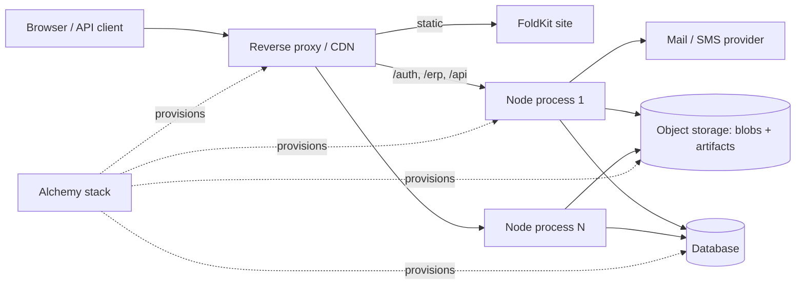

# Bridger ERP: operations, deployment and administration

Status: **proposal for review, not implemented or type-checked**. Date: 2026-10-02. Resource names, tables, endpoints and screens are proposed. Alchemy and Effect facts (stacks and stages, `Cloudflare.Website.Foldkit`, `RemovalPolicy.retain()`, drift, `Config.Redacted`, `Logger`/`Metric`/`Tracer`, `ManagedRuntime`) are cited from the [knowledge catalog](knowledge/README.md) entries A01–A21, A26–A30, E11, E15, E43, R29–R31, B03, B15, B18; they were not executed. Alchemy is at a 2.0 beta in the observed source. Policy: all packages target the latest stable Effect 4.x (4.1 at the time of the 2026-11-08 revision; this replaces the earlier 4.0 target). This document refines [ERP-SPEC.md](ERP-SPEC.md) §5–6.

> **Status banner (2026-11-08): example application, not normative.** This document describes an example ERP application built on Bridger with a server CRUD design: a database row is the source of truth and one server transaction commits each write. It is **not normative** for `@bridger/core` or any companion package, and it is **not the domain layer for local-first or event-sourced systems**; its row-as-truth write path conflicts with event-sourced, offline-first write paths. Such systems build on the [core specification](../references/core/README.md) and the companion specs ([command](../references/command/README.md), [durable-bus](../references/durable-bus/README.md), [federation](../references/federation/README.md), [loader](../references/loader/README.md), [audit-chain](../references/audit-chain/README.md)), and on the event-sourcing companions ([event-store](../references/event-store/README.md), [sequence](../references/sequence/README.md), [keyring](../references/keyring/README.md); Drafts like the others). Where this document and a spec disagree, the spec governs; the [supersession table](ERP-INDEX.md#supersession-table) maps each ERP concept to the spec that now governs it. Nothing here is implemented.

## 1. Decision

| Concern | Decision |
| --- | --- |
| First hosting target | One or more **long-lived Node processes** + **a relational database through a certified storage adapter** (PostgreSQL is the reference), behind a reverse proxy that serves the built FoldKit site, `/auth` (awthaq) and `/erp`. |
| Provisioning | Alchemy declares the infrastructure (database, compute, object storage, DNS/proxy, secrets). Application state (module state, artifacts, tenants) is **not** Alchemy state. |
| Trust | In-process plugins are trusted code with process privileges. Signing and approval authorize code; they are not a sandbox (§5). |
| Replicas | Several identical processes may serve one database. Module rollout is coordinated through durable state (§3). |
| Later targets | Cloudflare Workers, Worker Loader isolation and database-per-tenant are separate adapters (§5, §12). |

Four lifetimes stay separate ([knowledge/ARCHITECTURE.md](knowledge/ARCHITECTURE.md)): **infrastructure** (Alchemy), **runtime activation** (Bridger Host/Generation), **durable execution** (jobs, workflows, outbox) and **business data** (PostgreSQL, blobs). Removing a plugin never drops data or cancels durable executions; destroying infrastructure never happens implicitly.

## 2. Deployment topology and Alchemy stack



An illustrative stack (names are placeholders, provider layers are chosen at implementation time):

```ts
export default Alchemy.Stack("bridger-erp", {
  providers: /* ProviderLayer for the chosen cloud; ProviderLayer.dual for local/live */,
  state: /* cloud or database state store, separate from the ERP database */,
}, Effect.gen(function* () {
  const db = yield* Database("erp-db", { engine: /* the chosen dialect */ "postgres", removal: RemovalPolicy.retain() })
  const blobs = yield* ObjectStore("erp-blobs", { removal: RemovalPolicy.retain() })
  const secrets = yield* SecretSet("erp-secrets") // session secret, CSRF secret, signing public keys, DB URL
  const api = yield* NodeService("erp-api", { entry: "server/main.ts", env: { DATABASE_URL: db.url, /* … */ }, replicas: 2 })
  const site = yield* Website.Foldkit("erp-site", { build: "client" }) // or any static host
  return { api, site }
}))
```

- **Retain by default.** Database and blob store use `RemovalPolicy.retain()`; deleting a stack never deletes business data. Retention drops the state entry; it is **not a backup** (§6).
- **Stages and profiles.** `dev`, `staging`, `prod` stages with separate databases and secrets. Preview stages use anonymized data (§7).
- **Separate identities.** A *deployment identity* (Alchemy: can create/modify infrastructure) is distinct from the *runtime identity* of the Node processes (least privilege: database role without DDL for the application role; DDL role used only by the planner during module installs; a maintenance role for purge, §7). Secrets are injected as environment/secret bindings and read through `Config.Redacted`; nothing secret is bundled into the browser (`VITE_` values are public).
- **Drift.** `alchemy drift` runs on a schedule in CI against prod; drift is reported, repaired by a reviewed deploy, never silently. Alchemy Actions have no undo; infrastructure changes use review + staged rollout.
- **Alchemy state ≠ ERP state.** Alchemy's state store is never used as an install journal or artifact catalog ([ERP-DISTRIBUTION.md](ERP-DISTRIBUTION.md)).

## 3. Process lifecycle and multi-replica rollout

> **Superseded in part (2026-11-08).** Converging many hosts on what they should run — a signed host manifest per host, offline continuity and re-bootstrap — is governed by [`@bridger/federation`](../references/federation/README.md) ([01 — Host manifest](../references/federation/behaviors/01-host-manifest.md), [02 — Sync, offline and re-bootstrap](../references/federation/behaviors/02-sync-offline-and-rebootstrap.md)). The replica protocol below is an example for replicas that share one ERP database; it does not cover offline or multi-site hosts. Outbox leasing in the shutdown order is replaced by the durable-bus relay ([`@bridger/durable-bus`](../references/durable-bus/README.md)).

### Startup and shutdown

Startup order: configuration and secrets → connect pool → **platform migrations** under the storage adapter's named lock (one replica runs them; others wait) → artifact store check → `recover()` module journals ([ERP-DISTRIBUTION.md](ERP-DISTRIBUTION.md) §7) → start the durable-bus relay and the job, scheduler and workflow workers → open admission module by module → readiness green (platform plugins active and no in-flight install journal unresolved; tenant modules are not part of readiness because tenants load lazily). `ErpNode.runMain` owns signals.

Shutdown (`SIGTERM`): (1) readiness red, load balancer drains; (2) stop admitting new requests; (3) stop the durable-bus relay (it loses nothing on stop, BEH-DB-052) and stop leasing jobs and workflow tasks; (4) await admitted requests and in-flight deliveries up to `shutdownGrace` (default 30 s); (5) close registry generations (leases drain), activation scopes, pool. Cloud platforms may kill without finalizers (A21), so **durability never depends on a finalizer running**: leases expire, idempotency absorbs repeats, journals are resumable.

Health endpoints: `GET /healthz` (process alive), `GET /readyz` (database reachable, recovery complete, required modules active on this node), `GET /erp/diagnostics` (authorized: module phases, resident artifact versions, worker lag).

### Replica coordination

Desired module state is global in the ERP database ([ERP-DISTRIBUTION.md](ERP-DISTRIBUTION.md) §7). Each node reconciles its local runtime toward it.

```sql
CREATE TABLE bridger_module_nodes (
  node_id             text NOT NULL,
  tenant_id           text NOT NULL,
  module_id           text NOT NULL,
  observed_generation bigint NOT NULL,   -- the target_generation this node has fully applied
  phase               text NOT NULL,
  ready_at            timestamptz,
  heartbeat_at        timestamptz NOT NULL,
  PRIMARY KEY (node_id, tenant_id, module_id)
);
```

Protocol for a module change (enable, disable, upgrade):

1. **Propagate.** The initiator bumps `bridger_module_desired.target_generation` and emits a notification when the adapter has the `notify` capability (for example PostgreSQL `NOTIFY`). Nodes also poll every 5 s, and the notification is only an accelerator, not the source of truth.
2. **Single-flight schema.** Exactly one node runs migrations (module-level named lock). Other nodes wait for the `schema` phase to be `done`.
3. **Fence.** A change requiring incompatible behavior sets `admission = fenced` in the tenant's desired-state row (fencing is per tenant, [ERP-RUNTIME.md](ERP-RUNTIME.md) §5). Each node `closeAdmission` on its generation, drains, applies the new generation and acknowledges by updating its `bridger_module_nodes` row. Requests to a fenced model return `ModuleUnavailable` (retryable) during the window.
4. **Readiness acknowledgement.** The change is complete (`ensure`/`upgrade` returns) when every **live** node (heartbeat within 3× interval) has `observed_generation = target_generation` and `ready_at` set, or the initiator's timeout expires, in which case status reports exactly which nodes lag (`RolloutIncomplete`) and the change continues in the background.
5. **Dead nodes.** A node with an old heartbeat is ignored for completion; if it returns it must reconcile before serving that module (it reads desired state at startup and before opening admission).
6. **Compatible rollouts (expand/contract).** Expansion migrations are additive and run before code switches, so old and new nodes coexist; the new generation only publishes after schema `done`. The manifest's `schema.compatible` window bounds how old a node may be. Contract steps run only after all nodes are past the window.

One-process Todo needs none of this; it is the multi-replica requirement noted as unspecified in [ERP-SPEC.md](ERP-SPEC.md) §6.

## 4. Observability

- **Logging**: Effect `Logger` with structured JSON; fields `tenantId`, `companyId` (when present), `actorId` hash, `correlation`, `module`, `operation`. Secrets and `Redacted` values never appear. Request bodies are not logged by default.
- **Tracing**: Effect `Tracer` exported with OTLP. A span per request, per command transaction, per outbox delivery, per job and per workflow activity, linked by `correlation`. qadi emits spans and metrics for decisions (`qadi.evaluate`, predicate translation counters); they are included.
- **Metrics** (`Metric`): request counts/latency by operation and error class; transaction duration and retries; revision conflicts; idempotency hits/conflicts; outbox backlog and oldest pending age, parked envelopes (durable-bus); job queue depth/latency/failures; workflow instances by state; module phase counts by state (per-tenant detail lives in logs and the admin view); worker lag; pool saturation; catalog revision lag; attachment scan backlog; memory/resident artifact versions.
- **Cardinality rule**: metric labels are bounded (operation ID, error tag, module ID, state). `tenantId` and `actorId` are **never** metric labels; per-tenant visibility comes from logs/traces and the admin surface.
- **Audit is not telemetry**: business audit ([ERP-STORAGE.md](ERP-STORAGE.md) §11) and awthaq auth audit are stores with retention; traces/logs are sampled and expire.
- **Alerts** (defaults): outbox oldest-pending age, parked envelopes or stopped streams > 0 ([durable-bus BEH-DB-022](../references/durable-bus/behaviors/03-delivery-and-inbox.md)), module in `failed`, rollout incomplete beyond timeout, migration lock held beyond threshold, pool exhaustion, readiness flapping, elevated `InternalError` rate, certificate/key expiry (publisher keys, secrets).
- A correlation ID is minted at the edge (or accepted from a trusted header), returned to clients in `InternalError`, and stored in audit rows and events.

## 5. Isolation and the trust decision

- **First release**: all modules run in the server process under the application database role. Mitigations: signed approved artifacts, review of declared permissions/contracts at approval, externals pinned to host instances, import-time side-effect checks ([ERP-DISTRIBUTION.md](ERP-DISTRIBUTION.md) §6), and least-privilege database roles. A malicious signed module can still read process memory and the database through its role. The documentation, admin UI and artifact review checklist say so plainly.
- **Later adapter (not designed)**: Cloudflare Worker Loader / process isolation. Worker Loader isolates do not share Effect `Context` or `Scope` with the host (A28/A29), so a capability transport (typed RPC over a message channel, with a declared capability set per module) replaces in-process service access, the loader changes, and the 4-concurrent-dynamic-worker limit per request affects composition. Treat it as a separate spec when untrusted third-party modules become a requirement.
- **Data-plane isolation**: shared database with tenant column, optional RLS where the adapter supports it ([ERP-STORAGE.md](ERP-STORAGE.md) §12); database-per-tenant is a later storage adapter with its own migration ledger.

## 6. Reliability, backup and restore

| Data | Backup | Restore note |
| --- | --- | --- |
| ERP database (business data, awthaq tables, journals, catalog, outbox, jobs, workflow state) | Per the dialect's tooling: for PostgreSQL continuous WAL archiving plus periodic base backups; other dialects use their equivalent point-in-time recovery. Test restores monthly. | Restore the whole database to one point in time; never a subset, because journals, outbox, receipts and business rows must agree. |
| Blob store (attachments, artifacts) | Versioned bucket + cross-region replication. | After a database restore, reconcile blobs: orphans are swept; missing blobs surface as `AttachmentUnavailable`. |
| Secrets and publisher public keys | Secret manager backup; public keys also in the database. | |
| Alchemy state | Provider state backup, separate. | Retention is not a backup. |

Post-restore procedure: stop admission; run schema drift check ([ERP-STORAGE.md](ERP-STORAGE.md) §7); `recover()` journals; **raise the durable-bus origin incarnation** of every restored node before its relay restarts ([BEH-DB-004](../references/durable-bus/behaviors/01-events-and-envelope.md#beh-db-004-an-origin-is-an-incarnation-never-reused): without it, receivers stop the restored streams with `EnvelopeConflict`, and once their inbox retention has passed they absorb the reissued envelopes as repeats without recording them). The number can be raised by hand, or kept by a wired `IncarnationSource` (same behaviour), which stores it outside the database's backups so a restore cannot roll it back; the same raised incarnation is the ERP's only restore epoch: at the first start every open document-number series of a lower incarnation is closed and later numbers continue in a new series instead of reissuing numbers the lost interval already used ([ERP-RECORDS.md](ERP-RECORDS.md) §8; numbers issued in the lost interval are known only from documents sent out, and the closed series records the last number the restored database knew); clear job leases (jobs stay ERP-owned, [ERP-BUSINESS.md](ERP-BUSINESS.md) §3); run reconciliation for integration intents in `unknown` ([ERP-BUSINESS.md](ERP-BUSINESS.md) §6) because the restored database may predate external effects that did happen; reindex search; reopen admission. Documented RPO/RTO targets are deployment choices; defaults proposed: RPO ≤ 5 min, RTO ≤ 1 h.

## 7. Retention, purge and anonymization

- **Defaults** are in [ERP-STORAGE.md](ERP-STORAGE.md) §13. A `RetentionPolicy` per data class (receipts, delivered outbox, jobs, workflow history, import staging, notifications, attachments of deleted records) is configured per deployment and per tenant where law requires.
- **Purge** runs under a dedicated maintenance database role with its own audit record (what, how many, by whom/which job). Business-row purge and tenant erasure are explicit reviewed workflows (`tenants.erase`), integrated with awthaq's `Erasure`/`DataExport` services for user data subject requests. Audit rows referencing erased persons are pseudonymized rather than deleted unless law requires deletion.
- **Preview/staging data** is produced from production backups through an anonymization job (names, emails, free text, attachments replaced; IDs stable; secrets and integration credentials removed). Previews never connect to real mail/payment providers.

## 8. Administration surface

Administration uses the same operation pipeline (authorized management commands, ERP-SPEC §5), with an admin FoldKit area in the shell for users holding platform or tenant admin permissions. Screens:

| Screen | Content | Commands |
| --- | --- | --- |
| Tenants | List, suspend, create, host names | `tenants.*` ([ERP-IDENTITY.md](ERP-IDENTITY.md) §7) |
| Companies and grants | Companies, members, role grants, effective permissions ("why denied" via qadi trace) | `companies.*`, `grants.*`, `members.*` |
| Modules | Desired vs observed phase per tenant and node, journal, failures, resident versions | `modules.ensure/disable/upgrade/status`, `resume` |
| Artifacts | Candidates, manifest diff, permissions/contract review, approvals, revocation, publisher keys | `artifacts.approve/revoke`, `keys.*` |
| Receipts | Search by key/command, state (in flight or completed), claim expiry, retention state ([ERP-STORAGE.md](ERP-STORAGE.md) §10) | `receipts.purgeExpired`; `receipts.clearInFlight` releases an in-flight claim whose request is known to have stopped, with a reason, before `claim_expires_at` |
| Durable bus | Relay backlog and oldest pending age per stream, halted subscriptions, parked envelopes, stopped streams ([durable-bus 03](../references/durable-bus/behaviors/03-delivery-and-inbox.md)) | `bus.resume` (BEH-DB-021), `bus.unpark` (BEH-DB-022), `bus.releaseStream`; each calls the durable-bus operation of the same name and is attributed to the acting administrator |
| Jobs | Queue depth and latency, `dead` jobs with their last error ([ERP-BUSINESS.md](ERP-BUSINESS.md) §3) | `jobs.retry/cancel` |
| Workflows | Instances by state, pinned versions, suspended items | `workflows.resume/terminate` |
| Integrations | Connector health, unknown intents, reconciliation | `integrations.reconcile` |
| Audit and sessions | Search audit, active sessions, impersonation with reason/expiry | awthaq admin |
| System | Readiness, resident versions, migration lock, worker lag | read-only |

Destructive actions require a reason, are audited, and honor the impersonation restriction. Dangerous actions (revoke artifact, clear an in-flight receipt, release parked envelopes or a stopped stream ([durable-bus 03](../references/durable-bus/behaviors/03-delivery-and-inbox.md), BEH-DB-022), terminate workflows) require a second confirmation step in the UI and appear in the audit with before/after state.

## 9. Configuration

A typed configuration schema (`Config`) is validated at startup; the process refuses to start on invalid or unsafe values (e.g. `Identity.development` outside loopback in development mode, missing CSRF secret, production with inline modules, retention shorter than the minimum). Categories: database, object storage, session and CSRF secrets, allowed origins, tenant host resolution, mail/SMS providers, rate limits, retention, shutdown grace, approvals required, `maxResidentVersions`, `moduleIdleGrace` and `workflowDisableGrace` (default 10 minutes, [ERP-BUSINESS.md](ERP-BUSINESS.md) §4), the durable-bus `IncarnationSource` (one for the whole deployment, kept in a parameter store outside the database's backups, so every node runs the same incarnation; [ERP-RECORDS.md](ERP-RECORDS.md) §8), telemetry exporter, locale pack defaults. Per-tenant overrides live in the database and are cached with revision-based invalidation.

## 10. Errors

| Error | Meaning |
| --- | --- |
| `RolloutIncomplete` | Not all live nodes acknowledged the target generation within the timeout; status lists lagging nodes. |
| `NodeNotReady` | A node refused admission because recovery or reconciliation is incomplete. |
| `StartupConfigInvalid` | Startup validation failed. |
| `RestoreReconciliationRequired` | Post-restore checks not completed; admission refused. |
| `IncarnationBehind` | A node allocated a document number while running an older incarnation than the database has seen; restart it with the current incarnation ([ERP-RECORDS.md](ERP-RECORDS.md) §8). |


## 11. Acceptance checks

- Deploy twice concurrently: only one node runs platform migrations; the other waits and proceeds.
- Disable a module on a 3-node deployment with an in-flight command on node 2: the command settles, nodes acknowledge, `disable` returns after all live nodes report the new generation; a dead node is reported, not waited on.
- Kill -9 a node mid-relay-delivery, mid-job and mid-migration: the relay resends unacknowledged envelopes and the receivers' inboxes ignore repeats (BEH-DB-017, BEH-DB-018); the job is claimed again after its lease expires ([ERP-BUSINESS.md](ERP-BUSINESS.md) §3); no business effect is lost or applied twice by a database-only handler.
- SIGTERM drains requests and workers within `shutdownGrace`; readiness is red before admission stops.
- `alchemy` destroy of a stage leaves the database and blob store (retained).
- Restore a backup to a test environment: reconciliation reports unknown integration intents and the system refuses admission until it completes.
- Issue invoices, restore a backup taken before them, raise the incarnation and issue again: no invoice number is issued twice; the old series is closed with reason `superseded-by-restore`. Starting with an incarnation lower than the recorded one is refused by the durable bus (BEH-DB-004).
- No metric label contains a tenant or actor ID; logs never contain `Redacted` values.
- An anonymized preview database contains no real emails or secrets.
- The admin screen for a grant shows a qadi trace explaining a denial without exposing policy source to non-admins.

These are design acceptance scenarios, not tests already executed.

## 12. Decisions and remaining items

| # | Item | Decision |
| --- | --- | --- |
| 1 | Cloud and proxy provider layers in Alchemy | **Needs your decision.** The stack in §2 is provider-neutral. Needed: the target cloud or hosting provider, which database dialect and whether it is managed, and which proxy or CDN fronts the site. Alchemy is a 2.0 beta, so the choice is recorded with the exact Alchemy version when made. |
| 2 | Change notification (PostgreSQL `LISTEN/NOTIFY` and equivalents) | **Accelerator only.** The durable source of truth is the desired-state table plus 5 s polling (§3). A broadcast table is not added. |
| 3 | Worker Loader / isolation | **Deferred.** Trigger: the first requirement to run untrusted third-party modules. It then needs its own spec (capability transport, loader) as noted in §5. |
| 4 | Database-per-tenant | **Deferred.** Trigger: a regulatory isolation requirement or a noisy-neighbor problem shared schema cannot solve. The `Storage` interface and per-database migration ledger are kept so it can be added; migration fan-out across databases is part of that future spec. |
| 5 | Cross-region and data residency | **One region per deployment ("cell").** A tenant lives in exactly one deployment; awthaq's tenant region hint selects the deployment. No active cross-region replication of business data; backups may be replicated (§6). |
| 6 | Chaos and load testing | **Targets are recorded after the first prototype and before general availability.** The plan is: capacity targets per node for command and query throughput, outbox latency, and failover; chaos cases are the acceptance checks in §11 plus pool exhaustion and database failover. |

Only item 1 remains open and needs input from you.

Change log: 2026-11-08, round-2 agent review fixes — §6 post-restore procedure: "re-evaluate outbox leases" (a withdrawn model) replaced by raising the durable-bus origin incarnation before relays restart (BEH-DB-004), job leases kept; §3 startup and shutdown start and stop the durable-bus relay instead of outbox workers and outbox leasing; §8 "replay dead letters" replaced by releasing parked envelopes (BEH-DB-022) (R5-12); status banner links the event-store, sequence and keyring companions (R5-20).

Change log: 2026-11-08, round-2 integration (CCR-BR-029) — §6 post-restore procedure names the durable-bus `IncarnationSource` (BEH-DB-004), which keeps the incarnation number outside the database's backups, as an alternative to raising it by hand.

Change log: 2026-11-09, audit fixes — §6, §9, §10 and §11: after a restore the raised durable-bus incarnation, the only restore epoch (sequence CCR-SQ-003), closes open sequence series so a restore does not reissue invoice numbers; one deployment-wide `IncarnationSource`; `IncarnationBehind` (E-06). §8 splits the withdrawn "outbox dead items with replay" row into durable-bus operations (resume, unpark, release a stream) and the ERP job queue's `dead` jobs, and adds `receipts.clearInFlight`; §11 describes a killed node in durable-bus terms (E-05, E-01). §9 names `workflowDisableGrace` (E-09). The error for a node on an older incarnation is `IncarnationBehind`, so it does not share a name with the sequence companion's `SeriesSuperseded` event (E-06).
