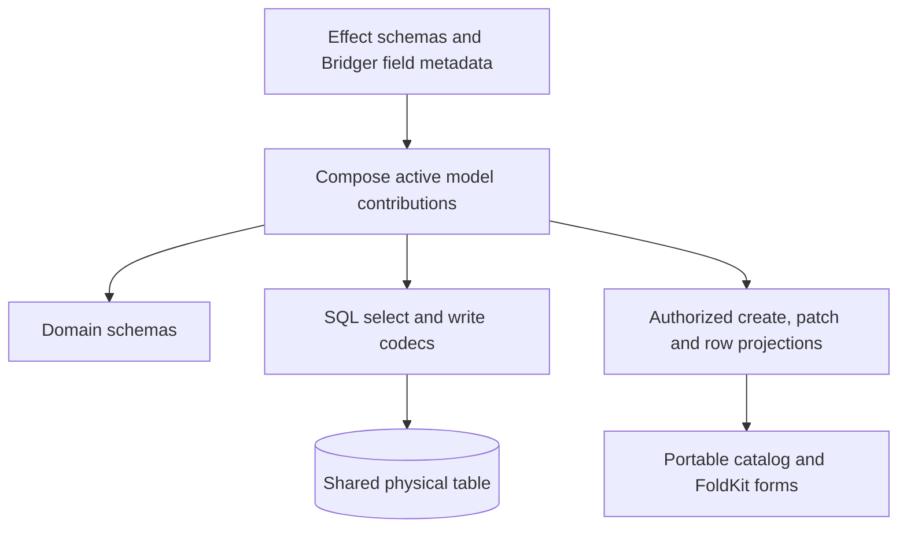

# Bridger ERP: Effect Schema as the model foundation

Status: proposed design refinement; no implementation or type-check. Read alongside [shared models](ERP-MODELS.md) and the [source review](knowledge/EFFECT-SCHEMA-MODEL.md).

## 1. Decision

Use **Effect Schema for value contracts** and **Effect's Model/VariantSchema machinery for representation variants**. Bridger adds field ownership, SQL storage mapping, model composition, permissions, migration history and activation. We should not create a second validation language inside `Field`.

Current source exports `Model` from `effect/schema`; use the alias `SchemaModel` to distinguish it from Bridger's `Model`. Context7 currently also surfaces documentation using the older `effect/unstable/schema/Model` URL. Import paths must follow the pinned release. [Effect schema exports](https://raw.githubusercontent.com/Effect-TS/effect/main/packages/effect/src/schema/index.ts)

```ts
import { Schema } from "effect"
import { Model as SchemaModel, VariantSchema } from "effect/schema"
import { Field, Model } from "@bridger/erp"
```

The latter package is proposed. The aliases clarify responsibilities; plugin authors do not need to use all three directly.

## 2. Schema-first field interface

```ts
const Priority = Schema.Literals(["low", "normal", "high"])

const TaskPlanning = Model.extend(Task, "planning.task", {
  fields: {
    priority: Field.make(Priority, {
      storage: { type: "text" },
      createDefault: "normal",
      ui: { label: "Priority" },
    }),
  },
})

const PlannedTask = Model.compose(Task, [TaskPlanning])
```

`Field.make` is the proposed fundamental constructor. `Priority` describes valid domain values. Storage describes their persistence; UI metadata describes presentation. `createDefault` is typed against the decoded schema type and validated when compiling the definition. It applies on creation only, never to an omitted update field.

The earlier `Field.text({ values: [...], default: ... })` remains convenience syntax compiled to the same representation. It must not implement separate validation semantics. Its `default` maps to `createDefault`, which is a create-pipeline value only: it does **not** create a SQL `DEFAULT`. A database default exists only when a migration declares one explicitly (`sqlDefault` field option), and `default: …` in a frozen migration snapshot records the create default for documentation, not a column default. Trimming and other normalization compile into an explicit Effect codec before refinement checks; a field cannot silently normalize differently in the client and server.

The first version supports deterministic value defaults. Time, actor, company and generated identity are server-owned derivations with explicit request/transaction context. Arbitrary Effectful defaults require a declared execution contract and do not become client code.

For a schema whose decoded and encoded types differ, the field must specify compatible transport and storage codecs. Primitive identity schemas may use registered defaults. An arbitrary custom schema cannot imply a SQL type: decimal precision, collation, timezone handling and foreign keys remain explicit persistence decisions.

## 3. Reuse variants without conflating their contracts

Effect's Model offers `select`, `insert`, `update`, `json`, `jsonCreate` and `jsonUpdate` representations. Bridger needs a deliberate mapping, with projections and authorization applied before publishing client contracts. [Model API](https://www.effect.website/docs/v4/api/effect/unstable/schema/Model)

| Bridger contract | Purpose | Implementation direction |
| --- | --- | --- |
| Internal stored row | Decode SQL driver values into domain values | Storage-specific select codec, including physical nullable extension columns. |
| Authorized `Row` | Typed caller projection | Select requested active fields, authorize, then encode public output. Never publish the full storage schema. |
| Internal insert | Encode a complete initialized row | Defaults and server-owned fields supplied before persistence. |
| Public `Create` | Accept writable user fields | Public create variant, excluding identity, ownership and computed values. |
| Public `Changes` | Partial user patch | Explicit optional keys for writable fields; omission means unchanged. |
| Internal update | Encode selected changed columns | Compiled patch plus derived values and revision, not a full-row replacement. |
| UI catalog schema | Describe an authorized public contract | Portable Schema/JSON Schema representation plus registered widget metadata. |

`SchemaModel.update` does not by itself promise our partial-patch semantics. The registry compiler must construct and verify those semantics explicitly. A public update envelope still includes `id`, `expectedRevision` and `changes`; its shape is not the SQL update payload.



## 4. Missing, null and defaults are distinct

| Value/state | Create | Patch | Storage |
| --- | --- | --- | --- |
| Key omitted | Apply declared create default, or reject if required | Leave unchanged | Adapter does not write omitted patch columns. |
| Explicit `null` | Accept only if domain schema permits null | Clear only a nullable field | Encode SQL NULL through the storage codec. |
| Explicit `undefined` | Reject at JSON ingress; domain calls obey an explicit schema | Do not silently reinterpret as delete | No implicit SQL NULL conversion. |
| Physically NULL inactive extension | Not part of an inactive public model | Extension is not addressable | Retained until activation backfill makes its active contract valid. |

Schema optionality is not the same as SQL nullability. Constructor defaults, decoding defaults, server create defaults and database defaults also execute at different points. The compiler must not substitute one for another. Persisted data is validated after backfill; public output must not silently manufacture a default to conceal incomplete migration.

## 5. Composition and lifecycle

1. Resolve the base owner and enabled contributions; validate qualified field ownership.
2. Build the canonical qualified field map and explicit storage bindings.
3. Derive domain, storage, create, patch and read-projection schemas from that map.
4. Reject conflicting contributions before struct merging. Never use object-spread overwrite as conflict resolution.
5. Check storage compatibility and complete tenant backfill.
6. Fence/drain affected model calls and publish one immutable registry generation.
7. Cache validators/codecs by generation and projection. Retire caches when the owning generation closes.

A `SchemaModel.Class` may be useful for statically known contracts. It does not make an existing TypeScript class acquire fields after a hot installation. Runtime composition uses immutable schema descriptors; `Model.compose` provides a static projection when the extension set is known at compile time. The generated UI consumes a runtime contract.

A base-model caller still triggers all active contributed invariants. Schema decoding validates values; `Records` separately enforces tenant/company, authorization, transaction-level constraints, revision comparison, audit and outbox semantics.

## 6. Reusable features and their limits

- **Generated/read-only variants:** useful for IDs and computed outputs. Keep actor/company/revision derivation server-owned; omission from a JSON schema alone is insufficient protection.
- **Sensitive fields:** schema variants can exclude fields from public representations. Role-dependent permissions still require authorized projections and checks across filters, ordering and export.
- **Annotations:** reuse standard descriptions and labels where appropriate. Permission policy, storage ownership and migration identity remain explicit metadata.
- **Structured schema errors:** preserve paths through `extensions[extensionId][field]` so FoldKit can target the corresponding input. Sanitize failures that might disclose inaccessible data.
- **Schema representation / JSON Schema:** useful for catalog delivery, but executable checks and transformations need a known codec/renderer contract. Do not serialize arbitrary closures.
- **Generated test values and codec checks:** useful for checking valid values and encode/decode behavior. They do not prove SQL constraint equivalence or row authorization.

See the [source review](knowledge/EFFECT-SCHEMA-MODEL.md) for actual APIs and limitations. These are proposed adoption decisions, not assertions that Effect supplies an extensible ORM.

## 6a. Verified Effect v4 Schema primitives (Context7, 2026-10-02)

Checked against Effect v4 documentation (version-specific rc.112 pages and the current API reference). Import paths differ between those sources, so pin the release before copying.

- **Patch schema:** derive `Changes` with `struct.mapFields(Struct.map(Schema.optionalKey))`. `optionalKey` means the key may be omitted; `Schema.optional` also accepts an explicit `undefined`, which section 4 rejects.
- **Defaults:** `Schema.withDecodingDefaultType` / `withDecodingDefaultTypeKey` apply at *decode* time. Do not put `createDefault` into the patch schema this way; an omitted patch key would be filled in. `createDefault` stays a Records create-pipeline step.
- **Values and checks:** `Schema.Literals([...])` (with `.pick`), `.check(Schema.makeFilter(...))` and `Schema.isPattern`.
- **Model variants:** six variants (`select`, `insert`, `update`, `json`, `jsonCreate`, `jsonUpdate`); `Sensitive` is kept in database variants and excluded from every JSON variant.
- **`VariantSchema.make({ variants, defaultVariant })`** returns `Class`, `Struct`, `Union`, `Field`, `FieldOnly`, `FieldExcept`, `extract` and `fieldEvolve`.
- **`SqlModel.makeRepository`:** the ID column must exist in `Type`, `update.Type` and `fields`. It has no tenant, revision or policy options, so Records owns the shared-table SQL.
- **Import paths:** the rc.112 pages place these under `effect/unstable/schema` and `effect/unstable/sql`; current main reportedly uses `effect/schema` and `effect/sql`. Pin first.

`@qadi/core` imports Schema as `effect/Schema` and pins Effect rc.116 exactly; see [knowledge/README.md](knowledge/README.md) for the version conflict.

## 7. Acceptance checks added to the model design

- Verify each supported codec's transport and database round trips separately.
- Decode public input strictly: reject extra fields instead of relying on decoder defaults that can discard them.
- Prove that an omitted patch does not invoke a create default or erase an extension column.
- Prove that public schemas never expose a sensitive or unauthorized field.
- Test inactive nullable storage against active required fields and interrupted backfill.
- Confirm static projection types remain stable after runtime installation.
- Confirm conflicts fail before schema merging and old requests retain their generation's codecs.

Examples remain design sketches until pinned Effect dependencies and implementation tests exist.
