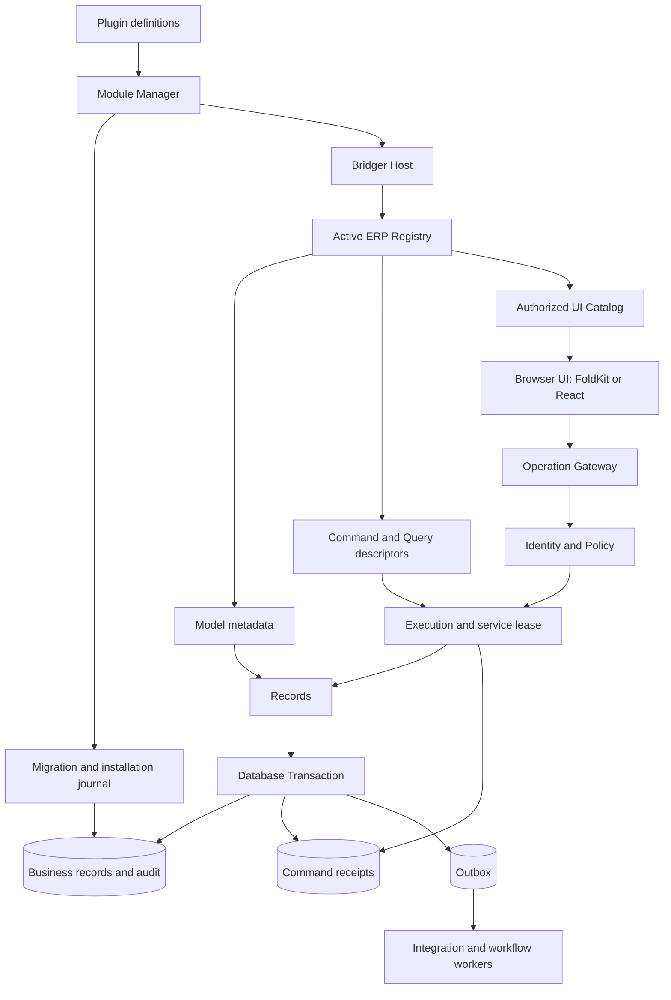
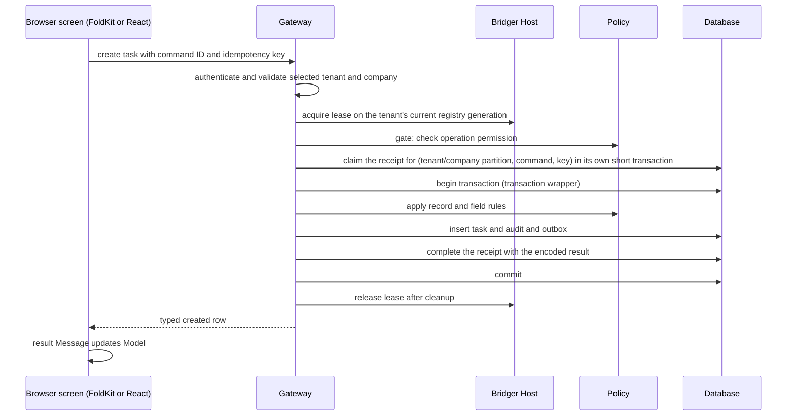
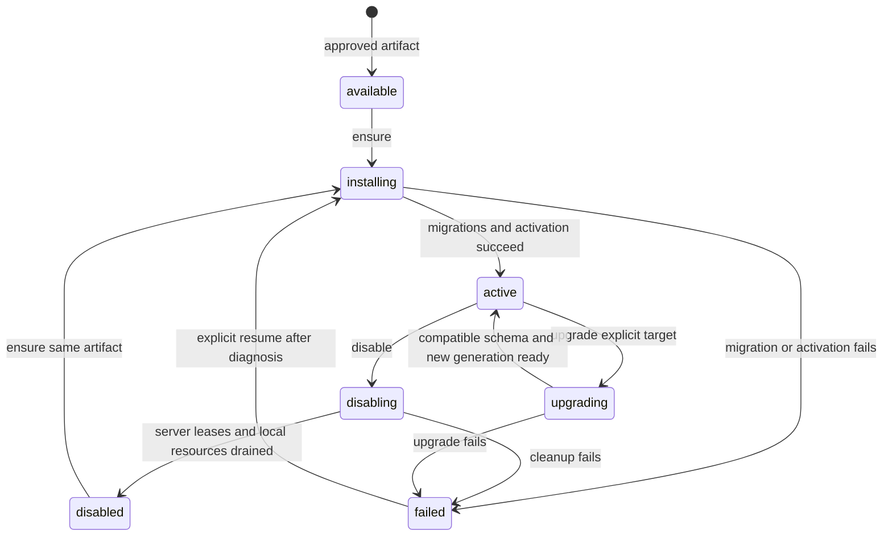

# Bridger ERP — core and public API design

Status: **proposal for review, not implemented or type-checked**. Date: 2026-10-02. Package names, exports, descriptors and signatures in this document are proposed. We retain the project's existing spelling, **Bridger ERP**. The target is the latest stable Effect 4.x (4.1 at the time of the 2026-11-08 revision; this replaces the earlier 4.0 target); unstable modules are used only where a feature needs them.

> **Status banner (2026-11-08): example application, not normative.** This document describes an example ERP application built on Bridger with a server CRUD design: a database row is the source of truth and one server transaction commits each write. It is **not normative** for `@bridger/core` or any companion package, and it is **not the domain layer for local-first or event-sourced systems**; its row-as-truth write path conflicts with event-sourced, offline-first write paths. Such systems build on the [core specification](../references/core/README.md) and the companion specs ([command](../references/command/README.md), [durable-bus](../references/durable-bus/README.md), [federation](../references/federation/README.md), [loader](../references/loader/README.md), [audit-chain](../references/audit-chain/README.md)), and on the event-sourcing companions ([event-store](../references/event-store/README.md), [sequence](../references/sequence/README.md), [keyring](../references/keyring/README.md); Drafts like the others). Where this document and a spec disagree, the spec governs; the [supersession table](ERP-INDEX.md#supersession-table) maps each ERP concept to the spec that now governs it. Nothing here is implemented.

Read [the complete Todo walkthrough](ERP-TODO-WALKTHROUGH.md) first to see the author experience. Permissions and policies are specified in [ERP-ACCESS.md](ERP-ACCESS.md). [Odoo core research](knowledge/ODOO-CORE.md) records the source evidence behind this proposal. The generic plugin runtime is the [core specification](../references/core/README.md); the earlier `SPEC.md` is superseded and kept only as design history. Area specifications: [storage](ERP-STORAGE.md), [identity and tenants](ERP-IDENTITY.md), [module distribution](ERP-DISTRIBUTION.md), [browser shell](ERP-BROWSER.md), [business platform services](ERP-BUSINESS.md), [operations](ERP-OPERATIONS.md), [developer experience](ERP-DX.md); see the [index](ERP-INDEX.md). Authentication is provided by awthaq ([ERP-IDENTITY.md](ERP-IDENTITY.md)); where this document and an area specification differ, the area specification is more detailed.

## 1. What the framework provides

An ERP plugin declares its models, permissions, migrations and screens. Bridger ERP supplies tenant/company context, authorized record access, transactions, audited writes, a versioned operation gateway, and the UI catalog. Effect supplies execution and resource machinery; Bridger supplies plugin activation and service leases; FoldKit or React renders the application (a deployment picks one renderer).

The initial reference topology is a long-lived server process with a relational database and a browser UI rendered with FoldKit or React. The core is dialect-neutral and reaches the database through storage adapters; PostgreSQL is the reference adapter ([ERP-STORAGE.md](ERP-STORAGE.md)). This makes the proposed trusted, in-process hot-install behavior concrete. Multiple replicas and Cloudflare Worker Loader remain supported design directions with additional coordination/transport adapters. Alchemy can provision the deployment independently.

### Package surfaces

| Package or subpath | Caller | Responsibility |
| --- | --- | --- |
| `@bridger/core` | Runtime authors | Generic service dependency graph, activation scopes and leases. |
| `@bridger/erp/contracts` | Plugin authors, browser, clients | **Browser-safe, pure data.** `Model.define` (fields, scope, schemas, operation references), `Model.extend`, `Field`, `Command.contract` / `Query.contract`, permission tokens (`Access.permissions`). No policies, storage, migrations, handlers or database types. |
| `@bridger/erp` | Plugin authors and application assembly (server) | Re-exports contracts and adds `Module`, `Model.serve`, `Command.implement`, `Query.implement`, `Migration`, `Records`, `Erp`. |
| `@bridger/qadi` | Plugin authors and `@bridger/erp` | Thin wrapper over `@qadi/core`: `Access` permissions, roles, model policies, request subject and error mapping. See [ERP-ACCESS.md](ERP-ACCESS.md). |
| `@bridger/erp/ui` | Plugin UI authors | Browser-safe `UiModule` and `View` descriptors; depends only on contracts. |
| `@bridger/erp/client` | Browser or external TypeScript clients | Typed `ErpClient`, commands and queries over the operation gateway; accepts contract references only. |
| `@bridger/erp-storage` | Adapter authors, application assembly | The `StorageAdapter` interface, capability model, portable statement and DDL IR, platform schema, planner, receipts, outbox and the storage conformance suite. No dialect code. |
| `@bridger/erp-postgres` (reference), `-mysql`, `-mssql`, `-sqlite`, … | Application assembly | Dialect adapters: rendering, execution, capabilities, error classification. Any adapter passing the conformance suite can be used. |
| `@bridger/erp-node` | Application assembly | HTTP hosting, authenticated execution context, static assets and process shutdown. |
| `@bridger/erp-ui` | Renderer authors, application UI assembly | Framework-neutral UI core: session and catalog stores, pure state machines (list, form, settings, navigation), effect descriptors, widget descriptors, UI conformance fixtures. No FoldKit or React dependency. |
| `@bridger/erp-foldkit` | Application UI assembly | FoldKit renderer for the ERP shell and built-in widgets, built on `@bridger/foldkit`. |
| `@bridger/erp-react` | Application UI assembly | React renderer for the same shell and widgets, built on `@bridger/react`. A deployment uses one renderer. |

These are conceptual package seams; the final published packaging is open. Browser exports must not pull migration execution, database drivers or server credentials into a bundle. The seam is enforced structurally: `contracts`, `ui` and `client` have no dependency edge to the server entry, `@bridger/qadi`'s policy evaluator or `@qadi/core` policies, and a package-export check in CI fails if one appears. A plugin therefore has a shared contracts module imported by both browser and server, and a server module that attaches access and storage to it (see the Todo layout). `@bridger/erp-foldkit` builds on the generic ideas in [@bridger/foldkit](FOLDKIT-API.md), adding ERP metadata and operations.

## 2. Core modules and seams



| Module | Small public interface | Behavior it owns |
| --- | --- | --- |
| Module Manager | `ensure`, `disable`, `upgrade`, `status` | Durable desired installation state, dependency resolution, schema readiness, activation, retries and generation publication. |
| ERP Registry | Immutable generation snapshot and typed descriptor lookup | Conflict detection, model/operation ownership and consistent publication of available capabilities. |
| Operation Gateway | `query` and `command` | Decode input, authenticate, check enabled generation, authorize, lease, execute, encode results and correlate diagnostics. |
| Records | `list`, `get`, `create`, `update`, `delete` | Scope filters, field rules, parameterized queries, optimistic concurrency and standard record metadata. |
| Policy (`@bridger/qadi` over `@qadi/core`) | Permission tokens, qadi policies, request subject | Operation gates, row predicates compiled to SQL, field projection and consistent enforcement across all entry points. Tenant/company scope is added by Records and is not a plugin policy. See [ERP-ACCESS.md](ERP-ACCESS.md). |
| Transaction | Execute one command unit | Record mutation, audit, outbox and the completion of a successful command receipt share one SQL transaction; the receipt claim commits before it ([ERP-STORAGE.md](ERP-STORAGE.md) §10). |
| UI Catalog | Authorized descriptors and revision changes | Available navigation/screens and compatible UI artifacts; no live server values enter the catalog. |

> **Superseded in part (2026-11-08).** The Operation Gateway and the `Command.contract` / `Command.implement` model are governed by [`@bridger/command`](../references/command/README.md) ([02 — Dispatch](../references/command/behaviors/02-dispatch.md)); the outbox in the Transaction row by [`@bridger/durable-bus`](../references/durable-bus/README.md); the Module Manager's multi-node rollout by [`@bridger/federation`](../references/federation/README.md); per-tenant registry generations by core [33 — Realm families](../references/core/behaviors/33-realm-families.md). See the [supersession table](ERP-INDEX.md#supersession-table).

Every asynchronous method returns an Effect unless explicitly shown as a pure descriptor or Promise-free browser configuration. Pure definition calls never contact a database or install code.

## 3. The plugin author's interface

### Model and fields

Effect Schema is the value-contract foundation. `Field.make(schema, metadata)` accepts a schema directly; the helpers below compile to that same representation. [Schema integration design](ERP-SCHEMA-DESIGN.md) explains Effect Model variants, storage codecs, defaults and partial updates.

A model is defined in two parts. The **contract** is shared pure data; the **server binding** adds access and is the only part that carries policy.

```ts
// contract.ts — browser-safe, imported by server, UI and clients
const TodoPerms = Access.permissions("todo.task", ["read", "write"])

const Task = Model.define("todo.task", {
  scope: "company",
  fields: {
    title: Field.text({ label: "Title", trim: true, minLength: 1, maxLength: 200 }),
    done: Field.boolean({ label: "Done", default: false }),
  },
})

// server.ts — server only
const TaskServed = Model.serve(Task, {
  access: Access.owner(TodoPerms, {
    read: "read", create: "write", update: "write", delete: "write",
  }),
})
```

`TodoPerms` (permission tokens are plain data) comes from `Access.permissions`; see [ERP-ACCESS.md](ERP-ACCESS.md). A `Module` lists served models; a model with no `Model.serve` binding fails module validation, so no model can be exposed without access rules.

`Model.define` produces immutable metadata, schemas `Id` / `Row` / `Create` / `Changes`, and typed operation references:

| Reference | Input | Result |
| --- | --- | --- |
| `Task.queries.list` | `ListQuery`: filter expression (`where`), `search`, up to three sort keys, bounded `limit`, optional `cursor`, optional `expand` and bounded `count` ([ERP-RECORDS.md](ERP-RECORDS.md) §5) | `{ items, nextCursor }`; no count by default. |
| `Task.queries.get` | `{ id }` | One readable row or `RecordNotFound`. |
| `Task.commands.create` | Writable fields; fields with defaults are optional | Created row, starting at revision 1. |
| `Task.commands.update` | `{ id, expectedRevision, changes }` | Updated row with incremented revision. |
| `Task.commands.delete` | `{ id, expectedRevision }` | `{ id }` after deletion. |

The full `Records` interface, constraints, computed fields, hooks, relations, queries and aggregates, module data, inter-module services, sequences, settings, money and translations are specified in [ERP-RECORDS.md](ERP-RECORDS.md). The reserved names also include the envelope key `i18n` for translations.

Every model also gets reserved server-owned fields: `id`, `tenantId`, `companyId` for company scope, `revision`, `createdAt`, `updatedAt`, `createdBy`, and `updatedBy`. IDs are opaque strings, timestamps are UTC values with schema-defined transport encoding, and revision is an integer. Client input cannot set reserved fields. Unknown fields are rejected.

Field definitions default to required unless they declare a default or optionality. `trim` runs before title length validation. The database adapter generates appropriate constraints as part of a reviewed migration, not in an ordinary record write.

`scope: "company"` requires exact tenant and selected-company filtering on every operation. `scope: "tenant"` omits company ownership but still requires tenant filtering. Cross-company reporting uses a separate authorized query; an ordinary filter cannot widen scope.

### Policy semantics

Policies are `@qadi/core` policy values, wrapped by `@bridger/qadi` (see [ERP-ACCESS.md](ERP-ACCESS.md)). `Access.owner` means the actor must hold the specified permission token **and** pass the owner rule, expressed as `allOf([hasPermission(p), hasResourceAttribute("createdBy", eq(subjectId()))])`. Reads, updates and deletes select only rows whose `createdBy` equals the authenticated actor, and the row rule is compiled to SQL (`toPredicate` plus `@qadi/predicate-sql`) rather than filtered after fetch. Creation assigns that actor. Ownership cannot be changed through generated CRUD. Tenant/company restrictions are always additional conditions added by Records, not plugin policies.

Permissions are `resource:action` tokens (for example `todo.task:read`); `:` is not allowed inside either segment. Roles come from qadi's role DAG and only grant permissions. They do not bypass owner or tenant rules. A future manager policy must be explicit. No permission declaration grants itself to a user; provisioning or an administrator assigns a role.

A broken attribute or relationship lookup is a failure (`InternalError`), never a denial. Qadi fails closed: a missing subject holds nothing, and an unwired resolver denies.

Field restrictions apply to filters, sorting, projections, exports and writes. A request for an unauthorized field is rejected; the gateway does not accidentally leak it through a full-row response. A row absent from the caller's authorized scope returns `RecordNotFound` whether it does not exist or belongs to someone else.

### Module

```ts
const TodoModule = Module.define({
  id: "todo",
  version: "1.0.0",
  apiVersion: "1",
  dependsOn: [],
  models: [TaskServed],        // Model.serve(Task, { access })
  migrations: [CreateTasks],
  ui: TodoUi,
  access: {
    permissions: TodoPerms,         // Access.permissions("todo.task", ["read", "write"])
    roles: [TodoUser],              // Access.role("todo.user", { permissions: [...] })
  },
})
```

Models contribute their standard operation references automatically. `ui` attaches a declarative UiModule whose validated descriptors can be sent to the browser as data. A module may additionally declare `commands`, `queries`, `events`, `jobs`, `workflows`, `services`, `sequences`, `settings` and `data` (seeds, enable hooks and data migrations), and `Model.serve` attaches constraints, computed functions and hooks ([ERP-RECORDS.md](ERP-RECORDS.md)). It declares any non-platform Effect requirements for custom handlers; activation must not infer hidden dependencies from runtime failures.

`version` identifies immutable code/schema packaging. `apiVersion` identifies the client operation contract. `dependsOn` declares ERP module version dependencies, whereas generic Bridger `requires` declares live Effect service dependencies. The ERP compiler translates the former into the necessary registry/activation dependencies without conflating the two.

Definitions are validated before publication: duplicate IDs, incompatible fields, missing permissions, unresolved references, dependency cycles and invalid operation result schemas fail activation. Publication changes one registry generation; partially registered routes or screens are not visible. The ERP coordinator builds the complete next registry as an immutable value, then publishes it with core's [`Generation`](../references/core/behaviors/20-generation.md) helper (BEH-BR-169–176): new calls get the new value atomically (BEH-BR-170), calls already admitted finish under the old one (BEH-BR-172), and `closeAdmission` (BEH-BR-171) plus the retired value's bounded `drain` (BEH-BR-173, BEH-BR-174) give the close-drain-switch sequence for incompatible changes. A plugin whose validators or handlers an old generation references is removed only after that generation has drained.

## 4. Request execution and transactions

> **Row-as-truth write path.** This section keeps the server CRUD model: the business row is the source of truth and one server transaction commits the row, its audit entry, its outbox entry and the completion of its receipt. **This conflicts with event-sourced, offline-first write paths**, where facts are appended locally (often offline), rows are derived projections and an authority orders and re-checks facts later. Such systems should not use this path; see the status banner. The gateway steps below are governed by [`@bridger/command`](../references/command/README.md) and the outbox by [`@bridger/durable-bus`](../references/durable-bus/README.md).



Idempotency follows the command companion ([BEH-CM-041](../references/command/behaviors/06-receipts-wrappers-and-breakers.md)): the key travels as `DispatchOptions.idempotencyKey`, and the application supplies the `CommandReceipts` port that [ERP-STORAGE.md](ERP-STORAGE.md) §10 implements. The claim is made at dispatch step 6, after the gate and the before-hooks, in its own short transaction. A repeat is therefore always judged again under current permissions, and a request whose key is still running is refused with `IdempotencyConflict { reason: "in-flight" }` instead of waiting. Receipts are scoped by (partition, command, key); the application's `receiptPartition` returns `<tenant>/<company>` from the scope annotation every ERP dispatch site adds to the request (the gateway, a subscription handler, the job runner, a workflow activity), and every call of the port receives the services it may use, including the transaction to write through, instead of reading fiber-local state (ERP-STORAGE §10). Another actor's use of the key, other input, or another definition of the command (after an upgrade) fails with `IdempotencyConflict` naming the reason. A completed receipt returns its stored outcome, the success or the typed error, marked as replayed, without running the handler. Receipt retention and the in-flight expiry must be configured (ERP-STORAGE §10, §13).

Each write command has one SQL commit point. The transaction wrapper, first in `handlerWrappers` ([BEH-CM-042](../references/command/behaviors/06-receipts-wrappers-and-breakers.md)), opens it; the business rows with their actor and company metadata, the audit record, the durable-bus envelopes and the completion of a successful receipt commit in it together. Failure before commit rolls them back, and the package releases the claim, so a retry with the same key runs again. Success-before-response network failure is resolved by retrying the same key. A typed failure such as a revision conflict is a stored outcome: a retry with the same key returns it again, and a deliberately new attempt uses a new key. Typed errors a retry may clear (`ModelFenced`, `ExtensionUnavailable`, `LockTimeout`, `HookTimeout`, `SerializationConflict`) are listed in every ERP command's `retryable` ([BEH-CM-001](../references/command/behaviors/01-command-definition.md)): they release the claim and are never stored. A durable-bus subscription handler passes its inbox transaction in `DispatchOptions.services`, with the key `${subscription}:${eventId}`, so the command joins it and its receipt commits or rolls back with the delivery; a dispatch that passes none opens its own transaction, whatever its fiber holds (ERP-STORAGE §10).

Queries are read-only, permission-filtered and bounded. Their cursor is opaque and tied to scope, ordering and filter shape. The default list order is `createdAt` descending and then `id`; pagination is a live view unless the caller explicitly requests a snapshot export. `nextCursor` is null at the end.

Commands issued together by the UI (FoldKit Commands or React effects) can run concurrently. Optimistic updates use `expectedRevision`, implemented as a scoped compare-and-update. Two writes against one revision produce one success and one `RevisionConflict`; no silent last-write-wins overwrite. Revision mismatch details are only available after row authorization.

Events are published through [`@bridger/durable-bus`](../references/durable-bus/README.md) inside the command transaction and delivered at least once by its relay; leasing, retry and parking are durable-bus rules, not ERP rules ([ERP-STORAGE.md](ERP-STORAGE.md) §12). Sending mail or charging a payment provider inside a SQL transaction is not rolled back by the database; those integrations need recorded intent and their own reconciliation policy.

## 5. Application assembly and trusted administration

```ts
const storage = yield* Postgres.make({ url: databaseUrl }) // any StorageAdapter, e.g. MySql.make, SqlServer.make
const erp = yield* Erp.make({ storage, loader: ErpNode.moduleLoader() })

yield* erp.tenants.ensure({ id: "demo", name: "Demo" })
yield* erp.companies.ensure({
  tenantId: "demo", id: "main", name: "Main",
  timezone: "Europe/Paris", defaultLocale: "en", functionalCurrency: "EUR",
})
yield* erp.modules.ensure({ tenantId: "demo", module: TodoModule })
yield* erp.access.grantRole({
  tenantId: "demo", actorId: "alice", role: "todo.user", companyIds: ["main"],
})
```

`companies.ensure` takes every value `bridger_companies` requires; none of the timezone, default locale and functional currency has a silent default ([ERP-IDENTITY.md](ERP-IDENTITY.md) §4, §7). `Erp.make` is scoped and owns an ERP coordinator and the process's single Bridger Host, with module activations shared across tenants and one registry `Generation` per tenant ([ERP-RUNTIME.md](ERP-RUNTIME.md)). Administrative methods above are server composition interfaces, not automatically exposed public RPC methods. The HTTP adapter creates a restricted operation gateway. An admin UI needs separately authorized management commands.

`ensure` is idempotent for an already-active identical artifact/version. A different artifact under the same version fails; a different version requires explicit `upgrade`. It returns an installation receipt only when the local tenant generation is ready; on a multi-node deployment it additionally waits for the cluster acknowledgements defined in [ERP-RUNTIME.md](ERP-RUNTIME.md) §9 and [ERP-OPERATIONS.md](ERP-OPERATIONS.md) §3 (a timeout reports lagging nodes as `RolloutIncomplete` and the change continues). Missing module dependencies or failed migrations are typed errors with a durable status entry; an install receipt never means merely "definition recorded". This deliberately differs from generic `Host.install`, which can leave a plugin waiting.


### Administrative operation contracts

All methods return Effects with typed errors; installation receipts include tenant/module identity, version, provenance, artifact digest (nullable for local definitions), and runtime generation.

| Operation | Input | Completion guarantee |
| --- | --- | --- |
| `modules.ensure` | `tenantId` and exactly one of `module` or `artifact` | Requested module is active in the local runtime; identical active installation is reused. |
| `modules.disable` | `tenantId`, `moduleId`, optional `cascade` | A tenant generation without the module published; admitted server calls of the retired generation settled (bounded drain); that generation's scope closed, releasing the tenant's leases on the module activation; durable data retained. The activation itself closes only when no tenant generation and no running workflow uses it ([ERP-RUNTIME.md](ERP-RUNTIME.md) §7). Default cascade is false. |
| `modules.upgrade` | `tenantId`, `moduleId`, approved target `artifact` | Compatibility and migration plan applied, target generation active; shared database schema constraints apply to all affected tenants. |
| `modules.status` | `tenantId`, `moduleId` | Current durable desired/observed state, phase, version, generation and failure details; does not wait for activation. |

An approved artifact descriptor carries module ID, version, immutable URL, content digest and compatibility metadata. `ErpNode.moduleLoader()` verifies bytes before evaluation, resolves shared dependencies and validates the exported module. The descriptor comes from trusted administrative orchestration. It is not accepted from ordinary operation requests. Restart recovery resolves the stored approved artifact references before reopening admission.

The inline `{ module: TodoModule }` form is convenient for source-defined local development. It records local provenance and no artifact digest; a metadata fingerprint is not code integrity verification. Re-running `ensure` with the same version and a changed definition fails with `ArtifactMismatch` unless `{ dev: { replace: true } }` is passed, and production mode refuses inline modules (`InlineModuleForbidden`); see [ERP-DISTRIBUTION.md](ERP-DISTRIBUTION.md) §5. Production artifact identity uses the loader path. The demo bootstrap intentionally reasserts its installation on restart; production bootstrap instead restores persisted desired state after separate provisioning.

The reference design uses one Bridger Host per process. Module code is activated once per dependency closure and shared by tenants; each tenant has a small evictable registry generation that owns its active module set ([ERP-RUNTIME.md](ERP-RUNTIME.md)). Request actor, selected company and authorization state are immutable Effect context values per request, never mutable globals on a module activation. Tenant generations may be evicted while durable desired state remains in the database. In-process trusted code has process privileges; the host layout is resource organization, not a security sandbox.

Many tenants share one process host and one physical database. The schema migration ledger is per physical database and module; enablement is per tenant. Initial table creation happens once, and enabling another tenant does not rerun it. An upgrade must account for every enabled tenant's compatible code/schema window. Database-per-tenant storage adapters use separate migration ledgers.

### HTTP hosting, the gateway wire format and the typed client

`@bridger/erp-node` hosts the gateway and `@bridger/erp/client` calls it. The signatures below are the ones the [Todo walkthrough](ERP-TODO-WALKTHROUGH.md) §7–§9 uses (proposed, not type-checked):

```ts
declare const ErpNode: {
  /** The verifying artifact loader passed to Erp.make (ERP-DISTRIBUTION.md §5). */
  readonly moduleLoader: (options?: ModuleLoaderOptions) => ModuleLoader
  /** The /erp routes (session, catalog, query, command, artifacts) for an application's own router (ERP-IDENTITY.md §8). */
  readonly routes: (options: { readonly erp: Erp; readonly identity: Layer.Layer<Identity, never, any> }) => HttpRouterMiddleware
  /** Binds the socket and serves /erp, the static shell and the health endpoints until interrupted; it never succeeds. */
  readonly serve: (options: ServeOptions) => Effect.Effect<never, ServeError, Scope.Scope>
  /** Runs a program as the process: handles SIGTERM and SIGINT with the shutdown order of ERP-OPERATIONS.md §3 and sets the exit code. */
  readonly runMain: <E>(program: Effect.Effect<unknown, E>) => void
}
// ModuleLoader: ERP-DISTRIBUTION.md §5.
interface ModuleLoaderOptions {
  readonly directory?: string          // where verified artifacts are materialized; default "<app>/.bridger/artifacts"
}
// Adds the /erp routes to an Effect HttpRouter, in the pipe form ERP-IDENTITY.md §8 uses;
// the exact router type is pinned with the Effect 4 release.
type HttpRouterMiddleware = <E, R>(router: HttpRouter.HttpRouter<E, R>) => HttpRouter.HttpRouter<E, R>
interface ServeOptions {
  readonly erp: Erp
  readonly host: string
  readonly port: number
  readonly identity: Layer.Layer<Identity, never, any>   // Identity.awthaq(...) or Identity.development(...), ERP-IDENTITY.md §3
  readonly assets?: { readonly directory: string }        // the built shell, served for paths outside /erp, /auth and /api
  readonly shutdownGrace?: Duration.Input                 // default 30 seconds
}
// ServeError: the socket cannot be bound, or the options are unsafe (Identity.development off loopback,
// production mode with a development identity), checked before binding.

declare const ErpClient: {
  /** Pure: no request is made until an operation runs. */
  readonly make: (options: { readonly baseUrl: string; readonly credentials?: "include" | "same-origin" | "omit"
                             readonly fetch?: typeof globalThis.fetch }) => ErpClient
}
interface ErpClient {
  readonly session: Effect.Effect<SessionSummary, ErpClientError>
  readonly selectCompany: (companyId: string) => Effect.Effect<SessionSummary, ErpClientError>
  readonly catalog: Effect.Effect<Catalog, ErpClientError>                               // ERP-BROWSER.md §4
  readonly query: <I, O, E>(ref: QueryRef<I, O, E>, input: I) => Effect.Effect<O, E | ErpClientError>
  readonly command: <I, O, E>(ref: CommandRef<I, O, E>, input: I,
                              options: { readonly idempotencyKey: string }) => Effect.Effect<O, E | ErpClientError>
}
// The contract objects of @bridger/erp/contracts (e.g. Task.commands.create, Task.queries.list); ERP-BROWSER.md §4
// carries the same id, apiVersion and digest as OperationRef.
interface QueryRef<I, O, E> {
  readonly id: string
  readonly apiVersion: string
  readonly input: Schema.Codec<I, unknown>
  readonly output: Schema.Codec<O, unknown>
  readonly error: Schema.Codec<E, unknown>
}
interface CommandRef<I, O, E> extends QueryRef<I, O, E> {
  readonly digest: string              // the command digest (BEH-CM-005), sent as expectDigest
}
interface SessionSummary {             // GET /erp/session, ERP-IDENTITY.md §4
  readonly actor: { readonly id: string; readonly displayName: string }
  readonly tenantId: string
  readonly companyId: string | null    // the selected company
  readonly companies: ReadonlyArray<{ readonly id: string; readonly name: string }>   // companies the actor holds grants in
  readonly generation: number          // the context generation
}
type ErpClientError =
  | Unauthenticated | Forbidden | ContextRequired | ContextChanged | ModuleUnavailable | ContractMismatch
  | IdempotencyConflict | InternalError
  | TransportError          // no definitive answer (network failure, timeout): ambiguous, retry with the same key
```

The client reads `GET /erp/session` before its first operation, keeps the context generation it was given, and sends it on every query and command; `selectCompany` replaces it. With cookie sessions it uses `@awthaq/client`'s CSRF middleware. A typed error of the operation (`E`) is decoded with the operation's error schema; `replayed` is not surfaced as a different result.

**Command request.** `POST /erp/command`:

| Part | Content |
| --- | --- |
| `Idempotency-Key` header | Required for every command at this gateway (an ERP choice; dispatch itself allows none). 1 to 128 characters from U+0021 to U+007E, as BEH-CM-041 requires; passed to dispatch as `idempotencyKey`. A missing key is `InvalidInput`; a malformed one fails at dispatch step 2 and is mapped to `InvalidInput`. |
| `X-Bridger-Context-Generation` header | The client's context generation ([ERP-IDENTITY.md](ERP-IDENTITY.md) §4). |
| `x-csrf-token` header | Cookie sessions only ([ERP-IDENTITY.md](ERP-IDENTITY.md) §8). |
| Body | `{ "operation": "todo.task.create", "apiVersion": "1", "expectDigest": "sha256:…", "input": { … } }`. `expectDigest` is optional: the command digest the catalog showed, checked at dispatch step 1 ([BEH-CM-009](../references/command/behaviors/02-dispatch.md)). Actor, tenant and company are never read from the body. |

**Query request.** `POST /erp/query` with the same headers except `Idempotency-Key`, and the body `{ "operation", "apiVersion", "input" }`.

**Response.** Every response is JSON with the context generation it was produced under and the correlation id:

```json
{ "ok": true,  "output": { }, "replayed": false, "generation": 4, "correlation": "…" }
{ "ok": false, "error": { "_tag": "RevisionConflict" }, "replayed": true, "retryable": false, "generation": 4, "correlation": "…" }
```

`retryable` appears on every failed command response. It is `true` exactly when no outcome was stored for the key and the same request, with the same key, may succeed later: the claim was never made (`ModuleUnavailable`, an `InternalError` from a platform refusal) or was released (the public forms of the `retryable` typed errors and every `InternalError` that ended a claimed dispatch), or the key is still running (`IdempotencyConflict` with reason `in-flight`). It is `false` for a stored outcome (`replayed: true`, or a typed failure being stored now) and for every answer that needs new input or a new intent. The client retries a `retryable` answer with the same key ([ERP-BROWSER.md](ERP-BROWSER.md) §6).

`replayed` appears on command responses only and is true when a stored receipt supplied the outcome (`CommandOutcome.replayed`, BEH-CM-041). A replayed failure keeps the status of the original.

| Status | `error._tag` |
| --- | --- |
| 200 | Success (`ok: true`), replayed or not. |
| 400 | `InvalidInput`, `InvalidQuery`, `ConstraintViolation`, `ReferenceInvalid`, `ReferenceInUse`, `ContextRequired`; a malformed body or key. |
| 401 | `Unauthenticated`. |
| 403 | `Forbidden`; a CSRF failure. |
| 404 | `RecordNotFound`. |
| 409 | `RevisionConflict`, `IdempotencyConflict` (with `reason`), `ContextChanged`, `ContractMismatch`. |
| 503 | `ModuleUnavailable`, with `Retry-After`. |
| 202 | `ApprovalRequired` with the draft id: the dispatch was deferred for approval (`CommandDeferred`). |
| 500 | `InternalError`, with the correlation id and no cause. |

The gateway maps the command companion's dispatch errors ([02 — Dispatch](../references/command/behaviors/02-dispatch.md)) to these tags; no dispatch error reaches the wire under its own name:

| Dispatch error | Public tag (status) |
| --- | --- |
| `CommandNotFound` | `ModuleUnavailable` (503) when the operation's module is not in the tenant's generation; otherwise `ContractMismatch` (409) |
| `CommandInputInvalid` | `InvalidInput` (400) |
| `ToolChanged` (the `expectDigest` check at step 1), `ToolNotInToolset` | `ContractMismatch` (409) |
| `CommandDeferred` | `ApprovalRequired` (202) |
| `ApprovalMismatch`, `CommandDraftStale` | `ApprovalInvalidated` (409, [ERP-BUSINESS.md](ERP-BUSINESS.md) §15) |
| `CommandVetoed` with cause `"veto"` or `"denied-policy"` | `Forbidden` (403), with the veto code or policy reason in public form |
| `CommandVetoed` with any other cause (a hook failed, timed out, or could not run) | `InternalError` (500), `retryable: true` |
| `CommandRefused` from the gate's `Refuse` (BEH-CM-011; the ERP gate's reasons start with `access-denied`) or with reason `"tainted-session"` | `Forbidden` (403), `retryable: false` |
| `CommandRefused` with a platform reason (`"receipts-unavailable"`, `"gate-defect"`, `"admission-unavailable"`) | `InternalError` (500), `retryable: true`. The ERP configures no admission policy (BEH-CM-044), so no command is refused for a budget |
| `IdempotencyConflict` | `IdempotencyConflict` (409) with `reason` |
| `CommandBreakerOpen`, `CommandTimeout`, `CommandWrapperFailed`, `ContributionUnavailable`, `LeaseRevoked`, `CommandOutputInvalid` | `InternalError` (500), `retryable: true` |

A gate denial is `Forbidden`, as [ERP-ACCESS.md](ERP-ACCESS.md) §6 maps it.

## 6. Durable installation versus runtime activation



The state machine belongs to the ERP Module Manager. Generic plugin state still follows core [04 — States and snapshots](../references/core/behaviors/04-states-and-snapshots.md) (BEH-BR-025–026). Durable status also stores phase, artifact digest, schema version, runtime generation and the underlying cause; it must distinguish migrated-but-not-active from a migration failure.

An install follows this order:

1. Load the approved immutable artifact and validate manifest, dependencies and platform compatibility.
2. Acquire the deployment/module migration lock; record the attempt.
3. Verify immutable migration checksums and execute unapplied migrations under their declared transaction policy.
4. Apply module data: required seeds, enable hooks and data migrations, as the module's system subject ([ERP-RECORDS.md](ERP-RECORDS.md) §6).
5. Ensure the module activation exists in the process host and stage the module's model, operation and UI metadata references for the tenant ([ERP-RUNTIME.md](ERP-RUNTIME.md)).
6. Validate the assembled registry and atomically publish a new tenant generation; mark the installation active.

SQL migration commit and runtime activation cannot be one database transaction. A failure after migration leaves durable recovery state and no falsely active module. Retrying can reuse the completed migration ledger.

`disable` acts on one tenant. It publishes a tenant generation without the module, so new calls of that tenant no longer reach it, then drains the retired generation with a bound (`retired.drain({ timeout, force })`, BEH-BR-173, BEH-BR-174) and closes that generation's scope, which releases the tenant's leases on the module activation. It does not close the activation: activations are shared by every tenant that uses the same closure, and the coordinator reclaims one only when no generation and no running workflow references it, after `moduleIdleGrace` ([ERP-RUNTIME.md](ERP-RUNTIME.md) §7). Running workflows of the module are suspended at `workflowDisableGrace` ([ERP-BUSINESS.md](ERP-BUSINESS.md) §4). `disable` stops dependents or returns `DependentsActive` unless a reviewed cascade was requested. Rows, migrations, command receipts and audit history remain. There is no destructive `uninstall` shortcut in this proposal; data purge is a separate administrative workflow.

UI catalog changes notify browsers. A remote browser does not hold a permanent server lease and cannot block disable forever. Stale browser calls fail with `ModuleUnavailable` or `ContractMismatch`. A browser's own local plugin host coordinates its local widgets and resources; custom-widget unmount completion matters for those local resources. Disconnected clients reconcile the latest catalog before submitting new work.

Upgrades use expansion/migration plus a controlled generation switch. This draft does not promise zero downtime for incompatible upgrades. Cross-replica installation requires desired-generation propagation, admission fencing and readiness acknowledgements before declaring rollout complete; the one-process Todo example does not implement that protocol.

## 7. Migrations are explicit

```ts
const CreateTasks = Migration.createModel("001-create-task", {
  model: "todo.task",
  scope: "company",
  fields: {
    title: Field.text({ trim: true, minLength: 1, maxLength: 200 }),
    done: Field.boolean({ default: false }),
  },
})
```

This is an immutable schema operation descriptor, translated by the storage adapter. It adds standard system fields, tenant/company indexes and the modeled field constraints. The migration definition contains its historical field snapshot; it must not import a live `Task.fields` object that changes in later releases. UI labels do not affect physical schema compatibility.

The module manager checks declared model storage compatibility against migration results. It never silently synchronizes changed model definitions into production tables. SQL migrations use a transaction where supported; online index creation and other nontransactional operations require explicit resumable steps. Failed checks or checksum changes stop activation.

## 8. UI descriptors and custom business operations

```ts
const TodoUi = UiModule.define({
  moduleId: "todo",
  apiVersion: "1",
  views: [View.collection("todo.tasks", {
    model: Task,
    title: "Tasks",
    navigation: { label: "Tasks", order: 100 },
    columns: ["title", "done"],
    form: ["title", "done"],
    actions: ["create", "edit", "delete"],
  })],
})
```

A generated collection supplies list loading, pagination, a create/edit form, delete confirmation, validation errors, pending state and revision-conflict refresh. It calls model operations; it never accesses storage directly. The client generates one idempotency key per user intent and preserves it across transport retries. An explicit new edit is a new intent.

The generic renderers (FoldKit and React) already understand collection descriptors and the supported field catalog. A newly installed Todo plugin therefore appears through catalog data without rebuilding the browser. Only public field schemas and UI metadata cross this seam; policies, migration code and handler functions remain server-side. Unsupported custom field codecs require an explicit renderer contract rather than arbitrary function serialization. Custom executable UI artifacts use a separate approved artifact manifest and local lifecycle adapter.

The server checks the UI module's model/operation references and filters catalog visibility by grants. Visible UI is a convenience, not authorization. A session/company change clears scoped client data, cancels in-flight queries and ignores stale responses using a context generation.

For custom logic, use a named ERP command:

> **Superseded (2026-11-08).** The command model below is governed by [`@bridger/command`](../references/command/README.md): a command is a value with an id and schemas ([01 — Command definition](../references/command/behaviors/01-command-definition.md), BEH-CM-001), its handler is a contribution for the lifetime of a scope (BEH-CM-003), and every caller goes through one dispatch path ([02 — Dispatch](../references/command/behaviors/02-dispatch.md), BEH-CM-009). Approval is a gate `Defer` (BEH-CM-011, core [32](../references/core/behaviors/32-generic-gate-and-plan.md)). The sketch is kept to show the ERP author experience.

> **Mapping to `@bridger/command` (decision D3, [ERP-APOTHEKA-DECISIONS.md](ERP-APOTHEKA-DECISIONS.md), 2026-11-11).** The ERP form below is the author API; the ERP compiles it. `Command.contract(id, { input, output })` becomes `Command.make(id, { input, output, ... })`, with `tags` from the module and `regulated` set for commands that touch a register. `Command.implement(contract, { permission, execute })` becomes `Command.contribute(command, handler)`, where the handler runs `execute(input)` inside a `CommandHandlerWrapper` that supplies the transaction, request context and scoped `Records`; `permission` becomes the command's `permission` option, enforced by the `CommandGate`. The `Idempotency-Key` header becomes the dispatch `idempotencyKey`. Proposed; not implemented.

A command is also two parts. The **contract** (name, input and output schemas) is browser-safe and lives in contracts; the **implementation** (permission, `execute`) is server-only.

```ts
// contract.ts — browser-safe
const CompleteTask = Command.contract("todo.task.complete", {
  input: Schema.Struct({ id: Task.Id, expectedRevision: Schema.Number }),
  output: Task.Row,
})

// server.ts — server only
const CompleteTaskImpl = Command.implement(CompleteTask, {
  permission: TodoPerms.write,
  execute: ({ id, expectedRevision }) => Effect.gen(function* () {
    const records = yield* Records
    return yield* records.update(Task, {
      id, expectedRevision, changes: { done: true },
    })
  }),
})
```

Register the implementation in the owning Module's `commands` array; the client calls the contract. A contract with no implementation in an active module returns `ModuleUnavailable`. ERP `Command` is a server operation descriptor, distinct from FoldKit `Command`, which describes UI work. The gateway supplies its transaction, request context and scoped `Records` interface. Nested record writes share that command transaction. `Records` still enforces model permissions and ownership; adding a command permission does not bypass model rules.

Custom queries follow the same split (`Query.contract` and `Query.implement`) and may only use read interfaces. Custom screens use the UI core's machines and `ErpClient` from either renderer (ordinary FoldKit Model/Message/update/Command code, or React components); schema-typed Ports are the seam for separately loaded UI runtimes. There is no mutation of the shell's static Message union at runtime.

## 9. Extending an existing ERP model

Multiple plugins can contribute to **the same model**, each storing its fields in its own extension table; the base table is never altered. One module owns the base model; other modules register named `Model.extend` contributions in their `extensions` array. `Model.compose` produces a typed projection for callers that know those extensions. Full interfaces, storage rules, lifecycle diagrams and a Planning extension for Todo are in [Shared models and database ownership](ERP-MODELS.md).

The registry compiles the base model and all enabled contributions into one immutable tenant model generation. Every write, including a base-only `Records.update(Task, ...)`, executes that generation's active constraints. A caller's typed projection limits fields it may request; it does not bypass contributed invariants. All fields of a record share one ID and revision; a write to extension fields only still raises the base row's revision.

Extension fields use qualified identities and nested transport names, while the storage adapter maps them to ordinary typed columns of the extension's own table, keyed by the base record's id. Ownership conflicts fail compilation. Contributors cannot silently replace fields, change model scope, weaken authorization or override commands by load order.

Physical schema is shared across tenants; enabled contributions are tenant-specific. A record with no row in an extension table reads as each field's absent value, so enabling writes nothing to existing records; logical requiredness applies from activation on. Database constraints must remain valid for all tenants and stay on the extension's own tables. Schema migrations serialize by the tables they create or alter, never by the base table. Disabling an extension drains calls leasing the composed model and removes its runtime contribution while retaining its table and data.

Computed fields declare dependencies and recomputation plans. Relation definitions specify scope and deletion semantics. Incompatible field changes require explicit migrations and dependent-contract checks. These are proposed ERP responsibilities above the generic Bridger Host.

## 10. Error and recovery contract

| Error | Meaning | Caller behavior |
| --- | --- | --- |
| `Unauthenticated` | No valid identity | Sign in again. |
| `Forbidden` | Scope or operation permission denied (qadi `AccessDenied`, public form) | Show denial; do not retry automatically. |
| `DependentsActive` | Disable refused because dependent modules are active | Disable dependents first or request a reviewed cascade. |
| `ExtensionUnavailable` | Requested extension is disabled or absent | Refresh catalog; request a supported projection. |
| `ModelOwnershipConflict` / `FieldOwnershipConflict` | Module compilation found a duplicate owner | Fix the module definitions; activation fails. |
| `ServiceUnavailable` / `UnknownPlugin` | Generic Bridger host errors surfaced by an adapter | Retry after the provider is active; check the plugin ID. |
| `InvalidInput` | Schema or field validation failed | Show field errors and preserve input. |
| `RecordNotFound` | No row visible in the authorized scope | Refresh or show missing. |
| `RevisionConflict` | Authorized row changed since the supplied revision | Reload and let the user reconcile. |
| `IdempotencyConflict` | The key is in use for this command by another actor, with other input or for another definition, or its first request is still running (`reason`, BEH-CM-041) | `in-flight`: retry later with the same key. Otherwise correct client intent/key handling. |
| `ContextRequired` / `ContextChanged` | No company selected for a company-scoped call, or the call carried an older context generation | Select a company or reload the session; resubmit as a new intent ([ERP-IDENTITY.md](ERP-IDENTITY.md) §4). |
| `ConstraintViolation` / `ReferenceInvalid` / `ReferenceInUse` / `InvalidQuery` | Application constraint, reference rule or query validation failed ([ERP-RECORDS.md](ERP-RECORDS.md) §13) | Show field errors and preserve input. |
| `ModuleUnavailable` | Disabled, stopping or failed generation | Refresh catalog and preserve unsent input. |
| `ContractMismatch` | Client operation contract incompatible | Load a compatible UI artifact. |
| `MigrationFailed` / `ActivationFailed` / `CleanupFailed` | Installation phase failed | Inspect durable phase/cause and explicitly resume. |
| `InternalError` | Unexpected defect, or a failed attribute/relationship lookup or undischarged obligation (never reported as a denial) | Return a correlation ID; retain detailed cause on the server. |

A timeout after commit is an ambiguous result, not proof of failure. Retrying a command must use the original idempotency key. No library finalizer substitutes for compensating a completed business action.

## 11. Deliberate relationship to Odoo

The inspected mechanisms are documented in [ODOO-CORE.md](knowledge/ODOO-CORE.md). The principal mappings are:

| Odoo concept | Bridger ERP proposal |
| --- | --- |
| Addon manifest and module graph | Immutable Module descriptor plus versioned artifact/dependency validation. |
| Registry and Environment | Immutable active registry generation plus per-request Effect context. |
| Models and fields | Typed Model/Field definitions, schemas and authorized Records operations. |
| Access controls and record rules | `@qadi/core` permission tokens and policies (via `@bridger/qadi`), row rules compiled to SQL, plus explicit tenant/company scope. |
| Views, actions and menus | Versioned View descriptors rendered by the ERP browser UI (FoldKit or React renderer). |
| Module schema/data upgrades | Migration journal separated from runtime activation and disable. |
| Python model inheritance | Explicit field/constraint/event/action extension contracts with conflict checking. |

The details are design choices, not a compatibility layer. Odoo has online module operations, but that alone does not prove the code-loading and lease semantics proposed for Bridger.

## 12. Review gates for this API proposal

- The Todo walkthrough must use exactly these interfaces without privileged database shortcuts.
- Verify schema-derived input/output inference, especially defaults, system fields and extension types.
- Exercise two actors and two companies; owner and company filtering must hold for queries and writes.
- Race identical idempotency keys and competing record revisions.
- Fail after migration commit but before activation; ensure the next run recovers without duplicate migration.
- Disable with an in-flight command; the admitted transaction settles before the tenant's generation releases its lease on the module activation, and another tenant using the same activation keeps working.
- A stale or disconnected browser cannot keep a server generation alive or bypass current policy.
- Render diagrams and type-check illustrative programs when implementation prototypes are authorized. At this stage, verification is document consistency and source review.

Change log: 2026-11-08, round-2 agent review fixes — status banner links the event-store, sequence and keyring companions instead of calling event-store "planned, not yet drafted" (R5-20).

Change log: 2026-11-09, audit fixes — §2, §4 and §10: idempotency follows the command companion's receipt port (BEH-CM-041, BEH-CM-042): the claim is taken in its own transaction after the gate, a success completes inside the command transaction, and a concurrent duplicate is refused, not awaited; receipts are scoped by (partition, command, key) through `receiptPartition`, port calls receive `services`, platform errors a retry may clear are `retryable` and never stored, and a subscriber's dispatch joins the inbox transaction (command CCR-CM-004) (E-01). Review fixes: §5 defines `QueryRef`, `CommandRef`, `SessionSummary`, `ModuleLoaderOptions` and `HttpRouterMiddleware`, adds `retryable` to failed command responses, and maps every dispatch error of the command companion to a public tag and status (E-01, E-07). §5 and §6: `modules.disable` drains the tenant generation and leaves activation to ERP-RUNTIME §7, instead of closing activation scopes other tenants share (E-02). Generation and state citations point to the core reference instead of the superseded SPEC.md (E-04). §5 defines `ErpNode`, `ErpClient` and the HTTP wire format, and the `companies.ensure` example passes every required company field (E-07).

Change log: 2026-11-11, extension tables — §9: extension fields live in the extension's own table, never in the base table; absent value, locks and disable follow.

Change log: 2026-11-11, specification audit round 9 (SPEC-AUDIT-09), third pass — §4: a subscription handler passes its inbox transaction in `DispatchOptions.services`; a dispatch that passes none opens its own transaction (command CCR-CM-011; ERP-STORAGE §3.1, §10).
