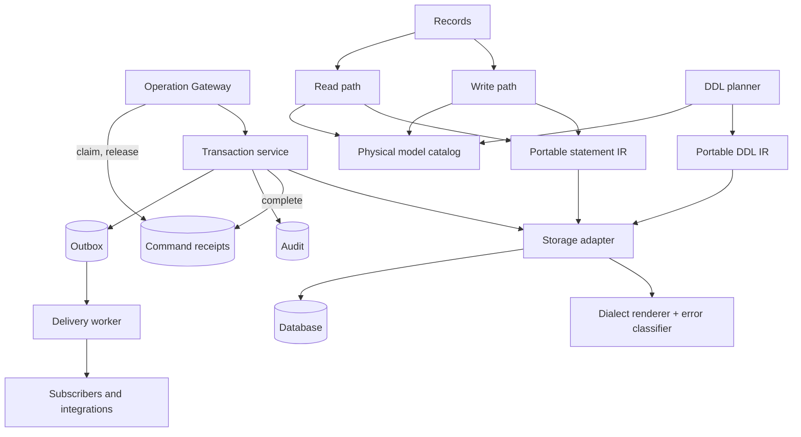
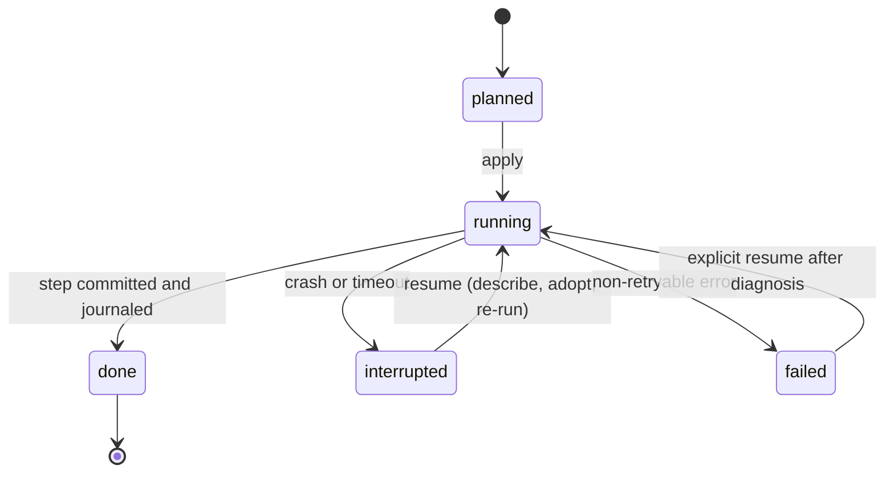

# Bridger ERP: data and storage (dialect-neutral, adapter-based)

Status: **proposal for review, not implemented or type-checked**. Date: 2026-10-02. Package names, interfaces, table names and SQL below are proposed. Effect APIs (`effect/sql` `SqlClient`, `SqlSchema`, `Migrator`, `effect/persistence` `PersistedQueue`) are cited from the [knowledge catalog](knowledge/README.md) entries E29–E32; qadi facts (`toPredicate`, `Predicate`, `@qadi/predicate-sql` supporting PostgreSQL, MySQL and SQLite) from reading `@qadi/core@0.8.0`; none were executed. Per-dialect behavior in §3.5 was checked against vendor documentation on 2026-10-02 (the page lists what is confirmed and what is not); the type mappings in §5 and any per-version minimums remain to be verified at certification. Policy: all packages target the latest stable Effect 4.x (4.1 at the time of the 2026-11-08 revision; this replaces the earlier 4.0 target). This document refines [ERP-SPEC.md](ERP-SPEC.md) §4 and §7 and [ERP-MODELS.md](ERP-MODELS.md) §5.

> **Status banner (2026-11-08): example application, not normative.** This document describes an example ERP application built on Bridger with a server CRUD design: a database row is the source of truth and one server transaction commits each write. It is **not normative** for `@bridger/core` or any companion package, and it is **not the domain layer for local-first or event-sourced systems**; its row-as-truth write path conflicts with event-sourced, offline-first write paths. Such systems build on the [core specification](../references/core/README.md) and the companion specs ([command](../references/command/README.md), [durable-bus](../references/durable-bus/README.md), [federation](../references/federation/README.md), [loader](../references/loader/README.md), [audit-chain](../references/audit-chain/README.md)), and on the event-sourcing companions ([event-store](../references/event-store/README.md), [sequence](../references/sequence/README.md), [keyring](../references/keyring/README.md); Drafts like the others). Where this document and a spec disagree, the spec governs; the [supersession table](ERP-INDEX.md#supersession-table) maps each ERP concept to the spec that now governs it. Nothing here is implemented.

## 1. Decision

The ERP core is **dialect-neutral**. It never emits dialect SQL directly. Every database is reached through a **storage adapter** that implements one interface (§3). PostgreSQL is the **reference adapter** (the first one built and the one the conformance suite is developed against); other dialects (MySQL/MariaDB, SQL Server, SQLite, later Oracle and others) are additional adapters. One deployment uses one dialect.

| Concern | Decision |
| --- | --- |
| Core vs adapter | Core builds portable statements (a small query IR, §4) and a portable DDL IR (§7). The adapter renders and executes them and declares its capabilities. |
| Capabilities | Each adapter declares which capabilities it provides (§3.2). A few are required; the rest have defined fallbacks or make dependent modules refuse to install. |
| Certification | An adapter is certified by the **storage conformance suite** ([ERP-DX.md](ERP-DX.md) §4). Tier 1 = production (full suite including concurrency and crash recovery); Tier 2 = development and test (functional suite only, documented limits). |
| Modules | Modules never write SQL. They use `Records` and the query IR. A module declares the storage capabilities it needs in its manifest (`storage.requires`, [ERP-DISTRIBUTION.md](ERP-DISTRIBUTION.md) §3); the manager refuses to install it on an adapter that lacks them. |
| Isolation | One physical database per deployment, tenant column on every business table (shared schema). Database-per-tenant is a later adapter mode with its own migration ledger. |
| Tenant identity | The tenant ID is the awthaq organization ID ([ERP-IDENTITY.md](ERP-IDENTITY.md)). |
| One commit point | Business rows, audit, outbox and the completion of a successful command receipt commit in one transaction (§9); the receipt claim commits before it, in its own short transaction (§10). |
| Source of truth | **Row-as-truth CRUD.** The current business row is the source of truth; `create`, `update` and `delete` change it in place on the server, and audit and outbox entries are side records of that change (§9, §11, §12). **This conflicts with event-sourced, offline-first write paths**, where an append-only log of facts written locally (often offline) is the truth, rows are derived projections, and an authority orders and re-checks facts later. Such systems should not adopt this write path; they belong on [`@bridger/durable-bus`](../references/durable-bus/README.md) and the [`@bridger/event-store`](../references/event-store/README.md) companion (a Draft, like the others). |
| Moving dialects | Not an adapter feature. Changing a deployment's dialect is an export/import project; the catalog, journals and receipts are per-database state. |
| Authentication storage | awthaq's SQL layer currently supports PostgreSQL and SQLite only. A deployment on another ERP dialect runs awthaq on a separate PostgreSQL or SQLite database, without a shared transaction ([ERP-IDENTITY.md](ERP-IDENTITY.md) §2). |

## 2. Modules and seams



| Package | Contents |
| --- | --- |
| `@bridger/erp-storage` | The `StorageAdapter` interface, capability model, statement and DDL IR, portable platform schema, shared planner/outbox/receipt logic, error taxonomy, and the **conformance suite**. No dialect code. |
| `@bridger/erp-postgres` | Reference adapter (Tier 1). |
| `@bridger/erp-mysql`, `-mssql` | Adapters targeted at Tier 1 (separate certification). |
| `@bridger/erp-sqlite` | Adapter for development and tests (Tier 2). Also used for single-user and embedded scenarios where limits are acceptable. |
| Other adapters | Anyone can publish `@bridger/erp-<dialect>` that passes the conformance suite. |

| Module | Small public interface | Owns |
| --- | --- | --- |
| `Storage` | `transaction`, `catalog`, `planner`, `outbox`, `locks` | Adapter lifecycle, capability negotiation, transaction service. |
| Physical model catalog | `resolve(modelId, generation)` | Model/field → table/column mapping and name allocation. |
| DDL planner | `plan`, `apply`, `resume`, `status` | Serialized schema changes per physical table. |
| Write path | `insert`, `patch`, `remove` | Portable scoped statements with revision compare. |
| Read path | `list`, `get` | Explicit column lists, cursors, predicate composition. |
| Receipts | The command `CommandReceipts` port: `claim`, `complete`, `release`, `void` | Idempotency and retained outcomes; the contract is [`@bridger/command`](../references/command/README.md) BEH-CM-041 (§10). |
| Outbox | Adapter implementation of the durable-bus `OutboxStore` and `InboxStore` ports | Event handoff after commit; the contract is [`@bridger/durable-bus`](../references/durable-bus/README.md) (§12). The earlier `append`, `lease`, `settle` interface is superseded. |

## 3. The storage adapter contract

### 3.1 Interface

```ts
interface StorageAdapter {
  readonly dialect: Dialect                        // descriptor, §3.3
  readonly capabilities: ReadonlySet<Capability>   // §3.2
  readonly tier: 1 | 2
  /** Runs a unit of work in one transaction (isolation per option). */
  readonly transaction: <A, E, R>(
    run: Effect.Effect<A, E, R | Tx>,
    options?: { readonly isolation?: Isolation },
  ) => Effect.Effect<A, E | StorageError, Exclude<R, Tx>>
  /** Executes a portable statement. Rendering and parameter binding are the adapter's job. */
  readonly execute: <A>(s: Statement<A>) => Effect.Effect<Result<A>, StorageError, Tx>
  /** Executes a DDL step (portable DDL IR) and reports what was applied. */
  readonly ddl: (step: DdlStep) => Effect.Effect<DdlResult, StorageError, Tx | DdlRole>
  /** Named, cross-process mutual exclusion; native when available, table-based otherwise. */
  readonly lock: (name: string, options: { readonly wait: Duration; readonly held?: "transaction" | "session" }) =>   // "transaction" (default) requires Tx; "session" pins a connection for the Scope (leader election, long-lived locks)
    Effect.Effect<void, LockTimeout | StorageError, Scope.Scope>   // lock held for the Scope
  /** Claims up to `limit` due rows of the job queue under a lease ([ERP-BUSINESS.md](ERP-BUSINESS.md) §3). */
  readonly claim: (q: ClaimQuery) => Effect.Effect<readonly Row[], StorageError, Tx>
  readonly classify: (cause: unknown) => StorageErrorKind    // §14
  readonly now: Effect.Effect<Instant>                       // database clock when needed
}

Storage.make({ adapter, pool?, rls?, ddlRole? }): Effect.Effect<Storage, StorageError, Scope.Scope>
```

`Tx` is a Context service carrying the current transaction. Repositories and the Records pipeline never open their own transaction; they require `Tx`. Every transaction the transaction service opens also provides durable-bus's `StoreTransaction` ([BEH-DB-009](../references/durable-bus/behaviors/02-transactional-outbox.md)) over the same connection, so `DurableBus.publish`, the command receipts port (§10) and the business writes share one commit. That `StoreTransaction` carries the storage-adapter obligation of [BEH-DB-054](../references/durable-bus/behaviors/07-core-bus-and-adapters.md) property 8: the transaction service runs every function registered with its `onEnd` once the transaction has committed or rolled back, on every exit (success, failure, a failed commit, a defect, an interruption), in registration order, passing "committed" only when the commit succeeded and "rolled-back" otherwise ([BEH-DB-009](../references/durable-bus/behaviors/02-transactional-outbox.md)). `DurableBus.fence` ends its admission there, and a keyring `shred` in a caller's transaction forks its later steps there only on "committed" (keyring BEH-KR-017), so a transaction service that skips or misreports it breaks the whole-store re-bootstrap freeze and the keyring's shred. Conversely, `Storage.transaction` run in a fiber that already holds a `StoreTransaction` (a durable-bus subscription handler, BEH-DB-020) joins that transaction instead of opening one, and provides `Tx` over it. The adapter is typically a thin layer over Effect's `SqlClient` for the chosen driver, so drivers and pooling are reused.

Default isolation is read committed with explicit row predicates and a revision compare. Operations needing stronger guarantees (posting, number sequences) either request `serializable` where the adapter provides it or take a named lock. A retried transaction re-runs only database work; external calls never run inside a retried transaction ([ERP-BUSINESS.md](ERP-BUSINESS.md) §6).

### 3.2 Capabilities

| Capability | Meaning | Required? | If absent |
| --- | --- | --- | --- |
| `transactions` | ACID transactions, at least read committed | **Required** | Adapter cannot be certified. |
| `uniqueConstraints` | Declarative unique indexes with violation errors | **Required** | Cannot be certified. |
| `affectedRows` | Row count of `UPDATE`/`DELETE` | **Required** | Cannot be certified. |
| `rowLocking` | Exclusive row read inside a transaction (the "load for update" step) | **Required** | Cannot be certified. |
| `namedLock` | Native cross-process named lock | Optional | Table-based lock (`bridger_locks`, claimed with a unique-row insert plus a lease and heartbeat) provided by `@bridger/erp-storage`. |
| `returning` | Statement returns the written row | Optional | Re-read the row by key in the same transaction. |
| `skipLocked` | Claim job-queue rows without blocking others | Optional | Optimistic claim of the job queue ([ERP-BUSINESS.md](ERP-BUSINESS.md) §3): update the lease columns where the row is still claimable, and keep rows whose update touched them. |
| `transactionalDdl` | DDL participates in transactions | Optional | Steps run one DDL at a time with journal-before and journal-after; recovery adopts a half-applied step (§7). |
| `onlineIndex` | Index build without blocking writes | Optional | Fence the model during index creation. |
| `partialIndex` | Index with a predicate | Optional | Full index. |
| `nativeJson` | Typed JSON column | Optional | JSON stored as text, decoded in the adapter. |
| `exactDecimal` | Fixed-point decimal arithmetic in SQL | Required for **modules that need it** | Money columns may be stored as text with scale or integer minor units, and SQL aggregation of them is disallowed. Modules that aggregate money in SQL (`storage.requires: ["exactDecimal"]`) refuse to install. |
| `serializable` | True serializable isolation | Optional | Named lock around the critical section. |
| `rowLevelSecurity` | Database-enforced tenant row policy | Optional | Application predicates only. |
| `fullText` | Native full-text search | Optional | External `SearchIndex` adapter ([ERP-BUSINESS.md](ERP-BUSINESS.md) §8). |
| `notify` | Cross-session notification | Optional | Polling (it is only an accelerator, [ERP-OPERATIONS.md](ERP-OPERATIONS.md) §3). |

`Erp.make` validates every enabled module's `storage.requires` against `adapter.capabilities` and fails with `StorageCapabilityMissing` (with the list) before activation.

### 3.3 Dialect descriptor

```ts
interface Dialect {
  readonly name: string                       // "postgres" | "mysql" | "mssql" | "sqlite" | ...
  readonly maxIdentifierBytes: number         // e.g. 63, 64, 128
  readonly quote: (identifier: string) => string
  readonly caseSensitiveIdentifiers: boolean
  readonly types: TypeMap                     // §5
  readonly reservedWords: ReadonlySet<string>
  readonly supportsEmptyStringDistinctFromNull: boolean // false on some dialects (Oracle)
  readonly textComparison: "binary" | "case-insensitive" | "collated"   // how = and LIKE behave on text columns by default
  readonly caseSensitiveKeys: boolean                // id and key columns compare exactly (adapter forces binary collation)
  readonly bucketInstant: (column: ColumnRef, timeZone: string, bucket: "day" | "week" | "month" | "year") => SqlFragment  // timezone-aware date bucketing for aggregates
}
```

Because some dialects treat the empty string as null, the platform uses the sentinel `'*'` (never the empty string) wherever a non-null "all companies" or "tenant-level" marker is needed in a primary key.

### 3.4 Conformance tiers

| | Tier 1 (production) | Tier 2 (development/test) |
| --- | --- | --- |
| Functional suite (CRUD, scope, policy, receipts, outbox, audit, catalog) | Required | Required |
| Concurrency suite (revision races, receipt claim races, lease races of the table-based named lock and of the job-queue claim; outbox delivery races are durable-bus checks) | Required | Skipped where the engine is single-writer; skip list published |
| Crash suite (planner steps, install journal, outbox port obligations under durable-bus redelivery) | Required | Required where feasible |
| Differential suite (memory interpreter vs rendered SQL) | Required | Required |
| Capabilities | Must include all required ones and `namedLock` (native or fallback certified) | May lack `exactDecimal`, `serializable` |

Published adapters state their tier, capabilities and tested database versions. Tier 2 adapters refuse production mode unless `allowTier2InProduction` is set explicitly.

### 3.5 Planned adapters and expected capability profiles

Delivery order: **PostgreSQL (reference) → SQLite → MySQL/MariaDB → SQL Server.** PostgreSQL defines the conformance suite. SQLite comes second because it exercises the fallback paths cheaply (no row locks, no notification, no exact decimal) and gives a zero-install development database. MySQL then adds a dialect without transactional DDL or `RETURNING`, and SQL Server adds a different locking and query-syntax family.

The profiles below were **checked against vendor documentation on 2026-10-02** (see "Verification status" below). They still have to be re-checked per database version when each adapter is certified; minimum versions are fixed at certification.

| Capability | PostgreSQL | SQLite | MySQL / MariaDB | SQL Server |
| --- | --- | --- | --- | --- |
| `transactions` | yes | yes (single writer) | yes (InnoDB only) | yes |
| `rowLocking` | `FOR UPDATE` | no row locks; a write transaction takes the database write lock | `FOR UPDATE` | `UPDLOCK, ROWLOCK` hints |
| `namedLock` | advisory locks (transaction-level or session-level) | table fallback | `GET_LOCK` (session-bound, held on a pinned connection) | `sp_getapplock` (transaction- or session-owned) |
| `returning` | yes | yes (3.35.0+) | no (re-read); MariaDB has it for insert and delete only | `OUTPUT` clause |
| `skipLocked` | yes | not needed (single writer) | yes (MySQL 8.0.1+; MariaDB on InnoDB) | `READPAST` hint (read committed or repeatable read only) |
| `transactionalDdl` | yes | yes | **no** (atomic DDL still implicitly commits) | yes |
| `onlineIndex` | concurrent build | no (fence) | online DDL for most index builds | Enterprise-type editions only (fence on Standard) |
| `partialIndex` | yes | yes (3.8.0+) | **no** (expression key parts exist) | filtered indexes (simple predicates; unique allowed on indexes, not on constraints) |
| `nativeJson` | yes | text + JSON functions | yes | text with a JSON validity check; native type only in SQL Server 2025+ |
| `exactDecimal` | yes | **no** (numeric values become integer or binary floating point) | yes | yes |
| `serializable` | yes | trivially | yes | yes |
| `rowLevelSecurity` | yes (superusers, `BYPASSRLS` roles and table owners bypass unless forced) | no | no | yes (`db_owner` is not exempt) |
| `fullText` | yes | FTS module | yes | optional feature |
| `notify` | yes | no | no | no |
| Target tier | 1 | 2 | 1 | 1 |

Dialect-specific rules the adapters must implement (each one is a conformance case):

- **PostgreSQL (Tier 1, reference).**
  - Platform locks use transaction-level advisory locks where possible; session-level advisory locks survive rollbacks and belong to the connection, so they require a pinned connection and an explicit release.
  - With row-level security enabled, the application role must not own the tables, must not have the bypass attribute, or the tables must be marked to force the policy for owners; the DDL role (the owner) is therefore never used for requests.
  - A failed concurrent index build leaves an invalid index; `resume` detects it, drops it and builds again.
- **SQLite (Tier 2).**
  - Serves development, tests and single-node embedded use. It is one process or machine, so multi-replica rollout is not supported.
  - Booleans are stored as 0/1 and dates and instants as text; money columns use text with scale, and SQL aggregation of them is disallowed; modules requiring `exactDecimal` refuse to install.
  - Write transactions start in immediate mode so the load-then-write step cannot deadlock.
  - Production mode needs the explicit `allowTier2InProduction` setting.
  - awthaq supports SQLite, so awthaq and the ERP may share a database file and transaction.
- **MySQL / MariaDB (Tier 1 target).**
  - Only the transactional storage engine is allowed. The session runs in strict mode with UTC timestamps, and every transaction sets read committed: the engine default is repeatable read, and read committed turns off gap locking except for foreign-key and duplicate-key checks, so concurrent inserts of the same key can still deadlock and are retried through the `Deadlock` classification.
  - Key and unique columns use a binary collation and bounded `varchar` lengths: the default collation is case- and accent-insensitive, and text and blob columns can only be indexed with a prefix (index key size is limited to 767 or 3072 bytes by row format).
  - DDL implicitly commits, so every migration step relies on the journal-bracketed, adopt-on-resume path (§7 rule 4).
  - Named locks belong to the session, are not released by commit or rollback, and several can be held at once; the adapter pins a connection for as long as a lock is held and releases explicitly.
  - No partial indexes: nullable unique columns are not supported for module uniqueness; the planner rejects such a plan.
- **SQL Server (Tier 1 target).**
  - Read committed snapshot isolation may be on or off. When it is on, queue claims with `READPAST` must also name the locking read hint (`READCOMMITTEDLOCK`), because `READPAST` cannot be combined with row-versioned read committed; `READPAST` skips row locks but not page locks and works only at read committed or repeatable read.
  - Row returns use `OUTPUT … INTO` a table variable when the target has enabled triggers, and the returned rows are ignored if the statement failed; the order of returned rows is not guaranteed.
  - Named locks use `sp_getapplock`: transaction-owned by default (it must run inside a transaction), with an explicit timeout always passed (the default waits forever). Resource names are case-sensitive and limited to 255 characters, and a deadlock victim is not rolled back automatically.
  - Pagination uses the dialect's offset/fetch or top syntax, and large `MemberOf` lists are batched because a request is limited to 2,100 parameters.
  - A unique constraint or index allows only one null per column, so uniqueness on nullable columns uses a filtered unique index (a unique constraint cannot be filtered); filtered predicates are limited to simple comparisons.
  - Identifiers may be longer (limit set in the dialect descriptor); the allocation rule is unchanged.
  - Text columns are Unicode (`nvarchar`).

All adapters: UUIDv7 ids are generated in the core, timestamps come from one transaction clock supplied by the core (not a database default), and the same conformance cases apply, with each adapter publishing its skip list and tested versions.

awthaq's SQL layer supports PostgreSQL and SQLite, so those two ERP dialects can share the authentication database. MySQL and SQL Server deployments run awthaq on a separate PostgreSQL or SQLite database ([ERP-IDENTITY.md](ERP-IDENTITY.md) §2).

#### Verification status

Confirmed in vendor documentation:

- **PostgreSQL:** `SKIP LOCKED` and `NOWAIT`; concurrent index builds (a failure leaves an invalid index to drop and rebuild); partial indexes; row security policies and their bypass rules; transaction- and session-level advisory locks; serializable snapshot isolation.
- **SQLite:** `RETURNING` since 3.35.0 (arbitrary row order, not inside triggers); partial indexes since 3.8.0; no fixed-point decimal type (numeric values are stored as integer or binary floating point); no boolean or date types; one write transaction at a time; `BEGIN IMMEDIATE`; schema changes are transactional.
- **MySQL:** `SKIP LOCKED` and `NOWAIT` since 8.0.1; DDL implicitly commits and atomic DDL is not transactional DDL (InnoDB only); `GET_LOCK` semantics; no partial indexes (functional key parts exist); index key length limits and prefix requirement for text and blob; default isolation repeatable read and read-committed gap-lock behavior; default `utf8mb4_0900_ai_ci` collation.
- **MariaDB:** `RETURNING` on insert, delete and replace (not update); `SKIP LOCKED` on InnoDB.
- **SQL Server:** `READPAST`, `UPDLOCK`, `ROWLOCK` and their restrictions; `OUTPUT` and its restrictions; `sp_getapplock` ownership and timeout; filtered indexes including filtered unique indexes; single null in a unique column; 2,100 parameter limit; row-level security including `db_owner`; native `json` type only from SQL Server 2025; online index operations restricted to Enterprise-type editions.

Not yet verified (to be checked at certification): PostgreSQL transactional DDL, `jsonb`, `LISTEN`/`NOTIFY` delivery semantics; the absence of `RETURNING` in MySQL itself; MySQL online DDL, native JSON and `FULLTEXT`; SQL Server full-text search and strict-mode/collation equivalents; SQLite full-text search; per-version minimums for every adapter.

Sources: [PostgreSQL SELECT locking clause](https://www.postgresql.org/docs/current/sql-select.html), [CREATE INDEX](https://www.postgresql.org/docs/current/sql-createindex.html), [row security](https://www.postgresql.org/docs/current/ddl-rowsecurity.html), [explicit locking](https://www.postgresql.org/docs/current/explicit-locking.html); [SQLite RETURNING](https://www.sqlite.org/lang_returning.html), [transactions](https://www.sqlite.org/lang_transaction.html), [partial indexes](https://www.sqlite.org/partialindex.html), [datatypes](https://www.sqlite.org/datatype3.html); [MySQL locking reads](https://dev.mysql.com/doc/refman/8.4/en/innodb-locking-reads.html), [implicit commit](https://dev.mysql.com/doc/refman/8.4/en/implicit-commit.html), [atomic DDL](https://dev.mysql.com/doc/refman/8.4/en/atomic-ddl.html), [locking functions](https://dev.mysql.com/doc/refman/8.4/en/locking-functions.html), [CREATE INDEX](https://dev.mysql.com/doc/refman/8.4/en/create-index.html), [isolation levels](https://dev.mysql.com/doc/refman/8.4/en/innodb-transaction-isolation-levels.html), [character sets](https://dev.mysql.com/doc/refman/8.4/en/charset-mysql.html), [8.0.1 release notes](https://dev.mysql.com/doc/relnotes/mysql/8.0/en/news-8-0-1.html); [MariaDB INSERT RETURNING](https://mariadb.com/kb/en/insertreturning/); [SQL Server table hints](https://learn.microsoft.com/en-us/sql/t-sql/queries/hints-transact-sql-table), [OUTPUT clause](https://learn.microsoft.com/en-us/sql/t-sql/queries/output-clause-transact-sql), [sp_getapplock](https://learn.microsoft.com/en-us/sql/relational-databases/system-stored-procedures/sp-getapplock-transact-sql), [filtered indexes](https://learn.microsoft.com/en-us/sql/relational-databases/indexes/create-filtered-indexes), [unique constraints](https://learn.microsoft.com/en-us/sql/relational-databases/tables/unique-constraints-and-check-constraints), [row-level security](https://learn.microsoft.com/en-us/sql/relational-databases/security/row-level-security), [json data type](https://learn.microsoft.com/en-us/sql/t-sql/data-types/json-data-type).

## 4. Portable statements and rendering

The core builds statements as data, not strings.

```ts
type Statement<A> =
  | { _tag: "Select"; table: TableRef; columns: readonly ColumnRef[]; where: Where; order?: Order; limit?: number; forUpdate?: boolean }
  | { _tag: "Insert"; table: TableRef; values: Record<string, Param>; returning?: readonly ColumnRef[] }
  | { _tag: "Update"; table: TableRef; set: Record<string, Param>; where: Where; returning?: readonly ColumnRef[] }
  | { _tag: "Delete"; table: TableRef; where: Where }

type Where = Predicate /* qadi Predicate: Compare | MemberOf | And | Or | Negate | True | False */
           | { _tag: "Scope"; tenantId: string; companyId?: string } | { _tag: "And"; ... }

// Select also supports (ERP-RECORDS.md §5):
//   joins:     { table, on: [leftColumn, rightColumn], targetPolicy: Where }   // single-valued references, depth <= 2
//   extension: { table, on: [tenant_id, company_id, id, same on the base], columns: [{ column, absent }] }   // left join to an extension table; absent is COALESCEd; emitted only when a column is selected, filtered, sorted or used by a policy
//   aggregate: { groupBy: ColumnRef[]; measures: Measure[]; having?: Where }     // count, sum, avg, min, max
//   text ops:  contains / startsWith / endsWith with escaped wildcards and a declared case behavior
```

- **Predicates come from qadi.** `toPredicate` yields a `Predicate`; the core adds `Scope` and `revision = ?` conditions as further `Where` nodes. Attribute paths are mapped to physical columns through the catalog (§6), not by string. An extension field maps to an expression over the extension table's left join, `COALESCE(column, absent)`, never to a bare column.
- **Rendering.** Each adapter has a renderer from IR to its dialect: placeholders, quoting, limit/offset syntax (`LIMIT`, `FETCH FIRST`, `TOP`), `returning`/`OUTPUT` or fallback, lock hints (`FOR UPDATE`, `UPDLOCK`), and boolean/decimal/date literal handling. `@qadi/predicate-sql` renders predicates for PostgreSQL, MySQL and SQLite; adapters for other dialects supply their own `PredicateRenderer`. A renderer is certified only if the **differential suite** shows it agrees with qadi's reference interpreter `evaluatePredicate` on generated policies and rows.
- **No raw SQL in modules.** Modules use Records, queries and the IR. An escape hatch (`Sql.raw`) exists only inside an adapter-specific extension module that declares `storage.dialects: ["postgres"]`; the manager refuses to activate it on another dialect.
- **Statements are parameterized.** Values never appear in SQL text.

## 5. Portable types

Contracts and the catalog use abstract column types; each adapter maps them.

| Abstract type | Meaning | PostgreSQL | MySQL | SQL Server | SQLite |
| --- | --- | --- | --- | --- | --- |
| `id` | Opaque string key (UUIDv7 text) | `text`/`uuid` | `varchar(36)` | `nvarchar(36)` | `text` |
| `text(n?)` | Unicode text with optional max | `text` / `varchar(n)` | `varchar(n)`/`text` | `nvarchar(n)`/`nvarchar(max)` | `text` |
| `boolean` | | `boolean` | `tinyint(1)` | `bit` | `integer` |
| `integer`, `bigint` | | `integer`, `bigint` | `int`, `bigint` | `int`, `bigint` | `integer` |
| `decimal(p,s)` | Fixed point | `numeric(p,s)` | `decimal(p,s)` | `decimal(p,s)` | text with scale (no `exactDecimal`) |
| `instant` | UTC instant, microsecond precision | `timestamptz` | `datetime(6)` stored UTC | `datetimeoffset(6)` | text ISO-8601 UTC |
| `date` | Calendar date | `date` | `date` | `date` | text |
| `json` | Structured document | `jsonb` | `json` | `nvarchar(max)` + validity check (native `json` from SQL Server 2025) | text |
| `binary` | Bytes | `bytea` | `varbinary`/`blob` | `varbinary(max)` | `blob` |
| `identity` | Auto-increment 64-bit key | identity column | `auto_increment` | `identity` | `integer primary key` |

(The type mappings above are general database knowledge, not yet checked against vendor documentation; SQLite's lack of fixed-point decimals, boolean and date types and SQL Server's native `json` type only from 2025 are confirmed in §3.5.) The adapter owns encode/decode between the abstract type and the driver value; `Field.make` storage hints choose from this closed set (`text`, `boolean`, `integer`, `bigint`, `decimal(p,s)`, `date`, `instant`), never from dialect-specific types. Money uses `decimal(p,s)` decoded as `BigDecimal`; date-only values are `date`, not `instant`.

## 6. Physical model catalog

The catalog is durable metadata about physical storage. It is written by the DDL planner and read by every operation. Runtime registries are rebuilt from it. Table definitions below use abstract types (§5).

| Table | Key | Content |
| --- | --- | --- |
| `bridger_model_catalog` | `model_id` | owning module, scope (`tenant` or `company`), physical table name, created-by migration ID. |
| `bridger_extension_table_catalog` | `(model_id, extension_id)` | physical table name, scope, `status` (`active`, `dormant`, `retired`), created-by migration ID. |
| `bridger_field_catalog` | `field_id` (qualified, e.g. `planning.task.priority`) | model ID, contributor, table (the base table or the extension table), SQL column name, abstract type, nullability, absent value (extension fields), `status` (`active`, `dormant`, `retired`), created-by migration ID. |
| `bridger_migration_journal` | `(module_id, migration_id)` | checksum, state, current step, last error, applied-at. One row set per physical database. |
| `bridger_tenant_activation` | `(tenant_id, extension_id)` | extension version, phase (`pending`, `backfilling`, `fenced`, `ready`, `disabled`), progress cursor, ready-at. |
| Other platform tables | — | Defined with their features: `bridger_external_ids`, `bridger_data_migrations`, `bridger_sequences`, `bridger_settings`, `bridger_translations` ([ERP-RECORDS.md](ERP-RECORDS.md) §12); `bridger_companies`, `bridger_grants`, `bridger_session_context` ([ERP-IDENTITY.md](ERP-IDENTITY.md)); module, artifact and journal tables ([ERP-DISTRIBUTION.md](ERP-DISTRIBUTION.md)). |
| `bridger_dialect_info` | single row | dialect name, adapter version, capabilities seen at creation, catalog schema version, the durable-bus incarnation the database was created under, which decides the `{series}` marker ([ERP-RECORDS.md](ERP-RECORDS.md) §8). A mismatch with the running adapter stops startup (`DialectMismatch`). |

### Name allocation

Identifiers are allocated **once** and recorded; never recomputed from labels or module versions.

1. Table: `m_` + model ID with `.` → `_`, lowercased, restricted to `[a-z0-9_]`.
2. Base-model column: the field name in snake case.
3. Extension table: `x_` + extension ID segment + `__` + base model ID with `.` → `_`. Its columns are the field names in snake case, with no prefix.
4. If the result exceeds `dialect.maxIdentifierBytes` (counting bytes, not characters), truncate and append `_` + the first 8 hex characters of the SHA-256 of the qualified field ID. Allocation is **dialect-independent in structure** but uses the running dialect's limit; the allocated name is stored, so a later change of limit never renames anything.
5. On collision with an existing catalog entry or a name in `dialect.reservedWords`, append a numeric suffix and record it. Allocation takes the catalog's name lock (§7), never a lock on a base table.
6. Reserved columns (`id`, `tenant_id`, `company_id`, `revision`, `created_at`, `updated_at`, `created_by`, `updated_by`) are never allocated to a field.
7. Case: names are lowercase ASCII, so case-insensitive and case-sensitive dialects behave identically.

A rename is an explicit identity-preserving catalog update, never a drop plus add. Two active fields never share a column.

### Standard columns

Every model table has `id`, `tenant_id`, `company_id` (not null for company scope), `revision` (integer, starts at 1), `created_at`, `updated_at` (`instant`), `created_by`, `updated_by`. Indexes: `(tenant_id, company_id, created_at, id)` for default listing and `(tenant_id, company_id, created_by)` when the model's access uses an owner rule. Foreign keys to `bridger_companies` are `(tenant_id, company_id)`.

An extension table has `tenant_id`, `company_id` (not null for company scope), `id` (the base record's id; the primary key with the scope columns), `created_at` and `updated_at`. It has no `revision` of its own (the base row's revision covers the record) and no foreign key to the base table, and it carries the same tenant policy where row-level security is enabled (§12). Its indexes lead with the scope columns.

## 7. DDL IR and planner

`Migration.createModel` and `Migration.extendModel` ([ERP-SPEC.md](ERP-SPEC.md) §7, [ERP-MODELS.md](ERP-MODELS.md) §2) compile to portable **steps**. The planner owns ordering, locking and recovery; the adapter renders each step.

```ts
interface Planner {
  readonly plan: (input: PlanInput) => Effect.Effect<Plan, PlanRejected>
  readonly apply: (plan: Plan) => Effect.Effect<ApplyReceipt, MigrationFailed>
  readonly resume: (moduleId: string) => Effect.Effect<ApplyReceipt, MigrationFailed | NothingToResume>
  readonly status: (moduleId: string) => Effect.Effect<MigrationStatus>
}

type DdlStep =
  | { kind: "create-table"; table: string; columns: readonly ColumnDef[]; primaryKey: readonly string[] }
  | { kind: "add-column"; table: string; column: ColumnDef }              // nullable
  | { kind: "create-index"; table: string; name: string; columns: readonly string[]; unique?: boolean; where?: Predicate }
  | { kind: "add-constraint"; table: string; name: string; check: ConstraintDef; deferred?: boolean }
  | { kind: "backfill"; table: string; column: string; value: Param; batch: number }
  | { kind: "validate"; table: string; name: string }
```

Every step carries a stable ID within its migration and is **idempotent by construction**: the planner first asks the adapter/catalog whether the object already exists (`describe`), then renders `IF NOT EXISTS`-style guards where the dialect has them, or an introspection check where it does not.

Rules:

1. **Single flight.** `apply` takes the named lock `physical-table:<table>` for each physical table it creates or alters, in sorted order, plus a module-level lock. An extension's plan touches only its own tables, so two plugins extending one model are two plans and neither locks the base table; only the module that owns a model locks that model's table.
2. **Checksums.** Each migration's descriptor is canonicalized and hashed. A changed checksum for an applied migration stops activation (`MigrationChecksumMismatch`).
3. **Step journal.** Before running a step the planner writes `state = running`; after, `state = done`. A crash leaves `running`; `resume` re-executes it.
4. **Transaction policy.** With `transactionalDdl`, a step and its journal update commit together. Without it (several dialects), the step is a single DDL statement bracketed by the journal rows; on `resume` the planner inspects the physical object (`describe`) and **adopts** it if it matches the plan (type, nullability), otherwise fails with `SchemaDrift`. Index builds use the `onlineIndex` form when available, otherwise the model is fenced during the build. An interrupted concurrent build can leave an invalid index (PostgreSQL); `resume` detects it through introspection, drops it and rebuilds.
5. **Expand then contract.** Module migrations are additive: `add-column` is nullable, constraints are added unvalidated then validated where the dialect supports it, and dropping or retyping a column is rejected (`DestructiveStepRejected`). Destructive changes happen only through a reviewed contract plan (§7a). A migration creates or alters only tables its module owns: an extension's fields go to an extension table, never to the base model's table.
6. **Cross-tenant safety.** A plan that adds a constraint is accepted only if it is valid for every tenant row and every retained generation ([ERP-MODELS.md](ERP-MODELS.md) §5): an extension table may carry tenant-scoped unique indexes and check constraints on its own columns, but never a foreign key to another module's table, and triggers are rejected on every table. Partial-index-based uniqueness is allowed only when `partialIndex` exists.
7. **Absent value and backfill.** The value a record with no extension row reads as is the migration's explicit `backfill` entry ([ERP-MODELS.md](ERP-MODELS.md) §5), never a field's create default, so enabling writes no row for existing records and needs no fenced catch-up. A value that must be stored per record (a derived value) is a `backfill` step: tenant-level steps are recorded in `bridger_tenant_activation`, run in batches by primary-key cursor, each in its own short transaction, with a final fenced catch-up (writes to the affected tenant and model are refused with `ModelFenced` for the catch-up only).
8. **Failure after DDL.** DDL committed but catalog or activation not recorded: the next `apply` sees a `running` journal row, uses `describe`, and adopts or fails with `SchemaDrift`.
9. **DDL privilege.** DDL runs under the `ddlRole` connection when the dialect separates roles; the application role has no DDL rights where the adapter can arrange it.



Schema drift check: at startup and on demand, the planner compares the adapter's introspection with the catalog for active models and reports mismatches. It never auto-repairs.

### 7a. Contract plans (destructive changes)

A contract plan removes or retires physical schema that earlier migrations expanded. It is a separate administrative workflow, never part of a module install.

1. **Proposal.** `schema.proposeContract` names the physical model, field IDs or columns to retire, and the reason. The planner records a plan (`bridger_contract_plans`: id, objects, state, proposed_by, approvals, retire_after).
2. **Preconditions** (all checked): no active or retained registry generation on any live node references the field (the module `schema.compatible` window has passed on all nodes, [ERP-OPERATIONS.md](ERP-OPERATIONS.md) §3); no installed dependent module's declared contract uses it; no policy, index, search document or export references the column; for columns holding data, a snapshot export exists or `discardData: true` is explicitly approved; an extension table is retired only when no tenant has its extension enabled or retained, and in a database shared by several tenants a tenant's rows are removed by a tenant-scoped delete instead of retiring the table.
3. **Two approvals** by different administrators with `bridger.schema:contract`.
4. **Soft retire first.** The catalog marks the field `retired` and the column is renamed to `retired_<timestamp>_<original>` (or marked unusable where renaming is not supported). Reads and writes cannot address it. The plan stays `soft-retired` for a retention period (default 30 days). For an extension table the catalog marks the table `retired` and the table is renamed `retired_<timestamp>_<original>`.
5. **Hard drop** after the retention period via a second command that re-checks the preconditions. A plan can be cancelled and the column restored while soft-retired.
6. Every state change is audited. Retyping uses expand (new column), backfill, switch contracts, then retire the old column through this flow.

## 8. Read path

- Every query selects an **explicit column list** built from the active generation's projection plus system columns. A wildcard select is never used, so inactive extension columns can never leak.
- Extension fields are read by a left join to the extension table on `(tenant_id, company_id, id)`, emitted only when a query selects, filters, sorts or applies a policy to one of its fields. A missing row reads as the field's absent value.
- Scope is `tenant_id = ?` plus, for company-scoped models, `company_id = ?`. Both come from the immutable request context, never from client input.
- The row predicate is the qadi `Predicate` for the caller's policy ([ERP-ACCESS.md](ERP-ACCESS.md) §5), with attribute paths mapped to columns through the catalog. An unknown path, or a path for an inactive field, rejects the operation when it is compiled.
- Ordering and filters accept only declared, authorized fields. The default order is `created_at` descending, then `id` descending.
- Cursors are opaque, signed and encode `(scope hash, order, last sort values)`. A cursor from a different scope, order or filter shape is `InvalidInput`.
- Reads use a fresh read-committed snapshot. Export snapshots use the strongest read-only snapshot the adapter offers (`repeatable read` / snapshot isolation) and report the isolation actually obtained.

## 9. Write path

All writes run inside `Storage.transaction`, started by the gateway ([ERP-SPEC.md](ERP-SPEC.md) §4). The portable form of an update is one `Update` statement whose `where` is `Scope ∧ id ∧ rowPredicate ∧ revision = expected`:

```sql
-- rendering of that statement, shown as PostgreSQL (placeholders and RETURNING vary by adapter)
UPDATE m_todo_task
   SET title = $4, done = $5, revision = revision + 1, updated_at = $now, updated_by = $actor
 WHERE id = $1 AND tenant_id = $2 AND company_id = $3
   AND ( created_by = $actor )            -- qadi row predicate, rendered
   AND revision = $expected
RETURNING <explicit column list>;
```

Outcome handling:

| Rows affected | Meaning | Resolution |
| --- | --- | --- |
| 1 | Success | If the adapter lacks `returning`, re-read the row by key in the same transaction. Continue to audit and outbox; the command package completes the receipt after the handler returns (§10). |
| 0 | Missing, out of scope, denied by row policy, or revision mismatch | A second query, `SELECT revision … WHERE id AND scope AND rowPredicate`, runs **only when the first affected 0**: no row → `RecordNotFound`; visible row with a different revision → `RevisionConflict`. Rows the caller cannot see always produce `RecordNotFound`, so existence is not leaked. |

Other rules:

- **Insert** sets `id` (UUIDv7 generated in the core, so no dialect-specific key generation is needed), scope columns, `revision = 1`, `created_by = updated_by = actor`, timestamps from one transaction clock, and applies `createDefault` values for every active extension ([ERP-SCHEMA-DESIGN.md](ERP-SCHEMA-DESIGN.md)), writing each extension's values to its extension table in the same transaction. Only supplied keys are written; an omitted patch key is never written.
- **Active constraints.** For a base-model write that touches an extended record, Records loads the full authorized row with `rowLocking`, validates the merged result, then issues the patch. Models without active constraints use the single statement.
- **Delete** is one `Delete` statement with the same `where` and outcome table. Soft delete is a per-model option (`softDelete: true` adds `deleted_at`), never the default. Extension rows are not touched by it: the owning extension removes them when it handles the delete event ([ERP-RECORDS.md](ERP-RECORDS.md) §4, `detach`).
- **Extension fields.** An update that changes only extension fields still issues the `Update` of the base row, which raises `revision` and sets `updated_*` under the revision check, then upserts the extension row in the same transaction. The extension table has no revision of its own.
- **Uniqueness** uses declarative unique indexes; the adapter's `classify` maps the violation to `UniqueViolation`. Check-then-insert is never used.
- **Nested writes** from a custom command reuse the same `Tx`.
- Reserved columns cannot appear in a `set` list; this is checked before the statement is built.

## 10. Idempotency receipts: the `CommandReceipts` port

> **Governed by [`@bridger/command`](../references/command/README.md)** ([06 — Receipts, wrappers and breakers](../references/command/behaviors/06-receipts-wrappers-and-breakers.md), BEH-CM-041 and BEH-CM-042). This section is the ERP's implementation of the `CommandReceipts` port that the application passes in `CommandCatalogOptions.receipts`; where it and BEH-CM-041 disagree, BEH-CM-041 governs. Withdrawn on 2026-11-09 (E-01): the reservation inside the command transaction, waiting on another request's uncommitted reservation, the receipt identity (tenant, company, actor, command, key), and the rule that a rolled-back transaction leaves no receipt. Also withdrawn after command CCR-CM-004: a port that reads the tenant and company from the dispatching fiber, and conditions a retry can clear carried as defects.

The command package decides when the port is called and what each answer means; the port only stores receipts. The ERP lists its transaction wrapper first in `handlerWrappers` (BEH-CM-042), so the transaction encloses the handler and the completion of a successful receipt. The ERP passes these catalog options (BEH-CM-011, BEH-CM-041):

```ts
// illustrative — not type-checked
CommandCatalogOptions({
  receipts: ErpCommandReceipts,                       // this section
  receiptPartition: (request) =>                      // pure; the gate's request; throws without the annotation
    Option.match(request.annotations.get(ErpAnnotations.Scope), {
      onNone: () => { throw new Error("ErpAnnotations.Scope missing") },
      onSome: ({ tenantId, companyId }) => `${tenantId}/${companyId}`,   // companyId '*' for a tenant-scoped command
    }),
  receiptContext: [StoreTransaction],                 // durable-bus; see "Dispatch from a subscriber"
  handlerWrappers: [erpTransaction, /* audit, … */],  // erpTransaction.provides = [Tx, StoreTransaction]
  receiptGrace: "60 seconds",
})

// core 30 (BEH-BR-289): the key's owner declares its flows once.
const ErpAnnotations = {
  Scope: Annotation.key<{ readonly tenantId: string; readonly companyId: string }>("bridger-erp/scope", {
    schema: Schema.Struct({ tenantId: Schema.String, companyId: Schema.String }),
    combine: (current, _incoming) => current,         // a dispatch never changes the scope it runs in
    monotonic: true,                                  // no API can replace or remove it
    flows: ["gate", "audit"],
  }),
}
```

`ErpAnnotations.Scope` is declared with flows `"gate"` and `"audit"` (core [30 — Operation context annotations](../references/core/behaviors/30-operation-context-annotations.md), BEH-BR-289), so it reaches `CommandRequest.annotations`. **Every ERP dispatch site** runs its dispatch under `Annotation.add(ErpAnnotations.Scope, scope)` for the tenant and company it serves: the gateway, from the request context it resolved ([ERP-IDENTITY.md](ERP-IDENTITY.md) §3); a durable-bus subscription handler, from the event's `tenantId` and `companyId` ([ERP-BUSINESS.md](ERP-BUSINESS.md) §2); the job runner, from the job row's `tenant_id` and `company_id` (ERP-BUSINESS §3); a workflow activity, from its instance's tenant and company (ERP-BUSINESS §4). A handler's nested dispatch inherits the annotation from its fiber. The key is monotonic and its `combine` keeps the current value, so nothing inside a dispatch can move it to another tenant or company; work for another tenant or company is enqueued as a job, which the job runner dispatches under that job's scope. Tenant and company IDs follow the ID rule of [ERP-IDENTITY.md](ERP-IDENTITY.md) §4 (1 to 63 characters from `[A-Za-z0-9._-]`), so a partition is always within the 128 printable characters BEH-CM-041 allows. A dispatch without the annotation is a defect of its dispatch site: `receiptPartition` throws and the package ends it with `CommandRefused { reason: "receipts-unavailable" }` without a claim.

The port never reads fiber-local state. Every call receives `services` (BEH-CM-041), and the port uses a transaction only when it finds one there: the durable-bus `StoreTransaction`, which the ERP transaction service provides over the same connection as `Tx` (§3.1, §12). Without one, the port runs the operation in its own short transaction.

### Scope

BEH-CM-041 scopes a receipt by (partition, command, key) and compares the actor first. The ERP's partition is `<tenantId>/<companyId>`, computed by `receiptPartition` above, with `'*'` as the company of a tenant-scoped command. The port splits the claim's or ticket's `partition` at the `/` into `tenant_id` and `company_id`, so the row key below is exactly (partition, command, key). A partition behaves as a separate receipt store. A key used in tenant A says nothing about tenant B, and a key reused in another company of the same tenant runs as a new request instead of replaying the first company's outcome. Inside a partition the package's rules apply unchanged: another actor's claim fails with `IdempotencyConflict { reason: "actor-differs" }` whatever its input; the same actor with other input gets `input-differs`; the same input after an upgrade changed the command's definition gets `definition-differs`; a task and a value never share a key (`mode-differs`). A partition the port cannot split fails the claim with `ReceiptsUnavailable`, so dispatch ends with `CommandRefused { reason: "receipts-unavailable" }` and no handler runs.

Portable definition (abstract types, §5):

```text
bridger_command_receipts
  tenant_id        id        not null      -- ReceiptClaim.partition, before the '/'
  company_id       id        not null      -- after the '/'; '*' when the command is tenant-scoped
  command_id       text      not null      -- ReceiptClaim.command, e.g. todo.task.create
  client_key       text      not null      -- ReceiptClaim.key: 1 to 128 characters (BEH-CM-041)
  token            id        not null      -- ReceiptTicket.token of the current claim (UUIDv7)
  state            text      not null      -- 'in-flight' | 'completed'
  actor_id         id        not null      -- ReceiptClaim.actorId
  input_digest     text      not null      -- ReceiptClaim.inputDigest
  digest           text      not null      -- ReceiptClaim.digest, the dispatch digest (BEH-CM-005)
  task_id          text      null          -- ReceiptClaim.taskId, when the dispatch runs as a task
  correlation_id   text      not null
  claim_expires_at instant   null          -- ReceiptClaim.expiresAt; null under a "forever" timeout
  outcome_tag      text      null          -- 'Success' | 'Failure' once completed
  outcome          json      null          -- the encoded output or the encoded typed error
  claimed_at       instant   not null
  completed_at     instant   null
  retain_until     instant   null          -- completed_at plus the retention period (§13)
  PRIMARY KEY (tenant_id, company_id, command_id, client_key)
```

### Port operations

| Operation | When the package calls it (BEH-CM-041) | Transaction | What the adapter does |
| --- | --- | --- | --- |
| `claim` | Dispatch step 6, after the gate and the before-hooks (BEH-CM-009) | The `StoreTransaction` in `services` when there is one (a subscriber's inbox transaction); otherwise its own short transaction at read committed, committed before the command transaction opens | (1) Read the row by key with a plain, non-locking read. (2) No row: conflict-ignoring insert of an `in-flight` row with a new token; inserted: answer `Fresh`; not inserted (another claim committed it first): go back to (1). (3) A live row (`in-flight` before `claim_expires_at`, or `completed` before `retain_until`): answer `InFlight` or `Completed` with its committed actor, digests, task id and outcome, writing nothing, and let the package decide the reason. A completion still uncommitted in another request's transaction is not visible, so that row answers `InFlight`. (4) An expired row: take it over with `UPDATE … SET token = <new>, state = 'in-flight', <claim fields> WHERE <partition, command, key> AND token = <token read> AND <still expired>`; one row: answer `Fresh`; zero rows (another claim took it, or a late completion committed): go back to (1). After three rounds without an answer the claim fails with `ReceiptsUnavailable`. |
| `complete` with a `Success` | Innermost, inside every handler wrapper | The `StoreTransaction` in `services`: the package adds the services of the keys the wrappers list in `provides` (BEH-CM-042), and the ERP transaction wrapper declares `provides: [Tx, StoreTransaction]`, so this is the command transaction it opened (or joined). Without one in `services` the port fails with `ReceiptsUnavailable`: a success receipt is never committed apart from its business write | `UPDATE … SET state = 'completed', outcome_tag, outcome, completed_at, retain_until WHERE <partition, command, key> AND token = <ticket token> AND state = 'in-flight'`. Zero rows (the claim expired and another claim took the row) fails with `ReceiptsUnavailable`; the package then fails the dispatch with `CommandWrapperFailed { wrapper: "receipts" }` inside the transaction, which rolls back. |
| `complete` with a `Failure` | After the wrapper chain returned a typed error not listed in `retryable`, outside every wrapper | The `StoreTransaction` in `services` when there is one; otherwise its own short transaction (the command transaction has already rolled back) | The same statement. |
| `release` | Every other end of a fresh claim: breaker or admission refusal (BEH-CM-044), a typed error listed in `retryable`, timeout, revoked lease, wrapper failure or defect (also after `complete` returned), interruption | As `claim`; run uninterruptibly by the package | `DELETE … WHERE <partition, command, key> AND token = <ticket token>`, whether the row is `in-flight` or `completed`. Zero rows is a no-op: a superseded ticket is ignored. `release` has no error channel (BEH-CM-041): a storage failure is logged with the ticket and counted in the receipts metrics, and the key stays `in-flight` until `claim_expires_at` (or until `receipts.clearInFlight`). |
| `void` | A batch rollback or a compensation undid the receipt's effect (command [07](../references/command/behaviors/07-batches-and-long-commands.md), BEH-CM-050) | As `claim` | The same delete; a ticket the port no longer knows is a no-op. |

A storage failure of `claim`, `complete` or `void` is `ReceiptsUnavailable`; `release` reports none (above). The statements are portable IR statements (§4); a conflict-ignoring insert is used where the dialect has one.

**Why the claim reads without locking.** The completion of a `Success` updates the row inside the command transaction and holds its row lock until that transaction ends. A locking read, or an insert that checks the unique index against a row being updated, would make a duplicate wait for that transaction. The plain read sees only committed state at read committed (§3.1), so a duplicate answers `InFlight` at once, and the claim writes only to an absent or expired row. Each dialect must make that read non-blocking: PostgreSQL and MySQL/InnoDB read committed do; SQL Server, where read committed snapshot isolation may be off (§3.5), reads the claim's row under snapshot isolation or requires read committed snapshot on, which the adapter checks at startup. Two waits remain and are bounded by short transactions: an insert can wait for a concurrent claim's own short transaction, and the takeover of an expired row can wait for a late completion of the expired ticket that is still committing. On a single-writer adapter (SQLite, Tier 2) every write, the claim included, waits for the current writer.

### What this means for callers

- **A claim is refused while its key is running, never awaited.** Concurrent identical requests meet only on the unique index, inside the short claim transaction: one gets `Fresh`, and each of the others gets `InFlight`, which the package turns into `IdempotencyConflict { reason: "in-flight" }`. The caller retries later with the same key. No request waits on another request's command transaction (the bounded exceptions are stated under the operations table).
- **A success commits with the business write.** The completion of a `Success` runs inside the command transaction, so it commits or rolls back with the business rows, the audit row and the durable-bus envelopes (§9, §11, §12). If the transaction rolls back after `complete` returned (a later statement, an outer wrapper or the commit itself fails), the package releases the claim, and a retry with the same key runs the handler again.
- **A typed failure is stored and replayed.** A handler's typed error, as declared by the command's `error` schema and not listed in its `retryable`, is completed as a `Failure`. A retry with the same key returns the same error, marked as replayed, without running the handler: a `RevisionConflict`, `ConstraintViolation`, `UniqueViolation`, `ReferenceInvalid`, `ReferenceInUse`, `RecordNotFound` or field-level `Forbidden` comes back unchanged. The client reloads and submits a new intent with a new key ([ERP-BROWSER.md](ERP-BROWSER.md) §6).
- **A condition a retry can clear is a `retryable` typed error, never a stored one.** `@bridger/erp` adds the platform's retryable errors to the `error` schema of every command it builds (`Model.serve` and `Command.contract`) and lists their tags in the command's `retryable` (BEH-CM-001; the list is digested): `ModelFenced`, `ExtensionUnavailable`, `LockTimeout`, `HookTimeout` and `SerializationConflict` (a serialization or commit conflict left after the transaction service's own retries). An author who declares another such condition lists it too; declaring one outside `retryable` is a review error, because a stored `Failure` answers every retry with the same key. These errors release the claim, the transaction rolls back, dispatch returns the error unchanged and the gateway maps it to its public error (§14), and a retry with the same key runs again. A storage outage is not a typed error: the transaction wrapper fails, the package reports `CommandWrapperFailed`, and the claim is released. `ModuleUnavailable` is raised by the gateway before dispatch and never reaches a receipt.
- **A repeat is judged again before an outcome is returned.** The claim runs after the gate, so the current permissions are checked on every repeat, and a stored outcome goes only to the same actor in the same tenant and company. Row policies are not evaluated again against a stored outcome. Outcomes are stored in public encoded form and never hold fields marked sensitive.
- **A crash between claim and completion** leaves the key `in-flight` until `claim_expires_at`: the claim time plus the dispatch's effective timeout plus `receiptGrace` (60 seconds by default). Until then a repeat gets `in-flight`; after it, a new claim takes the row with a new token, and a late `complete` from the stopped dispatch fails because its token no longer matches. Under a `"forever"` timeout the row has no expiry and stays `in-flight` until an administrator clears it (`receipts.clearInFlight`, [ERP-OPERATIONS.md](ERP-OPERATIONS.md) §8). The expiry is compared with the claiming node's `Clock`, so node clocks must agree to well within `receiptGrace`.
- **Dispatch from a subscriber.** A durable-bus subscription handler runs inside the inbox's `StoreTransaction` (BEH-DB-020). When it dispatches a command, it passes the key `${subscription}:${envelope.eventId}` (with a suffix fixed in its code when it dispatches the same command more than once for one envelope). `StoreTransaction` is in `receiptContext`, so the claim, the completion and any release go through the inbox transaction, and the ERP transaction wrapper finds that transaction in the fiber (`Effect.serviceOption(StoreTransaction)`) and provides it, with `Tx` over it, to the handler instead of opening its own (§3.1). The domain write, the receipt and the inbox cursor commit or roll back together: a rolled-back delivery (a `CommitConflict` or a failed attempt, BEH-DB-021) leaves no receipt, so its retry claims `Fresh`.
- **Not exactly once.** A completed receipt never runs its handler again ([INV-CM-007](../references/command/invariants.md#inv-cm-007-a-completed-receipt-never-runs-its-handler-again)). The success receipt and the business write are atomic only because the port writes the completion through the `StoreTransaction` it receives in `services`, which is the transaction the wrapper opened or joined. Effects outside the database follow [ERP-BUSINESS.md](ERP-BUSINESS.md) §6.

Retention: a completed receipt is kept until `retain_until`, by default 24 hours after completion, configurable. A cleanup job deletes rows past it in batches (§13). A claim that meets such a row treats it as absent, so a key reused after the retention period runs as a new request; clients must not reuse keys beyond it.

## 11. Audit

> **Superseded in part (2026-11-08).** Attribution, the audit record and sequence are governed by core [22](../references/core/behaviors/22-attributable-operations.md), [23](../references/core/behaviors/23-audit-sink-and-record.md) and [24](../references/core/behaviors/24-time-ids-and-sequence.md) (BEH-BR-185–216); hash chaining and anchoring by [`@bridger/audit-chain`](../references/audit-chain/README.md). The table below is the ERP's own business audit, a consumer-owned store; it makes no tamper-evidence or ledger claim.

`bridger_audit` is append-only and written in the command transaction.

```text
bridger_audit
  id           identity    primary key
  tenant_id    id          not null
  company_id   id          null
  actor_id     id          not null
  command_id   text        not null
  client_key   text        null
  model_id     text        null
  record_id    id          null
  action       text        not null      -- create | update | delete | custom
  changed      json        not null      -- {qualifiedFieldId: {before?, after}} for permitted-to-audit fields only
  registry_gen integer     not null      -- bigint
  correlation  text        not null
  occurred_at  instant     not null
```

- Platform administration events (artifact approvals and revocations, key changes, grants without a tenant context) are written to the same table with `tenant_id = '*'`, `command_id = 'platform:<name>'` and the administrator as `actor_id`.
- The application role has no `UPDATE`/`DELETE` privilege on this table where the dialect supports privilege separation; retention and purge run under a separate role (§13). Adapters that cannot enforce this report the weaker guarantee in their capability notes.
- Field values are recorded only for fields not marked `audit: "none"`; sensitive fields store a change marker, never values.
- This is the ERP business audit. Authentication events stay in awthaq's `AuditLog` ([ERP-IDENTITY.md](ERP-IDENTITY.md)); the two share `correlation` IDs but are separate stores with separate retention. It is not a legal ledger and is not the telemetry stream.
- Authorization decision traces go to a qadi `DecisionSink`; `@qadi/audit` can be layered on for deployments that need it.

## 12. Tenant isolation and outbox

### Isolation

Application predicates are the primary control. Where the adapter provides `rowLevelSecurity` (PostgreSQL, SQL Server), deployments may enable a database-enforced tenant policy as a second layer; the transaction service sets the tenant session setting at transaction start (mirroring awthaq's `TenantScope.enableRls()` for its own tables). RLS guards against a missing predicate, not against a missing policy; it does not replace the qadi row rules. On PostgreSQL the request role must not be a superuser, hold the bypass attribute or own the tables (unless the policy is forced for owners); on SQL Server `db_owner` is subject to the policy. Without the capability, only application predicates apply, and this is stated in the adapter's capability notes. Platform tables that are cross-tenant (`bridger_model_catalog`, journals) are not under tenant policies.

Extension tables carry the same database tenant policy as base tables, which is why they have the scope columns (§6).

### Outbox (superseded by `@bridger/durable-bus`)

> **Superseded (2026-11-08).** The outbox contract is governed by [`@bridger/durable-bus`](../references/durable-bus/README.md), not by this document: the envelope ([01](../references/durable-bus/behaviors/01-events-and-envelope.md), BEH-DB-001–007), publishing inside the caller's transaction and the `OutboxStore` port ([02](../references/durable-bus/behaviors/02-transactional-outbox.md), BEH-DB-009–015), delivery, acknowledgement, inbox deduplication, retry and parking of failed envelopes ([03](../references/durable-bus/behaviors/03-delivery-and-inbox.md), BEH-DB-017–024), order ([05](../references/durable-bus/behaviors/05-order-and-clocks.md), BEH-DB-033) and replay ([06](../references/durable-bus/behaviors/06-replay-and-snapshots.md)). This application no longer defines its own leases, retry states or dead letters. The earlier text of this section is withdrawn: the `bridger_outbox` table with `leased_until`, `leased_by`, `attempts` and the `pending | delivered | dead` states; the `OutboxStore { append, lease, settle }` interface; the `skipLocked` and optimistic-claim leasing rules; the exhausted-to-`dead` retry rule; and the `bridger_event_handled` table. Durable-bus is itself a Draft specification with nothing implemented.

What the ERP application still layers on top (proposed, not implemented):

- **The storage adapter implements the ports.** Each ERP storage adapter implements durable-bus's `OutboxStore` and `InboxStore` ports over its own tables; durable-bus embeds no SQL (BEH-DB-012). The table layout is the adapter's, as long as it meets the port obligations, and it is checked by the adapter conformance suite (§3.4).
- **One commit point.** A command publishes through `DurableBus.publish` inside the command's transaction (BEH-DB-009, BEH-DB-010), so an event exists if and only if the business change committed, together with the audit row and the completion of a successful receipt (§9, §10).
- **Tenant and ordering key map to the stream.** The ERP chooses the durable-bus stream from the tenant and, when an event declares one, its ordering key, so the only guaranteed order — per origin and stream (BEH-DB-033) — gives per-tenant, per-key order. The exact stream naming is open.
- **Business identity.** The stable per-business-fact key the ERP used as `dedupe_key` becomes part of the event payload; durable-bus deduplicates by envelope position, and a subscriber that must not repeat a business effect still checks that key itself (BEH-DB-024).
- **External effects.** Payment, mail and other external effects do not run in the command transaction. A command records an *intent* event; an integration subscriber performs the call and records the outcome, with its own reconciliation ([ERP-BUSINESS.md](ERP-BUSINESS.md)).
- **Administration.** Parked envelopes and stopped streams (BEH-DB-022) are shown in the ERP admin surface; releasing one is an administrative command with an audit record.
- **Retention.** No envelope is removed before it is acknowledged (BEH-DB-014); how long an acknowledged envelope is retained is an ERP setting (§13).

## 13. Retention and purge

| Data | Default retention | Mechanism |
| --- | --- | --- |
| Command receipts | `retain_until`: 24 h after completion (§10) | Batched delete of completed receipts past `retain_until` by a scheduled job; an `in-flight` row is never deleted by retention, only taken over after `claim_expires_at` (§10). |
| Outbox, acknowledged | 7 days (ERP setting) | Batched delete of acknowledged envelopes only (BEH-DB-014); parked envelopes are kept until released ([durable-bus 03](../references/durable-bus/behaviors/03-delivery-and-inbox.md)). |
| Audit | Deployment-configured (no default purge) | Purge under a separate maintenance role with its own audit record. |
| Sessions, auth audit | awthaq `Retention` | Owned by awthaq. |
| Business rows | Never purged automatically | Disable retains data; purge is a separate reviewed workflow ([ERP-SPEC.md](ERP-SPEC.md) §6). |

Purge jobs delete in bounded batches by key cursor, are idempotent, and record counts in the operations metrics. Batching syntax (`LIMIT`, `TOP`, key ranges) is the adapter's.

## 14. Errors

`adapter.classify(cause)` maps driver errors to a portable kind so the core never inspects vendor error codes.

| Kind | Source | Public mapping |
| --- | --- | --- |
| `StorageError` | Pool, connection, timeout | `InternalError` with correlation ID. |
| `UniqueViolation` | Unique constraint | `InvalidInput` with the field path when declared, otherwise `InternalError`. |
| `ForeignKeyViolation` | Foreign key | `InvalidInput` or `InternalError` depending on whether the relation is declared. |
| `SerializationFailure`, `Deadlock` | Concurrency conflicts | Retried by the transaction service (database work only), then the typed `SerializationConflict`, listed in every ERP command's `retryable` (§10); public `InternalError`, retryable with the same key. |
| `LockTimeout` | Named lock wait | Typed, listed in `retryable` (§10); public `InternalError`, retryable with the same key. |
| `RevisionConflict`, `RecordNotFound`, `IdempotencyConflict` | Write path / receipts | As in [ERP-SPEC.md](ERP-SPEC.md) §10; `IdempotencyConflict` carries the reason of BEH-CM-041. |
| `ReceiptsUnavailable` | Receipt port storage failure (§10) | Dispatch ends with `CommandRefused { reason: "receipts-unavailable" }` at the claim, or `CommandWrapperFailed { wrapper: "receipts" }` at completion; public `InternalError`, retryable with the same key. |
| `ModelFenced` | Backfill catch-up | Typed, listed in `retryable` (§10); public `ModuleUnavailable`, retryable with the same key. |
| `StorageCapabilityMissing`, `DialectMismatch` | Startup validation | Administrative error; the process does not start or the module does not install. |
| `MigrationFailed`, `MigrationChecksumMismatch`, `SchemaDrift`, `DestructiveStepRejected`, `PlanRejected` | Planner | Administrative errors with durable status. |
| `BackfillRequired` | Module compilation: a migration adds a field the extension declares `required` without a `backfill` entry ([ERP-MODELS.md](ERP-MODELS.md) §5) | Administrative error; the module does not install, and no DDL runs. |

## 15. Acceptance checks

These are the checks every adapter must pass (the **conformance suite**), run against each dialect; PostgreSQL is the first.

- Two concurrent updates at one revision: exactly one succeeds in one statement; the other gets `RevisionConflict` only when the row is visible to its caller.
- A row owned by Bob, targeted by Alice's ID: `RecordNotFound`, same timing class as a missing ID.
- The executed statement for a list contains the tenant, company and policy predicates in one parameterized statement and an explicit column list (checked on the rendered statement for each dialect).
- Race 50 identical requests (same actor, command, key and input) on a new key: the handler runs once; there is one business row, one audit row and one completed receipt; each of the other 49 either fails with `IdempotencyConflict { reason: "in-flight" }` or returns the stored outcome marked as replayed, and none waits on the first request's command transaction (on adapters other than single-writer ones). A repeat after completion returns the stored outcome.
- Reuse of one key: other input gives `input-differs`; another actor gives `actor-differs` whatever its input; the same key in another tenant or company runs as a new request.
- A handler that fails with `RevisionConflict` stores the failure: a retry with the same key returns the same `RevisionConflict` without running the handler; a new key runs it.
- A fault at commit after `complete` returned: no business row and no completed receipt remain, the claim is released, and a retry with the same key runs the handler.
- A `ModelFenced` during a backfill catch-up releases the claim and stores nothing; a retry with the same key after the catch-up succeeds. The same holds for `LockTimeout`, `HookTimeout` and `SerializationConflict`, and the review check rejects a command that declares such an error outside `retryable`.
- A subscription handler dispatches a command with the key `${subscription}:${eventId}`; a fault at the inbox commit leaves no business row, no receipt and no cursor advance, and the redelivery claims `Fresh` and commits all three together.
- The same key in two partitions (two tenants, or two companies of one tenant) names two receipts; a `release` or `complete` of one never touches the other.
- Kill the process after a claim commits and before completion: the key answers `in-flight` until `claim_expires_at`, then a new claim runs the handler; a late `complete` of the old ticket fails and leaves the new claim intact.
- Kill the process after a DDL step commits but before the journal write: `resume` adopts the object once; no duplicate table, column or lost value (with and without `transactionalDdl`).
- Two plugins extending one model concurrently: each plan creates its own extension table, neither locks the base table, and the base table is unchanged; catalog names are unique and within `maxIdentifierBytes`.
- Name allocation: two fields whose truncated names collide get distinct stable names; restart preserves them; a changed identifier limit renames nothing.
- Outbox: rollback leaves no event; a committed event is published exactly when the business change commits. Delivery, redelivery after a crash and deduplication are checked by the durable-bus acceptance checks ([durable-bus 08](../references/durable-bus/behaviors/08-testing-and-acceptance.md)) against this adapter's port implementation; the earlier lease-race check is superseded.
- Disable then re-enable a module: catalog, extension tables, values and tenant activation state are preserved.
- The rendered predicate agrees with qadi's reference interpreter on generated policies and rows (differential).
- Capability negotiation: a module requiring `exactDecimal` refuses to install on an adapter without it; a Tier 2 adapter refuses production mode by default.
- Receipts and acknowledged outbox envelopes are removed by retention jobs without touching business rows.
- The empty-string sentinel rule holds: no platform key depends on distinguishing `''` from null.
- A record with no extension row reads as the absent value in a list, a filter, a sort and a row policy, and the rendered statement agrees with qadi's reference interpreter on policies over extension fields (differential).
- Deleting a base record is not blocked by rows in an extension table, whether the extension is enabled or disabled.

These are design acceptance scenarios, not tests already executed.

## 16. Decisions and remaining items

| # | Item | Decision |
| --- | --- | --- |
| 1 | Dialect support | **Adapter-based, dialect-neutral core** (§1). PostgreSQL is the reference adapter; others certify through the conformance suite. |
| 2 | Event ordering keys | **Optional in the first release** (§12); an ordering key selects the durable-bus stream, so order follows BEH-DB-033. |
| 3 | Destructive migrations | **Specified in §7a** as a reviewed contract plan with soft retire before drop. |
| 4 | Partitioning of `bridger_audit` and the adapter's outbox tables (durable-bus port implementation, §12) | **Deferred, adapter-specific.** Tables carry `occurred_at`/`created_at` and tenant-prefixed indexes so partitioning can be added by an adapter that supports it. Trigger: a table exceeds 100 million rows or retention purges exceed their maintenance window. |
| 5 | Storage types in `Field.make` | **The closed abstract set in §5** (`text`, `boolean`, `integer`, `bigint`, `decimal(p,s)`, `date`, `instant`); no dialect-specific types. |
| 6 | CDC / logical replication | **Not supported for external consumers in the first release.** The durable-bus outbox (§12) is the integration contract. |
| 7 | Adapters after PostgreSQL | **SQLite, then MySQL/MariaDB, then SQL Server** (§3.5). Oracle and others can be added later by anyone who passes the conformance suite. |
| 8 | Authentication storage on other dialects | **Separate PostgreSQL or SQLite database for awthaq** until awthaq supports the dialect ([ERP-IDENTITY.md](ERP-IDENTITY.md) §2). Extending awthaq's SQL layer is a possible follow-up. |
| 9 | Driver availability per dialect | **Packages exist.** Effect publishes `@effect/sql-pg`, `@effect/sql-mysql2`, `@effect/sql-mssql`, `@effect/sql-sqlite-node` and `@effect/sql-libsql` (all at 4.0.0 on npm on 2026-10-02; to be re-checked against the Effect 4.1 target of the 2026-11-08 revision). Behavioral readiness of each (pooling, transactions, error codes) is still verified at certification. |

Change log: 2026-11-08, round-2 agent review fixes — status banner links the event-store, sequence and keyring companions; `bridger_event_handled` removed from the platform-table list, as §12 withdraws it (R5-20, R5-22).

Change log: 2026-11-09, audit fixes — §10 rewritten as the ERP's implementation of the command `CommandReceipts` port (BEH-CM-041): receipts scoped by (partition, command, key) with the partition `<tenant>/<company>` computed by `receiptPartition` from the gate's request and the actor compared first; every port call receives `services` and writes through the `StoreTransaction` it finds there, otherwise in its own short transaction (command CCR-CM-004); the claim refused while in flight instead of awaited; typed failures stored and replayed, except the platform's `retryable` errors (`ModelFenced`, `ExtensionUnavailable`, `LockTimeout`, `HookTimeout`, `SerializationConflict`), which release the claim; a dispatch from a subscription joins the inbox transaction with the key `${subscription}:${eventId}`; claim expiry and superseded tickets; §1, §2, §9, §12–§15 follow, and §15 replaces the 50-request race check with the BEH-CM-041 outcome (E-01). §1 links the event-store companion instead of calling it "planned, not yet drafted"; the adapter's `claim` and the `skipLocked` fallback now point at the job queue of ERP-BUSINESS §3, not at the withdrawn outbox leases (E-05). §6 records the durable-bus incarnation the database was created under, which decides the `{series}` marker of sequences (E-06). §7 rule 7 takes the backfill value from the migration's explicit `backfill` entry (E-10). Review fixes: `ErpAnnotations.Scope` is declared with core's `Annotation.key` (flows gate and audit, monotonic) and added by every dispatch site, not only the gateway; the transaction wrapper provides `Tx` and `StoreTransaction`, which §3.1 defines; the claim reads without locking and takes over an expired row with a token-guarded update, so a duplicate never waits for a command transaction; `release` reports no error and a failed one leaves the key in flight until expiry (E-01). §14 lists `BackfillRequired` (E-10).

Change log: 2026-11-11, extension tables — §4 query IR gains a left join to an extension table with an absent value; §6 catalog, name allocation and standard columns cover extension tables (scope columns, no revision, no foreign key to the base table); §7 locks follow the tables touched, a migration creates or alters only tables its module owns, rule 7 is the absent value plus data-migration backfill; §7a retires whole tables and handles shared databases; §8, §9, §12 and §15 follow.
