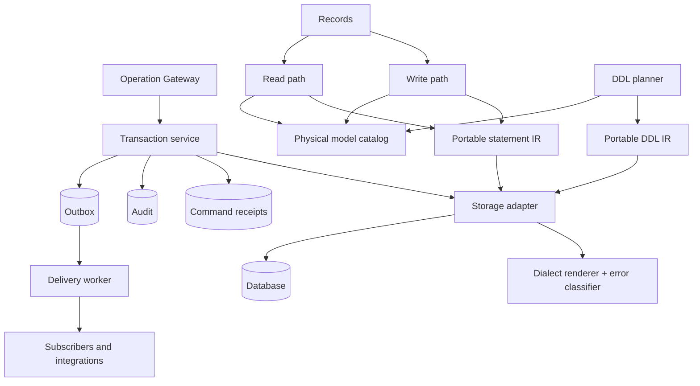
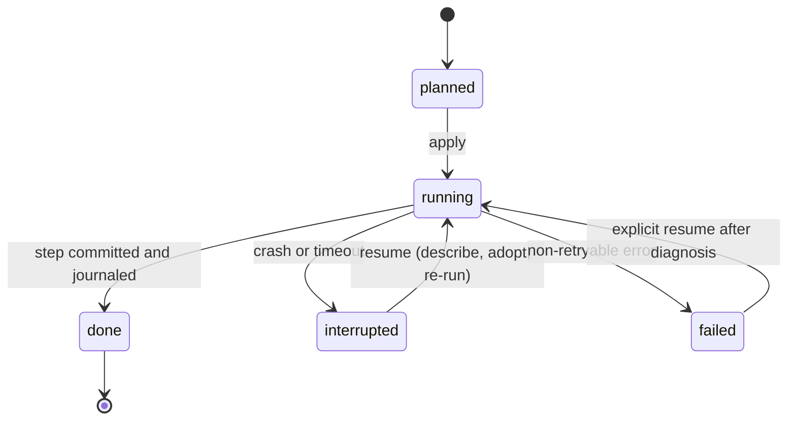

# Bridger ERP: data and storage (dialect-neutral, adapter-based)

Status: **proposal for review, not implemented or type-checked**. Date: 2026-10-02. Package names, interfaces, table names and SQL below are proposed. Effect APIs (`effect/sql` `SqlClient`, `SqlSchema`, `Migrator`, `effect/persistence` `PersistedQueue`) are cited from the [knowledge catalog](knowledge/README.md) entries E29–E32; qadi facts (`toPredicate`, `Predicate`, `@qadi/predicate-sql` supporting PostgreSQL, MySQL and SQLite) from reading `@qadi/core@0.8.0`; none were executed. Per-dialect behavior in §3.5 was checked against vendor documentation on 2026-10-02 (the page lists what is confirmed and what is not); the type mappings in §5 and any per-version minimums remain to be verified at certification. Policy: all packages target the latest stable Effect 4.x (4.0.0 at the time of writing). This document refines [ERP-SPEC.md](ERP-SPEC.md) §4 and §7 and [ERP-MODELS.md](ERP-MODELS.md) §5.

## 1. Decision

The ERP core is **dialect-neutral**. It never emits dialect SQL directly. Every database is reached through a **storage adapter** that implements one interface (§3). PostgreSQL is the **reference adapter** (the first one built and the one the conformance suite is developed against); other dialects (MySQL/MariaDB, SQL Server, SQLite, later Oracle and others) are additional adapters. One deployment uses one dialect.

| Concern | Decision |
| --- | --- |
| Core vs adapter | Core builds portable statements (a small query IR, §4) and a portable DDL IR (§7). The adapter renders and executes them and declares its capabilities. |
| Capabilities | Each adapter declares which capabilities it provides (§3.2). A few are required; the rest have defined fallbacks or make dependent modules refuse to install. |
| Certification | An adapter is certified by the **storage conformance suite** ([ERP-DX.md](ERP-DX.md) §4). Tier 1 = production (full suite including concurrency and crash recovery); Tier 2 = development and test (functional suite only, documented limits). |
| Modules | Modules never write SQL. They use `Records` and the query IR. A module declares the storage capabilities it needs in its manifest (`storage.requires`, [ERP-DISTRIBUTION.md](ERP-DISTRIBUTION.md) §3); the manager refuses to install it on an adapter that lacks them. |
| Isolation | One physical database per deployment, tenant column on every business table (shared schema). Database-per-tenant is a later adapter mode with its own migration ledger. |
| Tenant identity | The tenant ID is the awthaq organization ID ([ERP-IDENTITY.md](ERP-IDENTITY.md)). |
| One commit point | Business rows, audit, outbox and command receipt commit in one transaction (§9). |
| Moving dialects | Not an adapter feature. Changing a deployment's dialect is an export/import project; the catalog, journals and receipts are per-database state. |
| Authentication storage | awthaq's SQL layer currently supports PostgreSQL and SQLite only. A deployment on another ERP dialect runs awthaq on a separate PostgreSQL or SQLite database, without a shared transaction ([ERP-IDENTITY.md](ERP-IDENTITY.md) §2). |

## 2. Modules and seams



| Package | Contents |
| --- | --- |
| `@bridger/erp-storage` | The `StorageAdapter` interface, capability model, statement and DDL IR, portable platform schema, shared planner/outbox/receipt logic, error taxonomy, and the **conformance suite**. No dialect code. |
| `@bridger/erp-postgres` | Reference adapter (Tier 1). |
| `@bridger/erp-mysql`, `-mssql` | Adapters targeted at Tier 1 (separate certification). |
| `@bridger/erp-sqlite` | Adapter for development and tests (Tier 2). Also used for single-user and embedded scenarios where limits are acceptable. |
| Other adapters | Anyone can publish `@bridger/erp-<dialect>` that passes the conformance suite. |

| Module | Small public interface | Owns |
| --- | --- | --- |
| `Storage` | `transaction`, `catalog`, `planner`, `outbox`, `locks` | Adapter lifecycle, capability negotiation, transaction service. |
| Physical model catalog | `resolve(modelId, generation)` | Model/field → table/column mapping and name allocation. |
| DDL planner | `plan`, `apply`, `resume`, `status` | Serialized schema changes per physical model. |
| Write path | `insert`, `patch`, `remove` | Portable scoped statements with revision compare. |
| Read path | `list`, `get` | Explicit column lists, cursors, predicate composition. |
| Receipts | `reserve`, `complete` | Idempotency and retained results. |
| Outbox | `append`, `lease`, `settle` | Durable event handoff after commit. |

## 3. The storage adapter contract

### 3.1 Interface

```ts
interface StorageAdapter {
  readonly dialect: Dialect                        // descriptor, §3.3
  readonly capabilities: ReadonlySet<Capability>   // §3.2
  readonly tier: 1 | 2
  /** Runs a unit of work in one transaction (isolation per option). */
  readonly transaction: <A, E, R>(
    run: Effect.Effect<A, E, R | Tx>,
    options?: { readonly isolation?: Isolation },
  ) => Effect.Effect<A, E | StorageError, Exclude<R, Tx>>
  /** Executes a portable statement. Rendering and parameter binding are the adapter's job. */
  readonly execute: <A>(s: Statement<A>) => Effect.Effect<Result<A>, StorageError, Tx>
  /** Executes a DDL step (portable DDL IR) and reports what was applied. */
  readonly ddl: (step: DdlStep) => Effect.Effect<DdlResult, StorageError, Tx | DdlRole>
  /** Named, cross-process mutual exclusion; native when available, table-based otherwise. */
  readonly lock: (name: string, options: { readonly wait: Duration; readonly held?: "transaction" | "session" }) =>   // "transaction" (default) requires Tx; "session" pins a connection for the Scope (leader election, long-lived locks)
    Effect.Effect<void, LockTimeout | StorageError, Scope.Scope>   // lock held for the Scope
  /** Claims up to `limit` ready rows from a queue-shaped table (§12). */
  readonly claim: (q: ClaimQuery) => Effect.Effect<readonly Row[], StorageError, Tx>
  readonly classify: (cause: unknown) => StorageErrorKind    // §14
  readonly now: Effect.Effect<Instant>                       // database clock when needed
}

Storage.make({ adapter, pool?, rls?, ddlRole? }): Effect.Effect<Storage, StorageError, Scope.Scope>
```

`Tx` is a Context service carrying the current transaction. Repositories and the Records pipeline never open their own transaction; they require `Tx`. The adapter is typically a thin layer over Effect's `SqlClient` for the chosen driver, so drivers and pooling are reused.

Default isolation is read committed with explicit row predicates and a revision compare. Operations needing stronger guarantees (posting, number sequences) either request `serializable` where the adapter provides it or take a named lock. A retried transaction re-runs only database work; external calls never run inside a retried transaction ([ERP-BUSINESS.md](ERP-BUSINESS.md) §6).

### 3.2 Capabilities

| Capability | Meaning | Required? | If absent |
| --- | --- | --- | --- |
| `transactions` | ACID transactions, at least read committed | **Required** | Adapter cannot be certified. |
| `uniqueConstraints` | Declarative unique indexes with violation errors | **Required** | Cannot be certified. |
| `affectedRows` | Row count of `UPDATE`/`DELETE` | **Required** | Cannot be certified. |
| `rowLocking` | Exclusive row read inside a transaction (the "load for update" step) | **Required** | Cannot be certified. |
| `namedLock` | Native cross-process named lock | Optional | Table-based lock (`bridger_locks`, claimed with a unique-row insert plus a lease and heartbeat) provided by `@bridger/erp-storage`. |
| `returning` | Statement returns the written row | Optional | Re-read the row by key in the same transaction. |
| `skipLocked` | Lease queue rows without blocking others | Optional | Optimistic claim: update `state`, `leased_by`, `leased_until` where the row is still claimable, and keep rows whose update touched them. |
| `transactionalDdl` | DDL participates in transactions | Optional | Steps run one DDL at a time with journal-before and journal-after; recovery adopts a half-applied step (§7). |
| `onlineIndex` | Index build without blocking writes | Optional | Fence the model during index creation. |
| `partialIndex` | Index with a predicate | Optional | Full index. |
| `nativeJson` | Typed JSON column | Optional | JSON stored as text, decoded in the adapter. |
| `exactDecimal` | Fixed-point decimal arithmetic in SQL | Required for **modules that need it** | Money columns may be stored as text with scale or integer minor units, and SQL aggregation of them is disallowed. Modules that aggregate money in SQL (`storage.requires: ["exactDecimal"]`) refuse to install. |
| `serializable` | True serializable isolation | Optional | Named lock around the critical section. |
| `rowLevelSecurity` | Database-enforced tenant row policy | Optional | Application predicates only. |
| `fullText` | Native full-text search | Optional | External `SearchIndex` adapter ([ERP-BUSINESS.md](ERP-BUSINESS.md) §8). |
| `notify` | Cross-session notification | Optional | Polling (it is only an accelerator, [ERP-OPERATIONS.md](ERP-OPERATIONS.md) §3). |

`Erp.make` validates every enabled module's `storage.requires` against `adapter.capabilities` and fails with `StorageCapabilityMissing` (with the list) before activation.

### 3.3 Dialect descriptor

```ts
interface Dialect {
  readonly name: string                       // "postgres" | "mysql" | "mssql" | "sqlite" | ...
  readonly maxIdentifierBytes: number         // e.g. 63, 64, 128
  readonly quote: (identifier: string) => string
  readonly caseSensitiveIdentifiers: boolean
  readonly types: TypeMap                     // §5
  readonly reservedWords: ReadonlySet<string>
  readonly supportsEmptyStringDistinctFromNull: boolean // false on some dialects (Oracle)
  readonly textComparison: "binary" | "case-insensitive" | "collated"   // how = and LIKE behave on text columns by default
  readonly caseSensitiveKeys: boolean                // id and key columns compare exactly (adapter forces binary collation)
  readonly bucketInstant: (column: ColumnRef, timeZone: string, bucket: "day" | "week" | "month" | "year") => SqlFragment  // timezone-aware date bucketing for aggregates
}
```

Because some dialects treat the empty string as null, the platform uses the sentinel `'*'` (never the empty string) wherever a non-null "all companies" or "tenant-level" marker is needed in a primary key.

### 3.4 Conformance tiers

| | Tier 1 (production) | Tier 2 (development/test) |
| --- | --- | --- |
| Functional suite (CRUD, scope, policy, receipts, outbox, audit, catalog) | Required | Required |
| Concurrency suite (revision races, idempotency races, lease races, named lock) | Required | Skipped where the engine is single-writer; skip list published |
| Crash suite (planner steps, install journal, outbox redelivery) | Required | Required where feasible |
| Differential suite (memory interpreter vs rendered SQL) | Required | Required |
| Capabilities | Must include all required ones and `namedLock` (native or fallback certified) | May lack `exactDecimal`, `serializable` |

Published adapters state their tier, capabilities and tested database versions. Tier 2 adapters refuse production mode unless `allowTier2InProduction` is set explicitly.

### 3.5 Planned adapters and expected capability profiles

Delivery order: **PostgreSQL (reference) → SQLite → MySQL/MariaDB → SQL Server.** PostgreSQL defines the conformance suite. SQLite comes second because it exercises the fallback paths cheaply (no row locks, no notification, no exact decimal) and gives a zero-install development database. MySQL then adds a dialect without transactional DDL or `RETURNING`, and SQL Server adds a different locking and query-syntax family.

The profiles below were **checked against vendor documentation on 2026-10-02** (see "Verification status" below). They still have to be re-checked per database version when each adapter is certified; minimum versions are fixed at certification.

| Capability | PostgreSQL | SQLite | MySQL / MariaDB | SQL Server |
| --- | --- | --- | --- | --- |
| `transactions` | yes | yes (single writer) | yes (InnoDB only) | yes |
| `rowLocking` | `FOR UPDATE` | no row locks; a write transaction takes the database write lock | `FOR UPDATE` | `UPDLOCK, ROWLOCK` hints |
| `namedLock` | advisory locks (transaction-level or session-level) | table fallback | `GET_LOCK` (session-bound, held on a pinned connection) | `sp_getapplock` (transaction- or session-owned) |
| `returning` | yes | yes (3.35.0+) | no (re-read); MariaDB has it for insert and delete only | `OUTPUT` clause |
| `skipLocked` | yes | not needed (single writer) | yes (MySQL 8.0.1+; MariaDB on InnoDB) | `READPAST` hint (read committed or repeatable read only) |
| `transactionalDdl` | yes | yes | **no** (atomic DDL still implicitly commits) | yes |
| `onlineIndex` | concurrent build | no (fence) | online DDL for most index builds | Enterprise-type editions only (fence on Standard) |
| `partialIndex` | yes | yes (3.8.0+) | **no** (expression key parts exist) | filtered indexes (simple predicates; unique allowed on indexes, not on constraints) |
| `nativeJson` | yes | text + JSON functions | yes | text with a JSON validity check; native type only in SQL Server 2025+ |
| `exactDecimal` | yes | **no** (numeric values become integer or binary floating point) | yes | yes |
| `serializable` | yes | trivially | yes | yes |
| `rowLevelSecurity` | yes (superusers, `BYPASSRLS` roles and table owners bypass unless forced) | no | no | yes (`db_owner` is not exempt) |
| `fullText` | yes | FTS module | yes | optional feature |
| `notify` | yes | no | no | no |
| Target tier | 1 | 2 | 1 | 1 |

Dialect-specific rules the adapters must implement (each one is a conformance case):

- **PostgreSQL (Tier 1, reference).**
  - Platform locks use transaction-level advisory locks where possible; session-level advisory locks survive rollbacks and belong to the connection, so they require a pinned connection and an explicit release.
  - With row-level security enabled, the application role must not own the tables, must not have the bypass attribute, or the tables must be marked to force the policy for owners; the DDL role (the owner) is therefore never used for requests.
  - A failed concurrent index build leaves an invalid index; `resume` detects it, drops it and builds again.
- **SQLite (Tier 2).**
  - Serves development, tests and single-node embedded use. It is one process or machine, so multi-replica rollout is not supported.
  - Booleans are stored as 0/1 and dates and instants as text; money columns use text with scale, and SQL aggregation of them is disallowed; modules requiring `exactDecimal` refuse to install.
  - Write transactions start in immediate mode so the load-then-write step cannot deadlock.
  - Production mode needs the explicit `allowTier2InProduction` setting.
  - awthaq supports SQLite, so awthaq and the ERP may share a database file and transaction.
- **MySQL / MariaDB (Tier 1 target).**
  - Only the transactional storage engine is allowed. The session runs in strict mode with UTC timestamps, and every transaction sets read committed: the engine default is repeatable read, and read committed turns off gap locking except for foreign-key and duplicate-key checks, so concurrent inserts of the same key can still deadlock and are retried through the `Deadlock` classification.
  - Key and unique columns use a binary collation and bounded `varchar` lengths: the default collation is case- and accent-insensitive, and text and blob columns can only be indexed with a prefix (index key size is limited to 767 or 3072 bytes by row format).
  - DDL implicitly commits, so every migration step relies on the journal-bracketed, adopt-on-resume path (§7 rule 4).
  - Named locks belong to the session, are not released by commit or rollback, and several can be held at once; the adapter pins a connection for as long as a lock is held and releases explicitly.
  - No partial indexes: nullable unique columns are not supported for module uniqueness; the planner rejects such a plan.
- **SQL Server (Tier 1 target).**
  - Read committed snapshot isolation may be on or off. When it is on, queue claims with `READPAST` must also name the locking read hint (`READCOMMITTEDLOCK`), because `READPAST` cannot be combined with row-versioned read committed; `READPAST` skips row locks but not page locks and works only at read committed or repeatable read.
  - Row returns use `OUTPUT … INTO` a table variable when the target has enabled triggers, and the returned rows are ignored if the statement failed; the order of returned rows is not guaranteed.
  - Named locks use `sp_getapplock`: transaction-owned by default (it must run inside a transaction), with an explicit timeout always passed (the default waits forever). Resource names are case-sensitive and limited to 255 characters, and a deadlock victim is not rolled back automatically.
  - Pagination uses the dialect's offset/fetch or top syntax, and large `MemberOf` lists are batched because a request is limited to 2,100 parameters.
  - A unique constraint or index allows only one null per column, so uniqueness on nullable columns uses a filtered unique index (a unique constraint cannot be filtered); filtered predicates are limited to simple comparisons.
  - Identifiers may be longer (limit set in the dialect descriptor); the allocation rule is unchanged.
  - Text columns are Unicode (`nvarchar`).

All adapters: UUIDv7 ids are generated in the core, timestamps come from one transaction clock supplied by the core (not a database default), and the same conformance cases apply, with each adapter publishing its skip list and tested versions.

awthaq's SQL layer supports PostgreSQL and SQLite, so those two ERP dialects can share the authentication database. MySQL and SQL Server deployments run awthaq on a separate PostgreSQL or SQLite database ([ERP-IDENTITY.md](ERP-IDENTITY.md) §2).

#### Verification status

Confirmed in vendor documentation:

- **PostgreSQL:** `SKIP LOCKED` and `NOWAIT`; concurrent index builds (a failure leaves an invalid index to drop and rebuild); partial indexes; row security policies and their bypass rules; transaction- and session-level advisory locks; serializable snapshot isolation.
- **SQLite:** `RETURNING` since 3.35.0 (arbitrary row order, not inside triggers); partial indexes since 3.8.0; no fixed-point decimal type (numeric values are stored as integer or binary floating point); no boolean or date types; one write transaction at a time; `BEGIN IMMEDIATE`; schema changes are transactional.
- **MySQL:** `SKIP LOCKED` and `NOWAIT` since 8.0.1; DDL implicitly commits and atomic DDL is not transactional DDL (InnoDB only); `GET_LOCK` semantics; no partial indexes (functional key parts exist); index key length limits and prefix requirement for text and blob; default isolation repeatable read and read-committed gap-lock behavior; default `utf8mb4_0900_ai_ci` collation.
- **MariaDB:** `RETURNING` on insert, delete and replace (not update); `SKIP LOCKED` on InnoDB.
- **SQL Server:** `READPAST`, `UPDLOCK`, `ROWLOCK` and their restrictions; `OUTPUT` and its restrictions; `sp_getapplock` ownership and timeout; filtered indexes including filtered unique indexes; single null in a unique column; 2,100 parameter limit; row-level security including `db_owner`; native `json` type only from SQL Server 2025; online index operations restricted to Enterprise-type editions.

Not yet verified (to be checked at certification): PostgreSQL transactional DDL, `jsonb`, `LISTEN`/`NOTIFY` delivery semantics; the absence of `RETURNING` in MySQL itself; MySQL online DDL, native JSON and `FULLTEXT`; SQL Server full-text search and strict-mode/collation equivalents; SQLite full-text search; per-version minimums for every adapter.

Sources: [PostgreSQL SELECT locking clause](https://www.postgresql.org/docs/current/sql-select.html), [CREATE INDEX](https://www.postgresql.org/docs/current/sql-createindex.html), [row security](https://www.postgresql.org/docs/current/ddl-rowsecurity.html), [explicit locking](https://www.postgresql.org/docs/current/explicit-locking.html); [SQLite RETURNING](https://www.sqlite.org/lang_returning.html), [transactions](https://www.sqlite.org/lang_transaction.html), [partial indexes](https://www.sqlite.org/partialindex.html), [datatypes](https://www.sqlite.org/datatype3.html); [MySQL locking reads](https://dev.mysql.com/doc/refman/8.4/en/innodb-locking-reads.html), [implicit commit](https://dev.mysql.com/doc/refman/8.4/en/implicit-commit.html), [atomic DDL](https://dev.mysql.com/doc/refman/8.4/en/atomic-ddl.html), [locking functions](https://dev.mysql.com/doc/refman/8.4/en/locking-functions.html), [CREATE INDEX](https://dev.mysql.com/doc/refman/8.4/en/create-index.html), [isolation levels](https://dev.mysql.com/doc/refman/8.4/en/innodb-transaction-isolation-levels.html), [character sets](https://dev.mysql.com/doc/refman/8.4/en/charset-mysql.html), [8.0.1 release notes](https://dev.mysql.com/doc/relnotes/mysql/8.0/en/news-8-0-1.html); [MariaDB INSERT RETURNING](https://mariadb.com/kb/en/insertreturning/); [SQL Server table hints](https://learn.microsoft.com/en-us/sql/t-sql/queries/hints-transact-sql-table), [OUTPUT clause](https://learn.microsoft.com/en-us/sql/t-sql/queries/output-clause-transact-sql), [sp_getapplock](https://learn.microsoft.com/en-us/sql/relational-databases/system-stored-procedures/sp-getapplock-transact-sql), [filtered indexes](https://learn.microsoft.com/en-us/sql/relational-databases/indexes/create-filtered-indexes), [unique constraints](https://learn.microsoft.com/en-us/sql/relational-databases/tables/unique-constraints-and-check-constraints), [row-level security](https://learn.microsoft.com/en-us/sql/relational-databases/security/row-level-security), [json data type](https://learn.microsoft.com/en-us/sql/t-sql/data-types/json-data-type).

## 4. Portable statements and rendering

The core builds statements as data, not strings.

```ts
type Statement<A> =
  | { _tag: "Select"; table: TableRef; columns: readonly ColumnRef[]; where: Where; order?: Order; limit?: number; forUpdate?: boolean }
  | { _tag: "Insert"; table: TableRef; values: Record<string, Param>; returning?: readonly ColumnRef[] }
  | { _tag: "Update"; table: TableRef; set: Record<string, Param>; where: Where; returning?: readonly ColumnRef[] }
  | { _tag: "Delete"; table: TableRef; where: Where }

type Where = Predicate /* qadi Predicate: Compare | MemberOf | And | Or | Negate | True | False */
           | { _tag: "Scope"; tenantId: string; companyId?: string } | { _tag: "And"; ... }

// Select also supports (ERP-RECORDS.md §5):
//   joins:     { table, on: [leftColumn, rightColumn], targetPolicy: Where }   // single-valued references, depth <= 2
//   aggregate: { groupBy: ColumnRef[]; measures: Measure[]; having?: Where }     // count, sum, avg, min, max
//   text ops:  contains / startsWith / endsWith with escaped wildcards and a declared case behavior
```

- **Predicates come from qadi.** `toPredicate` yields a `Predicate`; the core adds `Scope` and `revision = ?` conditions as further `Where` nodes. Attribute paths are mapped to physical columns through the catalog (§6), not by string.
- **Rendering.** Each adapter has a renderer from IR to its dialect: placeholders, quoting, limit/offset syntax (`LIMIT`, `FETCH FIRST`, `TOP`), `returning`/`OUTPUT` or fallback, lock hints (`FOR UPDATE`, `UPDLOCK`), and boolean/decimal/date literal handling. `@qadi/predicate-sql` renders predicates for PostgreSQL, MySQL and SQLite; adapters for other dialects supply their own `PredicateRenderer`. A renderer is certified only if the **differential suite** shows it agrees with qadi's reference interpreter `evaluatePredicate` on generated policies and rows.
- **No raw SQL in modules.** Modules use Records, queries and the IR. An escape hatch (`Sql.raw`) exists only inside an adapter-specific extension module that declares `storage.dialects: ["postgres"]`; the manager refuses to activate it on another dialect.
- **Statements are parameterized.** Values never appear in SQL text.

## 5. Portable types

Contracts and the catalog use abstract column types; each adapter maps them.

| Abstract type | Meaning | PostgreSQL | MySQL | SQL Server | SQLite |
| --- | --- | --- | --- | --- | --- |
| `id` | Opaque string key (UUIDv7 text) | `text`/`uuid` | `varchar(36)` | `nvarchar(36)` | `text` |
| `text(n?)` | Unicode text with optional max | `text` / `varchar(n)` | `varchar(n)`/`text` | `nvarchar(n)`/`nvarchar(max)` | `text` |
| `boolean` | | `boolean` | `tinyint(1)` | `bit` | `integer` |
| `integer`, `bigint` | | `integer`, `bigint` | `int`, `bigint` | `int`, `bigint` | `integer` |
| `decimal(p,s)` | Fixed point | `numeric(p,s)` | `decimal(p,s)` | `decimal(p,s)` | text with scale (no `exactDecimal`) |
| `instant` | UTC instant, microsecond precision | `timestamptz` | `datetime(6)` stored UTC | `datetimeoffset(6)` | text ISO-8601 UTC |
| `date` | Calendar date | `date` | `date` | `date` | text |
| `json` | Structured document | `jsonb` | `json` | `nvarchar(max)` + validity check (native `json` from SQL Server 2025) | text |
| `binary` | Bytes | `bytea` | `varbinary`/`blob` | `varbinary(max)` | `blob` |
| `identity` | Auto-increment 64-bit key | identity column | `auto_increment` | `identity` | `integer primary key` |

(The type mappings above are general database knowledge, not yet checked against vendor documentation; SQLite's lack of fixed-point decimals, boolean and date types and SQL Server's native `json` type only from 2025 are confirmed in §3.5.) The adapter owns encode/decode between the abstract type and the driver value; `Field.make` storage hints choose from this closed set (`text`, `boolean`, `integer`, `bigint`, `decimal(p,s)`, `date`, `instant`), never from dialect-specific types. Money uses `decimal(p,s)` decoded as `BigDecimal`; date-only values are `date`, not `instant`.

## 6. Physical model catalog

The catalog is durable metadata about physical storage. It is written by the DDL planner and read by every operation. Runtime registries are rebuilt from it. Table definitions below use abstract types (§5).

| Table | Key | Content |
| --- | --- | --- |
| `bridger_model_catalog` | `model_id` | owning module, scope (`tenant` or `company`), physical table name, created-by migration ID. |
| `bridger_field_catalog` | `field_id` (qualified, e.g. `planning.task.priority`) | model ID, contributor, SQL column name, abstract type, nullability, `status` (`active`, `dormant`, `retired`), created-by migration ID. |
| `bridger_migration_journal` | `(module_id, migration_id)` | checksum, state, current step, last error, applied-at. One row set per physical database. |
| `bridger_tenant_activation` | `(tenant_id, extension_id)` | extension version, phase (`pending`, `backfilling`, `fenced`, `ready`, `disabled`), progress cursor, ready-at. |
| Other platform tables | — | Defined with their features: `bridger_external_ids`, `bridger_data_migrations`, `bridger_event_handled`, `bridger_sequences`, `bridger_settings`, `bridger_translations` ([ERP-RECORDS.md](ERP-RECORDS.md) §12); `bridger_companies`, `bridger_grants`, `bridger_session_context` ([ERP-IDENTITY.md](ERP-IDENTITY.md)); module, artifact and journal tables ([ERP-DISTRIBUTION.md](ERP-DISTRIBUTION.md)). |
| `bridger_dialect_info` | single row | dialect name, adapter version, capabilities seen at creation, catalog schema version. A mismatch with the running adapter stops startup (`DialectMismatch`). |

### Name allocation

Identifiers are allocated **once** and recorded; never recomputed from labels or module versions.

1. Table: `m_` + model ID with `.` → `_`, lowercased, restricted to `[a-z0-9_]`.
2. Base-model column: the field name in snake case.
3. Extension column: `x_` + extension ID segment + `__` + field name.
4. If the result exceeds `dialect.maxIdentifierBytes` (counting bytes, not characters), truncate and append `_` + the first 8 hex characters of the SHA-256 of the qualified field ID. Allocation is **dialect-independent in structure** but uses the running dialect's limit; the allocated name is stored, so a later change of limit never renames anything.
5. On collision with an existing catalog entry or a name in `dialect.reservedWords`, append a numeric suffix and record it. Allocation takes the physical-model lock (§7).
6. Reserved columns (`id`, `tenant_id`, `company_id`, `revision`, `created_at`, `updated_at`, `created_by`, `updated_by`) are never allocated to a field.
7. Case: names are lowercase ASCII, so case-insensitive and case-sensitive dialects behave identically.

A rename is an explicit identity-preserving catalog update, never a drop plus add. Two active fields never share a column.

### Standard columns

Every model table has `id`, `tenant_id`, `company_id` (not null for company scope), `revision` (integer, starts at 1), `created_at`, `updated_at` (`instant`), `created_by`, `updated_by`. Indexes: `(tenant_id, company_id, created_at, id)` for default listing and `(tenant_id, company_id, created_by)` when the model's access uses an owner rule. Foreign keys to `bridger_companies` are `(tenant_id, company_id)`.

## 7. DDL IR and planner

`Migration.createModel` and `Migration.extendModel` ([ERP-SPEC.md](ERP-SPEC.md) §7, [ERP-MODELS.md](ERP-MODELS.md) §2) compile to portable **steps**. The planner owns ordering, locking and recovery; the adapter renders each step.

```ts
interface Planner {
  readonly plan: (input: PlanInput) => Effect.Effect<Plan, PlanRejected>
  readonly apply: (plan: Plan) => Effect.Effect<ApplyReceipt, MigrationFailed>
  readonly resume: (moduleId: string) => Effect.Effect<ApplyReceipt, MigrationFailed | NothingToResume>
  readonly status: (moduleId: string) => Effect.Effect<MigrationStatus>
}

type DdlStep =
  | { kind: "create-table"; table: string; columns: readonly ColumnDef[]; primaryKey: readonly string[] }
  | { kind: "add-column"; table: string; column: ColumnDef }              // nullable
  | { kind: "create-index"; table: string; name: string; columns: readonly string[]; unique?: boolean; where?: Predicate }
  | { kind: "add-constraint"; table: string; name: string; check: ConstraintDef; deferred?: boolean }
  | { kind: "backfill"; table: string; column: string; value: Param; batch: number }
  | { kind: "validate"; table: string; name: string }
```

Every step carries a stable ID within its migration and is **idempotent by construction**: the planner first asks the adapter/catalog whether the object already exists (`describe`), then renders `IF NOT EXISTS`-style guards where the dialect has them, or an introspection check where it does not.

Rules:

1. **Single flight.** `apply` takes the named lock `physical-model:<id>` for each affected model, in sorted order, plus a module-level lock. Two plugins extending one table are one plan.
2. **Checksums.** Each migration's descriptor is canonicalized and hashed. A changed checksum for an applied migration stops activation (`MigrationChecksumMismatch`).
3. **Step journal.** Before running a step the planner writes `state = running`; after, `state = done`. A crash leaves `running`; `resume` re-executes it.
4. **Transaction policy.** With `transactionalDdl`, a step and its journal update commit together. Without it (several dialects), the step is a single DDL statement bracketed by the journal rows; on `resume` the planner inspects the physical object (`describe`) and **adopts** it if it matches the plan (type, nullability), otherwise fails with `SchemaDrift`. Index builds use the `onlineIndex` form when available, otherwise the model is fenced during the build. An interrupted concurrent build can leave an invalid index (PostgreSQL); `resume` detects it through introspection, drops it and rebuilds.
5. **Expand then contract.** Module migrations are additive: `add-column` is nullable, constraints are added unvalidated then validated where the dialect supports it, and dropping or retyping a column is rejected (`DestructiveStepRejected`). Destructive changes happen only through a reviewed contract plan (§7a).
6. **Cross-tenant safety.** A plan that adds a constraint is accepted only if it is valid for every tenant row and every retained generation ([ERP-MODELS.md](ERP-MODELS.md) §5): extension-only uniqueness, restrictive FKs and triggers are rejected unless the owner declared a persistent invariant. Partial-index-based uniqueness is allowed only when `partialIndex` exists.
7. **Backfill.** Tenant-level backfills are separate steps recorded in `bridger_tenant_activation`: batches by primary-key cursor, each in its own short transaction, with a final fenced catch-up (writes to the affected tenant and model are refused with `ModelFenced` for the catch-up only).
8. **Failure after DDL.** DDL committed but catalog or activation not recorded: the next `apply` sees a `running` journal row, uses `describe`, and adopts or fails with `SchemaDrift`.
9. **DDL privilege.** DDL runs under the `ddlRole` connection when the dialect separates roles; the application role has no DDL rights where the adapter can arrange it.



Schema drift check: at startup and on demand, the planner compares the adapter's introspection with the catalog for active models and reports mismatches. It never auto-repairs.

### 7a. Contract plans (destructive changes)

A contract plan removes or retires physical schema that earlier migrations expanded. It is a separate administrative workflow, never part of a module install.

1. **Proposal.** `schema.proposeContract` names the physical model, field IDs or columns to retire, and the reason. The planner records a plan (`bridger_contract_plans`: id, objects, state, proposed_by, approvals, retire_after).
2. **Preconditions** (all checked): no active or retained registry generation on any live node references the field (the module `schema.compatible` window has passed on all nodes, [ERP-OPERATIONS.md](ERP-OPERATIONS.md) §3); no installed dependent module's declared contract uses it; no policy, index, search document or export references the column; for columns holding data, a snapshot export exists or `discardData: true` is explicitly approved.
3. **Two approvals** by different administrators with `bridger.schema:contract`.
4. **Soft retire first.** The catalog marks the field `retired` and the column is renamed to `retired_<timestamp>_<original>` (or marked unusable where renaming is not supported). Reads and writes cannot address it. The plan stays `soft-retired` for a retention period (default 30 days).
5. **Hard drop** after the retention period via a second command that re-checks the preconditions. A plan can be cancelled and the column restored while soft-retired.
6. Every state change is audited. Retyping uses expand (new column), backfill, switch contracts, then retire the old column through this flow.

## 8. Read path

- Every query selects an **explicit column list** built from the active generation's projection plus system columns. A wildcard select is never used, so inactive extension columns can never leak.
- Scope is `tenant_id = ?` plus, for company-scoped models, `company_id = ?`. Both come from the immutable request context, never from client input.
- The row predicate is the qadi `Predicate` for the caller's policy ([ERP-ACCESS.md](ERP-ACCESS.md) §5), with attribute paths mapped to columns through the catalog. An unknown path, or a path for an inactive field, rejects the operation when it is compiled.
- Ordering and filters accept only declared, authorized fields. The default order is `created_at` descending, then `id` descending.
- Cursors are opaque, signed and encode `(scope hash, order, last sort values)`. A cursor from a different scope, order or filter shape is `InvalidInput`.
- Reads use a fresh read-committed snapshot. Export snapshots use the strongest read-only snapshot the adapter offers (`repeatable read` / snapshot isolation) and report the isolation actually obtained.

## 9. Write path

All writes run inside `Storage.transaction`, started by the gateway ([ERP-SPEC.md](ERP-SPEC.md) §4). The portable form of an update is one `Update` statement whose `where` is `Scope ∧ id ∧ rowPredicate ∧ revision = expected`:

```sql
-- rendering of that statement, shown as PostgreSQL (placeholders and RETURNING vary by adapter)
UPDATE m_todo_task
   SET title = $4, done = $5, revision = revision + 1, updated_at = $now, updated_by = $actor
 WHERE id = $1 AND tenant_id = $2 AND company_id = $3
   AND ( created_by = $actor )            -- qadi row predicate, rendered
   AND revision = $expected
RETURNING <explicit column list>;
```

Outcome handling:

| Rows affected | Meaning | Resolution |
| --- | --- | --- |
| 1 | Success | If the adapter lacks `returning`, re-read the row by key in the same transaction. Continue to audit, outbox and receipt. |
| 0 | Missing, out of scope, denied by row policy, or revision mismatch | A second query, `SELECT revision … WHERE id AND scope AND rowPredicate`, runs **only when the first affected 0**: no row → `RecordNotFound`; visible row with a different revision → `RevisionConflict`. Rows the caller cannot see always produce `RecordNotFound`, so existence is not leaked. |

Other rules:

- **Insert** sets `id` (UUIDv7 generated in the core, so no dialect-specific key generation is needed), scope columns, `revision = 1`, `created_by = updated_by = actor`, timestamps from one transaction clock, and applies `createDefault` values for every active extension ([ERP-SCHEMA-DESIGN.md](ERP-SCHEMA-DESIGN.md)). Only supplied keys are written; an omitted patch key is never written.
- **Active constraints.** For a base-model write that touches an extended record, Records loads the full authorized row with `rowLocking`, validates the merged result, then issues the patch. Models without active constraints use the single statement.
- **Delete** is one `Delete` statement with the same `where` and outcome table. Soft delete is a per-model option (`softDelete: true` adds `deleted_at`), never the default.
- **Uniqueness** uses declarative unique indexes; the adapter's `classify` maps the violation to `UniqueViolation`. Check-then-insert is never used.
- **Nested writes** from a custom command reuse the same `Tx`.
- Reserved columns cannot appear in a `set` list; this is checked before the statement is built.

## 10. Idempotency receipts

Portable definition (abstract types, §5):

```text
bridger_command_receipts
  tenant_id    id          not null
  company_id   id          not null      -- '*' when the command is tenant-scoped
  actor_id     id          not null
  command_id   text        not null      -- stable operation ID, e.g. todo.task.create
  client_key   text        not null
  input_hash   binary      not null      -- SHA-256 of canonical encoded input
  contract_ref text        not null      -- apiVersion + artifact digest at execution time
  status       text        not null      -- 'reserved' | 'succeeded'
  result       json        null          -- encoded public result, present when succeeded
  created_at   instant     not null
  expires_at   instant     not null
  PRIMARY KEY (tenant_id, company_id, actor_id, command_id, client_key)
```

Flow inside the command transaction:

1. Insert the row with `status = 'reserved'`. If the dialect offers a conflict-ignoring insert, use it; otherwise insert and classify the unique-violation error. Concurrent identical keys serialize on the unique index.
2. If the insert conflicted: read the row. Different `input_hash` → `IdempotencyConflict`. `succeeded` → authorize against **current** policy, then return the stored result. `reserved` can only be seen from another transaction that has not committed; the reader waits on the row lock (`rowLocking`) until it commits or rolls back (rolled back → the insert is retried).
3. After the writes succeed, set `status = 'succeeded'` and store the encoded result.
4. A rolled-back transaction leaves no receipt, so a `RevisionConflict` is retryable with the same key.

Retention: `expires_at` defaults to 24 hours after creation, configurable. A cleanup job deletes expired rows in batches (§13). A request whose key has expired is treated as new; clients must not reuse keys beyond the retention window. Results are stored in public encoded form (never sensitive fields).

## 11. Audit

`bridger_audit` is append-only and written in the command transaction.

```text
bridger_audit
  id           identity    primary key
  tenant_id    id          not null
  company_id   id          null
  actor_id     id          not null
  command_id   text        not null
  client_key   text        null
  model_id     text        null
  record_id    id          null
  action       text        not null      -- create | update | delete | custom
  changed      json        not null      -- {qualifiedFieldId: {before?, after}} for permitted-to-audit fields only
  registry_gen integer     not null      -- bigint
  correlation  text        not null
  occurred_at  instant     not null
```

- Platform administration events (artifact approvals and revocations, key changes, grants without a tenant context) are written to the same table with `tenant_id = '*'`, `command_id = 'platform:<name>'` and the administrator as `actor_id`.
- The application role has no `UPDATE`/`DELETE` privilege on this table where the dialect supports privilege separation; retention and purge run under a separate role (§13). Adapters that cannot enforce this report the weaker guarantee in their capability notes.
- Field values are recorded only for fields not marked `audit: "none"`; sensitive fields store a change marker, never values.
- This is the ERP business audit. Authentication events stay in awthaq's `AuditLog` ([ERP-IDENTITY.md](ERP-IDENTITY.md)); the two share `correlation` IDs but are separate stores with separate retention. It is not a legal ledger and is not the telemetry stream.
- Authorization decision traces go to a qadi `DecisionSink`; `@qadi/audit` can be layered on for deployments that need it.

## 12. Tenant isolation and outbox

### Isolation

Application predicates are the primary control. Where the adapter provides `rowLevelSecurity` (PostgreSQL, SQL Server), deployments may enable a database-enforced tenant policy as a second layer; the transaction service sets the tenant session setting at transaction start (mirroring awthaq's `TenantScope.enableRls()` for its own tables). RLS guards against a missing predicate, not against a missing policy; it does not replace the qadi row rules. On PostgreSQL the request role must not be a superuser, hold the bypass attribute or own the tables (unless the policy is forced for owners); on SQL Server `db_owner` is subject to the policy. Without the capability, only application predicates apply, and this is stated in the adapter's capability notes. Platform tables that are cross-tenant (`bridger_model_catalog`, journals) are not under tenant policies.

### Outbox

```text
bridger_outbox
  id             identity    primary key
  tenant_id      id          not null
  company_id     id          null
  event_type     text        not null    -- e.g. todo.task.created
  event_version  integer     not null
  payload        json        not null    -- stable versioned contract
  dedupe_key     text        not null    -- stable per business fact
  ordering_key   text        null
  correlation    text        not null
  available_at   instant     not null
  attempts       integer     not null default 0
  leased_until   instant     null
  leased_by      text        null
  state          text        not null default 'pending'   -- pending | delivered | dead
  last_error     text        null
  created_at     instant     not null
  UNIQUE (tenant_id, dedupe_key)
  INDEX  (state, available_at)            -- plain index; a partial index is used when the capability exists
```

```ts
interface OutboxStore {
  readonly append: (event: NewEvent) => Effect.Effect<void, StorageError, Tx>
  readonly lease: (options: { batch: number; leaseFor: Duration }) => Effect.Effect<readonly LeasedEvent[], StorageError>
  readonly settle: (id: number, result: "delivered" | { retryAfter: Duration } | "dead") => Effect.Effect<void, StorageError>
}
```

- `append` runs in the command's transaction, so an event exists if and only if the business change committed.
- **Leasing.** With `skipLocked`, `lease` claims ready rows without blocking other workers. Without it, the adapter uses the optimistic claim: one conditional update per candidate (`WHERE id = ? AND state = 'pending' AND (leased_until IS NULL OR leased_until < now)`) and keeps the rows it actually updated. Both set `leased_until` and `leased_by`; a crashed worker's lease expires and the event is re-leased.
- Delivery is **at least once**. Subscribers deduplicate on `(tenant_id, dedupe_key)`; framework subscribers record handled keys in `bridger_event_handled (tenant_id, subscriber_id, dedupe_key, handled_at; primary key on the first three)` inside their own transaction, so two subscribers handling one event do not skip each other.
- Retries use exponential backoff with jitter and a maximum attempt count; exhausted events become `dead`, visible and replayable in the admin surface. Replay never changes the payload or the dedupe key.
- Ordering is guaranteed only per `(tenant_id, ordering_key)` when the event declares one; the worker leases at most one event per key at a time. Without a key there is no ordering guarantee.
- The worker is a scoped Effect fiber per process. It stops leasing on shutdown and waits for in-flight deliveries before the pool is released ([ERP-OPERATIONS.md](ERP-OPERATIONS.md)).
- `effect/persistence` `PersistedQueue` is not the primary mechanism: it is not exactly-once and the outbox needs the business transaction.
- Payment, mail and other external effects do not run in the command transaction. A command records an *intent* event; an integration subscriber performs the call and records the outcome, with its own reconciliation ([ERP-BUSINESS.md](ERP-BUSINESS.md)).

## 13. Retention and purge

| Data | Default retention | Mechanism |
| --- | --- | --- |
| Command receipts | `expires_at` (24 h) | Batched delete by a scheduled job. |
| Outbox, delivered | 7 days | Batched delete; dead rows kept until resolved. |
| Audit | Deployment-configured (no default purge) | Purge under a separate maintenance role with its own audit record. |
| Sessions, auth audit | awthaq `Retention` | Owned by awthaq. |
| Business rows | Never purged automatically | Disable retains data; purge is a separate reviewed workflow ([ERP-SPEC.md](ERP-SPEC.md) §6). |

Purge jobs delete in bounded batches by key cursor, are idempotent, and record counts in the operations metrics. Batching syntax (`LIMIT`, `TOP`, key ranges) is the adapter's.

## 14. Errors

`adapter.classify(cause)` maps driver errors to a portable kind so the core never inspects vendor error codes.

| Kind | Source | Public mapping |
| --- | --- | --- |
| `StorageError` | Pool, connection, timeout | `InternalError` with correlation ID. |
| `UniqueViolation` | Unique constraint | `InvalidInput` with the field path when declared, otherwise `InternalError`. |
| `ForeignKeyViolation` | Foreign key | `InvalidInput` or `InternalError` depending on whether the relation is declared. |
| `SerializationFailure`, `Deadlock` | Concurrency conflicts | Retried by the transaction service (database work only), then `InternalError`. |
| `LockTimeout` | Named lock wait | Retryable internal error. |
| `RevisionConflict`, `RecordNotFound`, `IdempotencyConflict` | Write path / receipts | As in [ERP-SPEC.md](ERP-SPEC.md) §10. |
| `ModelFenced` | Backfill catch-up | `ModuleUnavailable` (retryable). |
| `StorageCapabilityMissing`, `DialectMismatch` | Startup validation | Administrative error; the process does not start or the module does not install. |
| `MigrationFailed`, `MigrationChecksumMismatch`, `SchemaDrift`, `DestructiveStepRejected`, `PlanRejected` | Planner | Administrative errors with durable status. |

## 15. Acceptance checks

These are the checks every adapter must pass (the **conformance suite**), run against each dialect; PostgreSQL is the first.

- Two concurrent updates at one revision: exactly one succeeds in one statement; the other gets `RevisionConflict` only when the row is visible to its caller.
- A row owned by Bob, targeted by Alice's ID: `RecordNotFound`, same timing class as a missing ID.
- The executed statement for a list contains the tenant, company and policy predicates in one parameterized statement and an explicit column list (checked on the rendered statement for each dialect).
- Race 50 identical idempotency requests: one row, one receipt, 49 identical results; one with different input: `IdempotencyConflict`.
- Kill the process after a DDL step commits but before the journal write: `resume` adopts the object once; no duplicate column or lost value (with and without `transactionalDdl`).
- Two plugins adding columns to one table concurrently: the planner serializes; both columns exist; catalog names are unique and within `maxIdentifierBytes`.
- Name allocation: two fields whose truncated names collide get distinct stable names; restart preserves them; a changed identifier limit renames nothing.
- Outbox: crash after commit before delivery: event delivered after lease expiry; duplicate delivery is deduplicated by the subscriber; rollback leaves no event; two workers never process one event concurrently (with and without `skipLocked`).
- Disable then re-enable a module: catalog, columns, values and tenant activation state are preserved.
- The rendered predicate agrees with qadi's reference interpreter on generated policies and rows (differential).
- Capability negotiation: a module requiring `exactDecimal` refuses to install on an adapter without it; a Tier 2 adapter refuses production mode by default.
- Receipts and delivered outbox rows are removed by retention jobs without touching business rows.
- The empty-string sentinel rule holds: no platform key depends on distinguishing `''` from null.

These are design acceptance scenarios, not tests already executed.

## 16. Decisions and remaining items

| # | Item | Decision |
| --- | --- | --- |
| 1 | Dialect support | **Adapter-based, dialect-neutral core** (§1). PostgreSQL is the reference adapter; others certify through the conformance suite. |
| 2 | Event ordering keys | **Optional in the first release** (§12). |
| 3 | Destructive migrations | **Specified in §7a** as a reviewed contract plan with soft retire before drop. |
| 4 | Partitioning of `bridger_audit` and `bridger_outbox` | **Deferred, adapter-specific.** Tables carry `occurred_at`/`created_at` and tenant-prefixed indexes so partitioning can be added by an adapter that supports it. Trigger: a table exceeds 100 million rows or retention purges exceed their maintenance window. |
| 5 | Storage types in `Field.make` | **The closed abstract set in §5** (`text`, `boolean`, `integer`, `bigint`, `decimal(p,s)`, `date`, `instant`); no dialect-specific types. |
| 6 | CDC / logical replication | **Not supported for external consumers in the first release.** The outbox is the integration contract. |
| 7 | Adapters after PostgreSQL | **SQLite, then MySQL/MariaDB, then SQL Server** (§3.5). Oracle and others can be added later by anyone who passes the conformance suite. |
| 8 | Authentication storage on other dialects | **Separate PostgreSQL or SQLite database for awthaq** until awthaq supports the dialect ([ERP-IDENTITY.md](ERP-IDENTITY.md) §2). Extending awthaq's SQL layer is a possible follow-up. |
| 9 | Driver availability per dialect | **Packages exist.** Effect publishes `@effect/sql-pg`, `@effect/sql-mysql2`, `@effect/sql-mssql`, `@effect/sql-sqlite-node` and `@effect/sql-libsql` (all at 4.0.0 on npm on 2026-10-02). Behavioral readiness of each (pooling, transactions, error codes) is still verified at certification. |
