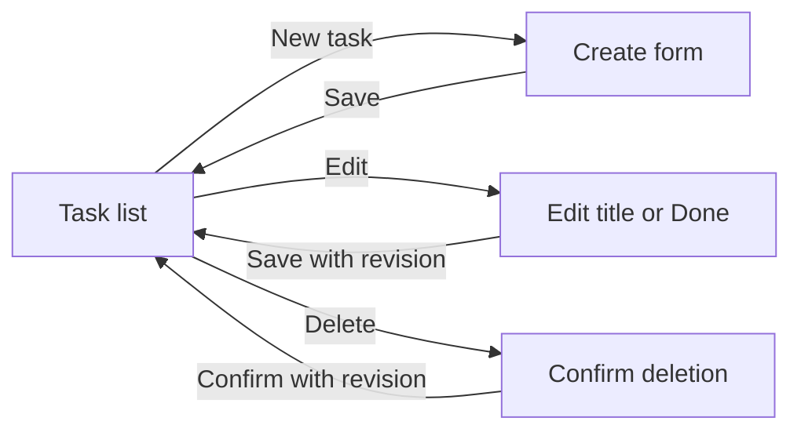
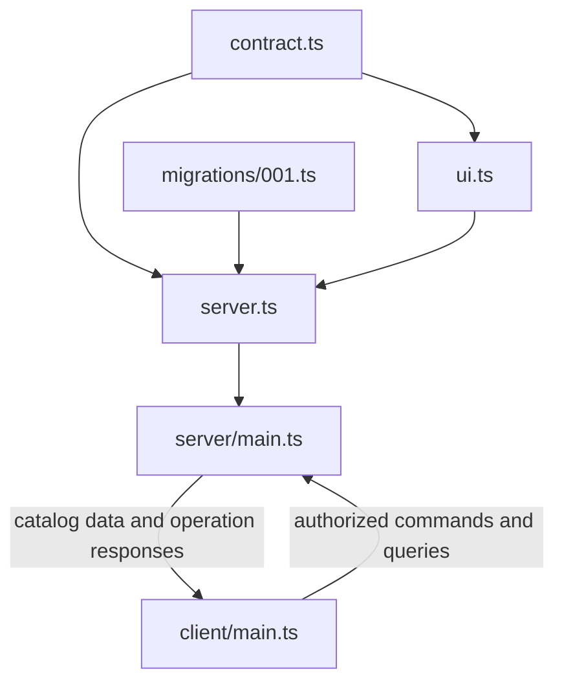
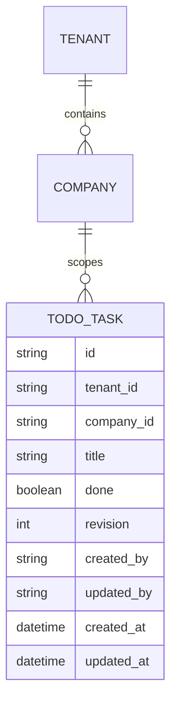
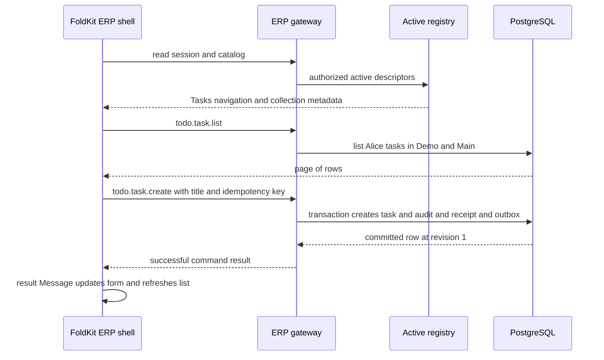
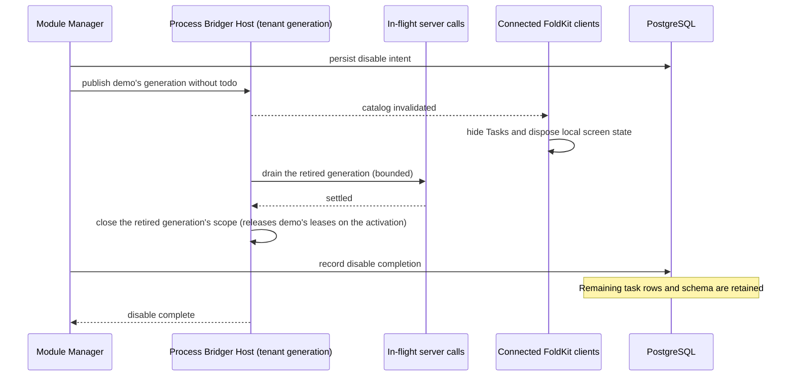

# Bridger ERP — a complete Todo plugin usage design

Status: **proposed developer experience, not executable library code**. All `@bridger/*` packages and APIs below are design sketches. They have not been implemented or type-checked. The contracts are defined in [ERP-SPEC.md](ERP-SPEC.md); [Odoo core research](knowledge/ODOO-CORE.md) explains the reference architecture.

> **Status banner (2026-11-08): example application, not normative.** This document describes an example ERP application built on Bridger with a server CRUD design: a database row is the source of truth and one server transaction commits each write. It is **not normative** for `@bridger/core` or any companion package, and it is **not the domain layer for local-first or event-sourced systems**; its row-as-truth write path conflicts with event-sourced, offline-first write paths. Such systems build on the [core specification](../references/core/README.md) and the companion specs ([command](../references/command/README.md), [durable-bus](../references/durable-bus/README.md), [federation](../references/federation/README.md), [loader](../references/loader/README.md), [audit-chain](../references/audit-chain/README.md)), and on the event-sourcing companions ([event-store](../references/event-store/README.md), [sequence](../references/sequence/README.md), [keyring](../references/keyring/README.md); Drafts like the others). Where this document and a spec disagree, the spec governs; the [supersession table](ERP-INDEX.md#supersession-table) maps each ERP concept to the spec that now governs it. Nothing here is implemented.

The complete small use case is: Alice opens the ERP, creates a task, lists her tasks, marks one done, edits its title, and deletes it. The module can be disabled and enabled again without deleting remaining tasks. The database stores the records (PostgreSQL in the examples, through its storage adapter); FoldKit renders a metadata-driven screen.

## 1. What the user sees

```text
Bridger ERP                  Company: Main                  Alice

Navigation          Tasks                         [+ New task]
  Tasks
                    Title                         Done    Actions
                    Review the proposal           No      Edit · Delete
                    Send the meeting notes        Yes     Edit · Delete
```

New task opens a form with Title and Done. Title is required and trimmed; Done defaults to false. Edit reuses the form and current revision. Delete asks for confirmation. The screen displays validation, loading, unavailable-module and revision-conflict states.



## 2. Proposed project layout

```text
plugins/todo/
  contract.ts              browser-safe: model metadata, permission tokens, operation references
  migrations/001.ts        immutable initial storage definition
  ui.ts                    declarative list and form metadata
  server.ts                server-only: access binding, role declarations, module assembly
server/
  main.ts                  database, demo provisioning and HTTP hosting
client/
  main.ts                  the generic FoldKit ERP shell
```

The snippets in sections 3–8 form the base example. They assume a browser build emits `dist/client` containing an HTML page with `<div id="app"></div>` and the compiled client entry. Build tooling and dependency versions will be specified when implementation begins. Sections 9 onward show optional consumers and extensions.



The generic client entry does not import the Todo plugin. It learns about its screen through the authorized catalog. This is what allows a new declarative plugin to appear while the shell is already running.

## 3. Define the model contract

`plugins/todo/contract.ts` (browser-safe; imported by the server, the UI descriptor and clients):

```ts
import { Access, Field, Model } from "@bridger/erp/contracts"

// Permission tokens "todo.task:read" and "todo.task:write" (resource:action).
export const TodoPerms = Access.permissions("todo.task", ["read", "write"])

export const Task = Model.define("todo.task", {
  scope: "company",
  fields: {
    title: Field.text({
      label: "Title",
      trim: true,
      minLength: 1,
      maxLength: 200,
    }),
    done: Field.boolean({ label: "Done", default: false }),
  },
})

export type TaskRow = typeof Task.Row.Type
```

`Task` is a definition, not a live database handle. It produces the row/input schemas and references such as `Task.queries.list` and `Task.commands.update`. It carries no policy, storage or handler code, so a browser can import it.

The ERP adds IDs, tenant/company scope, actor fields, timestamps and a revision. Alice does not submit an owner or company in the create payload. The authenticated request context supplies them. The access rule is attached on the server (section 6): `Access.owner` (a `@qadi/core` policy: the permission token **and** `createdBy` equals her subject ID) means she can operate only on her own tasks and only with the corresponding permission. The owner rule is compiled to SQL, so lists and pagination only ever read her rows. See [ERP-ACCESS.md](ERP-ACCESS.md).

The contract module imports only `@bridger/erp/contracts`. Its dependency edges are checked so that a browser bundle cannot reach policies, migrations or database types through it (see [ERP-SPEC.md](ERP-SPEC.md) §1).

## 4. Declare the initial migration

`plugins/todo/migrations/001.ts`:

```ts
import { Field, Migration } from "@bridger/erp"

export const CreateTasks = Migration.createModel("001-create-task", {
  model: "todo.task",
  scope: "company",
  fields: {
    title: Field.text({ trim: true, minLength: 1, maxLength: 200 }),
    done: Field.boolean({ default: false }),
  },
})
```

This historical field snapshot is deliberately independent of the current `Task` definition. A later `dueDate` addition must have a new migration; it must not rewrite migration 001. The installer stores and checks migration IDs/checksums. Re-enabling Todo verifies the existing schema instead of recreating the table.

Conceptual storage:



Physical table naming, SQL types and indexes belong to the storage adapter for the chosen database dialect ([ERP-STORAGE.md](ERP-STORAGE.md)). The diagram is the logical record shape.

## 5. Describe the screen

`plugins/todo/ui.ts`:

```ts
import { UiModule, View } from "@bridger/erp/ui"
import { Task } from "./contract"

export const TodoUi = UiModule.define({
  moduleId: "todo",
  apiVersion: "1",
  views: [
    View.collection("todo.tasks", {
      model: Task,
      title: "Tasks",
      navigation: { label: "Tasks", order: 100 },
      columns: ["title", "done"],
      form: ["title", "done"],
      actions: ["create", "edit", "delete"],
    }),
  ],
})
```

The collection renderer supplies the list and form. The boolean is editable through the form, so the base plugin needs no custom toggle handler. Saving `done: true` is an explicit target state. The generated update includes the row's revision.

This module contains serializable UI metadata and shared schemas. It contains no database connection, migration execution or server handler. The server publishes a validated public projection rather than serializing the `Task` object and its policy wholesale.

## 6. Assemble the plugin

`plugins/todo/server.ts`:

```ts
import { Model, Module } from "@bridger/erp"
import { Access } from "@bridger/qadi"
import { Task, TodoPerms } from "./contract"
import { CreateTasks } from "./migrations/001"
import { TodoUi } from "./ui"

export const TodoUser = Access.role("todo.user", {
  permissions: [TodoPerms.read, TodoPerms.write],
})

// Attach access to the shared contract; a model without Model.serve fails module validation.
const TaskServed = Model.serve(Task, {
  access: Access.owner(TodoPerms, {
    read: "read", create: "write", update: "write", delete: "write",
  }),
})

export const TodoModule = Module.define({
  id: "todo",
  version: "1.0.0",
  apiVersion: "1",
  dependsOn: [],
  models: [TaskServed],
  migrations: [CreateTasks],
  ui: TodoUi,
  access: {
    permissions: TodoPerms,
    roles: [TodoUser],
  },
})
```

This is the complete Todo plugin definition. CRUD operations come from the model; the UI contributes navigation and the screen. Installing the definition does not grant its role to everyone.

## 7. Start the server

`server/main.ts`:

```ts
import { Config, Effect } from "effect"
import { Erp } from "@bridger/erp"
import { Postgres } from "@bridger/erp-postgres"
import { ErpNode, Identity } from "@bridger/erp-node"
import { TodoModule, TodoUser } from "../plugins/todo/server"

const main = Effect.scoped(Effect.gen(function* () {
  const url = yield* Config.redacted("DATABASE_URL")
  const storage = yield* Postgres.make({ url })
  const erp = yield* Erp.make({ storage, loader: ErpNode.moduleLoader() })

  yield* erp.tenants.ensure({ id: "demo", name: "Demo" })
  yield* erp.companies.ensure({
    tenantId: "demo", id: "main", name: "Main",
    timezone: "Europe/Paris",       // company-local dates (ERP-RECORDS.md §8)
    defaultLocale: "en",
    functionalCurrency: "EUR",      // a code of bridger.currency (ERP-RECORDS.md §10)
  })
  yield* erp.modules.ensure({ tenantId: "demo", module: TodoModule })
  yield* erp.access.grantRole({
    tenantId: "demo",
    actorId: "alice",
    role: TodoUser,                 // qadi role; grants resolve to permissions per request
    companyIds: ["main"],
  })

  yield* ErpNode.serve({
    erp,
    host: "127.0.0.1",
    port: 3000,
    identity: Identity.development({
      actorId: "alice", tenantId: "demo", companyId: "main",
    }),
    assets: { directory: "dist/client" },
  })
}))

ErpNode.runMain(main)
```

`Identity.development` is an explicit local demo adapter restricted to loopback/development mode. It supplies Alice's fixed identity for this walkthrough. A deployed application uses `Identity.awthaq({ auth })`, which resolves the awthaq session (cookie plus CSRF, or bearer) to the tenant, selected company and actor; see [ERP-IDENTITY.md](ERP-IDENTITY.md). In the demo, the `demo` tenant stands for an awthaq organization and `main` for a row in `bridger_companies`. The role assignment is idempotent and scopes the external actor ID to the demo tenant and Main company.

This demo reasserts its module installation and role grant on every startup, so restarting it intentionally re-enables Todo. A deployed application moves this provisioning into an administrative command and restores persisted desired module state through the artifact loader.

`Postgres.make` (the reference storage adapter; another dialect uses its own adapter constructor) acquires a scoped pool. `Erp.make` prepares the ERP platform's own schema through its migration mechanism and constructs the coordinator. `modules.ensure` performs the Todo migration and waits for active publication before serving requests.

`companies.ensure` takes every column the company row requires: time zone, default locale and functional currency have no defaults ([ERP-IDENTITY.md](ERP-IDENTITY.md) §4).

`ErpNode.serve` is a long-lived Effect; it does not return immediately after binding the socket. `runMain` owns process signals, stops admission and drains/interrupts server work before closing the surrounding scope. Both are specified, with `ErpNode.moduleLoader`, in [ERP-SPEC.md](ERP-SPEC.md) §5 ("HTTP hosting, the gateway wire format and the typed client"); they are proposed and do not exist as packages yet.

## 8. Start the FoldKit shell

`client/main.ts`:

```ts
import { Runtime } from "foldkit"
import { ErpFoldkit } from "@bridger/erp-foldkit"

const container = document.getElementById("app")
if (container === null) throw new Error("Missing app container")

const application = ErpFoldkit.application({
  container,
  baseUrl: "/erp",
  credentials: "include",
})

Runtime.run(application)
```

The adapter constructs a normal FoldKit application. Its internal Model tracks session, catalog revision, route, list/form state and pending commands. Its update function handles explicit Messages. Commands call the ERP gateway; a Subscription follows catalog changes. The shell authenticates the session before requesting its authorized catalog.

The same ERP can be rendered with React instead (a deployment picks one renderer; both use the same server contract and UI core):

```tsx
import { createBridgerClient, BridgerProvider } from "@bridger/react"
import { ErpApp } from "@bridger/erp-react"

createRoot(container).render(
  <BridgerProvider client={await createBridgerClient({ plugins: [] })}>
    <ErpApp baseUrl="/erp" credentials="include" />
  </BridgerProvider>
)
```

Proposed HTTP mapping used by these adapters and `ErpClient`. Request and response bodies, headers (including `Idempotency-Key`) and status codes are specified in [ERP-SPEC.md](ERP-SPEC.md) §5 ("HTTP hosting, the gateway wire format and the typed client"):

| Endpoint | Purpose |
| --- | --- |
| `GET /erp/session` | Return the authenticated actor, tenant, **selected company**, the companies the actor holds grants in, and the context generation. |
| `GET /erp/session/methods` | Sign-in methods enabled for this deployment (public). |
| `POST /erp/session/company` | Select a company (body `{ companyId }`); validates an active grant, bumps the context generation. CSRF-protected. |
| `GET /erp/catalog` | Return a permission-filtered snapshot of available modules, public model schemas and UI descriptors. |
| `GET /erp/catalog/changes` | Follow catalog invalidation/revision notifications; reconnect fetches a fresh snapshot. |
| `POST /erp/query` | Execute a declared query by operation ID, API version and validated input. |
| `POST /erp/command` | Execute a declared command; the idempotency key travels in the `Idempotency-Key` header. |

Administrative `ensure`, role grants and migrations are not exposed through these endpoints automatically. Cookie-based deployment uses awthaq's `Host` cookie mode and signed double-submit CSRF ([ERP-IDENTITY.md](ERP-IDENTITY.md) §8); requests never trust a browser-provided actor, tenant or company ID. Catalog and shell behavior are specified in [ERP-BROWSER.md](ERP-BROWSER.md).



Arrows returning through the gateway are abbreviated where they do not change the explanation. Every operation goes through gateway authorization and a lease on the tenant's registry generation.

## 9. The same CRUD from a typed client

This optional example demonstrates the operation API used by generated screens. It runs in an authenticated browser context. The server reference above still supplies the demo identity.

```ts
import { Effect } from "effect"
import { ErpClient } from "@bridger/erp/client"
import { Task } from "../plugins/todo/contract"

const client = ErpClient.make({ baseUrl: "/erp", credentials: "include" })
const intent = crypto.randomUUID()

const example = Effect.gen(function* () {
  const created = yield* client.command(
    Task.commands.create,
    { title: "Review the API design" },
    { idempotencyKey: `${intent}:create` },
  )

  const page = yield* client.query(Task.queries.list, { limit: 20 })

  const completed = yield* client.command(
    Task.commands.update,
    {
      id: created.id,
      expectedRevision: created.revision,
      changes: { done: true },
    },
    { idempotencyKey: `${intent}:complete` },
  )

  const renamed = yield* client.command(
    Task.commands.update,
    {
      id: completed.id,
      expectedRevision: completed.revision,
      changes: { title: "API design reviewed" },
    },
    { idempotencyKey: `${intent}:rename` },
  )

  const deleted = yield* client.command(
    Task.commands.delete,
    { id: renamed.id, expectedRevision: renamed.revision },
    { idempotencyKey: `${intent}:delete` },
  )

  return { created, page, completed, renamed, deleted }
})

Effect.runPromise(example).then(console.log).catch(console.error)
```

The IDs are generated once for this logical sequence. A transport retry uses the same key; starting a genuinely new sequence generates a new `intent`. The generated shell manages these keys itself. This example creates and deletes one task; create a second task and leave it undeleted when demonstrating disable/re-enable persistence.

`ErpClient.make` and the `command` and `query` signatures are those of [ERP-SPEC.md](ERP-SPEC.md) §5. Client methods return Effects with typed transport/domain errors. `Task.Row` includes the revision needed for the next update. The client cannot call an undeclared method or select an arbitrary model table by name through the gateway.

## 10. Optional custom command

> **Superseded (2026-11-08).** `Command.contract` / `Command.implement` are governed by [`@bridger/command`](../references/command/README.md) (BEH-CM-001–016). The example shows the ERP author experience only.

When marking complete needs additional business logic, add the contract to `contract.ts`:

```ts
import { Schema } from "effect"
import { Command } from "@bridger/erp/contracts"

export const CompleteTask = Command.contract("todo.task.complete", {
  input: Schema.Struct({ id: Task.Id, expectedRevision: Schema.Number }),
  output: Task.Row,
})
```

and the implementation in `plugins/todo/complete.ts` (server only):

```ts
import { Effect } from "effect"
import { Command, Records } from "@bridger/erp"
import { Task, TodoPerms, CompleteTask } from "./contract"

export const CompleteTaskImpl = Command.implement(CompleteTask, {
  permission: TodoPerms.write,
  execute: ({ id, expectedRevision }) => Effect.gen(function* () {
    const records = yield* Records
    return yield* records.update(Task, {
      id, expectedRevision, changes: { done: true },
    })
  }),
})
```

Import it in `server.ts` and add `commands: [CompleteTaskImpl]` to the module definition. A client or custom screen imports only `CompleteTask`. It uses the gateway's transaction, idempotency and audit behavior. It cannot bypass `Task`'s owner/company rules. If external effects are needed, write an outbox intent within this command and perform the effect after commit.

The contract is already the browser-safe descriptor; the `execute` closure stays in the server artifact. The basic collection needs no such custom command; its standard update already marks `done` explicitly.

## 11. Hot installation, disabling and re-enabling

The methods below run in trusted server orchestration while `erp` remains alive. They are not snippets to paste into a browser console.

```ts
// approvedArtifact comes from the administrator-approved artifact catalog.
// It carries module ID, version, immutable URL, digest and compatibility data.
// The configured loader verifies bytes before evaluating the server entry.
const installed = yield* erp.modules.ensure({
  tenantId: "demo", artifact: approvedArtifact,
})

yield* erp.modules.disable({ tenantId: "demo", moduleId: "todo" })

// Re-enables the same approved version and uses existing tables and tasks.
yield* erp.modules.ensure({ tenantId: "demo", artifact: approvedArtifact })
```

`installed` includes tenant ID, module ID, version, artifact digest and active generation. `ErpNode.moduleLoader()` owns verified loading, shared dependency resolution and runtime descriptor validation. A URL alone is not identity. The source-defined `{ module: TodoModule }` path in the small demo records local provenance with a null artifact digest; a metadata fingerprint cannot prove the identity of JavaScript closures. Distributed installation uses the approved artifact path.

Because Todo's UI is declarative, hot installation publishes metadata that the running FoldKit shell already knows how to render. A permission-authorized user sees Tasks appear after catalog refresh. A custom new widget with executable browser code would additionally need the approved UI artifact loading contract from [ERP-BROWSER.md](ERP-BROWSER.md) §8.



The coordinator records disable intent durably before changing admission; the final database step records completion. Disable does not close the Todo activation: other tenants on the same closure may still use it, and the coordinator removes it only when no generation and no running workflow references it, after `moduleIdleGrace` ([ERP-RUNTIME.md](ERP-RUNTIME.md) §7). A server crash during the process resumes toward that desired state. Browsers can disconnect without blocking server disable. Subsequent requests from stale screens are rejected. Re-enable publishes a new generation and reloads existing data under the current policy.

## 12. What the framework does for this small plugin

| Author writes | Framework behavior |
| --- | --- |
| Two business fields | Input/row schemas and a standard record envelope. |
| Permission tokens, an owner policy and a role (`@bridger/qadi`) | Server-side operation gate, SQL-compiled row rules and field projection, with failures kept distinct from denials. |
| One initial migration | Table/system fields/indexes and a migration checksum entry. |
| A collection descriptor | FoldKit navigation, list, form, pending/errors and revision-aware CRUD. |
| A Module definition | Typed operation registration, schema validation and activation publication. |
| `modules.ensure` / `disable` | Durable installation state plus scoped runtime lifecycle. |

## 13. Acceptance scenarios for the API design

| Scenario | Expected result |
| --- | --- |
| Alice creates title `"  Buy milk  "` | Stored title is `"Buy milk"`; Done is false; revision is 1. |
| Alice submits whitespace-only title | Field validation error; no row, successful receipt or outbox event is committed. |
| Bob has the same role in Main | Bob sees his own tasks, not Alice's, because the owner predicate is part of the SQL. Guessing her ID produces `RecordNotFound`. |
| An attribute lookup used by a policy fails | `InternalError` with a correlation ID; never `Forbidden`. |
| Alice switches to another authorized company | Main tasks do not appear; pending responses from Main cannot fill the new screen. |
| Two edits use revision 1 | One can advance to revision 2; the other receives `RevisionConflict`. |
| A create response is lost after commit | Retry with the same input/key returns the original task, not a duplicate. |
| One key is reused with a different title | `IdempotencyConflict` with reason `input-differs`; no second write. |
| The same create is sent twice at once with one key | One runs; the other gets `IdempotencyConflict` with reason `in-flight` without waiting, and a later retry with the key returns the stored task marked as replayed. |
| Todo is disabled while a create is admitted | The admitted command settles before the retired generation finishes draining; new calls of the demo tenant get `ModuleUnavailable`; another tenant using Todo is not affected. |
| Todo is re-enabled | Remaining records return under the same actor/company rules. |
| Initial migration succeeds but activation fails | Status records the failure; retry skips the completed migration and attempts activation. |
| A browser is offline during disable | Server disable completes; browser reconciles the latest catalog on reconnect. |

These are reviewable behavior requirements, not tests already run. The walkthrough demonstrates the proposed module-author and application-author interfaces without implementing the ERP runtime.

## 14. A second plugin sharing the task table

The [Planning extension example](ERP-MODELS.md) adds priority to the same Task table. It shows `Model.extend`, typed composition, extension migrations, tenant activation and shared write validation. The simple Todo plugin above remains unchanged.

Change log: 2026-11-08, round-2 agent review fixes — status banner links the event-store, sequence and keyring companions instead of calling event-store "planned, not yet drafted" (R5-20).

Change log: 2026-11-09, audit fixes — §7 passes every required company field to `companies.ensure`; §7–§9 cite ERP-SPEC §5 for `ErpNode`, `ErpClient` and the HTTP wire format (E-07). §11 and §13: disable drains the tenant's generation and leaves the shared activation to the coordinator (E-02); §13 adds the in-flight duplicate case (E-01).
