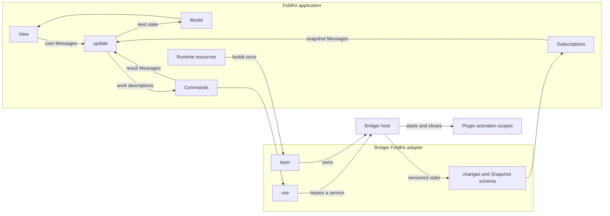
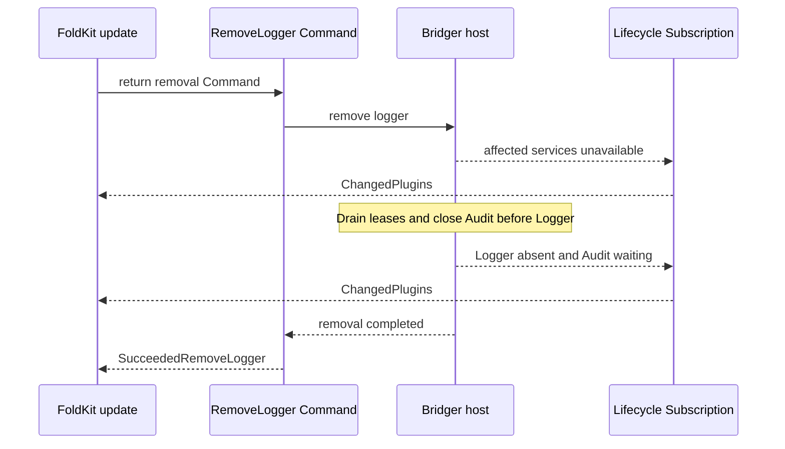

# Proposed `@bridger/foldkit` API

Status: API design for review, checked against the public FoldKit documentation on 2026-10-02. Bridger APIs below are proposed, unimplemented, and not type-checked. Examples reuse `Audit`, `audit`, and `logger` from the core's [worked example](../references/core/overview.md#worked-example), exported from an application-owned `./plugins` module.

The adapter connects a Bridger host to FoldKit's Model → Message → update → Command loop. Plugins keep their ordinary `@bridger/core` definitions. The Model contains data describing the host; live services and scopes stay in Effect resources.

## Modules and seams



| API | Responsibility |
| --- | --- |
| `BridgerFoldkit.layer({ plugins, base? })` | Compose `Bridger.layer(...)` (a Layer, so FoldKit's resource scope owns the host with no `ManagedRuntime` needed), register initial plugins, and provide `Bridger.Host` through runtime resources. |
| `BridgerFoldkit.use(key, callback)` | Resolve the host from Effect context and delegate to its leased `use` operation. |
| `BridgerFoldkit.changes` | Stream schema-compatible host snapshots for a FoldKit Subscription. |
| `BridgerFoldkit.Snapshot` | Schema for the data allowed into Messages and Model. |
| `BridgerFoldkit.isAvailable(snapshot, key)` | Pure availability selector for rendering and update guards. |
| `BridgerFoldkit.pluginState(snapshot, id)` | Pure selector returning a lifecycle state, or `uninstalled`. |

There is no adapter-specific Command type. Named operations use FoldKit's existing `Command.define`. Installation, removal, and replacement use `Bridger.Host` inside those Commands.

## 1. Attach Bridger through resources

```ts
import { Runtime } from "foldkit"
import { BridgerFoldkit } from "@bridger/foldkit"
import { audit, logger } from "./plugins"
import { Model, init, update, view, subscriptions } from "./main"

const container = document.getElementById("app")
if (container === null) throw new Error("Missing app container")

const application = Runtime.makeApplication({
  Model,
  init,
  update,
  view,
  subscriptions,
  container,
  resources: BridgerFoldkit.layer({ plugins: [audit, logger] }),
})

Runtime.run(application)
```

FoldKit shares its resource Layer across Commands and Subscriptions for the runtime lifetime. The adapter Layer owns the host within that resource scope. See [FoldKit resources](https://foldkit.dev/core/resources).

`layer` registers initial definitions and awaits currently runnable transitions before completing. A missing dependency leaves a plugin `waiting`. Invalid initial installation or initial activation failure fails Layer construction after cleanup, retaining cleanup failures in the reported cause. Later activation failures remain visible in host snapshots. Initial plugin order does not determine dependency order.

For an already-owned host, supply `Layer.succeed(Bridger.Host, host)` as resources instead. The owner must outlive the FoldKit runtime and close the host after that runtime's work settles. Supplying a borrowed host does not transfer ownership.

## 2. Define the Model and Messages

```ts
import { Option, Schema } from "effect"
import { defineMessageUnion } from "foldkit/message"
import { BridgerFoldkit } from "@bridger/foldkit"

export const Model = Schema.Struct({
  plugins: Schema.Option(BridgerFoldkit.Snapshot),
  recording: Schema.Boolean,
  feedback: Schema.String,
})
export type Model = typeof Model.Type

export const Message = defineMessageUnion({
  ClickedRecord: {},
  SucceededRecord: {},
  FailedRecord: { error: Schema.String },
  ChangedPlugins: { snapshot: BridgerFoldkit.Snapshot },
})
export type Message = typeof Message.Type

export const init = () => ({
  model: Model.make({
    plugins: Option.none(),
    recording: false,
    feedback: "",
  }),
})
```

`Option.none()` means the first snapshot has not arrived. The interface starts with actions unavailable. A received snapshot may legitimately contain zero plugins; that is different from an unknown initial state.

## 3. Call a service in a named Command

```ts
import { Effect } from "effect"
import { Command } from "foldkit"
import { BridgerFoldkit } from "@bridger/foldkit"
import { Audit } from "./plugins"
import { Message } from "./message"

export const RecordAudit = Command.define("RecordAudit", {
  messages: [Message.SucceededRecord, Message.FailedRecord],
  execute: BridgerFoldkit.use(
    Audit,
    audit => audit.record("button.clicked"),
  ).pipe(
    Effect.as(Message.SucceededRecord()),
    Effect.catch(error =>
      Effect.succeed(Message.FailedRecord({ error: String(error) })),
    ),
  ),
})
```

This is a FoldKit Command using a proposed Bridger Effect helper. Its success and typed failure become Messages; defects remain on FoldKit's runtime failure path. Interruption is not converted into an ordinary failure Message. [FoldKit Commands](https://foldkit.dev/core/commands) documents the execution contract.

The helper has this conceptual signature:

```ts
use<Service, A, E, R>(
  key: Context.Key<any, Service>,
  run: (service: Service) => Effect.Effect<A, E, R>,
): Effect.Effect<A, E | ServiceUnavailable | LeaseRevoked | LeaseTimeout, R | Bridger.Host>
```

It preserves the callback's remaining service requirements. The runtime's resources must provide them. It does not capture a plugin service when the Command is defined. Each execution leases the currently available provider, and releases that lease only after the callback and its finalizers settle.

## 4. Receive lifecycle changes through a Subscription

```ts
import { Stream } from "effect"
import { Subscription } from "foldkit"
import { BridgerFoldkit } from "@bridger/foldkit"

export const subscriptions = Subscription.make<Model, Message>()(_entry => ({
  plugins: Subscription.persistent(
    BridgerFoldkit.changes.pipe(
      Stream.map(snapshot => Message.ChangedPlugins({ snapshot })),
    ),
  ),
}))
```

This entry stays attached for the application's subscription lifetime. It emits an initial snapshot and subsequent changes. Unrelated Model changes must not restart it. FoldKit's [Subscription API](https://foldkit.dev/core/subscriptions) supports persistent streams and manages their scope.

The stream requires `Bridger.Host` in its Effect environment. It relies on `Host.changes` as defined in core [04 — States and snapshots](../references/core/behaviors/04-states-and-snapshots.md) (BEH-BR-030), the same seam `REACT-API.md` uses; it does not poll `snapshot()`.

## 5. Keep update pure

```ts
import { Option } from "effect"
import type { Update } from "foldkit"
import { Bridger } from "@bridger/core"
import { BridgerFoldkit } from "@bridger/foldkit"
import { Audit } from "./plugins"
import { RecordAudit } from "./commands"

export const canRecord = (model: Model) =>
  !model.recording &&
  Option.isSome(model.plugins) &&
  BridgerFoldkit.isAvailable(model.plugins.value, Audit)

export const update = (model: Model, message: Message) =>
  Message.match<Update.Return<Model, Message, Bridger.Host>>(message, {
    ClickedRecord: () => canRecord(model)
      ? {
          model: { ...model, recording: true, feedback: "" },
          commands: [RecordAudit()],
        }
      : { model },

    SucceededRecord: () => ({
      model: { ...model, recording: false, feedback: "Recorded" },
    }),

    FailedRecord: ({ error }) => ({
      model: { ...model, recording: false, feedback: error },
    }),

    ChangedPlugins: ({ snapshot }) => ({
      model: { ...model, plugins: Option.some(snapshot) },
    }),
  })
```

The view uses `canRecord(model)` for the button's disabled state and `model.feedback` for its result. Calling update creates a work description; the FoldKit runtime executes it later. `Update.Return` preserves `Bridger.Host` as a resource requirement, following FoldKit's [resource-aware update types](https://raw.githubusercontent.com/foldkit/foldkit/main/packages/foldkit/src/update/update.ts).

An availability check does not reserve a service. Removal can occur before the Command executes; `use` then fails with `ServiceUnavailable`. The failure Message clears `recording`. An already-running leased call delays provider cleanup until it settles.

## 6. Remove or hot-install plugins from Commands

A management screen defines its own result Messages and Model fields. For example, add `SucceededRemoveLogger` and `FailedRemoveLogger { error: Schema.String }` to that screen's Message union:

```ts
const RemoveLogger = Command.define("RemoveLogger", {
  messages: [Message.SucceededRemoveLogger, Message.FailedRemoveLogger],
  execute: Effect.gen(function* () {
    const host = yield* Bridger.Host
    yield* host.remove("example/logger")
    return Message.SucceededRemoveLogger()
  }).pipe(
    Effect.catch(error =>
      Effect.succeed(Message.FailedRemoveLogger({ error: String(error) })),
    ),
  ),
})
```

The lifecycle subscription independently updates availability. The management Command result acknowledges that removal finished; it must not overwrite the subscription's plugin state with an assumed state.

To install newly loaded code, the body of a Command can compose the application's trusted loader with the host:

```ts
// Inside a Command's Effect.gen body.
// loadApprovedPlugin is an application-owned Effect returning PluginDefinition.
const host = yield* Bridger.Host
const plugin = yield* loadApprovedPlugin(approvedEntryUrl)
yield* host.install(plugin)
const snapshot = yield* host.awaitIdle()
// Map the outcome to the Command's declared success or failure Message.
// Accepted installation does not imply successful activation; inspect snapshot.
```

Loading, validation, and approval policy belong to the application. Shared service keys and a compatible Effect v4 instance must resolve consistently across loaded modules. `replace` and `retry` compose in the same way. Sequential operations belong inside one Effect or in successive result-driven update steps; a list of Commands does not establish completion order.



The diagram shows logical events. Subscription delivery and Command completion can interleave, and intermediate snapshots can be coalesced. The latest snapshot is the state authority.

## Snapshot and lifecycle contracts

`Snapshot` is a schema-defined projection of core `HostSnapshot` ([BEH-BR-028](../references/core/behaviors/04-states-and-snapshots.md#beh-br-028-hostsnapshot)): host ID, revision, plugin IDs and states, missing service identifiers, provider identities, available service identifiers including base services, and optional failure summaries. `isAvailable(snapshot, key)` converts the key with `key.key` (its `ServiceId`) before checking `availableServiceIds`. It contains no service implementations, Context keys, fibers, DOM nodes, or raw Effect causes. The core retains full diagnostic causes separately. Failure summaries expose a phase and readable message; diagnostic redaction remains application policy.

The host subscription must deliver the initial state and later revisions without a subscription gap. One host uses increasing revisions; hosts have distinct IDs. Selectors are pure and never acquire leases. Snapshots may skip intermediate revisions but never regress within a live subscription. Model replay changes the displayed state only; it does not reinstall plugins or reverse external effects. Long-running workflows should carry request IDs in their Command results when stale results could overwrite newer intent.

Shutdown must first stop new Commands and subscriptions, interrupt their running work, and await resource finalizers before closing plugin scopes. A Command keeps its lease until cancellation cleanup finishes. The adapter must verify this ordering against the pinned FoldKit release before implementation. A `Runtime.embed` dispose call alone must not be assumed to be an awaitable shutdown barrier without checking its API.

A user-visible Cancel action can use FoldKit's interruptible Commands and an explicit cancellation-result Message to clear pending state. The example instead allows one record operation at a time. Plugin removal waits for an existing record operation; it does not automatically cancel it. A callback must not remove its own leased provider or a dependency it needs, because the core fails such a call immediately with `WouldDeadlock` (core [09 — Leases](../references/core/behaviors/09-leases.md), BEH-BR-088). Keep management Commands outside service leases.

## Use by the ERP UI

`@bridger/erp-foldkit` ([ERP-BROWSER.md](ERP-BROWSER.md)) is built on this adapter: the UI core's pure machines are used as Submodels, their effect descriptors run as named Commands, and UI plugins are embedded widgets mounted and torn down by the contract below ([ERP-BROWSER.md](ERP-BROWSER.md) §8, §9).

## Plugin-contributed FoldKit widgets

A plugin can contribute a FoldKit widget to a registry: a small FoldKit program that the shell starts inside a container with `Runtime.embed` ([embedding](https://foldkit.dev/core/embedding)) and talks to through two typed Ports. The widget's own Model and Message union stay inside its runtime; the shell never changes its schemas when code is hot-installed. This section is the contract between the shell and such a widget. The FoldKit names it uses (`Runtime.embed`, Flags, Ports, the handle's `dispose`) must be checked against the pinned FoldKit release (design checks below).

### Contribution

```ts
interface FoldkitWidget<Flags, Props, Value> {
  readonly element: FoldkitElement<Flags>        // the widget program, started with Runtime.embed
  readonly flags: Schema.Codec<Flags>            // start-up data, decoded before start
  readonly props: Schema.Codec<Props>            // e.g. { readOnly, invalid?, locale, field }
  readonly value: Schema.Codec<Value>            // the field value the widget edits
  readonly toWidget: string                      // name of the inbound Port
  readonly fromWidget: string                    // name of the outbound Port
}

type ToWidget<Props, Value> =
  | { readonly _tag: "Value"; readonly value: Value }        // the form's current value
  | { readonly _tag: "Props"; readonly props: Props }
  | { readonly _tag: "Shutdown" }                            // finish your work, then reply Closed

type FromWidget<Value> =
  | { readonly _tag: "Ready" }                               // subscribed to toWidget; send the first Value and Props
  | { readonly _tag: "Changed"; readonly value: Value }      // the user changed the value
  | { readonly _tag: "Closed" }                              // its cleanup and the calls it started have finished
```

Every message crossing a Port is decoded with these schemas. A message that does not decode is dropped and reported as a `WidgetProtocolError` diagnostic for the owning plugin; it is never passed on. The widget exchanges only values: the form machine owns validity, errors, pending state and idempotency ([ERP-BROWSER.md](ERP-BROWSER.md) §8).

### Mount

1. **Only while the owner is `active`.** A view entry whose `owner` (BEH-BR-165) is not `active` in `Host.changes` shows a placeholder and mounts when the owner becomes `active`. An entry without `owner` mounts at once.
2. **Two holds, in one hold fiber.** The adapter forks a hold fiber that takes an **owner lease**, `host.lease(keys, { realm: owner.realm })` on the keys the owner provides (BEH-BR-083), and a **registry hold**, `registry.use(id, () => Effect.never)` on the entry (BEH-BR-166). These are the two holds of [REACT-UI-PLUGINS.md](REACT-UI-PLUGINS.md) §5.1, for the same reasons: the lease keeps the owner's services open during the widget's cleanup, and the registry hold covers an owner that provides no key and an entry withdrawn while its owner stays `active`. If the lease fails with `ServiceUnavailable`, the adapter shows the fallback and retries when the owner is `active` again.
3. **Start.** The adapter decodes `flags`, allocates the container, starts the program with `Runtime.embed` and subscribes to `fromWidget`. Service calls the widget makes run in the instance's **call set**, a `FiberSet` the adapter owns, as in [REACT-UI-PLUGINS.md](REACT-UI-PLUGINS.md) §3.4, so interrupting the hold fiber never interrupts them.
4. **Ready.** The adapter sends `Value` and `Props` only after `Ready`. It ignores `Changed` before `Ready`.

### Unmount

The adapter unmounts an instance on the first of: the entry leaves the registry view; `Host.changes` shows the owner no longer `active` (for example `stopping`); the view that shows it closes. Waiting for the registry alone would hold the owner lease until the drain limit, because the host drains leases before it closes the owner's scope and the registry withdraws the entry only when that scope closes (BEH-BR-167).

1. **Mark closing.** `Changed` is no longer forwarded; the form machine keeps the last value so the generic widget can take over.
2. **Send `Shutdown`** and wait for `Closed`. A FoldKit embed's `dispose` is not an awaitable barrier, so `Closed` is the barrier: the widget sends it after its own cleanup has run.
3. **Await the call set**, then close it to new calls. A call started after this point takes a new lease and, while the owner is `stopping`, fails with `ServiceUnavailable`.
4. **Dispose** the embed handle and release the container.
5. **Release the holds last**, by interrupting the hold fiber: the owner lease and the registry hold end together.

Steps 2 and 3 are bounded by the time left until the owner's drain limit (the `drain` of the host operation that stops it, BEH-BR-085) or, when the owner stays `active`, until the registry's `drainTimeout` (BEH-BR-167). At the limit the adapter disposes the handle without `Closed`, the remaining calls are interrupted with the forced revocation (BEH-BR-086), the host's `force` revokes the owner lease (`lease-revoked` event) or the registry revokes the hold (`HoldRevoked`), and the adapter reports a `ForcedTeardown` diagnostic and shows the generic widget. Without `force`, the host's `remove` fails with `DrainTimeout` and the owner stays `stopping` (REACT-UI-PLUGINS.md §5.3).

A widget that sends `Closed` before `Shutdown` (it stopped by itself) is unmounted from step 3 and replaced by the generic widget.

After the holds are released the host closes the owner's activation scope, and that scope close withdraws the owner's registry entries (BEH-BR-167). The order is always: mount refused to new instances, `Shutdown`, `Closed`, calls settled, handle disposed, holds released, scope closed, entries withdrawn.

A FoldKit view renderer is mounted and torn down in the same order, with the same holds and the same `Shutdown`/`Closed` barrier; its data messages are not specified yet. Long-lived streams of plugin domain data into the shell, and FoldKit rendering for slots and shell contributions ([ERP-BROWSER.md](ERP-BROWSER.md) §13 item 8), remain open.

## Design checks before implementation

- Verify a pinned FoldKit version shares the required Effect v4 service and scope types.
- Verify resource requirements flow through Commands and Subscriptions without widening them to `any`.
- Story-level checks should cover duplicate-click suppression, success, failure, and unavailable services by resolving named Commands to Messages.
- Runtime checks should cover removal racing a call, interruption releasing a lease after finalizers, subscription startup without missed updates, and host shutdown after command cleanup.
- Verify against the pinned FoldKit release that `Runtime.embed` accepts Flags and typed Ports as used above, and what its `dispose` does to a running Command.
- Widget checks: a widget mounts only while its owner is `active`; removing the owner sends `Shutdown`, and a service call started in the widget's cleanup completes before the owner lease is released; a widget that never replies `Closed` is forced out at the drain limit with a `ForcedTeardown` diagnostic and the generic widget shown; a message that fails to decode is dropped and reported; registry entries disappear only after the holds are released.
- Examples intentionally omit the application's HTML view and module boilerplate; these are a proposed API contract, not a runnable application.

Change log: 2026-11-09, audit fixes — "Plugin-contributed FoldKit widgets" replaces the open note with a specified contract: the contribution, the Port messages, and the mount and unmount order with both holds released last and entries withdrawn on scope close (BEH-BR-167) (E-08). Citations of the superseded SPEC.md point to the core reference (E-04).
