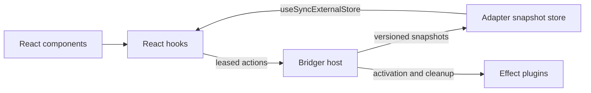

# Proposed `@bridger/react` API

Status: design examples for review (proposed; revised 2026-11-08, round 2). These APIs do not exist yet and have not been implemented or type-checked. The examples target a client-rendered React application and reuse the `Audit`, `audit`, and `logger` definitions from `SPEC.md`.

`@bridger/react` adapts the generic Bridger host to React. Plugin definitions still use `@bridger/core`. The adapter owns React subscriptions and component actions; the core owns activation, dependency ordering, leases, and finalizers.

This document covers the service and state layer: connecting a client, calling services and observing plugin state. Building the UI itself from plugins (shell, menus, routes, pages and plugin-defined slots) is specified in [REACT-UI-PLUGINS.md](REACT-UI-PLUGINS.md), which uses these hooks inside contributed components.



## 1. Connect the application

Create the client once at application startup. `BridgerProvider` exposes an existing client through React context; mounting or unmounting the provider does not install plugins or dispose the host.

```tsx
import { StrictMode } from "react"
import { createRoot } from "react-dom/client"
import { BridgerProvider, createBridgerClient } from "@bridger/react"
import { audit, logger } from "./plugins"
import { App } from "./App"

export async function mountApplication(element: HTMLElement) {
  const client = await createBridgerClient({ plugins: [audit, logger] })
  const root = createRoot(element)

  root.render(
    <StrictMode>
      <BridgerProvider client={client}>
        <App />
      </BridgerProvider>
    </StrictMode>
  )

  return async function dispose() {
    root.unmount()
    await client.dispose()
  }
}
```

The caller handles startup errors and retains `dispose` for its application lifecycle. `createBridgerClient` owns a `ManagedRuntime` over `Bridger.layer(...)` ([SPEC.md](./SPEC.md) "Hosting from non-Effect code"), forces the lazy layer build, registers the definitions, starts observation, and awaits current transitions before resolving. Missing dependencies produce `waiting`. Initial activation failures reject creation after cleanup; cleanup failures are included in the reported error. Disposal is idempotent, rejects new work, interrupts adapter-owned actions, awaits their finalizers, calls `host.shutdown()` so the `CloseReport` can be surfaced, and then disposes the runtime.

`plugins` may contain lazy definitions made with `Plugin.lazy({ manifest, load, digest })` ([core 27](../references/core/behaviors/27-manifest-and-lazy-activation.md), BEH-BR-244): they are registered `dormant`, none of their code runs, and readiness does not wait for them. Other options pass through to the host: `host` is `BridgerOptions` (for example `drainTimeout`, default 30 seconds, the default `drain` of every stop the client requests), and `ui` and `i18n` configure the UI layer of [REACT-UI-PLUGINS.md](REACT-UI-PLUGINS.md) (§5.3, §3.5). Policy ports (`AccessPolicy`, `OperationGate`, `AuditSink`, `RefusalList`) are wired by the application in the layer it gives the client, exactly as for any host; the adapter wires none of them and implements none of them.

## 2. Call a plugin service from a component

```tsx
import { useServiceAction } from "@bridger/react"
import { Audit } from "./plugins"

export function AuditButton() {
  const record = useServiceAction(
    Audit,
    (audit, event: string) => audit.record(event)
  )

  return (
    <div>
      <button
        disabled={!record.available || record.pending}
        onClick={() => record.run("button.clicked")}
      >
        {record.pending ? "Recording…" : "Record event"}
      </button>
      {!record.available && <p>Audit is unavailable.</p>}
      {record.error && <p role="alert">{record.error.message}</p>}
    </div>
  )
}
```

`run(...args): void` schedules an Effect action and exposes its result through `{ pending, data, error }`. Errors are captured in hook state, including Effect failure causes; this event-handler API does not return a rejecting Promise. The callback returns an Effect whose requirements have already been satisfied. It executes inside `host.use(Audit, callback)`, so the service reference stays inside the lease.

The hook accepts one action at a time. Calls while pending are ignored. Each accepted call clears previous data and error. Unmount requests interruption and suppresses subsequent component updates, but the lease is released only once the action and its finalizers settle. Interruption does not undo external writes. A change of client or service key cancels the previous action and resets its state; changing the callback updates future calls without restarting an in-flight action.

**Correlation.** Each accepted `run` executes under `CurrentCorrelation.with(id)` ([core 22](../references/core/behaviors/22-attributable-operations.md), BEH-BR-187) with a fresh id per action, unless the component passes one (`useServiceAction(Key, fn, { correlationId })`). Every host operation, gate request, audit record, call-log entry and remote call the action causes then carries that one id, so one click can be followed across them. The id is exposed as `record.correlationId` for display or error reports. The callback also runs inside `host.use`, so it has the host's `HostLink` (BEH-BR-250) and may dispatch hook points directly; adapter code that dispatches a hook point outside a lease provides `client.host.link` itself. It must not fall back to `HostLink.none`: that denies a point with veto codes (`no-host-link`) unless the point was made with `allowNoLink: true` ([core 31](../references/core/behaviors/31-hook-points.md), BEH-BR-309), so a component test that dispatches a veto point without a host needs that option on the point.

`available` is a rendering hint, not a reservation. If removal wins a race with a click, `host.use` reports `ServiceUnavailable` (and, if the provider is forced out or the call exceeds its limit, `LeaseRevoked` or `LeaseTimeout`), which appears in `error`. An already leased call completes or is interrupted before teardown proceeds. A later click resolves the current provider instead of using a cached service object.

## 3. Observe plugin lifecycle

```tsx
import { usePluginState } from "@bridger/react"

export function AuditStatus() {
  const audit = usePluginState("example/audit")

  if (audit.state === "uninstalled") return <p>Audit is not installed.</p>
  if (audit.state === "dormant") return <p>Audit loads on first use.</p>   // Plugin.lazy, not yet triggered
  if (audit.state === "disabled" && audit.reason === "refused-digest") return <p>Audit's version is refused.</p>
  if (audit.state === "waiting") {
    return <p>Waiting for: {audit.missingServiceIds.join(", ")}</p>
  }
  if (audit.state === "failed") return <p>Audit failed during {audit.failure.phase}.</p>

  return <p>Audit: {audit.state}</p>
}
```

The hook returns a discriminated snapshot with the seven core states (`dormant`, `waiting`, `starting`, `active`, `stopping`, `failed`, `disabled`; [core 04](../references/core/behaviors/04-states-and-snapshots.md), BEH-BR-027, and [core 27](../references/core/behaviors/27-manifest-and-lazy-activation.md), BEH-BR-244) plus `uninstalled` for an unknown ID. A `dormant` snapshot carries its `triggers`; `starting` carries `loading` while a lazy definition's code is being loaded; `failed` carries its `failure`, whose `phase` may be `"load"` (BEH-BR-027); `disabled` may carry `reason: "refused-digest"` when a wired `RefusalList` refused the plugin's digest (BEH-BR-267); `lazy.loaded` is present for registrations made from a lazy definition. A lazy plugin that idles returns to `dormant` (BEH-BR-252); components must treat `dormant` as "available on demand", not as an error. Missing services are displayable service identifiers (`missingServiceIds`, the keys' `key.key` identifiers); failure details preserve the underlying cause. Lifecycle snapshots describe plugin availability, not changes to arbitrary domain data inside services.

## 4. Install code while React remains mounted

Application orchestration can use the same client returned by `createBridgerClient`:

```ts
// Inside an async command whose caller handles rejection.
// approvedEntryUrl comes from the application's trusted loader policy.
const { plugin } = await import(approvedEntryUrl)
await client.install(plugin)
await client.awaitIdle()

// Existing subscribers update as the host changes.
await client.remove("example/logger")
// AuditButton becomes unavailable; AuditStatus becomes waiting.

await client.install(logger)
await client.awaitIdle()
// Audit activates again; both components update.
```

The client's `install`, `remove`, `replace`, `retry`, `wake` and `awaitIdle` methods are Promise wrappers around host operations; the mutating ones accept `{ context }` (an `OperationContext`) and the stopping ones `{ drain, force }`. `client.wake(trigger)` wakes a dormant plugin and takes no context: core records the caller's principal (BEH-BR-253). An installation can be accepted while activation later fails; inspect the returned idle snapshot for activation outcomes. `useBridgerClient()` exposes this same client to components that need management commands. Call commands from event handlers or application orchestration, never during rendering. Dynamic entries must share the application's Effect runtime and service-key contracts.

## Core observation seam

`Host.changes` (a `Stream<HostSnapshot>`) and the `HostSnapshot` shape are specified in [core 04](../references/core/behaviors/04-states-and-snapshots.md) (BEH-BR-028, BEH-BR-030), originally in [SPEC.md](./SPEC.md), and `changes` is prototyped in `prototypes/host-core/src/host.ts`. `snapshot()` is the one-time read. Each subscription must register and deliver its initial snapshot without a gap that could miss updates. Snapshots are immutable and carry a monotonically increasing revision. They include provider availability as well as plugin states, including stable base-service keys, so hooks can answer whether a key can be leased. Slow subscribers may receive the latest snapshot rather than every intermediate state; this is a state feed, not an audit log. Host closure terminates observation.

The adapter consumes one subscription per client and caches the latest snapshot. Hooks use `useSyncExternalStore` over that cache, with stable snapshot identity between revisions. React subscribes synchronously to the adapter store; it never starts asynchronous Effect work while rendering. The client is ready only after its initial snapshot is available.

## Use by the ERP UI

`@bridger/erp-react` ([ERP-BROWSER.md](ERP-BROWSER.md)) is built on this adapter. The browser Bridger host runs UI plugins (custom widgets and view renderers); each mounted widget's boundary takes a scoped lease on the service keys its plugin provides (`Host.lease` takes keys, not a plugin) and a hold on its registry entry, and releases both after React's cleanup pass for the widget's subtree, which provides the "contribution and teardown contract" listed below ([REACT-UI-PLUGINS.md](REACT-UI-PLUGINS.md) §5.1, steps 2 and 6). The renderer unmounts as soon as the plugin leaves `active` on `Host.changes`, before its activation scope closes ([REACT-UI-PLUGINS.md](REACT-UI-PLUGINS.md) §5.1). `@bridger/erp-react` sets the drain limit to 5 seconds; `@bridger/react` keeps the core default of 30 seconds (§5.3 there).

## Boundaries to preserve

- The provider borrows a client. Application startup and shutdown own its lifetime, including when multiple React roots share it.
- React Strict Mode subscription setup and cleanup must not install or remove plugins.
- Service actions return data; returning a live service or resource from a lease remains unsupported.
- Reactive domain data needs an explicit service stream or external-store contract. Host lifecycle observation alone cannot make arbitrary service fields reactive.
- Rendering plugin-contributed components needs a separate contribution and teardown contract: hiding a contribution must coordinate with React unmount before resources used by component cleanup are released. A raw component registry alone cannot guarantee this. That contract is [REACT-UI-PLUGINS.md](REACT-UI-PLUGINS.md) §5.
- These examples cover client rendering. SSR requires a request-scoped host and a matching hydration snapshot; server and browser hosts do not share live service objects.

React references: [external store subscription and snapshot contracts](https://react.dev/reference/react/useSyncExternalStore), [Strict Mode lifecycle checks](https://react.dev/reference/react/StrictMode).

Change log: 2026-11-08, round 2 — `Plugin.lazy` definitions accepted by `createBridgerClient`; `usePluginState` covers `dormant`, `starting.loading`, failure phase "load" and `disabled` reason "refused-digest"; `useServiceAction` runs under `CurrentCorrelation`; `HostLink` in lease callbacks; policy ports wired by the application; client `wake` and `{ drain, force }`; ERP paragraph aligned with the two-hold mount rule and the drain defaults.

Change log: 2026-11-08, round-2 agent review fixes — the `failed` example reads `audit.failure.phase` (BEH-BR-027) (R5-23); the ERP paragraph states that the lease is on keys and that holds are released after React's cleanup pass, as REACT-UI-PLUGINS §5.1 now specifies; ERP-BROWSER §9 itself was rewritten in the same change (the round-2 line above claimed an alignment that only this paragraph had) (R5-11); the `HostLink` paragraph notes that `HostLink.none` denies a veto point unless `allowNoLink: true` (BEH-BR-309, CCR-BR-029).
