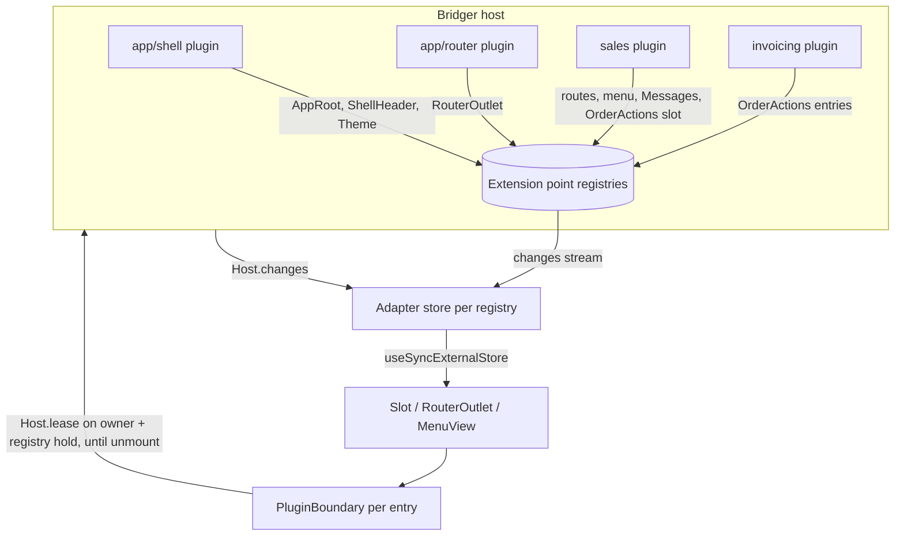

# `@bridger/react`: a UI built from plugins

Status: **proposal for review, not implemented or type-checked**. Date: 2026-10-03; revised 2026-11-08 (round 2). Every name in `@bridger/react` below is proposed. Core behavior is cited from `references/core` (behaviors 09, 13, 14, 15, 19, 20, 22, 26, 27, 28) and from [SPEC.md](SPEC.md) where no behavior file restates it. This document extends [REACT-API.md](REACT-API.md), which covers calling services and observing plugin state; that API stays and is used inside plugin components.

## 1. Decision

In a Bridger React application **everything visible is contributed by plugins**: the app shell, header, menus, routes, pages, commands, message catalogs, the theme, and the business components inside pages. The application entry renders exactly one thing:

```tsx
root.render(
  <BridgerProvider client={client}>
    <Slot of={AppRoot} />
  </BridgerProvider>
)
```

Plugins do not only fill extension points; **they define new ones** that other plugins fill. A Sales plugin opens an `OrderActions` slot on its order page; an Invoicing plugin adds a button there. Removing, replacing or installing any plugin updates the mounted UI in place, with the core's dependency ordering, leases and drain rules governing teardown.

| Concern | Decision |
| --- | --- |
| Extension mechanism | Typed **extension points** backed by `ContributionRegistry` ([behavior 19](../references/core/behaviors/19-contribution-registry.md)). No second mechanism. |
| Who contributes | Plugins, from their scoped `build`. Contributions disappear when the plugin's activation scope (or a narrower scope) closes. |
| Who defines extension points | `@bridger/react` defines the generic ones (§2). Any plugin may define its own and export it. |
| Shell | An ordinary plugin contributing to `AppRoot`. Replaceable with `replace` or overridden by a higher-priority contribution. |
| Mounted contributions | Each renders inside a `PluginBoundary` that holds the owning plugin and the contribution against removal, isolates errors and suspends for lazy code (§5). |
| Data inside components | The hooks of [REACT-API.md](REACT-API.md) (`useServiceAction`, `usePluginState`) plus `useServiceQuery` and `useServiceStream` (§3.4). |
| Messages and theme | Two more extension points, `Messages` and `Theme`, read with `useMessage`, `useLocale` and `useTheme` (§3.5, §3.6). |
| First-party UI code | Runs in the page, loaded through the application's trusted loader ([ERP-BROWSER.md](ERP-BROWSER.md) §8: verified bytes evaluated from a `blob:` URL). |
| Partner UI code | Never evaluated in the page. It runs in a sandboxed iframe behind a proxy plugin, through `SandboxedSlot` (§3.7). |
| Rendering | Client-side only. SSR is out of scope ([REACT-API.md](REACT-API.md) "Boundaries"). |



## 2. Extension points

An extension point is a typed token naming one `ContributionRegistry`. `@bridger/react` ships these; applications and plugins define more with the same constructors.

| Token | Registry name | Kind | Value contributed | Rendered by |
| --- | --- | --- | --- | --- |
| `AppRoot` | `@bridger/react/AppRoot` | `Slot.single<{}>` | The root layout component | `<Slot of={AppRoot} />` in the entry |
| `ShellHeader`, `ShellFooter`, `StatusBar` | `@bridger/react/ShellHeader`, … | `Slot.many<{}>` | Components | The shell plugin |
| `Routes` | `@bridger/react/Routes` | `Route.registry` | `{ path, component, title? }` keyed by `path` | `<RouterOutlet />` |
| `MainMenu` | `@bridger/react/MainMenu` | `Menu.define` | `{ id, label, to? \| command?, icon?, parent? }` | `<MenuView of={MainMenu} />`, `useMenu` |
| `Commands` | `@bridger/react/Commands` | `Command.registry` | `{ id, title, key?, when?, run }` | Command palette, keybinding listener |
| `Settings` | `@bridger/react/Settings` | `Slot.many<{}>` | Settings panels | The settings page |
| `Messages` | `@bridger/react/Messages` | `Messages.registry` | `MessageCatalog` (§3.5) | `useMessage`, `useLocale` |
| `Theme` | `@bridger/react/Theme` | `Theme.registry` (single winner) | `ThemeTokens` (§3.6) | `useTheme`, `<ThemeVariables>` |

A plugin-defined slot `Slot.many<P>("sales/order.actions")` names the registry `@bridger/react/slot:sales/order.actions`. Registry names matter in three places: `inspect` shows them (BEH-BR-168), a wired `AccessPolicy` receives them in `contribute` requests (BEH-BR-264), and a lazy plugin's manifest lists them in `contributions` (§3.8).

```ts
namespace Slot {
  // All entries render, ordered by priority ascending then ID (the registry order).
  function many<P>(id: string): SlotToken<P, "many">
  // Only the last entry in registry order renders: the highest priority wins, ties broken by ID.
  function single<P>(id: string): SlotToken<P, "single">
}
```

`single` is resolved in the adapter over the registry view; the core has no notion of a winner. When the winning entry is withdrawn, the next one renders, so a higher-priority shell overrides the default shell and removing it restores the default. `Theme` uses the same rule.

Contribution IDs are unique per registry and **must be prefixed with the contributing plugin's ID** (`invoicing/create`). A collision fails the contributing plugin's activation with `DuplicateContribution` (BEH-BR-163). Routes are keyed by `path`, so two plugins cannot claim the same path; overriding another plugin's page is done by replacing that plugin, or by the owner exposing a `Slot.single` for the page body.

**Typed extension points.** The tokens above hold components and data, and the adapter decodes data values with a Schema when they are contributed (§3.5, §3.6). A plugin-defined extension point whose entries are *service implementations* (for example a set of exporters behind one interface) is better declared over a contract registry, `ContributionRegistry.make({ contract, range })` (core K3, BEH-BR-162, BEH-BR-233): each contributor states `implements`, an incompatible one fails with `IncompatibleContract`, and readers narrow with `within(range)`. `Extension.registry({ contract, range? })` is the proposed token constructor for that case. A catalog or a token set is data, not an implementation of methods, so `Messages` and `Theme` stay plain registries with schema decoding.

## 3. API

### 3.1 The `Ui` service

```ts
class Ui extends Context.Service<Ui, {
  readonly slot:     <P>(point: SlotToken<P, any>, id: string, component: ComponentType<P>,
                         options?: ContributeOptions) => Effect.Effect<void, DuplicateContribution, Scope.Scope>
  readonly route:    (route: RouteDef, options?: ContributeOptions) => Effect.Effect<void, DuplicateContribution, Scope.Scope>
  readonly menu:     (menu: MenuToken, item: MenuItem, options?: ContributeOptions) => Effect.Effect<void, DuplicateContribution, Scope.Scope>
  readonly command:  (command: CommandDef) => Effect.Effect<void, DuplicateContribution, Scope.Scope>
  readonly messages: (catalog: MessageCatalog, options?: { readonly priority?: number }) =>
                       Effect.Effect<void, DuplicateContribution | InvalidContribution, Scope.Scope>
  readonly theme:    (tokens: ThemeTokens, options?: { readonly priority?: number }) =>
                       Effect.Effect<void, DuplicateContribution | InvalidContribution, Scope.Scope>
}>()("@bridger/react/Ui") {}

interface ContributeOptions {
  readonly priority?: number
  // Service keys the mounted component may still call during its cleanup; the boundary holds them
  // with Host.lease while it is mounted (§5.1). Default: the owning plugin's `provides`, when the
  // client registered that definition; otherwise none.
  readonly holds?: readonly Context.Key<any, any>[]
}

// Helper for plugins that contribute UI and provide no service.
function contribute(body: (ui: Ui["Type"]) => Generator<...>, defaults?: ContributeOptions): Layer.Layer<never, DuplicateContribution, Ui>

class InvalidContribution extends Schema.TaggedError<InvalidContribution>()("InvalidContribution", {
  registry: Schema.String, id: Schema.String, message: Schema.String
}) {}
```

`Ui` is a stable base service created by `createBridgerClient`; it holds one registry per extension point and creates registries lazily for plugin-defined tokens. Every method takes the caller's activation `Scope`, so contributions are withdrawn last-in-first-out when the plugin stops (BEH-BR-164). `component` may be `React.lazy(...)`; the boundary suspends while it loads.

**Owner.** When a `Ui` method runs in plugin code it reads the caller's principal with `CurrentPlugin.get` ([behavior 28](../references/core/behaviors/28-plugin-principal-and-mandatory-policy.md), BEH-BR-257) and stores `{ pluginId, realm, revision }` beside the value. Since core 19 revision 0.4 every `RegistryView` entry also carries the contributing plugin as `owner { pluginId, realm }` (BEH-BR-163, BEH-BR-165; G67, closed by CCR-BR-027), so the boundary takes the owner from the view entry, for registries written to with or without `Ui`, and uses it to report diagnostics, resolve the owner's realm and take the owner lease (§5.1). The value `Ui` stores adds only the `revision`; an entry without `owner` was added by the application, outside any plugin's activation, and its boundary takes no owner lease. Core's `owner` is diagnostic attribution and authorizes nothing (BEH-BR-165), and the adapter uses it the same way.

**Access policy.** The registries are made in the client's environment, so a wired `AccessPolicy` is consulted on every contribution with `{ kind: "contribute", registry, id }` (BEH-BR-163, BEH-BR-264). A refusal registers nothing and is the core's `AccessDenied` defect, which fails the contributing plugin's activation. With `AccessPolicy.declaredOnly` (BEH-BR-268), a plugin that has a manifest must list each UI contribution in `contributions` (registry name and id) or the contribution is refused. An unwired policy changes nothing (BEH-BR-266), and a policy is never authorization for what a user may see (§6).

### 3.2 React components

| Component / hook | Purpose |
| --- | --- |
| `<Slot of={token} props={...} fallback?>` | Renders the entries of a slot, each in a `PluginBoundary`. `fallback` renders when a `single` slot is empty. |
| `<RouterOutlet notFound? unavailable? loading?>` | Matches the current location against `Routes`. A path that was served by a plugin that has since left renders `unavailable`, not `notFound`. A path declared by a lazy plugin not yet loaded renders `loading` and wakes it (§3.8). |
| `<MenuView of={token}>`, `useMenu(token)` | Menu tree built from `parent` links, ordered by registry order. |
| `useCommands()` | Current commands, for a palette; keybindings are bound by the router plugin. |
| `useContribution()` | Inside a contributed component: `{ pluginId, contributionId, realm }`. |
| `useMessage(id, values?)`, `useLocale()` | Resolved message text; current locale, direction and fallback chain (§3.5). |
| `useTheme()`, `<ThemeVariables>` | Winning theme and token lookup; CSS custom properties on a wrapper element (§3.6). |
| `<SandboxedSlot partner={link} props={...}>` | Renders a partner UI bundle in a sandboxed iframe behind a proxy plugin (§3.7). |

### 3.3 Router

Routing is itself a plugin (`app/router`) that provides `RouterOutlet`'s location service and a `Navigation` service (`navigate`, `location`, `params`). `@bridger/react` ships a minimal history router; an application can replace that plugin with one wrapping another router, because route definitions are data in the `Routes` registry, not router-specific objects.

### 3.4 Data in plugin components

Plugin components use the service hooks of [REACT-API.md](REACT-API.md). Two additions:

- `useServiceQuery(Key, (svc) => effect, deps)` runs a one-shot read under a lease and re-runs it when `deps` change or the key's provider changes (for example after `replace`, seen on `Host.changes`). It is not reactive to the service's internal data.
- `useServiceStream(Key, (svc) => stream)` subscribes to a stream a service explicitly offers. This is the only way to make domain data reactive; host observation alone cannot ([REACT-API.md](REACT-API.md) "Boundaries").

Inside a `PluginBoundary`, a hook whose key is one of the boundary's `holds` runs against the service the boundary's lease returned, instead of taking a new `Host.use` lease. The call is **not** forked under the hold fiber: it runs as a daemon fiber registered in the boundary's call set (a `FiberSet` the boundary owns), so interrupting the hold fiber never interrupts it, and the boundary releases the owner lease only after the calls in the set have settled (§5.1, step 6). That is what lets a component's cleanup call its owner's service while the owner is `stopping` and refusing new leases (BEH-BR-081), although React runs the boundary's own cleanup before its children's. A call is accepted into the set only until the boundary's release begins; a call started later (for example from a timer a cleanup scheduled) takes a new lease like any other key and, while the owner is `stopping`, fails with `ServiceUnavailable`. Other keys take a new lease as in [REACT-API.md](REACT-API.md).

### 3.5 Messages (i18n)

```ts
interface MessageCatalog {
  readonly id: string                                  // contribution id: "<plugin id>/<locale>", e.g. "sales/fr"
  readonly locale: string                              // BCP 47 tag, e.g. "fr", "ar-MA"
  readonly direction?: "ltr" | "rtl"                   // metadata for this locale; see "Direction" below
  readonly messages: Readonly<Record<string, string>>  // message id -> message source, e.g. "sales/order.title": "Commande {n}"
}

namespace Messages {
  const registry: ExtensionToken<MessageCatalog, "many">   // `Messages`
}

interface I18nOptions {                                // createBridgerClient({ i18n })
  readonly locale: string                              // initial locale
  readonly fallbackLocales?: readonly string[]         // default []; tried after the requested locale's own chain
  readonly formatter?: MessageFormatter                // default: `{name}` substitution only
}
interface MessageFormatter {
  readonly format: (source: string, values: Readonly<Record<string, unknown>>, locale: string) => string
}

function useMessage(id: string, values?: Readonly<Record<string, unknown>>): string
function useLocale(): {
  readonly locale: string
  readonly direction: "ltr" | "rtl"
  readonly chain: readonly string[]                    // the fallback order actually used
  readonly setLocale: (locale: string) => void         // application state; never a plugin operation
}
```

**Keys.** A catalog contributes many messages for one locale. Message ids are global strings and, by convention, prefixed with the plugin that defines them (`sales/order.title`). A translation plugin may contribute catalogs for another plugin's ids (`acme-ar/sales-ar` contributing `locale: "ar"` with `sales/…` ids); a catalog's contribution id stays prefixed with its own contributor.

**Fallback order.** For `useMessage(id)` with current locale `L`, the adapter builds the chain: `L`, then `L` with its last subtag removed, repeatedly (`ar-MA` → `ar`), then each `fallbackLocales` entry with the same truncation, without repeats. For each locale in the chain, catalogs of that exact locale are searched in **reverse registry order** (highest priority first, ties by id), and the first catalog that defines `id` wins. If no catalog in the chain defines it, the hook returns `id` itself and the adapter reports a `message-missing` diagnostic once per `(locale, id)`. A higher-priority catalog therefore overrides one message without replacing the whole catalog, and removing it restores the previous text.

**Direction.** `useLocale().direction` is the `direction` of the highest-priority catalog of the first locale in the chain that declares one; otherwise the runtime's `Intl.Locale(...).getTextInfo?.().direction` when available; otherwise `"ltr"`. `@bridger/react` never writes to `document`: the `AppRoot` shell applies `lang` and `dir` to its own root element, and components use logical CSS properties (`margin-inline-start`) so a change of direction needs no remount.

**Validation.** `ui.messages` decodes the catalog with a Schema (string values, a well-formed locale tag). A catalog that does not decode fails with `InvalidContribution` and registers nothing. The formatter's parsing errors are reported as diagnostics and render the raw source; a message never throws during render.

**Not in scope.** Pluralization rules and date or number formatting belong to the formatter the application provides (for example one built on `Intl`); `@bridger/react` ships only substitution. Catalogs are loaded with the plugin's code; loading catalogs on demand per locale is an open item (§9, item 6b).

### 3.6 Theme

```ts
interface ThemeTokens {
  readonly id: string                                  // contribution id, e.g. "app/shell.theme"
  readonly tokens: Readonly<Record<string, string>>    // token name -> CSS value, e.g. "color.surface": "#fff"
  readonly dark?: Readonly<Record<string, string>>     // overrides when the effective scheme is dark
}

namespace Theme {
  const registry: ExtensionToken<ThemeTokens, "single">   // `Theme`
}

function useTheme(): {
  readonly id: string | undefined                      // the winning entry, undefined when none
  readonly scheme: "light" | "dark"                    // prefers-color-scheme unless the application sets it
  readonly token: (name: string) => string | undefined
}
function ThemeVariables(props: { readonly children: ReactNode; readonly as?: ElementType }): ReactElement
//   renders `as` (default "div") with style="--bridger-color-surface: …" for every resolved token
```

**Single winner.** Like `AppRoot`, the last entry in registry order wins: a branded theme contributed with `priority: 10` overrides the shell's default theme, and removing it restores the default. **Per-token fallback.** `token(name)` reads the winner (its `dark` map first when the scheme is dark); a name the winner does not define is looked up in the next entries in reverse registry order, so a theme may define only what it changes. A name no entry defines returns `undefined` and a `token-missing` diagnostic.

`<ThemeVariables>` writes CSS custom properties on its own element (`color.surface` → `--bridger-color-surface`), so a theme change re-renders that element and never touches `document`. `ui.theme` decodes `ThemeTokens` with a Schema and fails with `InvalidContribution` when token names or values are not strings. A theme is presentation only: it carries no code and no URLs that the adapter fetches.

### 3.7 Partner UI: `SandboxedSlot`

First-party UI plugins run in the page (§1). **Partner UI code never does.** A partner's UI bundle runs in an `<iframe>` whose `sandbox` attribute omits `allow-same-origin`, and the host page holds a **proxy plugin** that stands in for it, connected over `@bridger/remote`'s `Transport.postMessage` in its opaque-origin mode ([remote companion](../references/remote/overview.md); [BEH-RM-070](../references/remote/behaviors/09-placement-budgets-and-adapters.md), 09 — Placement, Budgets and Adapters).

**Isolation comes from the browser's iframe sandbox, never from Bridger.** An opaque-origin frame cannot read the host page's DOM, cookies or storage because the browser enforces it, under the sandbox flags and Content Security Policy the application chooses. Bridger, `@bridger/react` and `@bridger/remote` add no isolation of their own and make no claim about it ([BEH-RM-053](../references/remote/behaviors/07-transports-and-adapters.md#beh-rm-053-isolation-comes-from-the-host-process-or-isolate-never-from-bridger)). Defects in the browser's sandbox, and what the frame can do with the flags it was given, are outside what any Bridger package controls.

```ts
// Proposed. The partner's UI contract: what the host page asks of the frame.
const PartnerWidget = Contract.make(PartnerWidgetKey, {
  version: "1.0.0",
  methods: {
    render:     Contract.method({ payload: WidgetProps,  success: Schema.Void }),   // plain JSON props
    setContext: Contract.method({ payload: UiContext,    success: Schema.Void }),   // { locale, direction, theme tokens }
    resized:    Contract.method({ payload: Schema.Void,  success: Size, stream: true })
  }
})

// The proxy plugin in the host page: an ordinary plugin definition (BEH-RM-001).
export const acmeWidget = PartnerUi.define({
  id: "acme/order-widget",
  contract: PartnerWidget,
  bundle: verifiedBundle,              // bytes verified by the loader companion (BEH-LD-039); never evaluated in the page
  point: OrderActions,                 // the slot the proxy contributes to
  grants: [Grant.of(SalesReadKey, { methods: ["get"] })],   // what the frame may call back (core 29)
  sandbox: ["allow-scripts"],          // default; "allow-same-origin" is rejected as a defect
  callTimeout: "5 seconds"
})
```

```tsx
// Rendered for the proxy's slot entry; application code may also render it directly.
<SandboxedSlot partner={acmeWidget} props={{ orderId: order.id }} fallback={<PartnerUnavailable />} />
```

| Rule | Statement |
| --- | --- |
| Frame | `SandboxedSlot` renders `<iframe sandbox="allow-scripts">` (plus flags the application lists, never `allow-same-origin`), `allow=""` (no permissions-policy features) and `referrerpolicy="no-referrer"`. How the verified bytes reach the frame (`srcdoc`, a separate origin, a `blob:` URL) is the application's loader choice. |
| Channel | One `Transport.postMessage` connection per mounted frame, in the opaque-origin mode of BEH-RM-070 (`targetOrigin: "opaque"`): the frame's origin is opaque (`"null"`) and cannot be named or checked, so the host (1) puts a one-time nonce from `Transport.postMessage.nonce()` in the frame's `name` (or its `src` fragment) before loading it; (2) accepts the frame's `ready` message (`{ bridger: "remote-postmessage/1", endpoint, ready: nonce }`, posted by `GuestTransport.postMessage` to `parent`) only when `event.source === iframe.contentWindow` and it carries that unused nonce, then consumes the nonce; (3) then transfers a dedicated `MessagePort` exactly once, posting the handshake with the nonce to that frame's own window (`iframe.contentWindow`) with `targetOrigin` `"*"`, never to any other window; and (4) afterwards exchanges messages only on that port. `open` refuses a frame whose `sandbox` contains `allow-same-origin`. The frame never gets `allow-same-origin`. The nonce and the port bind the channel to one frame instance; they confine nothing — isolation is still only the browser's sandbox. The partner side is `Guest.serve` (BEH-RM-033) or the generated Promise SDK. |
| Proxy plugin | `PartnerUi.define` returns a plugin group: a `Remote.define` link for `contract` and a slot contribution. Each mounted frame is one session under the link, mounted as a child in the boundary's sub-scope and removed with `Plugin.Runtime.unmount(child, { context })` when the frame unmounts (core 14, BEH-BR-121, BEH-BR-126). A refused digest refuses the mount (`ChildNotAllowed`, BEH-BR-267). |
| Teardown | The slot entry belongs to the proxy plugin, so the lease, drain and `PluginBoundary` rules of §5 apply unchanged. The frame is removed from the DOM at unmount; nothing waits on the partner (BEH-RM-005). |
| Calls back | The frame reaches the host only through the contracts in `grants`, each call under a capability token and a core lease (remote 06, core 29). Bridger hands it no host objects, no user identity and no cookies. What the frame's own network requests carry is decided by the application, not by Bridger: an opaque-origin frame cannot read cookies, but a request it makes to the host's origin may still send cookies marked `SameSite=None`, depending on the browser's third-party cookie policy; the application's cookie attributes and its CSP for the frame (`connect-src`, `form-action`) decide it. |
| Props, locale, theme | Plain data only: `render(props)` with JSON props, `setContext` with the current locale, direction and resolved theme tokens (§3.5, §3.6). Live services and components never cross. |
| Failure | A frame that stops answering partitions its session (remote 04); `SandboxedSlot` shows `fallback`, and siblings and the shell are unaffected. |
| Size | The frame reports its content size on `resized`; the host clamps it to the slot's bounds. A frame cannot draw outside its element. |

**Same-page evaluation stays first-party only.** The `blob:` import of [ERP-BROWSER.md](ERP-BROWSER.md) §8 shares the page's React and Effect instances and its origin; it is for first-party UI plugins the deployment approved. A partner bundle is never imported that way, whatever its signature, because a signature says who published the bytes, not what they do in the page.

### 3.8 Lazy UI plugins

A UI plugin registered with `Plugin.lazy({ manifest, load, digest })` ([behavior 27](../references/core/behaviors/27-manifest-and-lazy-activation.md), BEH-BR-244) is `dormant` and has run none of its code. Its manifest lists its UI contributions as data, for example `contributions: [{ registry: "@bridger/react/Routes", id: "/reports" }]`.

- `RouterOutlet` reads `host.declaredContributions("@bridger/react/Routes")` (BEH-BR-250) for a location no loaded route matches. A declared path with status `dormant`, `waking` or `idling` renders `loading`; for `dormant` it calls, from an effect, `host.wake({ _tag: "OnContribution", registry, id: path })` (BEH-BR-245), and for `idling` (a loaded plugin returning to `dormant` by an idle return) it waits for `dormant` on `Host.changes` and then wakes it the same way; when the woken plugin contributes the route, the outlet renders it. Status `load-failed` or `refused` (disabled by the `RefusalList`, BEH-BR-267) renders `unavailable` and wakes nothing (BEH-BR-250).
- `Slot` renders a placeholder for each declared entry of its registry whose status is `dormant`, `waking` or `idling` (none for `load-failed` or `refused`) and wakes the plugin only when `<Slot wake="on-mount">` asks for it; the default shows nothing for declared entries, so a page does not load every plugin that might contribute to it.
- Menus show loaded entries only: a manifest entry carries a registry name and an id, not a label.
- A wake is a mutating call recorded with the caller's principal as `onBehalfOf` (BEH-BR-253); it takes no `OperationContext`. Under Strict Mode the effect may call `wake` twice; a trigger applies only to a `dormant` plugin, so the second call triggers nothing.
- An idle lazy plugin (`idle` option) returns to `dormant` through a normal drain (BEH-BR-252); its boundaries unmount as for any stop (§5.2), and the next navigation wakes it again.

## 4. Worked example

### 4.1 Shell

```tsx
export const shell = Plugin.define({
  id: "app/shell",
  requires: [Ui] as const,
  provides: [] as const,
  build: Ui.contribute(function* (ui) {
    yield* ui.theme({ id: "app/shell.theme", tokens: { "color.surface": "#ffffff", "color.text": "#1a1a1a" },
                      dark: { "color.surface": "#121212", "color.text": "#eeeeee" } })
    yield* ui.slot(AppRoot, "app/shell", () => {
      const { locale, direction } = useLocale()
      return (
        <ThemeVariables>
          <Layout lang={locale} dir={direction}
            header={<Slot of={ShellHeader} />}
            sidebar={<MenuView of={MainMenu} />}
            main={<RouterOutlet unavailable={<ModuleUnavailable />} loading={<Spinner />} />}
          />
        </ThemeVariables>
      )
    })
  })
})
```

### 4.2 A business plugin with its own extension point

```tsx
// Exported so other plugins can contribute to it.
export const OrderActions = Slot.many<{ readonly order: Order }>("sales/order.actions")

export const sales = Plugin.define({
  id: "sales",
  requires: [Ui, Api] as const,
  provides: [Sales] as const,
  build: Layer.merge(
    SalesLive,
    Ui.contribute(function* (ui) {
      yield* ui.messages({ id: "sales/en", locale: "en", messages: { "sales/orders": "Orders", "sales/order.title": "Order {n}" } })
      yield* ui.messages({ id: "sales/ar", locale: "ar", direction: "rtl", messages: { "sales/orders": "الطلبات" } })
      yield* ui.route({ path: "/sales/orders", component: OrderList, title: "sales/orders" })
      yield* ui.route({ path: "/sales/orders/:id", component: lazy(() => import("./OrderPage")) })
      yield* ui.menu(MainMenu, { id: "sales", label: "sales/orders", to: "/sales/orders", icon: "cart" })
      yield* ui.command({ id: "sales/new-order", title: "New order", key: "mod+shift+o", run: newOrder })
    }, { holds: [Sales] })            // the default when the client registered this definition
  )
})

// OrderPage.tsx
export default function OrderPage() {
  const { id } = useParams()
  const title = useMessage("sales/order.title", { n: id })
  const order = useServiceQuery(Sales, (s) => s.get(id), [id])
  if (order.pending) return <Spinner />
  if (order.error) return <ErrorPanel error={order.error} />
  return (
    <>
      <h1>{title}</h1>
      <OrderForm order={order.data} />
      <Slot of={OrderActions} props={{ order: order.data }} />
    </>
  )
}
```

With locale `ar-MA` and `fallbackLocales: ["en"]`, the chain is `ar-MA`, `ar`, `en`: "sales/orders" renders in Arabic, "sales/order.title" falls back to English, and `direction` is `rtl` (declared by the `ar` catalog).

### 4.3 A plugin extending another plugin's UI

```tsx
export const invoicing = Plugin.define({
  id: "invoicing",
  requires: [Ui, Sales] as const,
  optional: [Pdf] as const,
  provides: [] as const,
  build: Ui.contribute(function* (ui) {
    yield* ui.slot(OrderActions, "invoicing/create", ({ order }) => <CreateInvoiceButton order={order} />)
    // Present only while a PDF provider is available (whenAvailable, behavior 15).
    yield* whenAvailable([Pdf], () =>
      ui.slot(OrderActions, "invoicing/pdf", ({ order }) => <DownloadPdf order={order} />, { holds: [Pdf] }))
  })
})
```

### 4.4 Overriding the shell and the theme

```tsx
export const kioskShell = Plugin.define({
  id: "kiosk/shell",
  requires: [Ui] as const,
  provides: [] as const,
  build: Ui.contribute(function* (ui) {
    yield* ui.slot(AppRoot, "kiosk/shell", KioskLayout, { priority: 10 })
    yield* ui.theme({ id: "kiosk/shell.theme", tokens: { "color.surface": "#000000" } }, { priority: 10 })
    // tokens the kiosk theme omits fall back to app/shell.theme
  })
})
```

A feature made of several plugins installs as one unit with `Plugin.group` ([behavior 14](../references/core/behaviors/14-children-and-groups.md)).

## 5. Mounting and teardown

### 5.1 `PluginBoundary`

`Slot`, `RouterOutlet`, `MenuView` and `SandboxedSlot` render each contributed component inside a `PluginBoundary`, which:

1. **Mounts an entry only when its owner is `active`.** An entry whose `owner` is not `active` in `Host.changes` (for example `starting`, because contributions made in `build` are in the view before activation completes) renders the boundary's `loading` placeholder and mounts the component when the owner becomes `active`. An entry without `owner` mounts at once. This avoids the `ServiceUnavailable` that BEH-BR-081 returns for a lease on a provider that is not `active`.
2. **Holds the owning plugin and the contribution while mounted.** On mount (in `useEffect`) it forks one **hold fiber** that takes two holds and keeps them until the release of step 6 ends it:
   - an **owner lease**, `host.lease(keys, { realm: owner.realm })` (BEH-BR-083), where `owner` is the view entry's `owner` (BEH-BR-165) and `keys` are the keys of `holds` that the owner itself provides according to the definition the client registered (default: all of the owner's `provides`; none when the entry has no `owner`), so the owner's services stay open while the component's cleanup runs (BEH-BR-081, BEH-BR-085). If the lease fails anyway (`ServiceUnavailable`, because the owner left `active` between the signal and the lease), the boundary does not mount the component, shows its fallback and retries when `Host.changes` shows the owner `active` again; any other failure shows the fallback and reports a diagnostic;
   - a **registry hold**, `registry.use(id, () => Effect.never)` on the contribution (BEH-BR-166), so the entry's own removal waits for the unmount.
3. **Unmounts on the first of two signals:** the entry leaves the registry view, or `Host.changes` shows the owner no longer `active` (for example `stopping`). The second signal is required: the host drains leases *before* it closes the owner's activation scope, and the registry hides the entry only when that scope closes (BEH-BR-167), so a boundary that waited for the registry would hold the owner lease until the drain limit.
4. **Isolates errors.** A render error shows a per-contribution fallback and is reported as a diagnostic for the owning plugin; it never unmounts siblings or the shell.
5. **Suspends** while lazy plugin code loads; **provides context**: `useContribution()`, the owner's realm, the leased services for keys in `holds` and the boundary's call set (§3.4), so service hooks resolve providers the owner can see ([behavior 17](../references/core/behaviors/17-realms-and-interception.md)).
6. **Releases the holds after its children's cleanup, not in its own.** React runs the passive-effect cleanups of a deleted subtree from parent to child, synchronously, in one pass; the boundary's own cleanup therefore runs *before* the cleanups of the component it wraps. The boundary's cleanup does not interrupt the hold fiber. It marks the boundary closing and schedules the release on a microtask, which runs only after React has finished that synchronous pass, so every descendant cleanup has run and has registered its service calls in the boundary's call set (§3.4). The release then awaits the call set — bounded by the time left until the owner's drain limit (§5.3) — closes the set to new calls, and only then interrupts the hold fiber, which releases the owner lease and the registry hold. A call still running at the drain limit is interrupted with the forced revocation, as any lease holder is (BEH-BR-086).

**Why the release is deferred.** Holding the lease in a parent of the boundary would not help: a parent's cleanup runs even earlier. The only point that is reached after every cleanup of the subtree is after React's synchronous pass, which a microtask scheduled from the boundary's cleanup reaches; and the only way a cleanup's asynchronous call can finish on the leased service is if the call does not belong to the fiber being interrupted, hence the separate call set. Layout-effect cleanups of the children run even earlier, in the commit phase, while the hold is untouched.

**Why both holds.** Core says a renderer that mounts contributed UI uses a scoped lease on the owning plugin (BEH-BR-166) and ERP-BROWSER §9 does the same, and that is the hold that matters during a plugin's removal: it is drained by `remove`/`replace` before the activation scope begins to close, so cleanup can still use the owner's services, and a forced revocation is a `lease-revoked` host event and an audited system transition (BEH-BR-086). The lease alone is not enough in two cases, which the registry hold covers: (a) a plugin that provides no key (a shell, a pure UI plugin) has nothing to lease; (b) a contribution withdrawn while its owner stays `active` — a `whenAvailable` scope closing, or any narrower scope — involves no host drain at all, only the registry's. Using `registry.use(id, () => Effect.never)` alone, as the first version of this document did, would let the owner's scope begin closing (and its later-registered finalizers run) while the component is still mounted, and would leave a plugin's removal with no host-level record of a forced unmount.

### 5.2 Removal sequence

```mermaid
sequenceDiagram
    participant App as Application
    participant Host as Bridger host
    participant Reg as Registry
    participant Store as Adapter store
    participant B as PluginBoundary
    App->>Host: remove("invoicing", { drain, force })
    Host->>Store: Host.changes: invoicing stopping (new leases refused)
    Store->>B: owner not active: boundaries of invoicing unmount
    B->>B: boundary cleanup: mark closing, schedule release (microtask)
    B->>B: children's cleanups run (React, parent to child); their calls join the call set
    B->>B: microtask: await the call set (bounded by the drain limit)
    B->>Host: hold fiber interrupted: owner lease released
    B->>Reg: registry hold released
    Host->>Host: lease drain complete, activation scope closes
    Host->>Reg: scope close withdraws entries (hide, then drain: nothing held)
    Reg->>Store: changes: new view (revision + 1)
    Note over Host,B: drain limit expires with force: hold fiber interrupted (lease-revoked event),<br/>boundary shows its fallback. Without force: DrainTimeout, plugin stays stopping.
```

The order is always: new leases refused, unmounted by React (boundary cleanup first, then the children's), the calls started by those cleanups settled, holds released, plugin scope closed, entries withdrawn. Component cleanup therefore runs while the plugin's services are still available. Dependents leave first (BEH-BR-043): removing `sales` removes Invoicing's entries before Sales' own. When a narrower scope closes while the owner stays active, the sequence starts at the registry: hide, `changes`, unmount, registry hold released, removal complete.

### 5.3 Drain limits

Two limits apply, one per hold:

| Hold | Bounded by | Default | At expiry |
| --- | --- | --- | --- |
| Owner lease | the `drain` option of `remove`, `replace`, `restart`, `disable` (BEH-BR-085) | `BridgerOptions.drainTimeout`, **30 s** (02, BEH-BR-085) | without `force`: the call fails with `DrainTimeout` and the plugin stays `stopping`; with `force`: the hold fiber is interrupted, a `lease-revoked` event is emitted and, with a sink wired, audited (BEH-BR-086) |
| Registry hold | the `Ui` registries' `drainTimeout` (BEH-BR-167) | **30 s** | the hold is always revoked (`LeaseRevoked`); the registry publishes `HoldRevoked` and the adapter reports it as a `ForcedTeardown` diagnostic (§7, row 5) |

**A React application gets 30 s for both unless it says otherwise.** The ERP widgets' 5 s ([ERP-BROWSER.md](ERP-BROWSER.md) §9 item 4) is a setting of `@bridger/erp-react`, not a default of `@bridger/react` or the core. To set the limits:

```ts
const client = await createBridgerClient({
  plugins,
  host: { drainTimeout: "5 seconds" },    // BridgerOptions.drainTimeout: the default `drain` of every stop
  ui:   { drainTimeout: "5 seconds" }     // drainTimeout of every Ui registry (§2)
})
await client.remove("invoicing", { drain: "5 seconds", force: true })   // per call
```

`"forever"` is accepted only when written explicitly (BEH-BR-167, INV-BR-017). Because boundaries unmount as soon as their owner leaves `active` (§5.1), a limit is normally reached only by a component whose cleanup does not finish, or by a frame or embedded runtime that never confirms its shutdown.

### 5.4 Runtime behavior

| Operation | Effect on the mounted UI |
| --- | --- |
| `install(invoicing)` | "Create invoice" appears on every mounted order page. |
| `remove("invoicing")` | The button unmounts (§5.2); Sales is unaffected. |
| `remove("sales")` | Invoicing becomes `waiting`; Sales' routes, menu item, command and catalogs disappear; an open `/sales/...` location renders `unavailable`; its messages fall back along the chain or show their ids. |
| `replace(salesV2)` | Old entries are withdrawn and new ones contributed (replace is stop-then-start, [ADR 004](../references/core/decisions/004-replace-is-stop-then-start.md)); the location is kept and `useServiceQuery` re-runs against the new provider. |
| `install(kioskShell)` | `AppRoot` switches to `KioskLayout` and the kiosk theme wins; removing it restores the default shell and theme. |
| `Pdf` provider leaves | Only `invoicing/pdf` is withdrawn (registry hold path); Invoicing stays `active`. |
| Navigation to a lazy plugin's declared route | `loading`, then `wake`, then the route renders (§3.8). |
| A partner frame stops answering | Its `SandboxedSlot` shows `fallback`; the proxy plugin stays installed (§3.7). |

### 5.5 Strict Mode

Strict Mode mounts, cleans up and mounts again. The hold fiber is forked in an effect and released by the microtask its cleanup schedules, so the double mount takes and releases one owner lease and one registry hold besides the final ones (for a moment both pairs are held); it never installs or removes plugins and never leaks a hold. A `wake` from an effect is harmless when repeated (§3.8). Subscriptions to registries and to `Host.changes` go through `useSyncExternalStore` and start no Effect work during render.

## 6. Rules

- **Contributions are data and components.** A plugin never mutates another plugin's contributions or React tree; it can only add entries to an extension point it can resolve.
- **Extension point tokens are code-level contracts.** A plugin that defines a token exports it from a stable module; consumers import the token, not the plugin. Changing a token's props type is a breaking change for that plugin's contributors.
- **Visible UI is not authorization.** Hiding a menu or route does not protect an operation; the server enforces access ([ERP-ACCESS.md](ERP-ACCESS.md) §8). An `AccessPolicy` refusing a contribution decides which plugin may extend which point, not what a user may do.
- **Dynamic code** follows [SPEC.md](SPEC.md) "Dynamic code loading": first-party entries have no import-time side effects, are loaded only through the application's trusted loader, and share the page's single React and Effect instances. **Partner code is never loaded into the page**; it runs in a sandboxed iframe through `SandboxedSlot` (§3.7).
- **No live services in props.** Contributed components receive plain props and reach services through hooks under leases.
- **No isolation claim.** Realms are resolution namespaces, not boundaries; in-page code is not confined by anything Bridger does; a partner frame is confined only by the browser's sandbox and the flags the application set.

## 7. What the core must provide

| # | Need | Status |
| --- | --- | --- |
| 1 | `ContributionRegistry` with `changes`, `use` holds, hide-then-drain removal; contract registries | Specified ([behavior 19](../references/core/behaviors/19-contribution-registry.md), BEH-BR-161–168; contracts BEH-BR-233); prototyped in `prototypes/host-core/src/registry.ts` (without contracts). |
| 2 | Owning plugin ID on each `RegistryView` entry, so the boundary can report diagnostics and resolve the owner's realm | **Closed in core 19** (revision 0.4; URS gap G67, closed by CCR-BR-027): each view entry carries `owner { pluginId, realm }` from `ActivePlugin` at `add`, absent for an application contribution, diagnostic only (BEH-BR-163, BEH-BR-165). The boundary reads it (§3.1, §5.1); the earlier `CurrentPlugin` workaround is no longer needed for the owner. Specified, not prototyped. |
| 3 | `Host.changes` subscription for `usePluginState`, provider changes in `useServiceQuery` and the boundary's unmount signal | Specified (04, BEH-BR-030; [REACT-API.md](REACT-API.md) "Core observation seam"); prototyped: `changes` in `prototypes/host-core/src/host.ts`, a `SubscriptionRef` feed that ends when the host closes. |
| 4 | `whenAvailable` for conditional contributions | Specified ([behavior 15](../references/core/behaviors/15-optional-and-reactive.md)); prototyped. |
| 5 | A forced-teardown diagnostic when a hold is revoked | **Partly closed.** Owner leases: a forced revocation is a `lease-revoked` host event (13) and, with a sink, an audited system transition (BEH-BR-086); it names the plugin and a count, not the boundary. Registry holds: **closed in core 19** (revision 0.4; URS gap G68, closed by CCR-BR-027) — when a removal revokes holders at its `drainTimeout`, the registry publishes one `HoldRevoked { registry, id, owner?, holders, at }` on `Registry.revocations`, a notification feed that writes no audit record (BEH-BR-167). The adapter subscribes to each `Ui` registry's feed and reports `ForcedTeardown` from it. Specified, not prototyped. |
| 6 | Scoped `Host.lease` on keys, revoked by interrupting the acquiring fiber | Specified (09, BEH-BR-083, BEH-BR-086); the boundary's hold fiber is that acquiring fiber. |
| 7 | The owner's principal at contribution time | Specified: `CurrentPlugin.get` ([behavior 28](../references/core/behaviors/28-plugin-principal-and-mandatory-policy.md), BEH-BR-257). |
| 8 | Declared contributions and `wake` for lazy UI plugins | Specified: `Host.declaredContributions`, `Host.wake`, `HostLink` ([behavior 27](../references/core/behaviors/27-manifest-and-lazy-activation.md), BEH-BR-245, BEH-BR-250). |
| 9 | Theme and message registries | No new core need: plain registries (19) and an adapter-side winner. |
| 10 | A postMessage transport and a proxy plugin for partner frames | Not core: `@bridger/remote` (`Remote.define`, `Transport.postMessage` with its opaque-origin mode, BEH-RM-070). |

## 8. Testing

`@bridger/react/testing` renders a tree over a testing host ([behavior 21](../references/core/behaviors/21-testing-host.md)) and exposes `install`, `remove`, `replace`, `wake` and `awaitIdle`. Acceptance scenarios:

- Installing and removing a plugin adds and removes its slot entries, routes, menu items, catalogs and theme without remounting siblings or the shell.
- A component whose cleanup uses its plugin's service succeeds during removal, although the boundary's cleanup runs first (the release waits for React's pass and for the call set; the call runs on the leased service, outside the hold fiber). A call started from a timer after the release fails with `ServiceUnavailable`.
- An entry contributed while its owner is `starting` mounts only after the owner is `active`; a lease that fails with `ServiceUnavailable` shows the fallback and is retried on the next `active`.
- A UI-only plugin's entry is held by the registry hold alone, and its removal completes once the boundary unmounts.
- A `whenAvailable` contribution withdrawn while its owner stays active unmounts before the registry removal completes.
- A contribution that never unmounts: with `force`, the owner lease is revoked at the drain limit with a `lease-revoked` event; without `force`, `remove` fails with `DrainTimeout`. A registry hold is revoked at the registry's limit, with one `HoldRevoked` on the registry's `revocations` feed and a `ForcedTeardown` diagnostic.
- A contribution that throws during render shows its fallback; siblings stay mounted.
- A higher-priority `AppRoot` or `Theme` overrides the default and removing it restores the default; a token the winner omits falls back to the next entry.
- `useMessage` follows the chain `ar-MA`, `ar`, fallback locales; a missing id renders the id and one `message-missing` diagnostic; `direction` follows the catalog metadata.
- A declared route of a dormant plugin renders `loading`, wakes the plugin once (also under Strict Mode) and renders the route after activation.
- A `SandboxedSlot` frame has no `allow-same-origin`; the port is transferred once, to that frame's window only; a reply whose `source` is not the frame, or that does not echo the nonce, is ignored; after the handshake, messages on `window` are ignored; removing the proxy plugin removes the frame; a silent frame shows `fallback`.
- Strict Mode double mounting leaks no hold.

These are design acceptance scenarios, not tests already executed.

## 9. Decisions and open items

| # | Item | Decision |
| --- | --- | --- |
| 1 | Mechanism | **Extension points over `ContributionRegistry`**; no separate component registry. |
| 2 | Single-winner slots | **Resolved in the adapter** by registry order; the core stays winner-agnostic. `Theme` uses the same rule. |
| 3 | Route conflicts | **Fail with `DuplicateContribution`.** Overrides go through `replace` or an owner-provided `Slot.single`. |
| 4 | Mount hold | **Revised 2026-11-08: `Host.lease` on the owning plugin's keys plus a registry hold on the entry**, both in one hold fiber per boundary; the boundary mounts when the owner is `active`, unmounts when the owner leaves `active` or the entry leaves the view, and releases the holds on a microtask after React's cleanup pass and the boundary's call set (§5.1). Replaces "`registry.use` with a never-ending callback" alone, which did not keep the owner's services open through cleanup and produced no host-level record when forced, and the round-2 text that released in the boundary's own cleanup, which React runs before its children's. **Open:** a lease does not report which plugin provides each key, so when a realm interception (behavior 17) makes another plugin the provider of a key the owner declares, the owner lease holds that provider instead; the core API for checking it is not specified. |
| 5 | FoldKit parity | **Open.** [FOLDKIT-API.md](FOLDKIT-API.md) has no slot or route contribution model yet; the extension point tokens are framework-neutral, the rendering components are not. |
| 6 | Theme and i18n contributions | **Resolved 2026-11-08:** `Messages` (many catalogs per locale, per-message priority, BCP 47 truncation then `fallbackLocales`, direction metadata) and `Theme` (single winner, per-token fallback, CSS custom properties), §3.5–3.6. **6b open:** catalogs loaded on demand per locale. |
| 7 | SSR | **Out of scope.** |
| 8 | Default drain limit | **30 s for both holds** (core defaults); `@bridger/erp-react` sets 5 s; set through `createBridgerClient({ host, ui })` or per call (§5.3). |
| 9 | Partner UI | **Sandboxed iframe behind a proxy plugin** (`SandboxedSlot`, `PartnerUi.define`, §3.7); same-page `blob:` evaluation for first-party UI plugins only. Isolation is the browser's, never Bridger's. Channel: `Transport.postMessage` in the opaque-origin mode of BEH-RM-070 (one-time nonce, `ready` checked by `event.source` and the nonce, then one port transfer to `iframe.contentWindow`). **Open:** one frame per mounted instance (chosen) versus one shared frame per proxy. |
| 10 | Lazy UI plugins | **Routes and opt-in slot placeholders from `declaredContributions`, woken by `OnContribution`** (§3.8); menus show loaded entries only. |

Change log: 2026-11-08, round 2 — i18n and theme extension points (`Messages`, `Theme`, `useMessage`, `useLocale`, `useTheme`; open item 6 resolved); `SandboxedSlot` and `PartnerUi.define` for partner UI in a sandboxed iframe over `Transport.postMessage`; mount hold changed to owner `Host.lease` plus registry hold with unmount on owner `stopping`; default drain limits stated (30 s; ERP 5 s); §7 rows updated (`Host.changes` prototyped; owner on `RegistryView` still a gap; forced-teardown event partly closed by `lease-revoked`); lazy UI plugins, `AccessPolicy` on contributions, `CurrentPlugin` owner capture. Follow-up after integration (2026-11-08): §7 rows 2 and 5 cite G67 (`owner` on `RegistryView` entries) and G68 (`HoldRevoked` on `Registry.revocations`) as closed in core 19 by CCR-BR-027; §3.1 and §5.1 take the owner from the view entry; the `ForcedTeardown` diagnostic is reported from `HoldRevoked`.

Change log: 2026-11-08, round-2 agent review fixes — §3.4 and §5.1: service calls from a boundary's descendants run in a boundary-owned call set outside the hold fiber, and the holds are released on a microtask after React's parent-to-child cleanup pass and the call set, not in the boundary's own cleanup (R5-10); entries mount only when the owner is `active`, a failed owner lease shows the fallback and retries, and only keys the owner provides are leased (R5-24); §3.7 Channel row follows the opaque-origin `Transport.postMessage` handshake of remote BEH-RM-070 (nonce, one port transfer to `iframe.contentWindow`, `event.source` check) and links file 09 (R5-09); "Calls back" no longer claims the frame's requests carry no cookies (R5-25); §5.2, §5.5, §8 and §9 items 4, 9 and §7 row 10 updated; §3.8 handles the declaration statuses `idling` (loading, wake after `dormant`) and `refused` (unavailable) added to core BEH-BR-250 by CCR-BR-029.

Change log: 2026-11-08, round-2 integration (CCR-BR-029) — §3.7 Channel row and §9 item 9 follow the handshake order of remote BEH-RM-070: the frame sends `ready` with the nonce, the host checks `event.source` and the nonce, then posts the port once with `"*"`; `open` refuses `allow-same-origin`.
