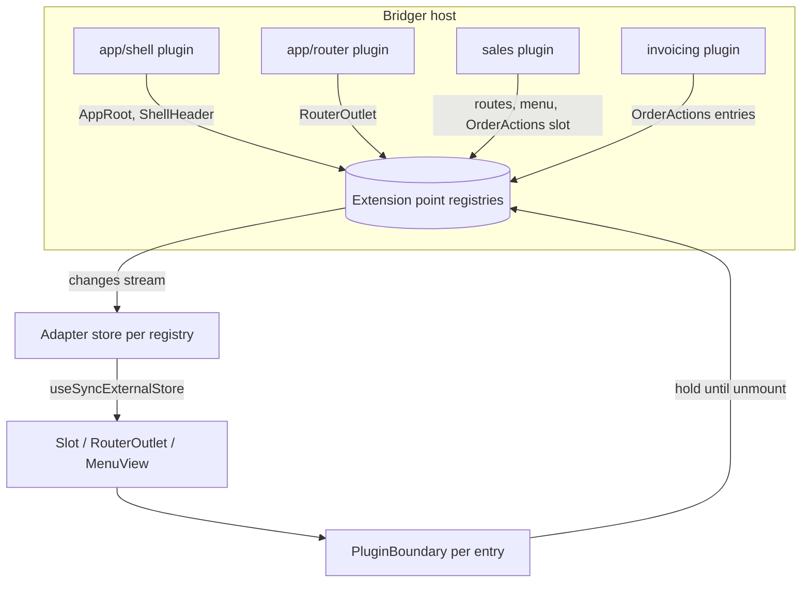
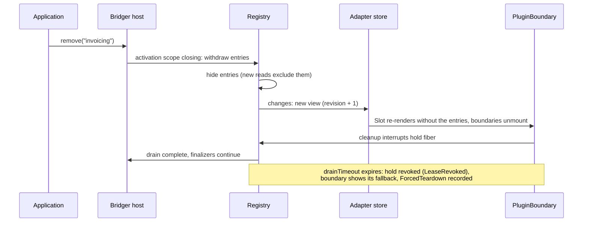

# `@bridger/react`: a UI built from plugins

Status: **proposal for review, not implemented or type-checked**. Date: 2026-10-03. Every name in `@bridger/react` below is proposed. Core behavior is cited from [SPEC.md](SPEC.md) and `references/core` (behaviors 15, 19, 20). This document extends [REACT-API.md](REACT-API.md), which covers calling services and observing plugin state; that API stays and is used inside plugin components.

## 1. Decision

In a Bridger React application **everything visible is contributed by plugins**: the app shell, header, menus, routes, pages, commands, and the business components inside pages. The application entry renders exactly one thing:

```tsx
root.render(
  <BridgerProvider client={client}>
    <Slot of={AppRoot} />
  </BridgerProvider>
)
```

Plugins do not only fill extension points; **they define new ones** that other plugins fill. A Sales plugin opens an `OrderActions` slot on its order page; an Invoicing plugin adds a button there. Removing, replacing or installing any plugin updates the mounted UI in place, with the core's dependency ordering, leases and drain rules governing teardown.

| Concern | Decision |
| --- | --- |
| Extension mechanism | Typed **extension points** backed by `ContributionRegistry` ([SPEC.md](SPEC.md) "Revertibility and shared state"). No second mechanism. |
| Who contributes | Plugins, from their scoped `build`. Contributions disappear when the plugin's activation scope closes. |
| Who defines extension points | `@bridger/react` defines the generic ones (§2). Any plugin may define its own and export it. |
| Shell | An ordinary plugin contributing to `AppRoot`. Replaceable with `replace` or overridden by a higher-priority contribution. |
| Mounted contributions | Each renders inside a `PluginBoundary` that holds its contribution against removal, isolates errors and suspends for lazy code (§5). |
| Data inside components | The hooks of [REACT-API.md](REACT-API.md) (`useServiceAction`, `usePluginState`) plus `useServiceQuery` and `useServiceStream` (§3.4). |
| Rendering | Client-side only. SSR is out of scope ([REACT-API.md](REACT-API.md) "Boundaries"). |



## 2. Extension points

An extension point is a typed token naming one `ContributionRegistry`. `@bridger/react` ships these; applications and plugins define more with the same constructors.

| Token | Kind | Value contributed | Rendered by |
| --- | --- | --- | --- |
| `AppRoot` | `Slot.single<{}>` | The root layout component | `<Slot of={AppRoot} />` in the entry |
| `ShellHeader`, `ShellFooter`, `StatusBar` | `Slot.many<{}>` | Components | The shell plugin |
| `Routes` | `Route.registry` | `{ path, component, title? }` keyed by `path` | `<RouterOutlet />` |
| `MainMenu` | `Menu.define` | `{ id, label, to? \| command?, icon?, parent? }` | `<MenuView of={MainMenu} />`, `useMenu` |
| `Commands` | `Command.registry` | `{ id, title, key?, when?, run }` | Command palette, keybinding listener |
| `Settings` | `Slot.many<{}>` | Settings panels | The settings page |

```ts
namespace Slot {
  // All entries render, ordered by priority ascending then ID (the registry order).
  function many<P>(id: string): SlotToken<P, "many">
  // Only the last entry in registry order renders: the highest priority wins, ties broken by ID.
  function single<P>(id: string): SlotToken<P, "single">
}
```

`single` is resolved in the adapter over the registry view; the core has no notion of a winner. When the winning entry is withdrawn, the next one renders, so a higher-priority shell overrides the default shell and removing it restores the default.

Contribution IDs are unique per registry and **must be prefixed with the contributing plugin's ID** (`invoicing/create`). A collision fails the contributing plugin's activation with `DuplicateContribution` (BEH-BR-163). Routes are keyed by `path`, so two plugins cannot claim the same path; overriding another plugin's page is done by replacing that plugin, or by the owner exposing a `Slot.single` for the page body.

## 3. API

### 3.1 The `Ui` service

```ts
class Ui extends Context.Service<Ui, {
  readonly slot:    <P>(point: SlotToken<P, any>, id: string, component: ComponentType<P>,
                        options?: { readonly priority?: number }) => Effect.Effect<void, DuplicateContribution, Scope.Scope>
  readonly route:   (route: RouteDef) => Effect.Effect<void, DuplicateContribution, Scope.Scope>
  readonly menu:    (menu: MenuToken, item: MenuItem, options?: { readonly priority?: number }) => Effect.Effect<void, DuplicateContribution, Scope.Scope>
  readonly command: (command: CommandDef) => Effect.Effect<void, DuplicateContribution, Scope.Scope>
}>()("@bridger/react/Ui") {}

// Helper for plugins that contribute UI and provide no service.
function contribute(body: (ui: Ui["Type"]) => Generator<...>): Layer.Layer<never, DuplicateContribution, Ui>
```

`Ui` is a stable base service created by `createBridgerClient`; it holds one registry per extension point and creates registries lazily for plugin-defined tokens. Every method takes the caller's activation `Scope`, so contributions are withdrawn last-in-first-out when the plugin stops (BEH-BR-164). `component` may be `React.lazy(...)`; the boundary suspends while it loads.

### 3.2 React components

| Component / hook | Purpose |
| --- | --- |
| `<Slot of={token} props={...} fallback?>` | Renders the entries of a slot, each in a `PluginBoundary`. `fallback` renders when a `single` slot is empty. |
| `<RouterOutlet notFound? unavailable?>` | Matches the current location against `Routes`. A path that was served by a plugin that has since left renders `unavailable`, not `notFound`. |
| `<MenuView of={token}>`, `useMenu(token)` | Menu tree built from `parent` links, ordered by registry order. |
| `useCommands()` | Current commands, for a palette; keybindings are bound by the router plugin. |
| `useContribution()` | Inside a contributed component: `{ pluginId, contributionId, realm }`. |

### 3.3 Router

Routing is itself a plugin (`app/router`) that provides `RouterOutlet`'s location service and a `Navigation` service (`navigate`, `location`, `params`). `@bridger/react` ships a minimal history router; an application can replace that plugin with one wrapping another router, because route definitions are data in the `Routes` registry, not router-specific objects.

### 3.4 Data in plugin components

Plugin components use the service hooks of [REACT-API.md](REACT-API.md). Two additions:

- `useServiceQuery(Key, (svc) => effect, deps)` runs a one-shot read under a lease and re-runs it when `deps` change or the key's provider changes (for example after `replace`). It is not reactive to the service's internal data.
- `useServiceStream(Key, (svc) => stream)` subscribes to a stream a service explicitly offers. This is the only way to make domain data reactive; host observation alone cannot ([REACT-API.md](REACT-API.md) "Boundaries").

## 4. Worked example

### 4.1 Shell

```tsx
export const shell = Plugin.define({
  id: "app/shell",
  requires: [Ui] as const,
  provides: [] as const,
  build: Ui.contribute(function* (ui) {
    yield* ui.slot(AppRoot, "app/shell", () => (
      <Layout
        header={<Slot of={ShellHeader} />}
        sidebar={<MenuView of={MainMenu} />}
        main={<RouterOutlet unavailable={<ModuleUnavailable />} />}
      />
    ))
  })
})
```

### 4.2 A business plugin with its own extension point

```tsx
// Exported so other plugins can contribute to it.
export const OrderActions = Slot.many<{ readonly order: Order }>("sales/order.actions")

export const sales = Plugin.define({
  id: "sales",
  requires: [Ui, Api] as const,
  provides: [Sales] as const,
  build: Layer.merge(
    SalesLive,
    Ui.contribute(function* (ui) {
      yield* ui.route({ path: "/sales/orders", component: OrderList, title: "Orders" })
      yield* ui.route({ path: "/sales/orders/:id", component: lazy(() => import("./OrderPage")) })
      yield* ui.menu(MainMenu, { id: "sales", label: "Sales", to: "/sales/orders", icon: "cart" })
      yield* ui.command({ id: "sales/new-order", title: "New order", key: "mod+shift+o", run: newOrder })
    })
  )
})

// OrderPage.tsx
export default function OrderPage() {
  const { id } = useParams()
  const order = useServiceQuery(Sales, (s) => s.get(id), [id])
  if (order.pending) return <Spinner />
  if (order.error) return <ErrorPanel error={order.error} />
  return (
    <>
      <OrderForm order={order.data} />
      <Slot of={OrderActions} props={{ order: order.data }} />
    </>
  )
}
```

### 4.3 A plugin extending another plugin's UI

```tsx
export const invoicing = Plugin.define({
  id: "invoicing",
  requires: [Ui, Sales] as const,
  optional: [Pdf] as const,
  provides: [] as const,
  build: Ui.contribute(function* (ui) {
    yield* ui.slot(OrderActions, "invoicing/create", ({ order }) => <CreateInvoiceButton order={order} />)
    // Present only while a PDF provider is available (whenAvailable, SPEC.md "Optional and reactive dependencies").
    yield* whenAvailable([Pdf], () =>
      ui.slot(OrderActions, "invoicing/pdf", ({ order }) => <DownloadPdf order={order} />))
  })
})
```

### 4.4 Overriding the shell

```tsx
export const kioskShell = Plugin.define({
  id: "kiosk/shell",
  requires: [Ui] as const,
  provides: [] as const,
  build: Ui.contribute(function* (ui) {
    yield* ui.slot(AppRoot, "kiosk/shell", KioskLayout, { priority: 10 })
  })
})
```

A feature made of several plugins installs as one unit with `Plugin.group` ([SPEC.md](SPEC.md) "Plugin handles, children and groups").

## 5. Mounting and teardown

### 5.1 `PluginBoundary`

`Slot`, `RouterOutlet` and `MenuView` render each contributed component inside a `PluginBoundary`, which:

1. **Holds the contribution while mounted.** On mount (in `useEffect`) it starts a fiber running `registry.use(id, () => Effect.never)` and interrupts it on cleanup. While the fiber runs, the contribution's removal waits for it, up to `drainTimeout` (BEH-BR-166, BEH-BR-167). No new core lease primitive is needed.
2. **Isolates errors.** A render error shows a per-contribution fallback and is reported as a diagnostic for the owning plugin; it never unmounts siblings or the shell.
3. **Suspends** while lazy plugin code loads.
4. **Provides context**: `useContribution()` and the owning plugin's realm, so service hooks resolve providers the owner can see ([SPEC.md](SPEC.md) "Realms and interception").

### 5.2 Removal sequence



The order is always: hidden from new renders, unmounted by React, hold released, plugin scope closed. Component cleanup therefore runs while the plugin's services are still available. Dependents leave first (BEH-BR-043): removing `sales` removes Invoicing's entries before Sales' own.

### 5.3 Runtime behavior

| Operation | Effect on the mounted UI |
| --- | --- |
| `install(invoicing)` | "Create invoice" appears on every mounted order page. |
| `remove("invoicing")` | The button unmounts (§5.2); Sales is unaffected. |
| `remove("sales")` | Invoicing becomes `waiting`; Sales' routes, menu item and command disappear; an open `/sales/...` location renders `unavailable`. |
| `replace(salesV2)` | Old entries are withdrawn and new ones contributed (replace is stop-then-start, [ADR 004](../references/core/decisions/004-replace-is-stop-then-start.md)); the location is kept and `useServiceQuery` re-runs against the new provider. |
| `install(kioskShell)` | `AppRoot` switches to `KioskLayout`; removing it restores the default shell. |
| `Pdf` provider leaves | Only `invoicing/pdf` is withdrawn; Invoicing stays `active`. |

### 5.4 Strict Mode

Strict Mode mounts, cleans up and mounts again. The hold is created in an effect and released in its cleanup, so the double mount takes and releases one hold before taking the final one; it never installs or removes plugins and never leaks a hold. Subscriptions to registries go through `useSyncExternalStore` and start no Effect work during render.

## 6. Rules

- **Contributions are data and components.** A plugin never mutates another plugin's contributions or React tree; it can only add entries to an extension point it can resolve.
- **Extension point tokens are code-level contracts.** A plugin that defines a token exports it from a stable module; consumers import the token, not the plugin. Changing a token's props type is a breaking change for that plugin's contributors.
- **Visible UI is not authorization.** Hiding a menu or route does not protect an operation; the server enforces access ([ERP-ACCESS.md](ERP-ACCESS.md) §8).
- **Dynamic code** follows [SPEC.md](SPEC.md) "Dynamic code loading": entries have no import-time side effects, are loaded only through the application's trusted loader, and share the page's single React and Effect instances.
- **No live services in props.** Contributed components receive plain props and reach services through hooks under leases.

## 7. What the core must provide

| # | Need | Status |
| --- | --- | --- |
| 1 | `ContributionRegistry` with `changes`, `use` holds, hide-then-drain removal | Specified ([behavior 19](../references/core/behaviors/19-contribution-registry.md), BEH-BR-161–168); prototyped in `prototypes/host-core/src/registry.ts`. |
| 2 | Owning plugin ID on each `RegistryView` entry, so the boundary can report diagnostics and resolve the owner's realm | **Gap.** The registry reports owners to the host for `inspect` (BEH-BR-168), and `registry.ts` records them through `ActivePlugin`, but `RegistryView` entries do not carry them. |
| 3 | `Host.changes` subscription for `usePluginState` and provider changes in `useServiceQuery` | Specified in SPEC.md; not yet in the prototype host. |
| 4 | `whenAvailable` for conditional contributions | Specified ([behavior 15](../references/core/behaviors/15-optional-and-reactive.md)); prototyped. |
| 5 | A forced-teardown diagnostic when a hold is revoked | **Gap.** Registries report `LeaseRevoked` to the holder; the adapter records `ForcedTeardown` until the core has a registry-level event. |

## 8. Testing

`@bridger/react/testing` renders a tree over a testing host ([references/core behavior 21](../references/core/behaviors/21-testing-host.md)) and exposes `install`, `remove`, `replace` and `awaitIdle`. Acceptance scenarios:

- Installing and removing a plugin adds and removes its slot entries, routes and menu items without remounting siblings or the shell.
- A component whose cleanup uses its plugin's service succeeds during removal (cleanup precedes scope close).
- A contribution that throws during render shows its fallback; siblings stay mounted.
- A contribution that never unmounts within `drainTimeout` is revoked and the removal completes.
- A higher-priority `AppRoot` overrides the shell and removing it restores the shell.
- Strict Mode double mounting leaks no hold.

These are design acceptance scenarios, not tests already executed.

## 9. Decisions and open items

| # | Item | Decision |
| --- | --- | --- |
| 1 | Mechanism | **Extension points over `ContributionRegistry`**; no separate component registry. |
| 2 | Single-winner slots | **Resolved in the adapter** by registry order; the core stays winner-agnostic. |
| 3 | Route conflicts | **Fail with `DuplicateContribution`.** Overrides go through `replace` or an owner-provided `Slot.single`. |
| 4 | Mount hold | **`registry.use` with a never-ending callback**, interrupted on unmount; no new core primitive. |
| 5 | FoldKit parity | **Open.** [FOLDKIT-API.md](FOLDKIT-API.md) has no slot or route contribution model yet; the extension point tokens are framework-neutral, the rendering components are not. |
| 6 | Theme and i18n contributions | **Open.** Candidates: `Slot`-like registries for theme tokens and message catalogs. |
| 7 | SSR | **Out of scope.** |
