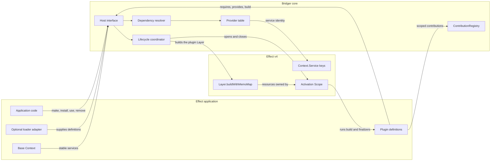
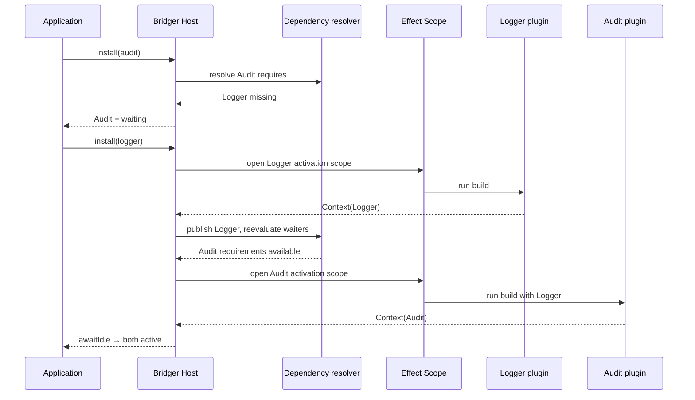
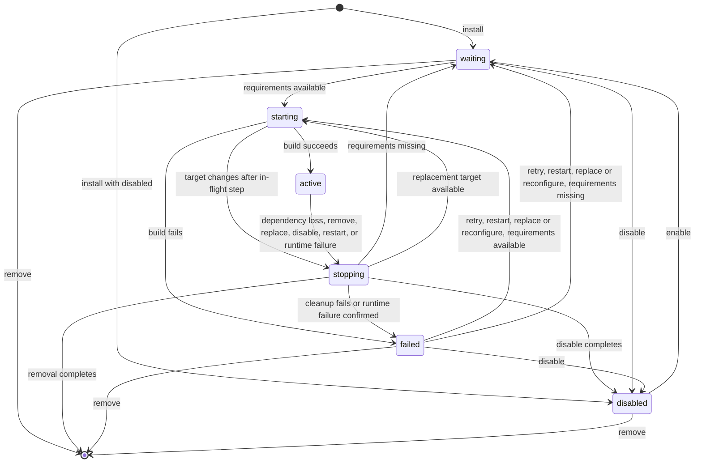
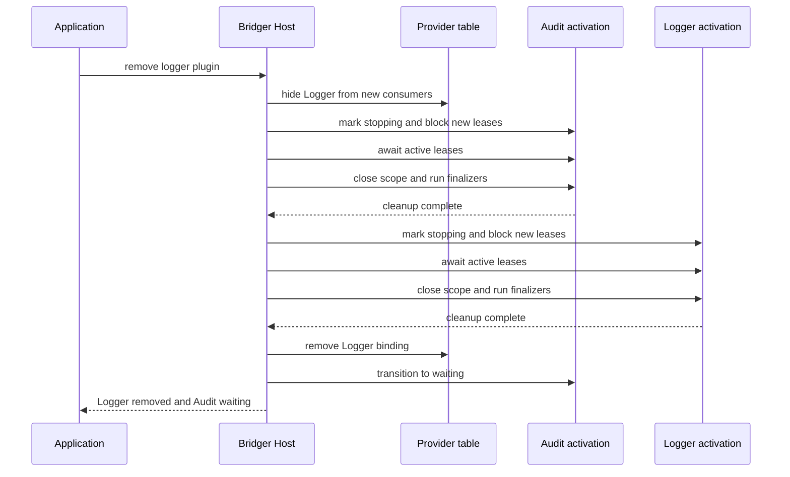

# Bridger — Effect v4 plugin library design

> **Superseded by [`references/core/`](../references/core/README.md) (CCR-BR-001); not normative.** This document is kept as design history. The normative specification of `@bridger/core` — requirements, behaviours, invariants, decisions, traceability and the GxP documents — is in `references/core/`. Where the two differ, `references/core/` governs; [the migration map](../references/core/appendices/spec-md-migration-map.md) records where each section below went. Anchors in this file are kept stable because other documents link to them.

Status: API proposal for review. Examples and signatures are illustrative and have not been type-checked. No implementation is included.

The ERP layer is proposed separately in [ERP core and API](ERP-SPEC.md), with a [complete Todo plugin walkthrough](ERP-TODO-WALKTHROUGH.md).

## Purpose

Bridger is a reusable plugin runtime for TypeScript applications built with Effect v4. It lets an application install, remove, and replace plugin definitions while running. A plugin declares the services it needs and provides; Bridger activates it when requirements are available, tracks its Effect scope, and closes dependent plugins before a provider leaves.

The host application decides what its plugins mean. Bridger contains no ERP entities, database migrations, tenants, UI framework, package manager, or deployment format. A FoldKit integration can be built as an adapter using the same runtime interface.

Technology policy: the design targets the latest stable Effect 4.x release (4.0.0 or later). Unstable-module imports are allowed where a feature needs them; each such import is recorded with an explicit compatibility version.

## Modules and seams

The boxes below are proposed modules and responsibilities, not separate packages that every application must install.



| Seam | What crosses it | What stays behind it |
| --- | --- | --- |
| Application → Host | `layer`, `make`, `install`, `remove`, `replace`, `use`, snapshots | Dependency ordering, transition serialization, provider lookup |
| Plugin definition → Host | ID, declared keys, `build` as an Effect `Layer` | The plugin's domain logic and the meaning of its services |
| Bridger → Effect v4 | Service keys, `Context`, `Scope`, finalizers | Effect's resource and execution machinery |
| Loader adapter → Host | An already loaded `PluginDefinition` | Fetching, verifying, versioning, and evaluating code |
| Plugin → ContributionRegistry | Unique contribution ID and value in an activation scope | The application's interpretation of registered values |

`Dependency resolver`, `Lifecycle coordinator`, and `Provider table` are internal modules. `Host` and `PluginDefinition` are the main public interfaces; `ContributionRegistry` and `Generation` are public helpers. The optional loader is an adapter at the Host seam.

## The small public interface

```ts
import { Context, Effect, Layer } from "effect"
import { Bridger, Plugin } from "@bridger/core" // proposed package name

class Logger extends Context.Service<Logger, {
  readonly log: (message: string) => Effect.Effect<void>
}>()("example/Logger") {}

class Audit extends Context.Service<Audit, {
  readonly record: (event: string) => Effect.Effect<void>
}>()("example/Audit") {}

const logger = Plugin.define({
  id: "example/logger",
  requires: [] as const,
  provides: [Logger] as const,
  build: Layer.effect(Logger, Effect.gen(function* () {
    const sink = yield* Effect.acquireRelease(openLogSink, (sink) => sink.close)
    return { log: (message) => sink.write(message) }
  }))
})

const audit = Plugin.define({
  id: "example/audit",
  requires: [Logger] as const,
  provides: [Audit] as const,
  build: Layer.effect(Audit, Effect.gen(function* () {
    const log = yield* Logger
    return { record: (event) => log.log(`audit: ${event}`) }
  }))
})

const program = Effect.scoped(Effect.gen(function* () {
  const host = yield* Bridger.make()
  yield* host.install(audit)   // waits for Logger
  yield* host.install(logger)  // starts Logger, then Audit
  yield* host.awaitIdle()

  yield* host.use(Audit, (service) => service.record("started"))

  yield* host.remove("example/logger")
  // Audit closes before Logger; Audit remains installed and waits for Logger.
}))
```

The library's main leverage is behind `install`, `remove`, and `replace`: callers do not manually order providers, dependents, or finalizers. A plugin's `build` is an ordinary Effect `Layer`, so everything an Effect author already knows (`Layer.effect`, `Layer.provide`, `Layer.merge`, scoped acquisition) applies unchanged. Layers wire services statically at compile time; Bridger's resolver does the same wiring dynamically, at runtime, for plugins that arrive and leave while the program runs.

## Plugin definition

Conceptual type shape:

```ts
type Keys = readonly Context.Key<any, any>[]

type PluginDefinition<Requires extends Keys, Provides extends Keys, E, C = void> = {
  readonly id: string
  readonly requires: Requires   // a `const` tuple inferred by Plugin.define; the type-level source of truth
  readonly provides: Provides
  readonly config?: Schema.Codec<C, unknown>           // decoded before build (see Configuration)
  readonly volatile?: readonly (keyof C & string)[]    // config fields that can change without a restart (see Volatile configuration)
  readonly optional?: Keys                             // services used if present; never gate activation (see Optional and reactive dependencies)
  readonly meta?: { readonly version?: string; readonly digest?: string; readonly description?: string; readonly tags?: readonly string[] }
  readonly health?: {                                  // optional liveness probe (see Runtime failure and health)
    readonly check: Effect.Effect<void, unknown, IdentifiersOf<Requires>>
    readonly every: Duration.Input
    readonly timeout: Duration.Input
    readonly failureThreshold: number
  }
  readonly build: Layer.Layer<
    IdentifiersOf<Provides>,
    E,
    IdentifiersOf<Requires> | Plugin.Runtime | Plugin.Config<C>
  >
}

type IdentifiersOf<K extends Keys> = K[number] extends Context.Key<infer I, any> ? I : never // union of key identifiers

Plugin.define<const Requires extends Keys, const Provides extends Keys, E, C = void>(
  definition: PluginDefinition<Requires, Provides, E, C>
): PluginDefinition<Requires, Provides, E, C>

// Sugar for authors who prefer an Effect that returns a Context (built with Layer.effectContext or equivalent).
Plugin.fromEffect<Requires extends Keys, Provides extends Keys, E>(
  build: Effect.Effect<Context.Context<IdentifiersOf<Provides>>, E, IdentifiersOf<Requires> | Scope.Scope | Plugin.Runtime>
): Layer.Layer<IdentifiersOf<Provides>, E, IdentifiersOf<Requires> | Plugin.Runtime>
```

`define` infers `requires` and `provides` as `const` tuples. The `Layer`'s input (`RIn`) may not exceed `IdentifiersOf<Requires>` plus the host-provided `Plugin.Runtime` and `Plugin.Config`, and its output (`ROut`) must cover every provided identifier; a mismatch is a compile error. The runtime lists are still required because the layer's types do not exist at runtime: the resolver needs them to wire plugins dynamically. This is the only type-level guarantee; requirements hidden inside returned methods are not tracked (see below).

- `id` is stable within one host and realm. A second installation of the same ID in the same realm fails.
- `requires` is the set of external Effect services the plugin declares. The `build` layer's requirements are constrained by it at the type level, and service availability is checked at runtime before activation. Requirements hidden inside methods returned by `build` remain an author contract and must be declared too.
- `provides` lists services published as one unit after `build` succeeds. An omitted declared service is an activation error; partial results are never published.
- `build` runs anew for each activation in a fresh activation scope, `Scope.fork(hostScope, "sequential")`. Scoped acquisitions and finalizers are released in last-in-first-out order. Closing the host scope would close any remaining activation scopes, but the host closes them itself in dependency order first (see Shutdown).
- `config`, `volatile`, `optional`, `meta` and `health` are optional and described in "Configuration and metadata", "Volatile configuration", "Optional and reactive dependencies" and "Runtime failure and health" below. `Plugin.Runtime` and `Plugin.Config` are `Context.Service`s (identifiers `@bridger/core/Plugin.Runtime` and `@bridger/core/Plugin.Config`) that the host provides to the `build` layer as part of its input.

**Activation.** The host builds the layer with `Layer.buildWithMemoMap(build, memoMap, activationScope)`, supplying the captured provider services, `Plugin.Runtime` and `Plugin.Config` as the layer's input. Resources the layer acquires are released when the activation scope closes. `memoMap` is created **fresh for every activation** (`Layer.makeMemoMap`): layer memoization is by reference, so sharing one memo map across activations would make a restart reuse a build whose scope has already closed. Inside one activation, memoization applies as usual, so a plugin may compose sub-layers and share them. Bridger does not require a second resource abstraction beside Effect Scope and Layer.

**Key identity and versioning.** The host matches services by `ServiceId`, which is the key's own string identifier (`key.key` on a `Context.Service`). That is what makes keys work across separately bundled plugins. Two consequences are enforced:

- If a plugin's `requires` key and the active provider's key share a `ServiceId` but are different key *objects* (typically two bundled copies of a package), activation fails with phase `activation` and a `KeyMismatch { serviceId }` cause. Bridger does not guess that the shapes agree.
- The core cannot detect a changed service *shape* under an unchanged `ServiceId`. By convention a breaking change to a service gets a new identifier carrying the major version (`example/Audit@2`); the distribution layer ([ERP-DISTRIBUTION.md](ERP-DISTRIBUTION.md)) adds API-version checks at the manifest level.

## Host interface

```ts
interface Host {
  install<R extends Keys, P extends Keys, E, C>(plugin: PluginDefinition<R, P, E, C>, options?: InstallOptions):
    Effect.Effect<PluginHandle, InstallError | HostClosed>
  remove(ref: PluginRef, options?: RemoveOptions):
    Effect.Effect<void, UnknownPlugin | CleanupError | DrainTimeout | WouldDeadlock | HostClosed>
  replace<R extends Keys, P extends Keys, E, C>(plugin: PluginDefinition<R, P, E, C>, options?: ReplaceOptions):
    Effect.Effect<void, ReplaceError | Conflict | Superseded | DrainTimeout | WouldDeadlock | HostClosed>
  retry(ref: PluginRef): Effect.Effect<void, UnknownPlugin | Conflict | HostClosed>
  reconfigure(ref: PluginRef, config?: unknown): Effect.Effect<void, UnknownPlugin | ConfigInvalid | Conflict | HostClosed>
  restart(ref: PluginRef, options?: RemoveOptions): Effect.Effect<void, UnknownPlugin | Conflict | DrainTimeout | WouldDeadlock | HostClosed>
  disable(ref: PluginRef, options?: RemoveOptions): Effect.Effect<void, UnknownPlugin | Conflict | DrainTimeout | WouldDeadlock | HostClosed>
  enable(ref: PluginRef): Effect.Effect<void, UnknownPlugin | Conflict | InstallError | HostClosed>
  reconcile(desired: readonly DesiredPlugin[], options?: ReconcileOptions):
    Effect.Effect<ReconcileReport, HostClosed>                       // see Desired-state reconciliation
  inspect(ref: PluginRef): Effect.Effect<PluginInspection, UnknownPlugin>   // see Inspection and diagnostics
  defineRealm(id: string, options: RealmOptions): Effect.Effect<void, DuplicateRealm | HostClosed>   // see Realms
  awaitIdle(options?: { readonly timeout?: Duration.Input }): Effect.Effect<HostSnapshot, IdleTimeout | WouldDeadlock>
  snapshot(): Effect.Effect<HostSnapshot>
  readonly changes: Stream.Stream<HostSnapshot>           // state feed
  readonly events: Stream.Stream<HostEvent>               // transition log (not coalesced; bounded, loss shows as a gap in `seq`)
  use<Service, A, E, R>(
    key: Context.Key<any, Service>,
    run: (service: Service) => Effect.Effect<A, E, R>,
    options?: { readonly timeout?: Duration.Input; readonly realm?: string }
  ): Effect.Effect<A, E | ServiceUnavailable | LeaseRevoked | LeaseTimeout, R>
  useAll<Keys extends readonly Context.Key<any, any>[], A, E, R>(
    keys: Keys,
    run: (services: ServicesOf<Keys>) => Effect.Effect<A, E, R>,
    options?: { readonly timeout?: Duration.Input; readonly realm?: string }
  ): Effect.Effect<A, E | ServiceUnavailable | LeaseRevoked | LeaseTimeout, R>
  lease<Keys extends readonly Context.Key<any, any>[]>(keys: Keys, options?: { readonly realm?: string }):   // scoped lease
    Effect.Effect<ServicesOf<Keys>, ServiceUnavailable, Scope.Scope>
  shutdown(options?: { readonly timeout?: Duration.Input }): Effect.Effect<CloseReport>
}

// A plugin is addressed by ID within a realm. A bare string means the default realm.
type PluginRef = string | { readonly id: string; readonly realm: string }

interface ReplaceOptions extends RemoveOptions {
  readonly realm?: string                     // realm of the plugin being replaced (default: "default")
}

interface InstallOptions {
  readonly realm?: string                     // default: "default" (see Realms)
  readonly config?: unknown                   // initial override (as reconfigure would set)
  readonly disabled?: boolean                 // register without activating
  readonly intercept?: readonly Interception<any>[]   // see Interception
}

interface PluginHandle {
  readonly id: string
  readonly realm: string
  readonly state: Effect.Effect<PluginState | "uninstalled">      // "uninstalled" once removed
  readonly changes: Stream.Stream<PluginSnapshot>                 // this plugin's entries from Host.changes
  // type PluginSnapshot = HostSnapshot["plugins"][number]
  readonly awaitActive: (options?: { readonly timeout?: Duration.Input }) =>
    Effect.Effect<void, ActivationFailed | PluginRemoved | WaitTimeout>
  readonly remove: (options?: RemoveOptions) => Effect.Effect<void, UnknownPlugin | CleanupError | DrainTimeout | WouldDeadlock | HostClosed>
  readonly restart: Effect.Effect<void, UnknownPlugin | Conflict | HostClosed>
}

interface RemoveOptions {
  readonly drain?: Duration.Input | "forever"   // how long to wait for leases (default: host drainTimeout)
  readonly force?: boolean                      // interrupt leases still held after `drain`
}

type ServicesOf<Keys extends readonly Context.Key<any, any>[]> =
  { readonly [I in keyof Keys]: Keys[I] extends Context.Key<any, infer S> ? S : never }

type ServiceId = string // the key's identifier: `key.key` of a Context.Service
type PluginState = "waiting" | "starting" | "active" | "stopping" | "failed" | "disabled"

interface HostSnapshot {
  readonly hostId: string
  readonly revision: number // increases on every state change within one host
  readonly plugins: readonly {
    readonly id: string
    readonly realm: string                  // "default" unless installed into a realm
    readonly parentId?: string              // set for child plugins (see Children and groups)
    readonly state: PluginState
    readonly missingServiceIds: readonly ServiceId[]
    readonly providerIds: readonly string[] // plugin IDs, or "base" for base services
    readonly meta?: { readonly version?: string; readonly description?: string }
    readonly health?: "healthy" | "degraded" | "unknown"
    readonly failure?: { readonly phase: "build" | "activation" | "runtime" | "cleanup"; readonly message: string }
  }[]
  readonly availableServiceIds: readonly ServiceId[] // the default realm's list; includes stable base services
  readonly realms: readonly { readonly id: string; readonly isolatedServiceIds: readonly ServiceId[]; readonly availableServiceIds: readonly ServiceId[] }[]
}

interface BridgerOptions {
  readonly base?: Context.Context<any> | Layer.Layer<any>   // stable application services; a Layer is built in the host scope
  readonly config?: ConfigSource                       // raw plugin configuration source (default: the ambient ConfigProvider)
  readonly concurrency?: number | "unbounded"          // concurrent builds and independent stops (default 4)
  readonly buildTimeout?: Duration.Input               // per-build limit (default 60 seconds)
  readonly drainTimeout?: Duration.Input | "forever"   // lease drain limit on remove/replace (default 30 seconds)
  readonly shutdownTimeout?: Duration.Input            // limit for host close (default 60 seconds)
  readonly eventBuffer?: number                        // capacity of the events PubSub (default 1024)
  readonly stallWarning?: Duration.Input | "never"      // report a plugin stuck in `waiting` (default 30 seconds)
  readonly onClose?: (report: CloseReport) => Effect.Effect<void>
}

type ConfigSource = ConfigProvider.ConfigProvider | ((id: string) => Effect.Effect<unknown>)

// Bridger.Host is a service key: Context.Service<Bridger.Host, Host> with identifier "@bridger/core/Host".
Bridger.layer(options?: BridgerOptions): Layer.Layer<Bridger.Host>                          // primary constructor
Bridger.make(options?: BridgerOptions): Effect.Effect<Host, never, Scope.Scope>             // the layer's body, for scoped code
```

`layer` is the primary constructor and `make` is its body for code that already has a scope; closing the owning scope (or releasing the layer) closes every installed plugin. `Bridger.Host` is the package's service key. An optional `base` supplies stable application services; base services cannot be replaced by a plugin in the same host. A `Layer` base is built in the host scope before any plugin starts and released after every plugin has stopped, so base services get a lifecycle and ordering that a bare `Context` cannot give; a `Context` base is used as given and is the caller's to manage.

`install` records a plugin immediately. It has two kinds of outcome:

- **Definition errors fail the call and register nothing.** `InstallError` is `DuplicatePlugin` (ID already known), `DuplicateProvider` (a provided key is already provided by an installed plugin or the base Context), `DependencyCycle` (the new plugin closes a cycle in the requires/provides graph), `UnknownRealm` (the named realm was never defined) or `InvalidDefinition` (malformed `id`, `requires` or `provides`, a plugin that requires a key it also provides, or a key listed in both `requires` and `optional`). `HostClosed` also fails the call. Duplicate, provider and cycle checks apply within the plugin's resolution scope (its realm). These checks run against the definitions currently installed, so their result can depend on install order.
- **Activation outcomes are state, never errors of `install`.** Missing requirements leave the plugin `waiting`; a build failure is recorded as `failed` (phase `build` or `activation`). Adapters may choose a stricter policy for the *initial* plugin set (the React and FoldKit adapters fail startup after cleanup when an initial plugin fails to activate); that policy belongs to the adapter, and later failures stay visible in snapshots.

`awaitIdle` waits for currently runnable transitions and returns a snapshot; it does not wait indefinitely for missing providers. `remove` unregisters the definition after cleanup; dependents remain installed but wait for their requirements. `replace` removes the old activation (dependents first), changes the definition under the same ID, and starts a new one when requirements are met. If the new build fails the plugin is `failed` with the new definition and the old one is not restored. It is not a transaction over external effects.

**`replace` may change `requires` and `provides`.** The new definition is validated with the `install` checks against the installed set *excluding the old definition of that ID*, and this validation runs **before** anything is stopped. A rejected definition fails with `ReplaceError` (carrying the `InstallError` cause) and leaves the running plugin untouched. After a valid replace:

- A key the old definition provided and the new one does not becomes unavailable: its dependents go `waiting` with that key in `missingServiceIds`.
- A key the new definition adds is subject to `DuplicateProvider` as in `install`.
- Changed `requires` are evaluated afresh; the plugin starts when they are satisfied and otherwise waits.

`use` leases an active service for the duration of the callback so a provider cannot close during that call. A service reference or asynchronous task that escapes the callback cannot be protected by TypeScript; callers must keep such work within the lease or a plugin activation scope.

`useAll` leases several services for one callback. It is all-or-nothing: if any key is unavailable it fails with `ServiceUnavailable` and holds no lease. Leases are acquired in a canonical key order so two concurrent `useAll` calls cannot deadlock each other. Removing any provider waits for every `useAll` callback leasing it. `useAll` does not extend leases to services a provider reaches internally; a layer that needs that (for example a registry generation) uses `Generation` below.

`changes` is the observation stream used by the [React](./REACT-API.md) and [FoldKit](./FOLDKIT-API.md) adapters. It is `SubscriptionRef.changes` over a `SubscriptionRef<HostSnapshot>`, which already emits the current value first and then every change. Each subscription receives the current snapshot first and registers without a gap, so no later revision can be missed. Revisions within one host never regress; a slow subscriber may skip intermediate revisions and receives the latest, so this is a state feed, not an audit log. Closing the host ends the stream. `snapshot()` is the one-time read of the same value.

`ServiceId` is the stable string identity of a Context key (`key.key`); snapshots hold identifiers, never keys, implementations, fibers or raw causes. Adapters map a key to its identifier with `key.key` when they answer "is this service available?". Full failure causes stay inside the core and are available through diagnostics, not the snapshot.

## Errors

Every named error is a tagged Effect error (`Schema.TaggedError`), so callers use `Effect.catchTag` and unions narrow by `_tag`. Errors carry identifiers and messages, never configuration values, keys, fibers or raw causes (those stay in the core's diagnostics).

```ts
class DuplicatePlugin extends Schema.TaggedError<DuplicatePlugin>()("DuplicatePlugin", { id: Schema.String }) {}
type InstallError = DuplicatePlugin | DuplicateProvider | DependencyCycle | InvalidDefinition | UnknownRealm
```

| Error | Fields |
| --- | --- |
| `DuplicatePlugin` | `id` |
| `DuplicateProvider` | `serviceId`, `providerId` (plugin ID or `"base"`) |
| `DependencyCycle` | `path` (plugin IDs) |
| `InvalidDefinition` | `id`, `reason` |
| `ReplaceError` | `id`, `cause: InstallError` |
| `UnknownPlugin` | `id` |
| `Conflict` | `id`, `pending` (the operation in progress) |
| `Superseded` | `id` |
| `HostClosed` | none |
| `ConfigInvalid` | `id`, `message` (decode issues, with `Redacted` values omitted) |
| `CleanupError` | `id`, `message` |
| `DrainTimeout` | `id` (plugin or generation name), `leases` |
| `WouldDeadlock` | `id` |
| `IdleTimeout` | `snapshot` |
| `ServiceUnavailable` | `serviceId` |
| `LeaseRevoked` | `serviceId` or `id` |
| `LeaseTimeout` | `serviceId`, `timeout` |
| `KeyMismatch` | `serviceId` |
| `AdmissionClosed` | `name` (generation) |
| `ActivationFailed` | `id`, `phase`, `message` |
| `PluginRemoved` | `id` |
| `WaitTimeout` | `id`, `timeout` |
| `DuplicateRealm`, `UnknownRealm` | `id` |
| `DuplicateContribution`, `ContributionUnavailable` | `id` |

## Install and activation flow

The example's `audit` plugin is installed first. Installation records a definition; activation waits until `Logger` is published. `awaitIdle` reports `waiting` rather than waiting for a provider that may never arrive.



Provided services become visible together only after a successful `build`. The provider identities captured for Audit remain its dependency view until Audit is stopped and restarted.

## State and lifecycle

| State | Meaning |
| --- | --- |
| `waiting` | At least one declared service is unavailable. |
| `starting` | The plugin's `build` effect is running. |
| `active` | All declared services are published. |
| `stopping` | The plugin accepts no new dependents or leases; cleanup is in progress. |
| `failed` | Activation or cleanup failed; the phase and cause are visible. |
| `disabled` | Registered with its definition and configuration retained, but deliberately not activated. It provides nothing and reserves no provider slot (see "Disable, enable and restart"). |



Rules the diagram leaves implicit:

- `failed` is sticky and holds no live scope. If its requirements disappear or return while it is failed, it stays `failed`; the snapshot keeps `missingServiceIds` current so an adapter can show whether `retry` would start the plugin or land in `waiting`.
- A plugin leaves `failed` only through an operation (`retry`, `restart`, `replace`, `reconfigure`, `disable`, `remove`). This holds for every failure phase, including `runtime`.
- `retry`, `restart`, `replace` and `reconfigure` on a `failed` plugin go to `starting` when its requirements are available and to `waiting` otherwise. A `waiting` plugin whose requirements later appear starts by itself; that is a normal start, not a retry.
- Dependency loss changes only `starting` and `active` plugins (they go through `stopping`). It does not touch `waiting` or `failed` ones.

A snapshot (see `HostSnapshot` above) includes host ID, a monotonic revision, each plugin's ID, realm, state, missing service identifiers, selected provider IDs and a failure phase and message, plus the available service identifiers including base services. State changes are applied atomically in a single order (the snapshot revision). Independent plugin builds may run concurrently within the configured `concurrency`, but a single plugin has at most one transition in flight. Operations on one plugin (ID within its realm) are linearized as described in "Operation semantics and races".

1. Reject duplicate plugin IDs, duplicate providers of one key, and dependency cycles (each within the plugin's resolution scope).
2. Start a plugin only when all required keys have active providers or are available from the base Context. Capture the provider identities for that activation.
3. Run `build` in a fresh scope. If it fails, close the scope, publish nothing, record `failed`, and wait for explicit `retry` or `replace`.
4. When a provider is removed or replaced, stop its active dependents first (including child plugins and `whenAvailable` blocks that use it). Wait for dependent scopes and host leases, then close the provider scope. A dependent becomes `waiting` or restarts against the new provider.
5. If dependencies change while an asynchronous build is running, let that step settle, close its stale scope, and reevaluate against the latest target. Do not publish stale results.
6. On host close, stop all plugins in reverse dependency order and await finalizers. Cleanup failures are reported through `CloseReport` (see "Shutdown"), never dropped.

If cleanup fails, the provider is unpublished and the failure is reported. Bridger must not claim that a leaked external resource has been recovered; conflicting replacement is withheld until the application resolves the failure.

### Removal ordering

The success path below makes the provider unavailable to *new* consumers as soon as removal begins, while an existing dependent keeps its captured service long enough to finish teardown.



This is the spatial guarantee: Audit can use its committed Logger binding during its finalizers, and Logger is closed only after Audit releases it. Each scope's own finalizers run in last-in-first-out order.

## Operation semantics and races

Operations that name a plugin (`install`, `remove`, `replace`, `retry`, `reconfigure`, `restart`, `disable`, `enable`) are **linearized per plugin (ID within its realm) in call order**, and each records its *intent* when it is called. The transition then runs asynchronously in the reconciler.

| Current activity on the ID | Incoming operation | Result |
| --- | --- | --- |
| none, ID unknown | `install` | Registers the plugin. |
| any | `install` of a known ID | `DuplicatePlugin`. |
| `remove` in progress | `remove` | Joins the removal; both callers complete together with the same result. |
| `remove` in progress | `replace`, `reconfigure`, `retry` | `Conflict` (`pending: "remove"`). The ID is going away. |
| `replace` in progress | `replace` | The later definition wins; the earlier caller completes with `Superseded` and the transition continues toward the later definition. |
| `replace` in progress | `remove` | Remove wins; the replacement is discarded and its caller completes with `Superseded`. |
| `replace` in progress | `reconfigure` | `Conflict`. |
| `starting` or `waiting` | `retry` | No-op (nothing failed). |
| `failed` | `retry`, `restart`, `replace`, `remove`, `reconfigure`, `disable` | Allowed; `retry`, `restart`, `replace` and `reconfigure` start the plugin when requirements are available and otherwise leave it `waiting`. A failure with phase `cleanup` rejects `retry` and `replace` (`Conflict`) until the application resolves the leak; `remove` retries the cleanup. |
| any | `use`/`useAll`/`lease` when the provider is not `active` | `ServiceUnavailable`. |
| `disabled` | `retry` | `Conflict` (`pending: "disabled"`). |
| `disabled` | `enable`, `remove`, `replace` | Allowed. `replace` keeps the plugin disabled. |
| `remove` or `replace` in progress | `disable`, `enable`, `restart` | `Conflict`. |
| `disable` in progress | `disable` | Joins. |
| `restart` or `reconfigure` in progress | `restart`, `reconfigure` | Joins; the in-flight restart satisfies both. |
| `restart` or `reconfigure` in progress | `remove`, `replace`, `disable` | The later operation wins; the earlier caller completes with `Superseded`. |
| any, host closing | any operation | `HostClosed`. |

**Caller interruption does not cancel the transition.** Intent is recorded when the operation is called; interrupting the *waiting* caller stops only the wait, not the removal or replacement. A caller that needs cancellation issues the opposite operation (for example `retry` or a new `replace`).

## Leases: limits, supervision and re-entrancy

A lease is held from the moment a callback is admitted until it ends, so a stuck callback must be bounded.

- **Drain limit.** `remove`, `replace`, `restart` and `disable` wait for leases up to `drain` (default: the host's `drainTimeout`, 30 seconds). On expiry the call fails with `DrainTimeout { id, leases }`; the plugin stays `stopping` (unavailable to new consumers) and the operation can be repeated with a longer `drain`, or with `force: true`. `drain: "forever"` is allowed but must be explicit.
- **Force.** With `force: true`, after the drain limit the host interrupts the remaining lease callbacks, waits for their finalizers, then closes the scope. Interrupted callbacks fail with `LeaseRevoked`. Forcing is audited as a host event (`lease-revoked`). Interruption does not undo external effects.
- **Supervised callbacks.** To be interruptible, `use` and `useAll` run the callback in a child fiber supervised by the host and joined by the caller. The caller's own fiber is never interrupted by the host. Edge rules:
  - **Caller interruption.** If the caller is interrupted while the callback runs, the host interrupts the child, awaits its finalizers, and only then releases the lease. The caller's interruption completes after that.
  - **Context propagation.** The child inherits the caller's fiber references (tracing span, logger annotations, the held-plugin-IDs reference used for `WouldDeadlock`) and the caller's `R` environment.
  - **Failures.** The callback's own failure and defects propagate unchanged; `LeaseRevoked` and `LeaseTimeout` are produced only when the host interrupted the child.
  - **Escaping work.** Fibers the callback forks outside the child's scope are not part of the lease. They are the author's responsibility, as described under `use` above.
- **Per-call timeout.** `options.timeout` bounds one callback; expiry interrupts it and fails with `LeaseTimeout` (implemented with `Effect.timeoutOrElse` on the supervised child).
- **One primitive.** `lease(keys)` is the primitive. `use` and `useAll` are `lease` scoped to the callback plus the supervised child: `Effect.scoped(lease(keys))`, then `Effect.forkChild` for the callback and a join. There is one admission, drain and revocation path, not two.
- **Scoped leases.** `lease(keys)` returns the services for the lifetime of a `Scope` (all-or-nothing, like `useAll`) and releases them when the scope closes. It is the primitive for components that hold providers beyond one callback, such as a tenant registry generation ([ERP-RUNTIME.md](ERP-RUNTIME.md)). The same drain and force rules apply to scoped leases; a force removal closes the lease's scope contribution by revoking it, so the holder observes interruption of fibers it forked under the lease.
- **Re-entrancy.** A fiber that holds a lease on plugin *P* (and any fiber it forks) carries the held plugin IDs in a `Context.Reference<ReadonlySet<string>>` (identifier `@bridger/core/HeldPlugins`, default: the empty set), which forked fibers inherit. Calls from such a fiber that would wait for *P* to drain fail immediately with `WouldDeadlock { id }`: `remove`/`replace`/`restart`/`disable` of *P* or of any provider whose dependents include *P*'s lessee, and `awaitIdle`. `use` of other services remains allowed. The check follows the carried reference only: a wait that goes through another fiber (a callback that awaits a fiber which then calls `remove`) cannot be detected, and `DrainTimeout` is the only backstop for it, exactly as for any stuck lease.

## Runtime failure and health

An `active` plugin can fail after activation. The core defines three signals; all end in the same transition.

1. **Supervised background work.** `build` receives a `Plugin.Runtime` service:

```ts
interface PluginRuntime {
  // Runs `effect` as a fiber scoped to the plugin's activation. What happens when it fails:
  readonly background: <A, E, R>(
    name: string,
    effect: Effect.Effect<A, E, R>,
    options?: { readonly onFailure?: "fail-plugin" | "restart" | "ignore"; readonly restart?: Schedule.Schedule<unknown, unknown> }
  ) => Effect.Effect<void, never, R | Scope.Scope>
  // Report an unrecoverable condition detected by the plugin itself.
  readonly reportFailure: (cause: Cause.Cause<unknown>) => Effect.Effect<void>
  // Optional and reactive dependencies, children (see the sections below).
  readonly optional: <S>(key: Context.Key<any, S>) => Effect.Effect<Option.Option<S>>
  readonly useOptional: <S, A, E, R>(key: Context.Key<any, S>, run: (service: S) => Effect.Effect<A, E, R>) =>
    Effect.Effect<Option.Option<A>, E | LeaseRevoked | LeaseTimeout, R>
  readonly whenAvailable: <const Keys extends readonly Context.Key<any, any>[], A, E, R>(
    keys: Keys,
    run: (services: ServicesOf<Keys>) => Effect.Effect<A, E, R | Scope.Scope>,
    options?: { readonly name?: string; readonly onFailure?: "fail-plugin" | "restart" | "ignore" }
  ) => Effect.Effect<void, never, Scope.Scope>
  readonly install: <R extends Keys, P extends Keys, E, C>(child: PluginDefinition<R, P, E, C>, options?: InstallOptions) =>
    Effect.Effect<PluginHandle, InstallError, Scope.Scope>
}
```

   Default `onFailure` is `"fail-plugin"`. Unsupervised fibers forked in `build` are not tracked and are the author's responsibility. `background` is `Effect.forkIn(effect, activationScope)` plus the failure policy: `fail-plugin` reports through `reportFailure`, and `restart` wraps the effect with the given `Schedule` (`Effect.retry`/`Effect.repeat`).
2. **Health check.** If `health` is declared, the host runs `check` every `every`, bounded by `timeout`. `failureThreshold` consecutive failures count as a runtime failure. The snapshot shows `healthy`, `degraded` (some failures below the threshold) or `unknown` (no check declared or not yet run). Semantics:
   - The check runs only while the plugin is `active`, in its activation scope, against its captured services. It counts as a short lease on the plugin itself, bounded by `timeout`, so a drain waits for at most one in-flight check.
   - When the plugin leaves `active` (removal, replacement, dependency loss, runtime failure) an in-flight check is interrupted and its outcome is discarded; it is never counted as a failure.
   - A check timeout counts as a failed check. Checks are not transitions: `awaitIdle` neither waits for them nor treats them as activity.
3. **`reportFailure`.** Immediate runtime failure.

**Runtime failure transition:** the plugin is marked failing (new leases and dependents blocked, hidden from new consumers), dependents are stopped first, leases drain under the normal drain limit, the scope is closed, and the plugin ends `failed` with `failure.phase = "runtime"`. It stays failed until an explicit operation (`retry`, `restart`, `replace`, `reconfigure` or `remove`), per the "never automatic" policy. If the drain limit expires during a runtime failure there is no caller to receive `DrainTimeout`; the host then revokes the remaining leases (`LeaseRevoked`, event `lease-revoked`) and completes the transition, so a failing plugin cannot hold the host hostage. A `restart` policy on one background fiber restarts only that fiber and never changes plugin state.

## Concurrency and scheduling

- **Ready set.** A plugin is ready to build when its requirements have active providers and no operation is pending on it. Ready plugins are built in FIFO order of becoming ready, with at most `concurrency` builds at once (default 4). A plugin never builds before the providers it requires are `active`.
- **Stops.** Stops always honor reverse dependency order; independent subtrees may stop concurrently up to `concurrency`.
- **Build timeout.** A build longer than `buildTimeout` is interrupted and the plugin is `failed` with phase `build` and a timeout cause.
- **Idle.** The host is idle when no transition is running and no plugin is ready to start. Plugins waiting for missing providers do not count. `awaitIdle({ timeout })` fails with `IdleTimeout { snapshot }` if the host does not become idle in time. Because idle depends on builds and drains finishing, both are bounded by their own timeouts.
- **Fairness.** FIFO ordering and finite per-step timeouts mean no operation starves another indefinitely; a plugin whose requirement never appears stays `waiting` without consuming a build slot.

## Configuration and metadata

- A plugin that needs configuration declares `config` (an Effect Schema). The host obtains raw configuration from `BridgerOptions.config` and **decodes it before `build`**, providing it as the `Plugin.Config` service (`value` at activation, plus `current` and `changes` for `volatile` fields; see Volatile configuration). The source is a `ConfigSource`: by default the ambient Effect `ConfigProvider`, read with the plugin's schema under the path of the plugin ID (so environment variables, files and any provider the application installed work unchanged and `Config.redacted` applies); or a function `(id) => Effect<unknown>` for sources such as a database. A decode failure fails the activation with phase `activation` and a `ConfigInvalid` cause. Schemas may use `Redacted` for secrets.
- Configuration values are never placed in snapshots, events or logs.
- **Where the raw value comes from.** `BridgerOptions.config` is read at **every activation** of the plugin (first start, automatic restart after a dependency returns, `retry`, `replace`, `reconfigure`), so the source is the single default.
- `reconfigure(id, raw?)` restarts the plugin and its dependents through the same stop/start path as `replace`; it is a restart, not live mutation, **unless the change is confined to `volatile` fields** (see Volatile configuration). With `raw`, the value is validated first (`ConfigInvalid` leaves the running plugin untouched) and becomes an **override** held by the host for that ID, taking precedence over the source on later activations. Without `raw`, it clears any override and re-reads the source. An override is dropped by `remove` and `replace` (the new definition may have a different schema). Plugins that want live-changing values declare `volatile` fields or read them from a service they require.
- `meta` (version, digest, description, tags) is opaque to the core except that `reconcile` compares `version` and `digest`; `version` and `description` appear in snapshots so adapters and admin screens can display them.

## Shutdown

`shutdown(options?)` stops every plugin in reverse dependency order, bounded by `shutdownTimeout` (default 60 s; per-plugin drain follows `drainTimeout` and `force` is applied after the overall limit), and returns a **`CloseReport`**:

```ts
interface CloseReport {
  readonly stopped: readonly string[]
  readonly failed: readonly { readonly id: string; readonly phase: "cleanup" | "drain"; readonly message: string }[]
  readonly forced: readonly string[]            // plugins whose leases were interrupted
  readonly durationMs: number
}
```

Closing the host's `Scope` performs the same shutdown, because a scope finalizer cannot fail. In that path the report is passed to `BridgerOptions.onClose` and logged at error level with each failure. Applications that must act on cleanup failures call `shutdown()` before closing the scope. After shutdown starts, new operations fail with `HostClosed`.

## Observability

- **Events** (`Host.events`, not coalesced): `plugin-installed`, `plugin-removed`, `build-started` / `build-finished` (with duration and outcome), `state-changed` (from, to, reason), `runtime-failure`, `lease-timeout`, `lease-revoked`, `drain-timeout`, `config-rejected`, `config-updated`, `plugin-stalled`, `listener-failed`, `closed`. Each carries the host ID, plugin ID (where one applies), a timestamp and a monotonic `seq`. `events` is not coalesced but it is bounded: it is backed by `PubSub.sliding(eventBuffer)` (default 1024), so a subscriber that falls behind loses the oldest events and sees the loss as a gap in `seq`. Events are a diagnostic feed; consumers needing durable history persist them themselves. (The per-subscriber lag behaviour of a sliding PubSub needs confirming at prototype time; if it is shared, the `seq` rule still holds.)
- **Spans:** `bridger.plugin.build`, `bridger.plugin.stop`, `bridger.lease`. **Logs** at each state change.
- **Metrics:** plugin count by state, build duration, transition counts by kind, lease wait and hold duration, drain timeouts. Metric labels are bounded (state, outcome); plugin IDs appear in spans, events and logs, not as metric labels.

## Testing the core

`@bridger/core/testing` provides a deterministic host: the reconciler is steppable (`step`, `runUntilIdle`), time comes from the test clock, and faults are injectable (`Fault.buildFails(id)`, `Fault.stopFails(id)`, `Fault.holdLease(id)`, `Fault.runtimeFailure(id)`). Required behaviors (acceptance checks for the core):

- Dependents stop before providers, and providers can still be used from dependents' finalizers.
- A removal waits for leases, fails with `DrainTimeout` at the limit, and succeeds with `force`, interrupting callbacks with `LeaseRevoked`.
- A callback that removes its own provider fails with `WouldDeadlock`.
- Every row of the operation table above (joins, supersession, conflicts, interrupted callers).
- A background fiber failure and a failing health check each move the plugin to `failed` (phase `runtime`) after stopping dependents.
- Builds respect `concurrency`, dependency order and `buildTimeout`; `awaitIdle` times out when it must.
- Configuration decode failure fails activation without publishing; `reconfigure` restarts dependents.
- Shutdown reports cleanup failures and forced plugins; closing the scope runs the same path.
- `install` rejects duplicate IDs, duplicate providers and cycles without registering anything; `replace` validates before stopping and leaves the running plugin untouched on `ReplaceError`; a replace that drops a provided key sends dependents to `waiting`.
- A `failed` plugin stays `failed` through dependency loss and return; `retry` lands in `starting` or `waiting` according to requirements.
- `KeyMismatch` fails activation when two key objects share a `ServiceId`.
- Interrupting a caller inside `use` interrupts the child, awaits its finalizers, then releases the lease; the child inherits the caller's fiber references.
- `reconfigure` with and without a value, `retry` and `replace` follow the configuration source and override rules; `ConfigInvalid` on `reconfigure` leaves the plugin running.
- A health check in flight when the plugin leaves `active` is interrupted and not counted.
- A slow `events` subscriber that overflows the buffer observes a gap in `seq`, never silent reordering.
- `ContributionRegistry`: collisions, ordering by priority then ID, removal waiting on `use` and revoking at `drainTimeout`.
- `Generation`: `drain` fails with `DrainTimeout` and succeeds with `force`, revoking `acquire` and `use` holders; several retired values drain independently.
- Restarting a plugin runs its layer build again (a fresh memo map per activation); two layers inside one activation that share a sub-layer build it once.
- A `Layer` base is built before and released after every plugin; a base build failure fails `Bridger.layer`.
- `use` and `useAll` go through the same admission, drain and revocation path as `lease`.
- `install` returns a handle: `awaitActive` resolves on activation, fails fast on `failed`, and fails with `PluginRemoved` on removal.
- Child plugins are removed with their parent in LIFO order; a failing child leaves the parent running; group operations are atomic.
- `optional` services never gate activation or appear in `missingServiceIds`; `useOptional` returns `None` when unavailable; `whenAvailable` runs, is interrupted and re-runs as providers leave and return without changing plugin state, and closes its scope before the provider.
- Events: each dispatch mode's semantics, priority and `prepend` order, listener removal with its plugin, `emit` isolating listener failures, `parallel` failing on the first typed failure, and a typed listener mismatch failing to compile.
- Realms: an isolated key resolves only inside its realm; the same definition installs in two realms; provider slots and cycles are per realm; interceptions wrap per consumer without changing leases.
- `disable` keeps definition and configuration, frees the provider slot, and `enable` re-validates; `restart` keeps the override and restarts dependents.
- Volatile-only `reconfigure` publishes to `Plugin.Config.changes` without a state change; a mixed change restarts.
- `reconcile` is idempotent, prunes only plugins it owns, reports per-entry rejections, and gives the same result from different histories.
- `inspect` returns names and counts only; a plugin `waiting` past `stallWarning` yields one `plugin-stalled` event.
- Hosting through `ManagedRuntime`: the build is forced before the client is ready, and dispose runs `shutdown()` first so the `CloseReport` is not lost.

## Revertibility and shared state

Effect v4 Scope supplies cleanup *within one plugin*. Bridger adds dependency-ordered cleanup *between plugins*. Those mechanisms do not prove that arbitrary mutations of a shared service commute. A plugin's acquired resource must have a correct finalizer, and operations on shared state need an independence contract.

Bridger should include a small `ContributionRegistry` helper for the common safe case:

```ts
class Routes extends Context.Service<Routes, ContributionRegistry.Registry<Route>>()(
  "example/Routes"
) {}

// Application setup: make one registry and provide it as a stable base service.
const routes = yield* ContributionRegistry.make<Route>()
const host = yield* Bridger.make({ base: Context.make(Routes, routes) })

// Inside a plugin's build layer, Routes resolves to that shared registry.
const sharedRoutes = yield* Routes
yield* sharedRoutes.add("example/audit-page", auditRoute)
```

```ts
namespace ContributionRegistry {
  interface Registry<A> {
    // Registers `value` for the lifetime of the caller's Scope; closing the scope removes it.
    readonly add: (id: string, value: A, options?: { readonly priority?: number }) =>
      Effect.Effect<void, DuplicateContribution, Scope.Scope>
    readonly get: (id: string) => Effect.Effect<Option.Option<A>>
    // Immutable view, sorted by priority (ascending) then ID. Not protected by a lease.
    readonly view: Effect.Effect<RegistryView<A>>
    readonly changes: Stream.Stream<RegistryView<A>>             // same gap-free, latest-wins rules as Host.changes
    // Holds the contribution(s) against removal for the duration of the callback.
    readonly use: <B, E, R>(id: string, run: (value: A) => Effect.Effect<B, E, R>) =>
      Effect.Effect<B, E | ContributionUnavailable | LeaseRevoked | LeaseTimeout, R>
    readonly useAll: <B, E, R>(run: (view: RegistryView<A>) => Effect.Effect<B, E, R>) =>
      Effect.Effect<B, E | LeaseRevoked | LeaseTimeout, R>
  }
  interface RegistryView<A> {
    readonly revision: number                                    // increases on every add and removal
    readonly entries: readonly { readonly id: string; readonly priority: number; readonly value: A }[]
  }
  interface Options { readonly drainTimeout?: Duration.Input | "forever" } // default 30 seconds
  function make<A>(options?: Options): Effect.Effect<Registry<A>, never, Scope.Scope>
}
```

- **Registration.** IDs are unique; a collision fails with `DuplicateContribution` and registers nothing. Contributions made in one plugin's activation scope are removed in last-in-first-out order when that scope closes, and removing one leaves every other contribution intact.
- **Ordering.** Entries are ordered by `priority` ascending (default 0), ties broken by ID. The order is stable between revisions.
- **Removal and consumers.** When a scope closes, the contribution is first hidden from `get`, `view`, `use` and `useAll` (new consumers get `ContributionUnavailable` or an entry-free view), then removal waits for callbacks running through `use` and `useAll` that hold it, up to `drainTimeout`; on expiry those callbacks are revoked (`LeaseRevoked`) so a scope finalizer cannot block forever. A value read from `get` or `view` is a plain reference: it is not leased, and a consumer that needs the contribution to outlive a read must use `use` or `useAll`. Renderers that mount contributed UI use a scoped lease on the owning plugin instead ([REACT-API.md](./REACT-API.md)).
- **Scope.** A registry is a stable base service, independent of any plugin. It never reads or changes plugin state.

This is a generic extension point; Bridger does not define what a route, command, menu item, or handler means.

Scope cleanup concerns tracked resources and registrations. Emissions such as sent messages, committed transactions, and writes seen by another process remain outside this guarantee. Compensation is application-defined.

## Generations: atomic publication and admission control

Some hosts must change *several* behaviors at once and must not let an old call mix with the new state. An ERP's active model registry is the standing example: validators from one version must not run against storage mappings from another. A per-plugin `provides` cannot express that. Bridger therefore ships a second small helper, `Generation`, next to `ContributionRegistry`:

```ts
interface Generation<A> {
  // Admit a call to the current immutable value. Fails when admission is closed.
  readonly acquire: Effect.Effect<Lease<A>, AdmissionClosed, Scope.Scope>
  // Atomically make `next` the value new callers receive.
  // Callers already holding the old value keep it until their lease ends.
  readonly publish: (next: A) => Effect.Effect<Retired<A>>
  // Stop admitting new callers to the current value.
  readonly closeAdmission: Effect.Effect<void>
  readonly reopenAdmission: Effect.Effect<void>
  // Wait until every lease on the CURRENT value has ended (used with closeAdmission, e.g. eviction, where nothing is published).
  readonly awaitDrained: (options?: DrainOptions) => Effect.Effect<void, DrainTimeout>
  // Run a callback under a lease in a supervised child fiber (like Host.use), so a forced revocation
  // interrupts the callback and not the caller's own fiber.
  readonly use: <B, E, R>(run: (value: A) => Effect.Effect<B, E, R>) =>
    Effect.Effect<B, E | AdmissionClosed | LeaseRevoked, R>
  readonly current: Effect.Effect<{ readonly revision: number; readonly open: boolean }>
}

interface Lease<A> {
  readonly value: A
  readonly revision: number
}

interface Retired<A> {
  readonly value: A
  readonly drained: Effect.Effect<void>                          // completes when every lease on `value` has ended; unbounded
  readonly drain: (options?: DrainOptions) => Effect.Effect<void, DrainTimeout>
  readonly holders: Effect.Effect<number>                        // leases still held on `value`
}

interface DrainOptions {
  readonly timeout?: Duration.Input   // default: GenerationOptions.drainTimeout
  readonly force?: boolean            // after `timeout`, revoke the leases still held and wait for their finalizers
}

interface GenerationOptions {
  readonly name?: string                                  // identifies the generation in DrainTimeout and events
  readonly drainTimeout?: Duration.Input | "forever"      // default 30 seconds
}

Generation.make<A>(initial: A, options?: GenerationOptions): Effect.Effect<Generation<A>, never, Scope.Scope>
```

- **Atomic publication.** `publish` replaces the value in one step. A new caller sees either the old value or the new one, never a mixture. The value is an immutable description built before publication; building it can fail without affecting the current generation.
- **Admission control.** `closeAdmission` makes `acquire` fail with `AdmissionClosed`; calls already admitted continue. After closing, `awaitDrained` (the current value) or the retired value's `drained` gives the "close admission, drain, then change" sequence without involving unrelated plugins.
- **Draining.** A retired value's `drained` completes only when every lease taken against it has ended. Nothing waits on a lease that was never admitted. `drained` is unbounded and meant for tests and callers that apply their own timeout; production owners use `drain(options)` or `awaitDrained(options)`, which fail with `DrainTimeout { id, leases }` (`id` is `GenerationOptions.name`) when the limit passes. After a `DrainTimeout` the value is still retired and the call can be repeated with a longer timeout or with `force`.
- **Force.** With `force: true`, after `timeout` the generation revokes the leases still held on that value: lease scopes are closed with a `LeaseRevoked` cause, callbacks started through `Generation.use` are interrupted, and the call waits for their finalizers before completing. A holder that took the lease with `acquire` is interrupted through its lease scope, which also interrupts fibers it forked under the lease; holders for whom that is unacceptable use `Generation.use`. Forcing emits a `lease-revoked` event through the owning coordinator and does not undo external effects.
- **Retired values.** Several retired values may be draining at once. A retired value is released once its holders reach zero; the generation keeps no reference to it afterwards.
- **Ordering rule for resources.** A generation may reference resources owned by plugins (validators, handlers). The owner removes a plugin only after the generation that referenced it is retired and drained. The owner publishes the replacement generation first, then drains the old one, then removes the plugin. This replaces any need to lease an extension plugin from a base-model call. The owner drains with a timeout and, where the plugin's removal must not be blocked, with `force`, so a stuck generation lease cannot hold a plugin removal hostage.

`Generation` is a helper, not part of the Host interface, and it assumes one owner (a coordinator plugin or application code) that calls `publish`. It does not read or modify plugin state. As with `use`, it cannot protect a value reference that escapes its lease.

## Dynamic code loading

Bridger accepts a `PluginDefinition` at any time, including one produced by a dynamic `import()` while the host is running:

```ts
const { plugin } = await import(pluginEntryUrl)
await Effect.runPromise(host.install(plugin))
```

The core library does not fetch, verify, version, or sandbox plugin packages, nor does it manipulate Node's module cache. Those belong to an optional loader adapter. A plugin entry must have no import-time side effects; its runtime work belongs in scoped `build`. `remove` and `replace` deactivate behavior and release tracked resources, but cannot promise immediate reclamation of imported code from the JavaScript runtime.

## Plugin handles, children and groups

`install` returns a **`PluginHandle`**, the Bridger counterpart of Cordis's fiber handle. It identifies one installed plugin and offers `state`, `changes`, `awaitActive`, `remove` and `restart`. `awaitActive` resolves when the plugin is `active`, fails fast with `ActivationFailed { id, phase, message }` if it becomes `failed`, fails with `PluginRemoved` if it is removed or superseded first, and with `WaitTimeout` when `timeout` passes. By default it does not time out while the plugin is `waiting`, because waiting is not an error; callers who want a bound pass `timeout`.

**Children.** A plugin can mount other plugins for the lifetime of its own activation with `Plugin.Runtime.install(child, options)`. The call needs the activation `Scope`; when that scope closes the child is removed (its dependents first), in last-in-first-out order with the plugin's other finalizers. Rules:

- The child's ID is prefixed with the parent's ID (`parent/child`) and the snapshot records `parentId`. The child installs into the parent's realm and inherits its interceptions unless `options` say otherwise. It is an ordinary plugin otherwise: its own state, requirements, leases and failure.
- A failing child does not fail its parent; it is visible in the snapshot. A parent that must not run without a child awaits `handle.awaitActive` and reports the failure itself.
- A child may require services the parent provides. Because the parent publishes only after its `build` succeeds, such a child waits until then, and the removal order (dependents first) keeps the parent's services alive for the child's teardown.
- Removing, replacing, disabling or restarting the parent removes its children; the new activation mounts them again.

**Groups.** `Plugin.group(id, members)` is a plugin that mounts `members` as children and provides nothing. It is removed, disabled, enabled and restarted as one unit, and its handle's `awaitActive` waits for every member. A group is sugar over children, not a second mechanism.

## Optional and reactive dependencies

`requires` is all-or-nothing and gates activation. Two further forms cover soft dependencies without cascading stops:

- **`optional`** (definition field) lists services the plugin uses when present. Optional keys never gate activation, never appear in `missingServiceIds`, and do not take part in dependency-cycle detection or start ordering. `Plugin.Runtime.optional(key)` returns `Option<Service>` as of that moment and does **not** track later changes; `useOptional(key, run)` runs the callback under a lease and returns `None` when the service is unavailable. A lease on an optional provider delays that provider's removal like any lease; it does not stop the optional consumer.
- **`whenAvailable(keys, run)`** is the reactive form (Cordis's `ctx.inject`). Inside a plugin's activation, it runs `run` in a child scope while *all* the keys are available: it takes a scoped lease, runs `run`, and when any key's provider starts leaving it interrupts the run, closes the child scope (finalizers run) and releases the lease; when the keys return it runs `run` again. The plugin's own state does not change. A registered `whenAvailable` counts as a dependent in removal ordering: its child scope closes before the provider closes, so the guarded-withdrawal guarantee holds for it. Failure follows the same `onFailure` policy as `background` (default `fail-plugin`).

## Typed events and hooks

Lifecycle observation (`Host.events`) is not an application event system. The core therefore provides a typed event bus, the Bridger counterpart of Cordis's events, as a **base service** `Bridger.Events` (identifier `@bridger/core/Events`) provided by `Bridger.layer`; plugins list it in `requires` like any service.

```ts
// An event is a typed key. No declaration merging: the owner exports the key, consumers import it.
interface EventKey<Args extends readonly unknown[], Result, E> { readonly id: string }
const InvoicePosted = Event.make<[invoiceId: string], void, PostingError>()("billing/invoice-posted")
//                               ^ args           ^ result  ^ error type of listeners and dispatch

interface EventBus {
  // Registers for the lifetime of the caller's Scope; closing the scope removes the listener.
  readonly on: <Args extends readonly unknown[], Result, E>(
    event: EventKey<Args, Result, E>,
    listener: (...args: Args) => Effect.Effect<Result, E>,
    options?: { readonly priority?: number; readonly prepend?: boolean }
  ) => Effect.Effect<void, never, Scope.Scope>
  readonly around: <Args extends readonly unknown[], Result, E>(          // waterfall listener (middleware)
    event: EventKey<Args, Result, E>,
    listener: (args: Args, next: Effect.Effect<Result, E>) => Effect.Effect<Result, E>,
    options?: { readonly priority?: number; readonly prepend?: boolean }
  ) => Effect.Effect<void, never, Scope.Scope>
  readonly emit: <Args extends readonly unknown[], R, E>(event: EventKey<Args, R, E>, ...args: Args) => Effect.Effect<void>
  readonly parallel: <Args extends readonly unknown[], R, E>(event: EventKey<Args, R, E>, ...args: Args) => Effect.Effect<readonly R[], E>
  readonly serial: <Args extends readonly unknown[], R, E>(event: EventKey<Args, R, E>, ...args: Args) => Effect.Effect<Option.Option<R>, E>
  readonly waterfall: <Args extends readonly unknown[], R, E>(
    event: EventKey<Args, R, E>, args: Args, final: Effect.Effect<R, E>) => Effect.Effect<R, E>
}
```

| Mode | Cordis | Bridger |
| --- | --- | --- |
| `emit` | Synchronous broadcast, results ignored | Fire and forget: each listener runs in a supervised fiber, failures are logged and reported as `listener-failed` events and never reach the emitter. |
| `parallel` | Concurrent, awaited | Listeners run concurrently, all awaited, results collected; the first typed failure interrupts the rest and fails the dispatch. |
| `serial` | Sequential, stops at the first non-null result | Sequential in priority order; the first listener that returns a defined result ends the chain (`Option.some`); none gives `None`. |
| `bail` | Synchronous `serial` | Dropped: Effect has no synchronous mode, and `serial` covers the decision pattern. |
| `waterfall` | Around-middleware with `next` | `around` listeners compose over `final`; a listener that does not call `next` short-circuits. A listener that only observes must call `next`. |

- **Typing.** `EventKey<Args, Result, E>` carries the argument tuple, result and error types, so a listener whose signature does not match is a compile error and dispatch results are typed. Listener environment is `never`: a listener closes over the services of the plugin that registered it.
- **Order.** Listeners are ordered by `priority` (ascending, default 0), then registration order; `prepend` puts a listener first among equal priorities. The list is stored in a `ContributionRegistry` per event; the bus assigns each listener a zero-padded, monotonically increasing contribution ID (descending for `prepend`), so the registry's tie-break by ID yields exactly this order. It inherits the registry's snapshot and removal rules: a dispatch uses the listener list as of its start, and a listener whose plugin is removed mid-dispatch is either already complete or interrupted under the registry's `drainTimeout`.
- **Removal is automatic.** A listener is registered in the plugin's activation scope, so it disappears when the plugin stops; there is no manual removal bookkeeping.
- **Context.** `serial`, `parallel` and `waterfall` run listeners in the dispatcher's fiber context (tracing span, annotations, held-plugin reference); `emit` runs them in child fibers that inherit the same.
- **Naming.** Identifiers follow `domain/action` by convention; ownership and compatibility follow the key-identity rules above.
- **Lifecycle events** stay on `Host.events` (a typed stream), which replaces Cordis's `internal/*` events for observation. Veto-style hooks over host operations (Cordis's `internal/update` waterfall) are not provided: configuration is validated by its schema and by `reconfigure` before anything restarts.

## Realms and interception

Cordis's `isolate` lets one service name resolve to different providers in different parts of the tree, and `intercept` decorates a service for a subtree. Bridger's core decision of one provider per key (decision 1) stays; realms make it "one provider per key **per realm**".

**Realms.** A realm is a named service-resolution namespace.

```ts
interface RealmOptions {
  readonly isolate: readonly Context.Key<any, any>[]            // keys that resolve inside this realm
  readonly interceptors?: readonly Interception<any>[]          // applied to every plugin installed in the realm
}
host.defineRealm("tenant-a", { isolate: [Database] })
host.install(repository, { realm: "tenant-a" })
```

- The `"default"` realm always exists. A plugin installed into realm *R* resolves each required or optional key as follows: if the key is in *R*'s `isolate` list, only providers installed in *R* count; otherwise providers in the default realm count. Isolated keys never leak out of *R*.
- Plugin IDs are unique **per realm**, and so are provider slots for isolated keys. This lets the same definition be installed twice (two realms, two databases) and gives the "factory with distinct IDs and keys" workaround a proper replacement. It revises decision 4: one instance per plugin ID per **realm**.
- `use`, `useAll` and `lease` take a `realm` option and every plugin-addressed operation takes a `PluginRef`; the default is `"default"`. Base services belong to the default realm. Realms live as long as the host; their plugins are removed individually.
- Dependency-cycle and `DuplicateProvider` checks run per resolution scope. `HostSnapshot.plugins[].realm` records membership, and `HostSnapshot.realms` lists each realm with its isolated keys and available service identifiers; the top-level `availableServiceIds` remains the default realm's list.
- A realm is not a security boundary. It changes resolution only; plugins share the process (see the exclusions below).

**Interception.** An `Interception` wraps a service for its consumers:

```ts
interface Interception<S> {
  readonly key: Context.Key<any, S>
  readonly wrap: (service: S, consumer: { readonly pluginId: string; readonly realm: string }) => S
}
```

When the host captures a provider's service for a consumer plugin in scope of an interception (set by `InstallOptions.intercept`, by the realm, or inherited from a parent plugin), the consumer receives `wrap(service, consumer)`. Typical uses: a per-plugin logger with annotations, an authorization or rate-limiting wrapper, tracing. Leases are unchanged: they are on the provider, not on the wrapper. The wrapper is applied once per activation and cannot see or change other consumers. As with any service, a wrapper that leaks the underlying object is the author's responsibility.

## Disable, enable and restart

- **`disable(id)`** stops the plugin through the same dependents-first, drain and `force` path as `remove`, but keeps its definition and configuration and ends in `disabled`. A disabled plugin provides nothing, so its dependents go `waiting`; it also **reserves no provider slot**, so another plugin may provide the same key meanwhile. `install(plugin, { disabled: true })` registers a plugin directly in this state.
- **`enable(id)`** re-validates the definition against the installed set (it can fail with `DuplicateProvider` or `DependencyCycle` if a competing provider appeared while it was disabled) and moves the plugin to `waiting` or `starting`.
- **`restart(id)`** stops and starts the *same* definition again with the same configuration override, through the `replace` stop/start path. It is the hot-reload primitive for a development adapter that has only changed the plugin's external state; a changed definition uses `replace`. `retry` stays restricted to `failed` plugins. On a `failed` plugin `restart` behaves like `retry`, on a `waiting` plugin it is a no-op, and on a `disabled` plugin it fails with `Conflict`.
- Disabled plugins are skipped by shutdown reports (nothing to stop) and survive `reconfigure` (the override is stored for the next `enable`).

## Volatile configuration

`volatile` lists configuration fields that can change **without restarting** the plugin. `Plugin.Config<C>` is `{ value: C; current: Effect<C>; changes: Stream<C> }`: `value` is the decoded configuration at activation, `current` reads the latest, and `changes` is a `SubscriptionRef.changes` feed. Non-volatile fields in `current` never differ from `value`.

`reconfigure` compares the decoded old and new values. If the difference is confined to volatile fields it updates the stored value, publishes to `changes`, emits `config-updated { id, paths }` and changes no state. Any other difference restarts the plugin and its dependents as described under Configuration. Validation failure (`ConfigInvalid`) rejects the change in both cases and leaves the plugin untouched.

## Desired-state reconciliation

Applications often keep a declarative list of plugins (a config file, a database row set, an ERP module registry). `reconcile` makes the host match such a list; it is the Bridger counterpart of the Cordis loader's keyed reconciliation, without any file format.

```ts
interface DesiredPlugin {
  readonly id: string                    // must equal plugin.id; repeated so diffs and overlays can address an entry
  readonly plugin: PluginDefinition<any, any, any, any>
  readonly config?: unknown
  readonly disabled?: boolean
  readonly realm?: string
}
interface ReconcileOptions { readonly scope?: string; readonly prune?: boolean }   // prune default: true
interface ReconcileReport {
  readonly installed: readonly string[]; readonly replaced: readonly string[]
  readonly reconfigured: readonly string[]
  readonly enabled: readonly string[]; readonly disabled: readonly string[]
  readonly removed: readonly string[]; readonly unchanged: readonly string[]
  readonly rejected: readonly { readonly id: string; readonly reason: InstallError | ConfigInvalid }[]
}
Desired.overlay(base: readonly DesiredPlugin[], patch: readonly Partial<DesiredPlugin> & { id: string }[]): readonly DesiredPlugin[]
```

- **Keyed diff.** Entries are matched by `id` (and realm). Missing → `install`; a different definition → `replace`; different configuration → `reconfigure` (volatile-only changes do not restart); `disabled` flipped → `disable`/`enable`; same → unchanged. "Same definition" means the same object, or equal `meta.version` and `meta.digest` when both are present.
- **Ownership.** A reconcile owns the plugins it installed, tracked under `options.scope` (default `"default"`). With `prune`, owned plugins absent from the list are removed; plugins installed by hand or by another scope are never touched, so a profile and a manual override can coexist.
- **Idempotent and convergent.** Running `reconcile(D)` twice is the same as once. After it completes and the host is idle, the plugin set, configuration and enabled flags depend only on `D` (see Confluence), not on the edit history that led there.
- **Errors are per entry.** An invalid entry is reported in `rejected` and does not stop the others. Activation failures are state, as for `install`.
- **`Desired.overlay`** merges patches by `id` in order (later wins; `config` is merged deeply), the pure building block for profiles, bundles and local overrides. How lists are stored, signed or fetched belongs to the application and the loader adapter.

## Inspection and diagnostics

`inspect(ref)` returns an owned-resources view for diagnostics, the counterpart of Cordis's effect tree:

```ts
interface PluginInspection {
  readonly id: string; readonly realm: string; readonly state: PluginState
  readonly requires: readonly ServiceId[]; readonly optional: readonly ServiceId[]; readonly provides: readonly ServiceId[]
  readonly children: readonly string[]
  readonly background: readonly { readonly name: string; readonly policy: string; readonly restarts: number; readonly running: boolean }[]
  readonly whenAvailable: readonly { readonly name: string; readonly keys: readonly ServiceId[]; readonly running: boolean }[]
  readonly listeners: readonly { readonly event: string; readonly priority: number }[]
  readonly leases: number
  readonly contributions: readonly { readonly registry: string; readonly id: string }[]
  readonly lastBuildMs?: number
}
```

It carries names and counts only, never values, keys, fibers or configuration. Registries and the event bus report ownership to the host through the ambient `Context.Reference` `@bridger/core/ActivePlugin` (default: none) when one is present.

- **Stall diagnostics.** A plugin that stays `waiting` longer than `BridgerOptions.stallWarning` (default 30 seconds, `"never"` to disable) produces one `plugin-stalled { id, missingServiceIds }` event per stall, so a missing provider is never a silent hang.
- **Log and span context.** Every activation, background fiber, `whenAvailable` run and listener runs with log annotations `plugin` and `realm` and inside the span of its operation, so logs carry plugin identity without a per-plugin logger service.

## Confluence

The state the host converges to depends on *what is installed* and the base services, not on the order of operations that produced it: installing A then B, B then A, or install, remove and install again yields the same active set once idle. Three properties support this: dependents-first stop and provider-first start, reactive restart when a required provider returns, and `reconcile` as a pure function of a desired list. The deliberate exception is failure: `failed` is sticky (decision 3), so two histories that differ in a past build failure can differ until `retry`. The sticky rule is kept because automatic retries hide repeated side effects.

## Comparison with Cordis

Bridger's core is built on the same paradigm as Cordis (revertible effects for time, reactive coeffects for space; see the source notes). This table maps Cordis's published features to Bridger and records what Effect changes.

| Cordis | Bridger | Note |
| --- | --- | --- |
| Plugin as function, object or `Service` class | `PluginDefinition` with a `Layer` `build`; service classes are `Context.Service` | One form with static types |
| Fiber states `PENDING → LOADING → ACTIVE → UNLOADING → DISPOSED`, `FAILED` | `waiting → starting → active → stopping`, `failed`, plus `disabled` | Same machine; removal ends in no state |
| `fiber.dispose / restart / update / await` | `PluginHandle.remove / restart`, `reconfigure`, `awaitActive` | `awaitActive` fails fast with the cause |
| `ctx.effect(disposer)` | `Scope`, `Effect.acquireRelease`, `Layer` finalizers | LIFO, sequential, interruptible; async disposers do not race |
| Child plugins dispose with the parent | `Plugin.Runtime.install`, `Plugin.group` | Prefixed IDs, scope-owned |
| `inject: [...]` and `ctx.inject(deps, cb)` | `requires`, `whenAvailable` | `requires` is typed through the Layer's `RIn` |
| `ctx.get` (optional) | `optional`, `Runtime.optional`, `useOptional` | Optional use is leased |
| Target and committed views | Provider identities captured per activation | Same rule |
| Guarded withdrawal | Dependents-first removal, leases, `drain` and `force` | Adds bounded drain and revocation |
| `ctx.isolate`, `ctx.intercept` | Realms and `Interception` | Resolution only, not a security boundary |
| `ctx.on` / `emit` / `parallel` / `serial` / `bail` / `waterfall` | `Bridger.Events` with `on`, `around`, `emit`, `parallel`, `serial`, `waterfall` | Typed keys with args, result and error; no `bail` |
| Config schema, `.volatile()`, `!!js` | `Schema`, `volatile`, `ConfigProvider` and `Config.redacted` | Computed values come from Effect config |
| Loader entries, `id`, `disabled`, groups, patches | `reconcile`, `disabled`, `Plugin.group`, `Desired.overlay` | File format and fetching left to the app |
| HMR | `replace` and `restart`, driven by an adapter | No automatic private-state migration (same as Cordis) |
| `ctx.registry`, `fiber.getEffects()` | `snapshot`, `changes`, `inspect` | Names and counts only |
| Silent `PENDING` stalls | `plugin-stalled` event | |
| `ctx.timer / interval / debounce` | `Effect.sleep`, `Schedule`, `Effect.forkIn(scope)` | Native, scope-owned |
| `ctx.mixin`, `ctx.accessor`, `Service.invoke`, `ctx.extend` | Not adopted | Effect services are reached through keys; scoping is `Context`/`Scope` |
| Session log, profiles, bundles | Application layer | Out of core scope |

**Beyond Cordis, from Effect:** typed requirements and errors per service and per event; scoped leases with drain, `force` and re-entrancy detection; a specified operation-race table; supervised background work, health checks and a runtime-failure path; atomic `Generation` publication; schema-validated, redacted configuration; a deterministic test host with fault injection; and tracing and interruption that follow the fiber.

## Hosting from non-Effect code (ManagedRuntime)

An application that is not an Effect program (a React or FoldKit client, a framework callback, a script) holds the host through `ManagedRuntime`:

```ts
const runtime = ManagedRuntime.make(Bridger.layer(options))   // layer is built lazily on first use
await runtime.runPromise(Effect.void)                          // force the build (or run the first real effect)
const report = await runtime.runPromise(Bridger.Host.use((host) => host.shutdown()))
await runtime.dispose()                                        // releases the layer; the runtime cannot be reused
```

- **Dispose is not a report.** `dispose()` runs scope finalizers, which cannot fail, so a cleanup failure would be logged and not returned. An adapter's `dispose` therefore calls `host.shutdown()` first, surfaces its `CloseReport`, and only then disposes the runtime.
- **Build is lazy.** A `ManagedRuntime` builds its layer on first use. An adapter that promises "ready after the initial snapshot" forces the build and awaits the first `snapshot()` before resolving.
- **One runtime holds the static part only.** The runtime's `R` contains `Bridger.Host` and the application's base services. Plugin services are dynamic and never appear in `R`; they are reachable only through `host.use`, `useAll` and `lease`. This is a design rule, not a limitation: it is what lets plugins leave.
- **The runtime is per application, not per plugin.** A plugin never creates its own `ManagedRuntime`; it uses `Scope` and `Plugin.Runtime`, so its resources stay inside the activation scope.

## Core exclusions

- No domain model, database, tenant, or migration interface.
- No built-in FoldKit, React, HTTP, CLI, or server integration.
- No filesystem watcher or hot module replacement policy in core.
- No automatic compensation for external emissions.
- No process or browser sandbox for untrusted code. Realms and interceptions change resolution only; they are not isolation boundaries.

Adapters can add these features without enlarging the core host interface. For example, a FoldKit adapter can register and remove page descriptors through `ContributionRegistry`; its own code handles `Runtime.embed` and disposal.

## API decisions

Optional adapters are explored in [REACT-API.md](./REACT-API.md) and [FOLDKIT-API.md](./FOLDKIT-API.md). Both include usage examples and consume the host observation stream (`Host.changes`) defined above. The questions earlier left open, and the design choices added since, are resolved as follows; each is a first-release decision that a later version may extend without breaking this interface.

| # | Question | Decision | Why |
| --- | --- | --- | --- |
| 1 | Provider policy | **One provider per service key (per realm; see Realms).** A second provider of an installed or base key is rejected at install (`DuplicateProvider`). Multiplexing (several implementations behind one key) is an application service, typically a `ContributionRegistry` the implementations register into. | Dependents capture one provider identity, removal ordering and leases need an unambiguous owner, and the ERP layer already models extension points as registries. |
| 2 | `replace` on a failed new build | **Explicit stop-then-start.** `replace` closes dependents and the old activation, swaps the definition, then builds the new one. If that build fails the plugin is `failed` with the *new* definition; the old definition is not retained. A caller wanting rollback calls `replace(previous)` itself. | Keeping the old activation alive while building the new one would need two providers of one key and would still force dependents to stop. Rollback with external effects is an application concern. Layers that need safe switching (the ERP registry) use `Generation`, which publishes the new value before the old one is drained. |
| 3 | Retry after a failed build | **Never automatic.** `failed` is sticky until an explicit `retry`, `restart`, `replace`, `reconfigure` or `remove`. A plugin that merely *lost a dependency* is different: it goes `waiting` and restarts by itself when the dependency returns, because that is a normal start, not a retry. | Automatic retries on dependency changes hide repeated side effects of `build` and can loop. Failure should be visible and acted on. Callers who want policy build it on `changes` and `retry`. |
| 4 | Instances per plugin ID | **One instance per plugin ID per realm** (the default realm for ordinary use; see Realms). `install` takes no instance key; a realm is the instance boundary. Configuration comes through the plugin's `config` schema (see Configuration and metadata). Multi-tenant products do not create a host per tenant: they share plugin activations and give each tenant a registry value ([ERP-RUNTIME.md](ERP-RUNTIME.md)). A definition that must run twice is installed into two realms that isolate its keys; without realms the alternative is a factory yielding distinct IDs and keys. | With one provider per key, a second instance in the same resolution scope could not publish the same services. Realms give a second scope without an instance key, matching Cordis's `isolate`. The ERP uses only the default realm. |
| 5 | Shape of `build` | **An Effect `Layer`.** `Plugin.fromEffect` is sugar for authors who prefer an Effect returning a `Context`. Each activation uses a fresh memo map and a forked scope. | Layers already provide scoped construction, typed requirements and composition; a bespoke `Effect<Context>` contract would duplicate them. The runtime resolver stays, because it wires plugins dynamically while `Layer.provide` wires statically. |
| 6 | Observation and errors | `changes` is `SubscriptionRef.changes`; `events` is a sliding `PubSub` with a `seq`; all errors are `Schema.TaggedError`s; configuration comes from `ConfigProvider` by default. | These are the existing Effect mechanisms for latest-wins state feeds, bounded logs, typed failures and configuration. |
| 7 | Non-Effect hosts | `ManagedRuntime.make(Bridger.layer(...))`, dispose after `shutdown()`. | The runtime holds only the static host; plugin services stay behind leases. |
| 8 | Cordis parity | Handles, children and groups, optional and reactive dependencies, typed events, realms and interception, disable/enable/restart, volatile configuration, `reconcile`, `inspect` and stall diagnostics. | Covers each Cordis capability with an Effect-native form (see the comparison table); items Cordis gets from JavaScript dynamics (`mixin`, `accessor`, `invoke`, `bail`) are deliberately not adopted. |

These decisions are reflected in the Host semantics above: `install` rejects duplicate IDs and providers, `replace` is stop-then-start, `failed` waits for an explicit action, and the plugin ID within its realm is the instance identity.

## Source notes

Broader framework and ERP research is indexed in [knowledge/README.md](./knowledge/README.md). It distinguishes library capabilities from proposed ERP contracts above Bridger; the catalog does not change this core API proposal.

- Shi, Zhang, and Cui, *A Programming Paradigm for Spatiotemporal Composability*, especially Sections 3–4 and its boundary discussion in Section 6.1.
- [Effect v4 Scope](https://effect.website/docs/v4/resource-management/scope), [services](https://effect.website/docs/v4/runtime), and [Layers](https://effect.website/docs/v4/requirements-management/layers).
- [FoldKit embedding](https://foldkit.dev/core/embedding) informs a possible adapter, not Bridger's core interface.
- Cordis, the plugin framework of DeepSeek Harness, reviewed for feature parity: [tutorial](https://github.com/deepseek-ai/deepseek-harness/tree/master/docs/cordis-tutorial), [API reference](https://github.com/deepseek-ai/deepseek-harness/tree/master/docs/cordis-api) (context, service, fiber, registry, events) and the [primer](https://github.com/deepseek-ai/deepseek-harness/blob/master/docs/cordis-primer.md). The mapping is in "Comparison with Cordis".
