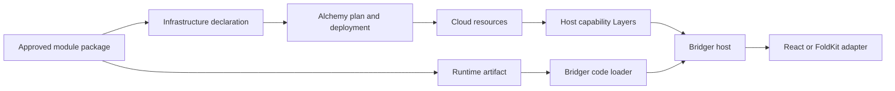

# Alchemy knowledge index for Bridger and a plugin ERP

Research date: 2026-10-02. Scope: infrastructure and runtime integration; design research only. No packages installed or resources deployed. **Verified** means documented in current first-party sources, not executed here. Relevance and recommendations are design inferences. This is a curated capability index, not a claim to enumerate every provider resource.

## Version and evidence baseline

The current repository `main` declares **Alchemy 2.0.0-beta.79**. Its workspace catalog requires `effect >=4.0.0-rc.118 || >=4.0.0` and overrides Effect to `4.0.0-rc.118`. These are repository observations, not a verified npm `latest` resolution or a tested Bridger compatibility matrix. Pin an exact working dependency set before implementation. [Package metadata](https://raw.githubusercontent.com/alchemy-run/alchemy/main/packages/alchemy/package.json), [workspace catalog](https://raw.githubusercontent.com/alchemy-run/alchemy/main/pnpm-workspace.yaml).

Alchemy v1 used async orchestration and explicit finalization. V2 uses Effect generators and `Alchemy.Stack`; ordinary async application handlers remain possible. V1 state is incompatible with v2 state: migration uses explicit physical names and adoption. Do not mix lowercase v1 import examples with v2 imports such as `alchemy/Cloudflare`. [Migration guide](https://alchemy.run/migrating-from-v1/).

Context7 was used: selected **`/alchemy-run/alchemy`**, because it resolves the official repository. Its resolver metadata still describes the async lineage and lists v0.70.2; its actual query returned v2 migration and runtime examples. The query reported an older Effect minimum, rc.112; the live workspace file reports rc.118, which takes precedence for this research. The official getting-started guide currently uses `effect@rc`. [Getting started](https://alchemy.run/getting-started/). The attempted `llms.txt` fetch failed, so the official documentation navigation and linked source files supplied the index.

## Capability catalog

| ID | Capability | Verified behavior and source | Relevance to Bridger / ERP | Limit or design implication |
| --- | --- | --- | --- | --- |
| A01 | Effect stacks | `Alchemy.Stack` runs an Effect describing resources, providers, state and outputs. [Guide](https://alchemy.run/getting-started/) | Compose deployable ERP infrastructure in TypeScript. | A stack is a deployment unit; it is not a tenant's active plugin registry. |
| A02 | Resource identity and dependencies | Resource attributes are typed deferred Outputs; using one as another resource's input creates a graph edge. [Resources](https://alchemy.run/infrastructure-as-code/resource/) | Stable infrastructure IDs per module and explicit dependency ordering. | Renaming an identifier can affect physical resource lifecycle. |
| A03 | Deferred outputs | Outputs model values available after provisioning. [Inputs and outputs](https://alchemy.run/infrastructure-as-code/outputs/) | Wire database addresses, queue URLs and browser API endpoints without manual copying. | Keep deploy-time Outputs out of ordinary plugin service contracts. |
| A04 | Plan and converge | Lifecycle plans create/update/replace/delete/no-op and invokes convergent reconciliation. [Lifecycle](https://alchemy.run/infrastructure-as-code/resource-lifecycle/) | Review module infrastructure requirements before applying them. | Reconciliation is not an atomic business transaction. |
| A05 | Retention and teardown | Deletion follows reverse dependencies; `RemovalPolicy.retain()` keeps the cloud object while removing its state entry. [Lifecycle](https://alchemy.run/infrastructure-as-code/resource-lifecycle/) | Preserve records and attachments when disabling modules. | Retention also forgets management state; it is not a backup or reversible uninstall. |
| A06 | Resource renaming | `renamedFrom` records an identity move. [Renaming](https://alchemy.run/infrastructure-as-code/renaming/) | Evolve module packaging without accidental infrastructure replacement. | Validate all state addresses and dependency references during a rename. |
| A07 | Adoption and provider extension | Providers define reconciliation, diff, deletion and optional read; read can distinguish owned and unowned resources. [Providers](https://alchemy.run/infrastructure-as-code/provider/) | Bring existing ERP infrastructure under deployment management; add vendor integrations. | Adoption is provider-specific ownership takeover, not importing ERP data. |
| A08 | Drift detection | CLI exposes `alchemy drift` for detection and optional repair. [Drift](https://alchemy.run/cli/drift/) | Detect manual infrastructure changes that invalidate plugin assumptions. | Schedule and approve repair independently of runtime activation; verify provider coverage. |
| A09 | State stores and locks | State is scoped by stack/stage; local, Cloudflare, Postgres and memory implementations are documented. Postgres uses a session advisory lock per stack/stage. [State](https://alchemy.run/state-store/) | Coordinate team deployments and recover provisioning progress. | This state is infrastructure metadata, not the ERP database or an install journal. |
| A10 | Stages and credential profiles | Separate environment stages and auth profiles are CLI concepts. [Stages](https://alchemy.run/environments/stages/), [CLI](https://alchemy.run/cli/) | Preview, development and production environments with explicit deployment identity. | Stage separation does not establish row-level tenant isolation. |
| A11 | Cross-stack references | References read persisted upstream outputs at plan time; borrowers do not own referenced resources. [References](https://alchemy.run/infrastructure-as-code/references/) | Share foundational databases or artifact stores across module deployments. | Upstream must already exist; reference resolution does not orchestrate its deployment. |
| A12 | Deployment Actions | Actions run Effects on changed input hashes; they have no delete/replace lifecycle. [Actions](https://alchemy.run/infrastructure-as-code/action/) | Build artifacts, seed infrastructure or apply controlled deployment work. | Removing an Action does not undo its side effects; design idempotence and migration history. |
| A13 | Runtime construction phases | Outer constructors run during planning and cold start; returned handlers run for events. [Phases](https://alchemy.run/infrastructure-as-effects/phases/) | Express infrastructure needs alongside service implementations. | Plugin activation side effects cannot blindly run in this constructor. |
| A14 | Typed bindings and IAM | Bindings connect infrastructure to a runtime and provide typed clients; implementations generate native bindings or IAM/env wiring. [Bindings](https://alchemy.run/infrastructure-as-effects/binding/) | Host adapters can supply storage or queue capabilities to plugins. | Runtime-loaded plugins cannot infer and provision new deployment permissions merely by calling a service. |
| A15 | Layers owning infrastructure | Effect Layers can encapsulate resources and bindings behind an application service. [Layers](https://alchemy.run/infrastructure-as-effects/layers/) | A strong seam for `Storage`, `Jobs`, `Database` implementations. | Keep those deployment Layers distinct from per-activation plugin scopes. |
| A16 | Circular runtime bindings | Tag/implementation separation is documented for mutually bound deployed runtimes. [Circular bindings](https://alchemy.run/infrastructure-as-effects/circular-bindings/) | Useful for infrastructure topology research. | The page still describes create/update hooks while newer lifecycle docs use reconcile; verify source before copying. This does not justify cyclic Bridger activation dependencies. |
| A17 | Secret/config discovery | Config resolved in Construction becomes a runtime binding; `Config.Redacted` uses the secret channel. [Secrets](https://alchemy.run/environments/secrets/) | Inject provider credentials without hardcoding them into plugins. | Config first read only inside a handler is not discovered for binding; browser configuration must contain no secrets. |
| A18 | Local and live providers | `ProviderLayer.dual` switches implementations, with local data-plane routing and scoped process management. [Local provider](https://alchemy.run/infrastructure-as-code/local-provider/) | Exercise adapters against emulators while retaining the same contracts. | Development hot reload is a different lifecycle from installing a production plugin. |
| A19 | Real infrastructure tests | A suite deploys once, tests live resources, then destroys; local mode is also supported. [Testing](https://alchemy.run/testing/) | Test queue, database, permissions and deployment contracts that mocks miss. | Tests need isolated stages, cleanup and controlled cost; no tests were executed here. |
| A20 | CI and previews | Official CI guidance covers stage-based deployment workflows. [CI](https://alchemy.run/environments/ci/) | Review each ERP/module release in an isolated environment. | Preview data provisioning and anonymization still require application policy. |
| A21 | Runtime lifetime and finalizers | Request scopes close per event; instance cleanup on Workers is unavailable and on Lambda is best effort. [Runtime scopes](https://alchemy.run/infrastructure-as-effects/runtime/#instance-scope-vs-request-scope) | Determines where Bridger can keep an in-memory host and lease counters. | Cloud eviction is not a graceful `host.remove`; durable business cleanup cannot depend on scope finalization. |
| A22 | Event sources | Bindings expose cloud events as Effect Streams and wire source/handler infrastructure. [Event sources](https://alchemy.run/infrastructure-as-effects/event-sources/) | Inbound integrations, scheduled work and background processing. | Persist business events and handle redelivery rather than treating an in-memory subscription as durable delivery. |
| A23 | Batched sinks | SQS, SNS and Kinesis sinks expose batch APIs through Effect Sink with generated permissions. [Sinks](https://alchemy.run/infrastructure-as-effects/sinks/) | Bulk imports, reporting pipelines and outbound integration events. | Batch sizing, partial failures and business idempotency need explicit contracts. |
| A24 | Durable workflows | Cloudflare workflow tasks checkpoint results, support retries, rollback callbacks, sleep and event waits. [Workflows](https://alchemy.run/cloudflare/compute/workflows/) | Purchase approvals, long imports and integration orchestration. | Replay requires stable step IDs and serializable values; external writes still need idempotency. Plugin removal must account for running workflow versions. |
| A25 | SQL and migration integration | Effect SQL, Drizzle and Prisma integration paths include existing databases, Postgres and migration guidance. [SQL](https://alchemy.run/sql/) | Relational ERP persistence and controlled schema evolution. | Migration deployment is not a complete module migration protocol or an ORM extension model. |
| A26 | Cloud resource families | Cloudflare documents D1/KV/R2/Hyperdrive/Queues/DOs; AWS documents Lambda, S3, SQS, DynamoDB and other services. [Cloudflare](https://alchemy.run/cloudflare/), [AWS](https://alchemy.run/aws/) | Documents, relational connectivity, caches, jobs and compute. | Provider breadth is not semantic interchangeability; choose consistency, transaction and regional behavior explicitly. |
| A27 | Composable telemetry | OTLP Layers configure signals and destinations; destinations can fan out while preserving span IDs, with stack/stage attributes. [Telemetry](https://alchemy.run/infrastructure-as-effects/telemetry/) | Correlate plugin activation, service calls, jobs and infrastructure changes. | Add plugin generation, tenant and operation IDs yourself; operational telemetry is not the audit ledger. |
| A28 | Dynamic Worker Loader | `Cloudflare.WorkerLoader` supplies runtime `load`/`get` for source modules in separate isolates. [Worker Loader](https://alchemy.run/cloudflare/compute/worker-loader/) | A verified cloud primitive for hot-loaded code, including trusted modules. | It needs a Bridger transport adapter; it does not share the host's Effect Context or scopes. |
| A29 | Workers for Platforms | Dispatch namespaces are documented for executing deployed tenant Workers. [Workers for Platforms](https://alchemy.run/cloudflare/compute/workers-for-platforms/) | Alternative boundary for independently deployed tenant/module execution. | Dynamic dispatch and same-process service installation have different lifecycle and latency contracts. |
| A30 | Native Foldkit deployment | `Cloudflare.Website.Foldkit` supplies Vite deployment and SPA fallback; frontend Effect pinning belongs to the app. [Foldkit integration](https://alchemy.run/cloudflare/frontend/foldkit/) | Deploy the ERP shell and its API address alongside backend infrastructure. | Browser bundles cannot access Worker bindings directly; use API routes and design browser module loading separately. |

## Recommended seam with Bridger — design inference

Use an optional deployment integration outside the generic plugin host. A module can have a runtime artifact plus a separately reviewed infrastructure declaration. The installer resolves required capabilities and activates code only after a deployment process has produced the necessary resources. Existing capabilities allow immediate hot installation; a new database, binding or permission introduces an asynchronous provisioning step.

The integration should return an immutable deployment receipt containing the stage, resource identities, capability handles or references, artifact digest and compatible contract versions. The runtime host owns provider resolution, activation, leases and scope closure. A durable module-management service owns desired installation state, retries and cross-replica coordination. These are proposed responsibilities, not existing Alchemy or Bridger APIs.

Disabling a plugin should stop accepting work and drain its runtime generation. Data retention, schema rollback and cloud resource deletion need their own policies and workflows. A completed runtime removal does not imply a safe infrastructure destroy. This separation follows the different lifetimes documented in [resource lifecycle](https://alchemy.run/infrastructure-as-code/resource-lifecycle/) and [runtime scopes](https://alchemy.run/infrastructure-as-effects/runtime/).

## Hosting constraints for hot-installed modules

**Long-lived Node/Bun server:** a sensible first target for the proposed in-process Bridger semantics. The design still needs immutable artifact versions, a loader cache policy, a persisted desired registry, generation handover and rehydration after process restarts. This is a recommendation, not a verified runtime implementation.

**Cloudflare:** it is incorrect to conclude that no runtime code loading is possible. Dynamic Workers are explicitly supported through Worker Loader. The platform's `get(id, callback)` may reuse an isolate; use a content/version-bearing ID when changing code. The loaded code executes across a Worker boundary, so transfer serialized service calls and explicit capability bindings. Do not transfer JavaScript Effect service instances and assume shared identity or finalization. [Dynamic Workers API](https://developers.cloudflare.com/dynamic-workers/api-reference/), [Alchemy wrapper](https://alchemy.run/cloudflare/compute/worker-loader/).

At this research date, Cloudflare documents a limit of four distinct Dynamic Workers with in-flight requests per ordinary Worker request, and ten per Durable Object I/O context. CPU and subrequest limits can be constrained per invocation. These limits make an ERP design with one concurrently invoked isolate per installed module a decision requiring measurement. Warm isolates are a cache, not durable module state. [Platform limits](https://developers.cloudflare.com/dynamic-workers/platform/limits/), [custom limits](https://developers.cloudflare.com/dynamic-workers/usage/limits/). Check availability and current plan terms before choosing the target; this research performed no deployment.

**Serverless scopes:** durable registry state, migration progress and business jobs must survive process/isolate loss. Request work should use event scopes. Alchemy explicitly warns that Workers have no instance teardown hook; Lambda instance finalizers have only a best-effort shutdown window. A Bridger API promise about graceful explicit removal must be distinguished from termination imposed by the host platform. [Runtime scopes](https://alchemy.run/infrastructure-as-effects/runtime/).

**Browser/FoldKit:** Alchemy's Foldkit helper builds a client application; `VITE_` configuration is bundled into assets, while Worker bindings remain server-side. Hot installation needs a module manifest, compatible bundle format, versioned URL strategy and an adapter to the running UI registry. Alchemy deployment support does not itself provide that adapter. [Foldkit guide](https://alchemy.run/cloudflare/frontend/foldkit/).

## Gaps that remain ours to design

These are design requirements, not claims that Alchemy supplies ERP features:

- A durable install/upgrade/remove journal, recovery after partial installation, and deployment/activation status reconciliation.
- Capability negotiation and separate browser/server artifacts with shared contract versioning.
- Schema migrations per module, compatibility windows across active generations, backup/restore and data retention.
- Tenant authorization, row-level isolation and company-aware data access independent of infrastructure stages.
- Transaction boundaries, outbox delivery, idempotency and reconciliation for money, inventory and external integrations.
- Durable job/workflow version retention when a plugin is upgraded or disabled.
- Audit records with business identity, immutable event history and explicit retention distinct from logs and traces.
- UI contribution composition, forms, routes, localization and asset loading in FoldKit/React.

Before locking the API, verify the exact Alchemy/Effect/Foldkit dependency set, decide the first hosting topology, and prototype one full install path with a runtime artifact, pre-provisioned capability, migration and controlled removal. The strongest discoveries for that prototype are A13–A17, A21, A24 and A28; their lifecycle boundaries directly affect the plugin API.
