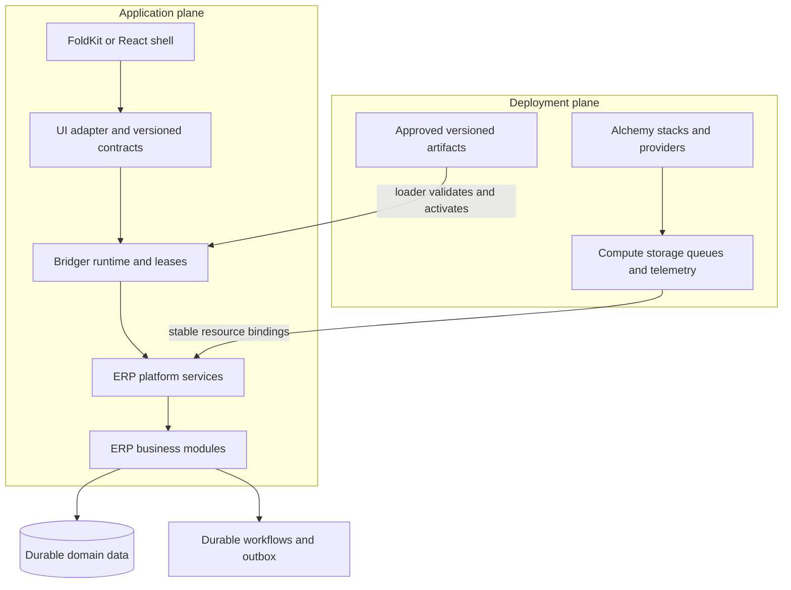

# Architecture decisions informed by the research

Status: proposals and unresolved decisions, 2026-10-02. This document maps research to future specifications. It does not expand Bridger core into an ERP framework or claim that any proposed capability is implemented.

Accepted constraint: all Effect v4 unstable features are permitted. The decisions below should select features by their fit and semantics; unstable status does not require another approval or a stable alternative. Pinning versions and validating upgrades remain part of the design.

## Separate four lifetimes

| Lifetime | Owner | Typical unit | What ending it means |
| --- | --- | --- | --- |
| Infrastructure | Alchemy deployment | database, bucket, worker, secret binding | Change or destroy a provisioned resource according to its deployment policy. |
| Runtime activation | Bridger | plugin services, registrations, fibers | Drain use and close the activation scope. |
| Durable execution | ERP process engine | approval, invoice delivery, replenishment run | Complete, retry, suspend, cancel, or compensate a recorded business process. |
| Business data | ERP domain and persistence | ledger entry, invoice, stock movement | Retain, correct, archive, or erase according to the application's domain and retention rules. |

The four rows are a proposed architectural separation. Removing a plugin does not imply destroying its database, deleting its records, or cancelling durable executions. Source foundations: [Alchemy research](ALCHEMY.md), [Effect research](EFFECT-V4.md), [ERP capability evidence](ERP-CAPABILITIES.md).

Arrows express architectural relationships, not a new package dependency API. Framework capabilities in the catalogs are evidence; this layering is our design proposal.

## Decision index

All entries below are **proposed requirements**, rather than library features. Evidence points to the relevant research or current design.

| ID | Decision or contract | Suggested starting point | What must be demonstrated | Evidence |
| --- | --- | --- | --- | --- |
| B01 | Generic runtime boundary | Keep dependency resolution, activation, leases, and scoped contribution cleanup in Bridger. | Core examples work without ERP models or a UI framework. | [Current SPEC](../SPEC.md) |
| B02 | Version and compatibility policy | Pin a tested Effect / Alchemy / FoldKit tuple and plugin ABI version. | Packages resolve one compatible service-key/runtime graph; upgrades pass compatibility checks. | [Effect](EFFECT-V4.md), [Alchemy](ALCHEMY.md), [FoldKit](FOLDKIT-BRIDGER.md) |
| B03 | Runtime topology | Compare a long-lived process with remote/isolate execution before choosing a deployment target. | Hot loading, restart recovery, tenancy, and resource limits hold in the actual target. | [Alchemy](ALCHEMY.md) |
| B04 | Plugin artifact and loader contract | Versioned manifest, dependency range, artifact digest, approved entry point, declared host capabilities. | Failed or incompatible loads cannot publish partial providers. Import-time behavior stays constrained by policy. | [Current loading seam](../SPEC.md) |
| B05 | Tenant and company isolation | Choose host topology separately from database isolation and company visibility. | Concurrent tenant requests cannot share mutable tenant context, cache entries, or authorization decisions. | [ERP requirements](ERP-CAPABILITIES.md) |
| B06 | Authorization | Central application policy with tenant/company/record/field/action decisions and service identities. | UI, API, background job, import, and report paths enforce the same policy. | [ERP requirements](ERP-CAPABILITIES.md) |
| B07 | Data model extension | Define metadata, IDs, relationships, constraints, extension precedence, and schema evolution above core. | Independently installed extensions cannot silently override invariant enforcement or redefine incompatible fields. | [ERP requirements](ERP-CAPABILITIES.md) |
| B08 | Plugin migrations | Expand/contract schema changes, migration history, forward recovery, explicit data retention policy. | Deactivation is safe without dropping schema; old and new code have a tested compatibility window. | [ERP requirements](ERP-CAPABILITIES.md) |
| B09 | Transaction and outbox boundary | Place domain state changes and their outbox records in the same database transaction. | Crash tests show no missing committed event and consumers tolerate duplicate delivery. | [Effect SQL research](EFFECT-V4.md) |
| B10 | Durable process ownership | Record workflow definition version, module owner, execution IDs, retry and compensation decisions. | A process survives host restart and a safe plugin upgrade without changing already recorded meaning. | [Effect workflow research](EFFECT-V4.md) |
| B11 | Money, units, and time | Use explicit currencies, units, decimal arithmetic, rounding policy, business dates, and time zones. | Posting and stock examples satisfy domain invariants across currencies and period boundaries. | [ERP requirements](ERP-CAPABILITIES.md) |
| B12 | UI contributions | Schema-defined descriptors, versioned ports, activation generations, explicit teardown acknowledgement. | Removing a provider cannot race cleanup code in a still-mounted screen. | [FoldKit seams](FOLDKIT-BRIDGER.md) |
| B13 | Domain event contracts | Separate host lifecycle snapshots from durable domain events and user audit records. | Correlation, retention, ordering scope, and replay semantics are explicit for each stream. | [Effect streaming research](EFFECT-V4.md), [ERP requirements](ERP-CAPABILITIES.md) |
| B14 | Search, analytics, reports | Build authorized read models with tenant/company filters and freshness indicators. | Exports and background aggregates cannot bypass field/record policy. Rebuilds are reproducible. | [ERP requirements](ERP-CAPABILITIES.md) |
| B15 | Operations and recovery | Treat migrations, restore drills, disaster recovery, secrets, rollout, and telemetry as product capabilities. | Restore tests recover domain data and in-flight processes into a compatible artifact set. | [Alchemy](ALCHEMY.md), [ERP requirements](ERP-CAPABILITIES.md) |
| B16 | Localization scope | Pick countries, legal entities, industry, and supported business processes before promising parity. | Qualified domain review validates locale-specific posting, tax, payroll, documents, and reporting rules. | [ERP requirements](ERP-CAPABILITIES.md) |
| B17 | Shared state contribution semantics | Prefer keyed registries and explicit extension composition over mutable global patches. | Removing one extension preserves other registrations and their deterministic ordering. | [Current SPEC](../SPEC.md) |
| B18 | Domain and infrastructure safety | ERP runtime roles receive application data permissions; infrastructure mutations use a separate deployment identity. | Disabling a business module cannot trigger accidental destruction of shared infrastructure. | [Alchemy](ALCHEMY.md) |

## Decisions to resolve in the next specification passes

1. **Compatibility baseline:** reconcile live package metadata and choose exact released versions. Do not code from a mixture of v3, v4 beta, and current v4 references.
2. **Execution topology:** decide where a trusted plugin runs, whether it can restart independently, and how its capabilities cross a process or isolate boundary.
3. **Tenant boundary:** decide which resources are shared and which are tenant-owned. Company scoping inside a tenant is a separate decision.
4. **Extension contracts:** specify model extension, commands, events, routes/screens, schedules, and migrations as ERP platform contracts.
5. **First vertical acceptance scenario:** define a small complete business flow before expanding the module catalog. A possible design exercise is sales order → stock reservation → invoice posting → payment allocation, with an approval rule installed as a plugin.

The scenario is a proposal for validating the architecture, not a commitment to implement those modules now.

## Useful review questions

- What happens if a plugin is removed while a posting Command, an approval, and a mounted screen all refer to it?
- Can the same event be delivered twice without creating a second payment or stock move?
- What does an old workflow definition do after its plugin code is replaced?
- Can an extension add a field without bypassing access rules, translations, reporting, and migrations?
- Which release restores from yesterday's backup, and where are its exact plugin artifacts stored?
- Can a failed cleanup quarantine one activation without hanging the whole host forever?
- What is the difference between a feature being installed, enabled for a tenant, active in a process, and available to a user?

These questions identify missing contracts that Effect and Alchemy primitives alone do not answer.
