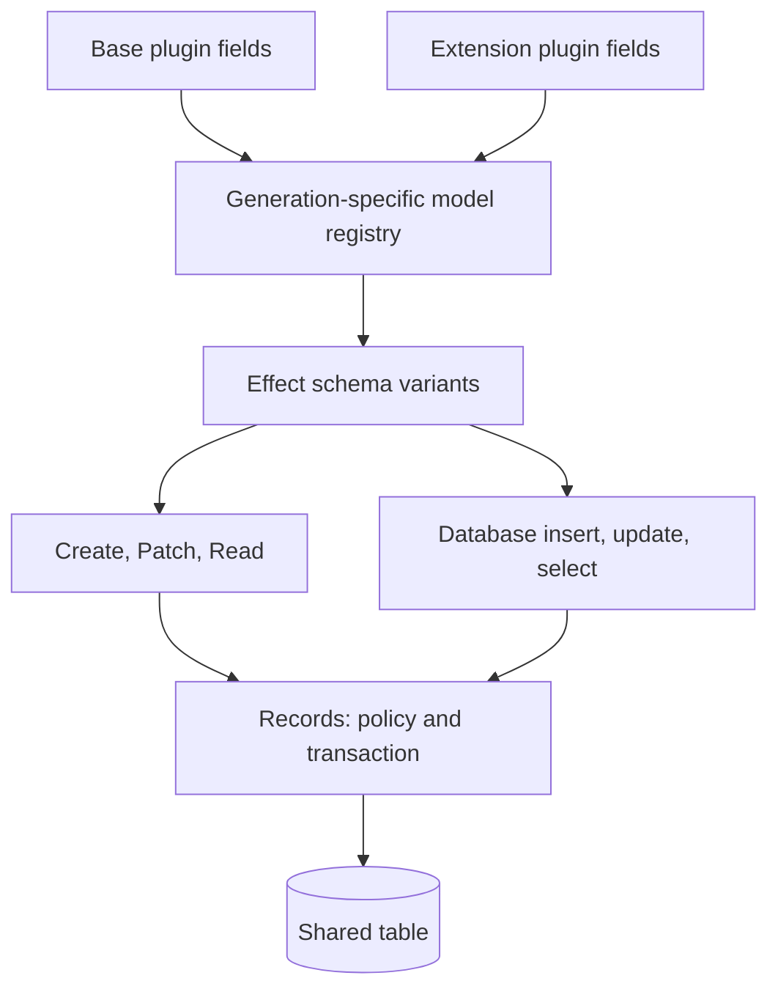

# Effect Schema Model: findings for Bridger ERP

Research date: 2026-10-02. Primary sources inspected; examples are design references, not installed or type-checked against a pinned dependency.

## 1. Names and version boundary

The current v4 barrel exports `Model` and `VariantSchema` from `effect/schema`, with unstable annotations. `SchemaModel` can be our import alias; it is not the export name. Current `SqlModel` imports this model module internally. Older cached examples use `effect/unstable/schema`; do not mix those paths into current examples. [Current schema barrel](https://raw.githubusercontent.com/Effect-TS/effect/main/packages/effect/src/schema/index.ts), [current SqlModel](https://raw.githubusercontent.com/Effect-TS/effect/main/packages/effect/src/sql/SqlModel.ts).

```ts
import { Schema } from "effect"
import { Model as SchemaModel } from "effect/schema"
import { SqlModel } from "effect/sql"
```

## 2. Model mechanisms worth adopting

`Model` derives six variants: `select`, `insert`, `update`, `json`, `jsonCreate`, `jsonUpdate`. The default is `select`. `Class`, `Struct`, and `Field` build the declarations; `fields` preserves variant definitions. `GeneratedByDb` appears only in select/json; `GeneratedByApp` additionally appears in insert/update. `Sensitive` excludes JSON variants. `FieldOption` maps database nullability and JSON missing/null values through `Option`. `DateTimeInsertFromDate` and `DateTimeUpdateFromDate` bridge database dates and JSON strings. These are schema transformations, not SQL migrations. [Current Model implementation](https://github.com/Effect-TS/effect/blob/main/packages/effect/src/schema/Model.ts).

An original minimal schema example using those APIs:

```ts
const TaskId = Schema.String.pipe(Schema.brand("todo.task.id"))

class TaskRow extends SchemaModel.Class<TaskRow>("TaskRow")({
  id: SchemaModel.GeneratedByDb(TaskId),
  title: Schema.String,
  done: Schema.Boolean,
  createdAt: SchemaModel.DateTimeInsertFromDate,
  updatedAt: SchemaModel.DateTimeUpdateFromDate,
}) {}

const DatabaseInsert = TaskRow.insert
const DatabaseUpdate = TaskRow.update
const PublicRead = TaskRow.json
const PublicCreate = TaskRow.jsonCreate
const PublicUpdate = TaskRow.jsonUpdate
```

This example deliberately makes no claim about table creation, primary-key generation, authorization, default `done`, or partial updates. Those need explicit Bridger contracts.

## 3. VariantSchema is the lower-level mechanism

The inspected earlier v4 implementation exposes `VariantSchema.make({ variants, defaultVariant })`; its toolkit includes `Class`, `Struct`, `Field`, `FieldOnly`, `FieldExcept`, `extract`, and `fieldEvolve`. A field can have a different schema or be absent in each variant. Extraction traverses field declarations and chooses the requested variant. The current barrel confirms the module remains exported; the current relocated implementation could not be retrieved, so this exact lower-level signature needs pinned-version confirmation before implementation. [Inspected v4 VariantSchema source](https://raw.githubusercontent.com/Effect-TS/effect/main/packages/effect/src/unstable/schema/VariantSchema.ts), [current export](https://raw.githubusercontent.com/Effect-TS/effect/main/packages/effect/src/schema/index.ts).

**Bridger design recommendation:** use the existing model variants where their semantics match. Introduce a custom variant toolkit only if a concrete requirement cannot fit them. Public `Patch` is a likely separate derived schema, since omitted fields mean unchanged.

**Context7 confirmation (2026-10-02, rc.112 pages):** `VariantSchema.make({ variants, defaultVariant })` returns `Class`, `Struct`, `Union`, `Field`, `FieldOnly`, `FieldExcept`, `extract` and `fieldEvolve`, resolving the earlier uncertainty about the signature. Those pages place it under `effect/unstable/schema`; the current-path question above remains. The documented `Model.Class` also exposes `select`, `insert`, `update`, `json`, `jsonCreate`, `jsonUpdate`, and `Sensitive` is omitted from every JSON variant.

## 4. SqlModel is useful but has a narrower contract

`makeRepository(Model, options)` requires `tableName`, `spanPrefix`, `idColumn`, with optional `softDeleteColumn`; construction needs `SqlClient`. It returns insert/insertVoid, update/updateVoid, findById, and delete. Methods encode request schemas and decode model rows. `makeResolvers` adds batching and requires `Scope` as well. The ID must exist in both selected and update types. SQL predicates use ID and optional soft-delete checks; there is no tenant, actor, policy, or revision option. [SqlModel implementation and signatures](https://raw.githubusercontent.com/Effect-TS/effect/main/packages/effect/src/sql/SqlModel.ts).

**Important consequence:** the preceding `GeneratedByDb` example is not directly compatible with `makeRepository`'s ID constraint. Its ID is absent from update. If that repository is used, declare the relevant variants explicitly:

```ts
const RepositoryId = SchemaModel.Field({
  select: TaskId,
  update: TaskId,
  json: TaskId,
})
```

This is a schema declaration; the database must still generate the inserted ID. Bridger command envelopes can keep ID separate from user changes instead.

**Bridger recommendation:** borrow schema encoding and SQL resolver patterns, but implement the shared-table write query in the Records adapter. A wrapper that merely authorizes before calling an ID-only repository leaves tenant/revision predicates outside the actual SQL mutation.

## 5. Recommended responsibility split

The following is our design inference, not a capability supplied by Effect:

| Component | Responsibility |
| --- | --- |
| Effect Schema | Value contracts, validation, codecs, brands, structured errors |
| Effect Model / VariantSchema | Distinct database and public schema variants |
| Bridger Field | Storage mapping, ownership, create default, UI metadata, field policy |
| Bridger model registry | Compose all active contributions and resolve stable field identities |
| Bridger Records | Tenant/company predicates, policy, revision checks, complete-record validation |
| Bridger migrations | Physical schema history, backfills, indexes, database constraints |



## 6. Schema-first Bridger field proposal

Keep `Field.text` and similar shortcuts, but allow a first-class Effect schema. The following API belongs to the proposed Bridger library:

```ts
import { Schema } from "effect"
import { Field, Model } from "@bridger/erp"

const Priority = Schema.Literals(["low", "normal", "high"])

const TaskPlanning = Model.extend(Task, "planning.task", {
  fields: {
    priority: Field.make(Priority, {
      storage: { type: "text" },
      createDefault: "normal",
      ui: { label: "Priority" },
    }),
  },
})
```

The schema handles allowed values. Storage metadata chooses SQL representation. `createDefault` is applied by the create pipeline and then validated; it does not claim to create a database default or a historical backfill. SQL defaults and backfills remain explicit migration actions.

For transformations, the field adapter must state whether the supplied schema describes the domain value or a boundary codec. Do not silently assume its encoded representation is a safe SQL column type. Distinguish JSON codecs from database codecs when representations differ.

## 7. Rules for contributions to the same table

These are recommended Bridger invariants:

1. Compose declaration metadata before deriving schema variants. Do not mutate an existing `SchemaModel.Class` to hot-install an extension.
2. Each registry generation owns immutable schema references. In-flight requests retain their generation until their lease ends.
3. A base-model update validates the merged resulting record against every active extension's constraints; validating only the submitted patch is insufficient.
4. Build update SQL from supplied writable keys. Never encode a complete selected row and write every field back.
5. An absent patch key means unchanged; explicit null means clear only if permitted. Avoid collapsing those states through nullable `Option` conversion before tracking key presence.
6. Compile private-field omission into public schemas, then apply actor-specific field policy. A static `Sensitive` declaration alone cannot express per-user permissions.
7. Preserve extension columns when disabled. Exclude inactive fields from the tenant catalog and ordinary mutation schemas, while migrations retain their physical definitions.
8. Do not infer database constraints from arbitrary schema checks or Effectful validation. Supported SQL translations must be explicit; uniqueness also needs database enforcement.
9. Do not infer migration history by comparing live Schema ASTs. Use immutable migration identifiers and declarations.
10. Statically composed plugins can expose richer inferred types. Runtime installation updates runtime schemas and catalogs, not the TypeScript types of already-compiled application code.

## 8. Review checks before implementation

- Pin a v4 revision/package and type-check imports and each model variant example.
- Verify create-default application separately from constructor defaults and database defaults.
- Test missing versus null patches, generated IDs, date round trips, and private-field output.
- Test extension validation through base-model writes and preservation of untouched columns.
- Test the SQL mutation itself contains tenant/company/revision predicates.
- Verify schema compilation remains compatible with the chosen deployment environment.
- Keep all accepted unstable APIs available; instability changes dependency management, not the user's approved feature scope.

See [shared model ownership](../ERP-MODELS.md) for the ERP contract and [Effect capability inventory](EFFECT-V4.md) for the wider stack.
