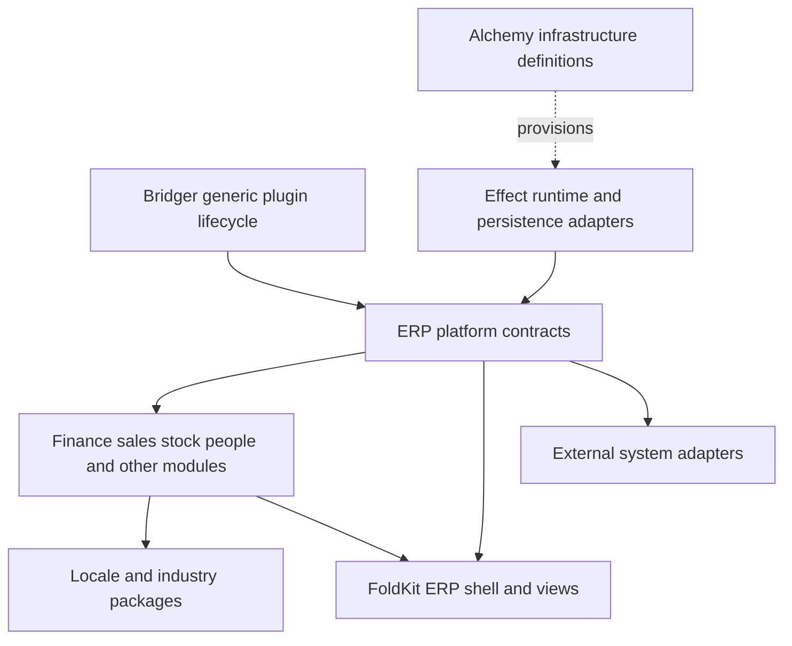

# ERP capability knowledge index

Research date: 2026-10-02. Status: design research, not implemented requirements or a claim of vendor parity. Stable requirement identifiers: **R01–R32**.

The target is an extensible business platform. Bridger remains a domain-neutral plugin host. ERP models, permissions, accounting rules and UI metadata belong in packages above that host. The evidence column records vendor capabilities; the proposal column records our design inference and the knowledge we still need to turn into contracts.

## Scope and evidence quality

Odoo evidence primarily targets **19.0**; individual explicitly marked SaaS pages concern other release lines. Sage evidence here is **Sage Intacct**, not every Sage product. The Intacct XML reference provides useful domain coverage, but labels that API legacy and recommends the [REST API for new clients](https://developer.intacct.com/api/). SAP evidence concerns **S/4HANA Cloud Public Edition**, not the entire SAP portfolio. A capability appearing in documentation does not establish edition entitlement, regional availability, implementation completeness or hot-install support.

Some Odoo pages timed out on direct fetch. Their official indexed documentation excerpts were available and used; no third-party articles are treated as evidence. All architecture and invariant proposals below require design review and acceptance tests.

## Platform and extension contracts

| ID | Knowledge area | Vendor evidence | Proposed contract or investigation |
| --- | --- | --- | --- |
| R01 | Module identity, provenance and dependencies | Odoo manifests declare metadata and prerequisite modules. [Module manifests](https://www.odoo.com/documentation/19.0/zh_CN/developer/reference/backend/module.html) | Versioned manifests, publisher identity, artifact digest, compatible host/schema ranges, required/optional services and contribution ownership. Reject incompatible graphs before activation. Administrator approval of trusted code is an application policy. |
| R02 | Extensibility boundaries | SAP distinguishes key-user, developer and side-by-side extensions. [SAP extensibility](https://help.sap.com/docs/SAP_S4HANA_CLOUD/0f69f8fb28ac4bf48d2b57b9637e81fa/533228e1e854433ab16d013f161ca509.html) | Specify separate seams for metadata customization, trusted code plugins and external integrations. Published contracts need compatibility policy and deprecation windows. Avoid requiring internal table access for ordinary extensions. |
| R03 | Runtime lifecycle versus durable installation | Odoo has module upgrade scripts and phases. [Upgrade scripts](https://www.odoo.com/documentation/19.0/nl/developer/reference/upgrades/upgrade_scripts.html) | Track artifact availability, schema readiness, tenant enablement and runtime activation separately. Removing an activation must not drop tables or reverse business transactions. Hot-install code does not prove safe online schema migration. |
| R04 | Extensible records and computed fields | Odoo's ORM supports model inheritance, fields and record caching. [ORM API](https://www.odoo.com/documentation/19.0/developer/reference/backend/orm.html) | Decide typed extension composition, namespaced fields, relation ownership, validation, persisted versus derived fields, dependency invalidation, cycle rejection and query batching. Record schema version must remain intelligible after a plugin is disabled. |
| R05 | UI contribution metadata | Odoo interprets view definitions; SAP exposes custom fields and extension inventory. [Odoo views](https://www.odoo.com/documentation/19.0/ar/developer/reference/user_interface/view_architectures.html), [SAP key-user extensibility](https://help.sap.com/docs/SAP_S4HANA_CLOUD/0f69f8fb28ac4bf48d2b57b9637e81fa/3ccb50e724b045508fea8b2cf1774b2b.html) | An ERP UI package owns forms, lists, actions, routes, menus, reports and extension slots. Define deterministic ordering and conflict errors. FoldKit adapts those contributions into Model/Message/update/view; Bridger only owns their availability and lifetime. |
| R06 | Human workflow and approvals | Odoo Studio supports ordered steps and exclusive approval. This source is SaaS 19.3. [Approval rules](https://www.odoo.com/documentation/saas-19.3/applications/studio/approval_rules.html) | Persist transitions, approver identity, policy revision, deadlines and delegation. Enforce approvals server-side, including API calls. Define escalation, cancellation and reassignment if a plugin version retires. Approval must survive process restart. |
| R07 | Authentication and session context | Intacct authenticates company-scoped operations and supports entity context. [Request authentication](https://developer.intacct.com/web-services/requests/) | A platform identity adapter supplies principal, session, tenant, company and delegation. Plan SSO/MFA and service accounts separately. Never let a caller-supplied company identifier substitute for authorization. |
| R08 | Authorization and separation of duties | Odoo documents model, record and field access; SAP groups application access through roles/catalogs. [Odoo security](https://www.odoo.com/documentation/19.0/th/developer/reference/backend/security.html), [SAP business roles](https://help.sap.com/docs/SAP_S4HANA_CLOUD/a630d57fc5004c6383e7a81efee7a8bb/4236eef12b8b4d4286c53aa89899a6f5.html) | Define deny-by-default permissions, row/field policies and action checks. Separate payee maintenance, payment approval and payment execution. Enforce the same policy in queries, exports, reports, background jobs and integrations. |
| R09 | Tenant and company boundaries | Odoo checks cross-company relations and supports company-dependent values. [Multi-company guidelines](https://www.odoo.com/documentation/19.0/fr/developer/howtos/company.html) | Distinguish customer tenant from legal entity, branch and reporting group. Decide database isolation, shared records and tenant plugin sets. Include tenant/company in cache, job and idempotency keys. Trusted in-process plugins share process privileges; scoped services are not a security sandbox. |
| R10 | Master data and reference identity | Intacct exposes customers, vendors, items and units. [API domain catalog](https://developer.intacct.com/api/) | Establish parties, addresses, products, variants, units and external identifiers as explicit shared contracts. Support merge/alias history without breaking posted documents. Agree which module owns each identity and which consumers may enrich it. |

## Business capabilities

| ID | Knowledge area | Vendor evidence | Proposed contract or investigation |
| --- | --- | --- | --- |
| R11 | General ledger and posting | Odoo uses double-entry bookkeeping. [Accounting](https://www.odoo.com/documentation/19.0/applications/finance/accounting.html) | Balanced journal entries, explicit posting commands, period checks, stable numbering, immutable posted representation and linked corrective entries. A posted invoice and its ledger effects must share a deliberate transaction boundary. |
| R12 | Money, exchange and rounding | Odoo retains company and transaction currency values. [Multi-currency accounting overview](https://www.odoo.com/documentation/19.0/applications/finance/accounting.html) | Use decimal money with currency, documented precision and rounding stage. Snapshot rates and policy revisions on documents. Define residual allocation, gains/losses and historical conversion. Never assume a JavaScript number alone represents money safely. |
| R13 | Taxes, localizations and electronic documents | Odoo packages fiscal rules by country and constrains switching after posting. [Fiscal localizations](https://www.odoo.com/documentation/19.0/applications/finance/fiscal_localizations.html) | Locale packages own effective-dated tax rules, legal document formats, declarations and exchange adapters. Validate each target locale with domain specialists and fixtures; installing a package alone is not compliance evidence. Preserve the rule version used historically. |
| R14 | Receivables, payables and reconciliation | Intacct exposes invoices, bills, payments and aging. [Finance API catalog](https://developer.intacct.com/api/) | Partial settlement, credit notes, disputes, due dates, allocations and duplicate detection. Maintain reconciled versus outstanding amounts through atomic transitions. Distinguish invoice state, payment attempt state and settlement state. |
| R15 | Banking and payment integrations | Intacct includes bank feeds, accounts and transfers. [Cash management catalog](https://developer.intacct.com/api/) | Payment providers are adapters with durable requests, external references, webhook verification and reconciliation. An unknown result must remain pending investigation rather than automatically creating a second transfer. No raw payment credentials in plugin logs. |
| R16 | Assets, budgeting and financial analysis | Odoo finance covers assets and analytics; Intacct exposes budgets and allocations. [Odoo finance](https://www.odoo.com/documentation/19.0/applications/finance.html), [Intacct ledger catalog](https://developer.intacct.com/api/) | Separate asset lifecycle, depreciation policy, budgets, cost centers and analytical dimensions. Version financial report definitions and preserve drill-down to source entries. Local accounting policy remains an explicit selection and validation task. |
| R17 | Sales, pricing and customer lifecycle | Intacct covers orders and price lists. [Order entry catalog](https://developer.intacct.com/api/) | Quote-to-order-to-delivery-to-invoice lineage, price validity, discount approvals, credit limits, returns and CRM handoff. Snapshot accepted commercial terms so later price plugin changes do not rewrite existing orders. |
| R18 | Procurement and supplier lifecycle | Intacct covers purchasing and vendor transactions. [Purchasing catalog](https://developer.intacct.com/api/) | Requisitions, RFQs, purchase orders, receipts and invoice matching. Define quantity/price tolerances, supplier approvals and backorders. A three-way matching policy must state its exceptions and authority to override. |
| R19 | Inventory, reservations and traceability | Odoo offers reservation timing policies; Intacct exposes warehouses and inventory transactions. [Odoo reservations, SaaS 19.4](https://www.odoo.com/documentation/saas-19.4/nl/applications/inventory_and_mrp/inventory/shipping_receiving/reservation_methods.html), [Intacct inventory catalog](https://developer.intacct.com/api/) | Stock movements, reservations, lots/serials, locations, units, counts and returns. Prevent two orders reserving the same availability through database concurrency control. Define negative-stock policy and valuation/posting integration explicitly. |
| R20 | Manufacturing, quality and maintenance | Odoo bills of materials describe components and production operations. [Bill of materials](https://www.odoo.com/documentation/19.0/fr/applications/inventory_and_mrp/manufacturing/basic_setup/bill_configuration.html) | Explore BOM revisions, routings, work centers, capacity, yield, scrap, subcontracting and work-in-progress costing. Quality checks and maintenance are adjacent module proposals needing further domain research. Preserve the production revision actually used. |
| R21 | Projects, time, expenses and service delivery | Intacct exposes projects, tasks and timesheets. [Project/resource catalog](https://developer.intacct.com/api/) | Cost and billable time, expense approvals, rate cards, milestones and resource calendars. Define corrections after billing and avoid charging one time entry twice. Plan field service/helpdesk as optional extensions with their own process research. |
| R22 | People, payroll and sensitive records | Odoo payroll has locale-specific modules. [Payroll localizations](https://www.odoo.com/documentation/19.0/applications/hr/payroll/payroll_localizations.html) | Separate personnel records, leave, schedules, payroll calculations and payment exports. Use effective-dated contracts and restricted fields. Payroll rules and retention require validation for every supported locale; no universal payroll claim. |
| R23 | Contracts, subscriptions and revenue schedules | Intacct exposes contract billing/revenue schedules. [Contract catalog](https://developer.intacct.com/api/) | Separate recurring billing from revenue recognition, usage metering, amendments and entitlements. Contract revisions need deterministic effective dates and replay rules. Recognition policy must be validated for the applicable reporting regime. |
| R24 | Intercompany and consolidation | Intacct distinguishes domestic and global consolidation. [Consolidation catalog](https://developer.intacct.com/api/) | Explicit paired intercompany documents, ownership structures, elimination rules, currency translation and consolidation runs. Reconcile rather than silently repair mismatches. Scope this as an advanced finance package, with a separate acceptance dataset. |

## Integration, information and operations

| ID | Knowledge area | Vendor evidence | Proposed contract or investigation |
| --- | --- | --- | --- |
| R25 | APIs, events and reliable integrations | Intacct distinguishes request correlation from duplicate suppression and offers transaction grouping. [XML request semantics](https://developer.intacct.com/web-services/requests/) | Version API/event schemas, outbox/inbox records, deduplication keys, retry categories and dead-letter recovery. Domain mutation plus outbox insertion must be atomic. A successful retry mechanism does not establish exactly-once business effects. New Intacct adapters should investigate REST independently. |
| R26 | Data import, migration and reconciliation | SAP provides migration objects and staging/direct migration approaches. [SAP data migration](https://help.sap.com/docs/SAP_S4HANA_CLOUD/d5699934e7004d048c4801b552f3b013/4c4047f1989f4b9a836dbc24f82989e8.html) | Staging validation, field mapping, external IDs, dry run, resumable batches and per-row errors. Reconcile opening balances and quantities to control totals before activation. Keep business data import distinct from module schema upgrades. |
| R27 | Reporting, search and exports | Odoo search views filter records; Intacct supports data delivery for analytics. [Odoo search architecture](https://www.odoo.com/documentation/19.0/ar/developer/reference/user_interface/view_architectures.html), [Intacct DDS catalog](https://developer.intacct.com/api/) | Authorized query contracts, pagination, saved filters, export jobs, report snapshots and searchable projections. Record index lag and report consistency point. Search must not expose hidden records or field snippets. Translation/timezone formatting belongs to presentation contracts. |
| R28 | Attachments and business documents | Intacct has an attachment API. [Attachments](https://developer.intacct.com/api/company-console/attachments/) | Object storage with record authorization, metadata, checksums, versions, upload limits and retention. Define orphan cleanup and malware scanning adapters. Database and blob backups need a consistent restore strategy. |
| R29 | Business audit and evidence | Intacct exposes advanced audit trails. [Advanced audit trails](https://developer.intacct.com/api/company-console/advanced-audit-trails/) | Capture actor/delegation, tenant/company, action, record revision, policy/plugin version and correlation. Audit storage and retention are durable business contracts. Runtime spans/logs supplement them; logs alone do not prove an approved posting or access history. |
| R30 | Upgrades, tests and historical replay | Odoo documents phased upgrade scripts, unit tests and integration tours. [Upgrades](https://www.odoo.com/documentation/19.0/nl/developer/reference/upgrades/upgrade_scripts.html), [Testing](https://www.odoo.com/documentation/19.0/developer/reference/backend/testing.html) | Module compatibility matrix, representative data upgrades, contract tests, role/company isolation tests and posting/reservation race tests. Durable jobs must retain compatible handlers or explicit migration. Restoring code alone cannot roll back a data migration. |
| R31 | Operations, resilience and deployment | Odoo.sh documents backups including filestore and production import. [Odoo.sh operations](https://www.odoo.com/documentation/19.0/administration/odoo_sh/getting_started/create.html) | Define service objectives, tested restore, job recovery, capacity limits, connection budgets, tenant quotas and incident tooling. Alchemy provisions resources; an ERP operations layer owns migration coordination, backup policy and business reconciliation. Choose deployment targets only after persistence and workload requirements. |
| R32 | Licensing, editions and ecosystem governance | Odoo Community and Enterprise use different licenses; commercial apps can differ again. [Odoo licenses](https://www.odoo.com/documentation/19.0/nl/legal/licenses.html) | Record package license/provenance and dependencies in the catalog. Public documentation is capability evidence, not permission to copy proprietary implementations. SAP/Sage product entitlements and adapter access must be checked per product/contract; this index does not establish reusable source rights. |

## Proposed invariants the technical stack cannot supply by itself

These are architecture requirements for the ERP layer, not claims about guarantees provided by Effect, FoldKit, Alchemy or Bridger.

1. **Posting:** debit/credit totals balance under the selected ledger policy. Posting, numbering and period locks are concurrency-safe. Corrections preserve references to original postings.
2. **Money:** rounding stage and precision are explicit. Split allocations reconcile to their total; historical documents keep the rates and rules used.
3. **Stock:** concurrent reservations cannot exceed allocatable quantity under the selected policy. Cancellation releases only the reservation it owns.
4. **Authorization:** each command, query and background action carries authenticated tenant/company context. UI visibility is not permission enforcement.
5. **Approval:** the actor who changes protected data cannot satisfy an incompatible approval duty. Authorization is checked again when execution occurs.
6. **Messaging:** persist the business change and outgoing intent together. Receivers deduplicate; replay preserves business identifiers. Unknown external outcomes trigger reconciliation.
7. **History:** a plugin update cannot retroactively reinterpret a posted document, completed approval or valuation without an explicit domain correction/migration.
8. **Lifecycle:** disabling code prevents new work while preserving durable records, recovery handlers and audit interpretation. Finalizers release runtime resources; they do not compensate completed business transactions.
9. **Recovery:** restore procedures include the database, attachments, pending jobs, plugin artifacts and relevant configuration versions. Recovery is accepted through reconciled business totals.

## Proposed module seams

Arrows describe proposed support/dependency relationships, not existing package imports. Keep ERP platform services such as authorization, record metadata, migrations, outbox, audit and document storage above Bridger. Avoid injecting ERP-specific lifecycle policy into the generic host.

## Research-to-design sequence

First settle R01–R09, R25 and R30: durable installation versus activation, typed extension rules, principal/tenant context, transaction boundaries and compatibility. Next use a thin order → reserve → invoice → post → reconcile example to test R11–R19 together. Only then broaden domains and add locale packs.

Before claiming a full-featured release, choose target industries, countries, company scale, accounting scope and deployment profile. Each capability needs concrete workflows, permissions, fixtures and acceptance criteria. CRM, commerce/POS, quality, maintenance, warehouse automation and industry verticals need deeper follow-up catalogs; their omission from detailed workflows here is not a claim that the reference vendors lack them.
