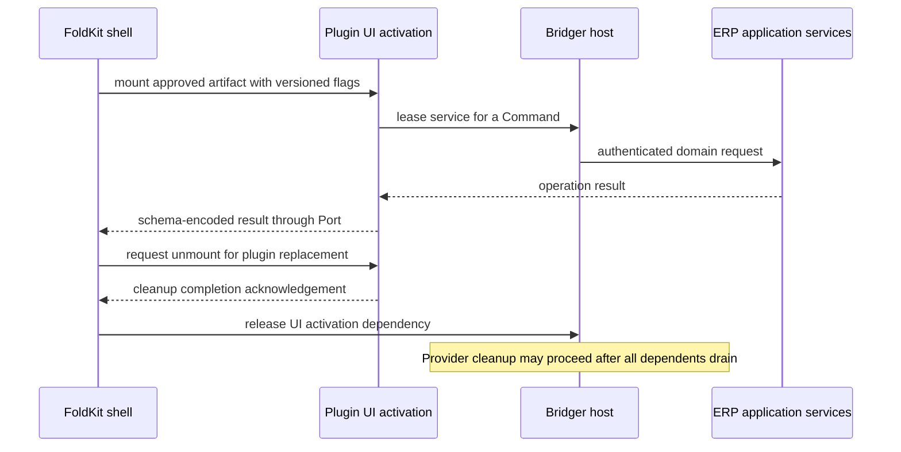

# FoldKit and Bridger integration knowledge

Checked: 2026-10-02. This is research and design input, not an implemented integration. The current adapter sketch remains [FOLDKIT-API.md](../FOLDKIT-API.md).

## Evidence and version checkpoint

Context7 resolved **`/foldkit/foldkit`** and returned embedding documentation and the changelog introducing `Runtime.embed` in 0.107.0. The result also included a vendored Effect example; that example is not evidence for FoldKit's own disposal API. Current repository package metadata reports FoldKit **0.165.0**, with exact peers **`effect: 4.0.0`** and **`@effect/platform-browser: 4.0.0`**. This is a repository observation, not a verified npm installation or lockfile. [Package source](https://raw.githubusercontent.com/foldkit/foldkit/main/packages/foldkit/package.json).

The public runtime exports expose `embed` and `EmbedHandle`. The docs describe disposal, but the inspected evidence does not establish an awaitable completion barrier for arbitrary asynchronous teardown. Preserve that as an integration check. [Public exports](https://raw.githubusercontent.com/foldkit/foldkit/main/packages/foldkit/src/runtime/public.ts), [embedding contract](https://foldkit.dev/core/embedding).

## Feature index

In the table, the capability is documented; the ERP application and required design work are our proposed use of it.

| ID | Capability | ERP / Bridger use | Boundary or required work | Evidence |
| --- | --- | --- | --- | --- |
| F01 | Runtime `resources` Layers | Supply the application host and API client once to UI Commands and Subscriptions. | Runtime resources do not make a dynamically replaced plugin service safe to cache; use leases. | [Resources](https://foldkit.dev/core/resources) |
| F02 | Named, schema-argument Commands with result Messages | Record posting, approval, and install requests as explicit UI operations. | A UI success Message is not the authoritative business transaction; return a server result with an operation ID. | [Commands](https://foldkit.dev/core/commands) |
| F03 | Command interruption keys | Cancel a report fetch or superseded lookup by request ID. | Cancellation cannot undo an already committed posting. Explicitly transition UI pending state on cancellation. | [Interrupting Commands](https://foldkit.dev/core/commands#interrupting-commands) |
| F04 | Model-dependent scoped Subscriptions | Follow host state or a filtered activity feed while its screen is open. | Host snapshot changes concern availability, not arbitrary domain-data changes. Long leases require coordinated stop. | [Subscriptions](https://foldkit.dev/core/subscriptions) |
| F05 | ManagedResource acquire / release from Model conditions | Own a camera, scanner session, connection, or worker while a feature is mounted. | Resource ownership and plugin ownership must agree on stop order; obtaining a bare handle is not a Bridger lease. | [Managed Resources](https://foldkit.dev/core/managed-resources) |
| F06 | `Layer.build` inside managed acquisition | Reuse Effect setup and finalizers in feature-scoped UI resources. | Test the combined finalizer order before the resource depends on a removable plugin. | [Layer acquisition](https://foldkit.dev/core/managed-resources#building-a-layer-in-acquire) |
| F07 | `makeElement` and `Runtime.embed` | Host independently loaded plugin screens in shell-owned containers. | Establish a teardown acknowledgement before a plugin's required services close. | [Embedding](https://foldkit.dev/core/embedding) |
| F08 | Schema-typed inbound and outbound Ports | Give dynamic screens versioned data contracts without coupling the shell to their private Model. | Serialize data, not live services or DOM references; incompatible port versions need explicit rejection or adaptation. | [Port boundary](https://foldkit.dev/core/embedding#the-schema-boundary) |
| F09 | Submodels and explicit parent/child communication | Compose known screens and reusable UI workflows within one build. | A static Message union cannot validate arbitrary future plugin Messages without a separate versioned boundary. | [Submodel](https://foldkit.dev/core/submodel) |
| F10 | Element-scoped Mount lifecycle | Attach imperative grids, charts, editors, or scanners to a rendered element. | Coordinate DOM cleanup with plugin shutdown; a menu contribution disappearing is not a cleanup acknowledgement. | [Mount](https://foldkit.dev/core/mount) |
| F11 | Story and Scene tests | Exercise approval forms and command outcomes independently of live ERP services. | Add server invariant, authorization, and integration tests; UI stories cannot establish accounting correctness. | [Testing examples](https://foldkit.dev/#example-applications) |
| F12 | Model / Message DevTools | Explain why a screen is waiting, failed, or showing a stale result. | Keep sensitive business payloads out of exported histories; debug replay is not a financial audit trail. | [DevTools](https://foldkit.dev/core/devtools) |
| F13 | Experimental SSR / SSG and hydration | Evaluate public portals or pre-rendered content independently of the back-office application. | Official docs mark server rendering experimental; pin and validate build identity, per-request flags, and tenant-sensitive caching. | [Server rendering](https://foldkit.dev/core/server-rendering) |
| F14 | One page owner, container-scoped elements | Let the shell own routing and page metadata; plugin widgets own only their containers. | Multiple independently page-owning applications need an explicit routing and document ownership strategy. | [Runtime entry points](https://foldkit.dev/core/runtime) |
| F15 | Commands and perpetual fibers attached to runtime scope | Support orderly shutdown of a UI runtime and its ongoing work. | Inspect pinned shutdown implementation and test asynchronous finalizers; public disposal completion is still a design check. | [Runtime source](https://raw.githubusercontent.com/foldkit/foldkit/main/packages/foldkit/src/runtime/runtime.ts) |
| F16 | Explicit peer dependency versions | Define a compatible plugin build contract for the browser shell. | The observed FoldKit package pins Effect 4.0.0; independently compiled plugins must share compatible framework and service-key identities. | [Package metadata](https://raw.githubusercontent.com/foldkit/foldkit/main/packages/foldkit/package.json) |

## Integration contracts needed before UI plugin implementation

These are Bridger design requirements, not claims that FoldKit already implements a plugin system.

1. **Published artifact contract.** Record plugin ID, artifact digest, API compatibility, entry points, declared capabilities, and UI port schemas. Load the exact approved artifact rather than following a mutable URL.
2. **Availability contract.** Core snapshots need host identity, monotonically increasing revision, plugin activation identity, and a way to distinguish installed, active, stopping, and unavailable services. Browser projections must contain schema-compatible data.
3. **Mount ownership.** Track each UI instance against the exact plugin activation. Replacement creates a new activation and mount generation; late results from the old one cannot update the new screen.
4. **Teardown handshake.** Reject new mounts and calls, request widget shutdown, await command/finalizer completion, acknowledge unmount, and then permit provider cleanup. A failed acknowledgement is a visible failed cleanup, not successful removal.
5. **Long-running work.** Separate user cancellation, route departure, provider revocation, and whole-app shutdown. Infinite service streams cannot hold an uncancellable lease while removal waits for that lease.
6. **Server authority.** Browser permissions and enabled buttons explain UX. The server authenticates and authorizes every data operation in its current tenant/company context.
7. **Read-model freshness.** Correlate domain events and command results with durable operation IDs or versions. Plugin availability revisions cannot substitute for invoice, stock, or payment versions.

## Reference flow

The acknowledgement above is an adapter requirement. The existing `Runtime.embed` examples do not alone establish its implementation.
