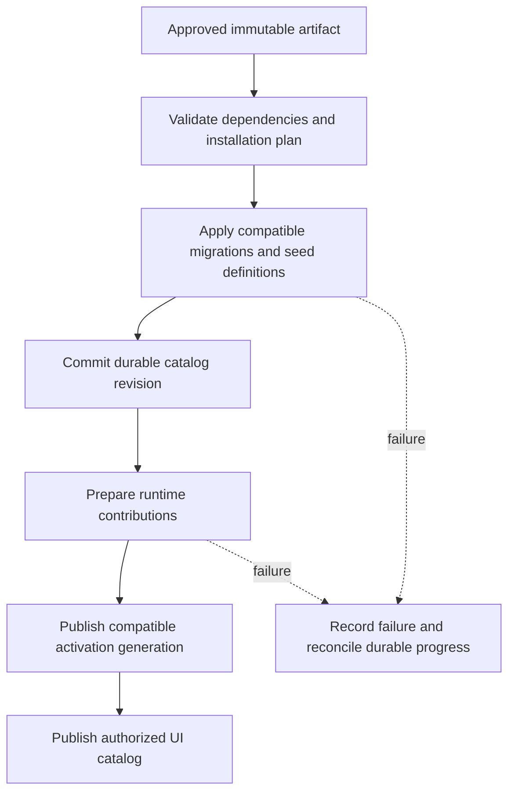

# Odoo core mechanisms and the proposed Bridger ERP design

Research date: 2026-10-02. Scope: source inspection of the official `odoo/odoo` **19.0 branch**. This is input to the full ERP specification, not an implementation. Branch links are mutable; pin a commit before implementing compatibility-sensitive behavior.

Context7 was used once for resolution and once for querying `/odoo/odoo/__branch__19.0`. Its response included 20.0 source links and a misleading delegation description. Those snippets were **not accepted as 19.0 evidence**. The findings below come from directly inspected 19.0 raw source and the already indexed official documentation.

## Mechanism index

“Adopt” and “Difference” are proposed design choices for our TypeScript/Effect platform. They do not describe features already implemented in Bridger.

| ID | Odoo core mechanism verified in source | Adopt in the ERP platform | Deliberate difference in the Effect design |
| --- | --- | --- | --- |
| O01 | `Manifest._from_path` parses manifest literals; `ModuleGraph` resolves installed state, dependencies and ordered phases. Missing dependencies and loops cause modules to be skipped. [module.py](https://github.com/odoo/odoo/blob/19.0/odoo/modules/module.py), [module_graph.py](https://github.com/odoo/odoo/blob/19.0/odoo/modules/module_graph.py) | Declarative identity, version, owned contributions and prerequisite graph; inspect installation plans before applying them. | Validate JSON-compatible manifest data separately from executing trusted code. Return typed graph errors with dependency paths; do not silently accept a partially applicable installation plan. |
| O02 | `Registry` maps model names to classes per database; signaling coordinates registry reloads and cache invalidation across processes. [registry.py](https://github.com/odoo/odoo/blob/19.0/odoo/orm/registry.py) | A coherent catalog of installed model definitions and explicit invalidation generations. | Separate durable ERP catalog revisions from Bridger runtime provider generations. A database, tenant and legal company are distinct identities. Publish compatible catalog snapshots rather than mutating existing consumers invisibly. |
| O03 | Loading runs migration phases, model/schema setup, data loading and lifecycle hooks; uninstall processes records and rebuilds the registry. [loading.py](https://github.com/odoo/odoo/blob/19.0/odoo/modules/loading.py), [migration.py](https://github.com/odoo/odoo/blob/19.0/odoo/modules/migration.py) | Dependency-aware install/upgrade planning, migration history, postconditions and explicit uninstall policy. | Define separate artifact import, durable installation, tenant enablement and runtime activation commands. Deactivation releases runtime resources; deleting persistent data requires its own migration/retention operation. |
| O04 | `Environment` carries cursor, user, context and superuser mode, plus record cache/recomputation state. [environments.py](https://github.com/odoo/odoo/blob/19.0/odoo/orm/environments.py) | Consistent command context and a transaction-bound repository session. | Use typed Effect services for principal, tenant/company, transaction and repositories. Do not pass arbitrary dictionaries as authorization context. Keep transaction-scoped services from escaping their scope. |
| O05 | Model classes combine module definitions using Python MRO; field overrides depend on definitions present in the registry. [model_classes.py](https://github.com/odoo/odoo/blob/19.0/odoo/orm/model_classes.py) | Modules can extend existing business records and behavior without copying the original module. | Namespaced field contributions and typed hooks with explicit ordering, collision checks and version constraints. Prefer relations/composition over implicit method replacement and `super()` chains across separately installed modules. |
| O06 | Fields support computation, inverse/related behavior, dependency and context tracking; stored computed fields default to elevated computation. [fields.py](https://github.com/odoo/odoo/blob/19.0/odoo/orm/fields.py) | Declare derived field dependencies, materialization, invalidation and display metadata. | Make execution privilege and transaction policy explicit. Validate dependency graphs and query cost. Wire schemas describe data; adding Effect Schema does not itself create persistence, recomputation or a safe extension ORM. |
| O07 | `ir.model.access` grants model CRUD rights; `ir.rule` intersects global domains and unions applicable group domains. [ir_model.py](https://github.com/odoo/odoo/blob/19.0/odoo/addons/base/models/ir_model.py), [ir_rule.py](https://github.com/odoo/odoo/blob/19.0/odoo/addons/base/models/ir_rule.py) | Separate model/action grants, row restrictions and field visibility. Treat authorization composition as specified behavior. | Define a policy algebra with explicit mandatory tenant/company filters and default denial. Record whether a plugin contributes a grant or restriction. Never let an optional plugin widen mandatory isolation rules. |
| O08 | XML/CSV conversion loads records through model APIs, resolves external IDs and supports `noupdate`. [convert.py](https://github.com/odoo/odoo/blob/19.0/odoo/tools/convert.py) | Stable namespaced IDs for seed data, menus, views and permissions; reconcile owned definitions on upgrade. | Typed contribution declarations with ownership and explicit replace/preserve policy. Separate developer defaults from customer overrides. Seed installation must be repeatable without duplicating business records. |
| O09 | `ir.ui.view` stores view architecture, priority, inheritance and primary/extension modes. [ir_ui_view.py](https://github.com/odoo/odoo/blob/19.0/odoo/addons/base/models/ir_ui_view.py) | Metadata-driven forms/lists and third-party extension points. | Use a typed view AST and named slots instead of brittle XPath targeting. Compile validated metadata into FoldKit views; retain custom screens for workflows beyond generated CRUD. UI metadata does not grant server access. |
| O10 | Actions carry target model, domain, context and views; menus filter by groups and model read rights. [ir_actions.py](https://github.com/odoo/odoo/blob/19.0/odoo/addons/base/models/ir_actions.py), [ir_ui_menu.py](https://github.com/odoo/odoo/blob/19.0/odoo/addons/base/models/ir_ui_menu.py) | Stable navigation/action IDs and authorized menu projection. | Distinguish navigation actions from authenticated business commands. Client-visible descriptors contain serializable schemas/references, not database handles or arbitrary server code. FoldKit messages invoke typed command adapters. |
| O11 | HTTP handling selects the database registry/environment and authenticates before dispatching an endpoint. [http.py](https://github.com/odoo/odoo/blob/19.0/odoo/http.py) | A common ingress path for routing, identity, decoding and error mapping. | Explicit published endpoints and versioned DTOs rather than exposing arbitrary public model methods. Acquire a compatible plugin-generation lease for command execution; recheck authorization inside the business boundary. |
| O12 | Request processing retries selected transaction failures; cursors provide commit/rollback callbacks and run postcommit callbacks after SQL commit. [service/model.py](https://github.com/odoo/odoo/blob/19.0/odoo/service/model.py), [sql_db.py](https://github.com/odoo/odoo/blob/19.0/odoo/sql_db.py) | Transaction ownership, bounded concurrency retries and clear after-commit semantics. | Persist outbox work in the transaction for durable delivery. Retry the entire valid unit of work only when safe. Effect finalizers handle resource lifetime; they neither reverse committed business facts nor ensure delivery after a crash. |

## What the source reveals about installation

The loader does support online module operations: it sets a schema lock timeout for online installs. It also rebuilds registries, mutates schema and commits installation progress. This is evidence of coordinated module loading, **not proof of zero-downtime arbitrary hot code replacement**. [Loader source](https://github.com/odoo/odoo/blob/19.0/odoo/modules/loading.py)

`load_openerp_module` returns immediately if the qualified module name is already present in `sys.modules`. Importing a new module and replacing already imported code are different operations. [Module import source](https://github.com/odoo/odoo/blob/19.0/odoo/modules/module.py)

The proposed Bridger ERP installation flow must therefore specify its own guarantees:

This diagram is a proposal, not the Odoo execution sequence. There is no automatic atomic transaction across SQL schema changes, runtime publication and browser updates. An installation operation needs durable phase/status tracking and recoverable transitions. A failed activation can leave a compatible schema installed but inactive; it must not pretend the migration was rolled back.

## Inheritance and security pitfalls to carry into the spec

### Extension order is observable

Odoo constructs reverse-definition inheritance order; a field may be partially overridden by several definitions. The effective result depends on installed modules. [Model composition source](https://github.com/odoo/odoo/blob/19.0/odoo/orm/model_classes.py)

**Proposal:** registration order must not accidentally decide business behavior. Each override needs an explicit target and compatibility contract. Reject unresolved conflicts. Distinguish validators that all execute, transformations that execute in order, and a single implementation provider. Do not expose one vague “hook” abstraction for all three.

### Adding a policy can widen access

Odoo combines applicable group record rules with OR and global restrictions with AND. A new group rule is not automatically a further restriction. Model ACL checks separately allow elevated mode. [Record rules](https://github.com/odoo/odoo/blob/19.0/odoo/addons/base/models/ir_rule.py), [Model access](https://github.com/odoo/odoo/blob/19.0/odoo/addons/base/models/ir_model.py)

**Proposal:** distinguish grants, mandatory restrictions and explicit privileged commands. Tenant boundaries are mandatory restrictions. Privileged work records the original actor, effective actor, reason and affected company. Trusted in-process plugins can bypass application abstractions if malicious; these contracts are correctness boundaries, not a sandbox.

### Derived data may reveal protected information

Odoo's field setup chooses elevated computation by default for stored computed fields and related fields. [Field setup source](https://github.com/odoo/odoo/blob/19.0/odoo/orm/fields.py)

**Proposal:** require review of which source fields a derived value may reveal, especially totals, counts and cross-company aggregates. Enforce field policies on API output and exports as well as forms. Cache keys must include the relevant policy/company context or use a safely shared projection.

### Hidden menus are not a security boundary

Odoo menu visibility checks groups and target-model read access. This is a navigation filter. [Menu source](https://github.com/odoo/odoo/blob/19.0/odoo/addons/base/models/ir_ui_menu.py)

**Proposal:** HTTP requests, RPC calls, imports, scheduled jobs and UI actions all reach the same authorized business command/query services. Tests must invoke the API directly without the menu.

### Transaction retries repeat code

Odoo's retry loop invokes the transaction function again after selected concurrency failures. Cursor postcommit callbacks run after the database commit. [Retry source](https://github.com/odoo/odoo/blob/19.0/odoo/service/model.py), [Cursor source](https://github.com/odoo/odoo/blob/19.0/odoo/sql_db.py)

**Proposal:** no direct payment/email/webhook execution inside automatically retried database units. Commit an outgoing intent, process it with a stable idempotency key, and reconcile uncertain external outcomes. A process crash after commit but before an in-memory callback is the reason durable outbox storage is necessary.

## Minimum Todo plugin as a design probe

These are acceptance expectations for the forthcoming example, not additional APIs implemented here.

| Concern | Smallest useful example |
| --- | --- |
| Record definition | `todo.task` with stable ID, tenant/company scope, title, completion state, owner and revision. |
| Persistence | A migration creates storage; a repository runs within an authorized transaction. |
| Commands | Create and mark-complete use input/output schemas and typed failures; explicit set-complete is naturally safer to retry than blind toggle. |
| Queries | List only permitted tasks, with bounded pagination and decoded filters. |
| UI contributions | One menu, a task list, a create form and a completion command. Client permissions improve affordances; server permissions decide access. |
| FoldKit seam | Commands return Messages; update changes Model; the view is pure. Dynamic contribution state has stable IDs and a retirement policy. |
| Concurrent updates | Revision conflict is visible and actionable rather than silently overwriting another user's change. |
| Runtime removal | Stop new commands, finish/cancel leased operations according to policy and remove navigation. Keep stored tasks. |
| Re-enable | Reuse compatible persisted data and publish a new activation generation. |
| Extension example | A second plugin contributes `priority` through a namespaced field/slot, exposing conflict and migration rules without a large business domain. |

## Source inspection boundaries

- Inspected 19.0 modules: `module.py`, `module_graph.py`, `loading.py`, `migration.py`.
- Inspected 19.0 ORM: `registry.py`, `environments.py`, `model_classes.py`, `fields.py`.
- Inspected base models: `ir_model.py`, `ir_rule.py`, `ir_ui_view.py`, `ir_actions.py`, `ir_ui_menu.py`.
- Inspected transport/storage glue: `http.py`, `service/model.py`, `sql_db.py`, `tools/convert.py`.
- This was selected source inspection, not an exhaustive security audit, benchmark or execution of Odoo.
- ERP domain correctness remains covered by [ERP-CAPABILITIES.md](ERP-CAPABILITIES.md), including accounting, reservations, localization and durable audit.

The design should borrow Odoo's consistent module, record and UI contribution model while making resource lifetime, schema lifetime, authorization context and transaction boundaries explicit in the proposed Effect API.
