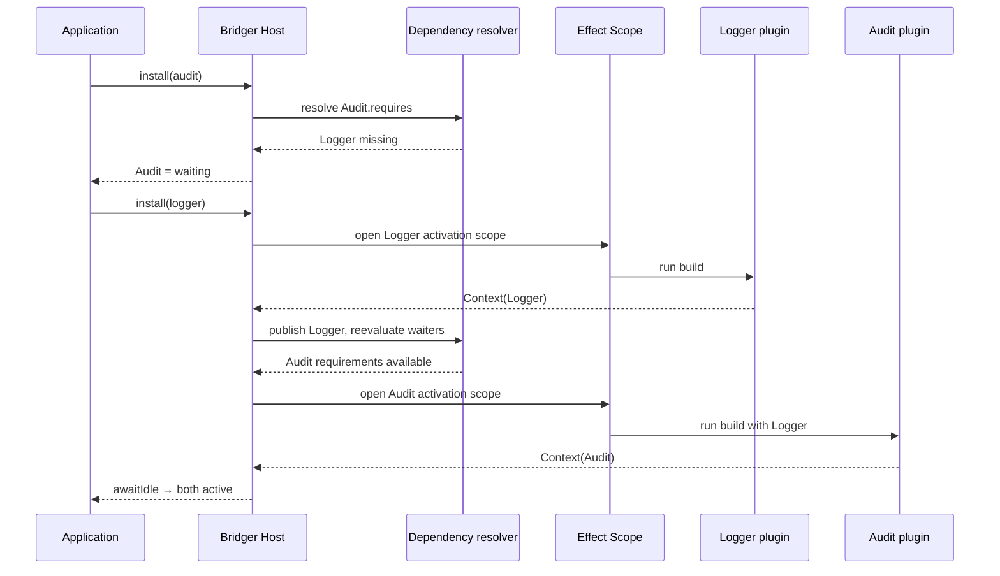

# 05 — Activation

> **Document Control**
>
> | Property       | Value                                                        |
> | -------------- | ------------------------------------------------------------ |
> | Document ID    | BRIDGER-BEH-05                                               |
> | Revision       | 0.10                                                         |
> | Effective Date | — (pending approval)                                         |
> | Status         | Draft                                                        |
> | Author         | Bridger Engineering                                          |
> | Reviewed by    | — (no independent reviewer yet; see PROC-03 §5)              |
> | Approved by    | — (pending; single maintainer, see PROC-03 §5)               |
> | Classification | Functional Specification                                     |
> | Change History | 0.10 (2026-11-10): BEH-BR-040 `awaitIdle` fails `WouldDeadlock` from a fiber carrying a plugin in `HeldPlugins` or `CurrentTransition`, `load` included (H1) (CCR-BR-035)<br>0.9 (2026-11-10): BEH-BR-037 phase "activation" also covers a runtime failure signalled while `starting` (`reportFailure`, a background fiber; BEH-BR-091) (audit round 2, Low) (CCR-BR-034)<br>0.8 (2026-11-09): BEH-BR-039 a build that imports handed-off state is decided stale before the import and is committed once the import begins (34, BEH-BR-349) (U-02); BEH-BR-034 a build queued when shutdown begins is cancelled and its plugin unregistered without a stop step (BEH-BR-105) (CCR-BR-033)<br>0.7 (2026-11-09): BEH-BR-033 a `waiting` plugin does not start once shutdown has begun; BEH-BR-034 no build begins and queued builds are cancelled under shutdown; BEH-BR-039 shutdown is a target change whose stale build is discarded (U-01) (CCR-BR-032)<br>0.6 (2026-11-08): BEH-BR-033 a wired `RefusalList` is consulted before a plugin enters `starting`, and a refused start lands in `disabled` (CCR-BR-026)<br>0.5 (2026-11-08): BEH-BR-034 the build step of an unloaded lazy registration begins with `load`; BEH-BR-038 contract references compared by version instead of object (CCR-BR-017)<br>0.4 (2026-10-03): A transition step requested and not yet begun counts against idleness (prototype finding G33) (CCR-BR-012)<br>0.3 (2026-10-02): A build begins when it holds a slot; a `starting` plugin whose requirement is gone when its build would begin returns to `waiting`, not `failed`; a stop cancels a build that has not begun (prototype finding G25) (CCR-BR-010)<br>0.2 (2026-10-02): Stale build with both causes; parked stops never count for `awaitIdle` and do not prevent idleness; `WouldDeadlock` from builds and finalizers; `concurrency` bounds builds only, stops take no slot (CCR-BR-008)<br>0.1 (2026-10-02): Initial draft (CCR-BR-001)                 |

---

This file specifies how a registered plugin becomes `active`: when it is ready,
in what order ready plugins build and how many at once, how its providers are
captured, how its `build` Layer is run in a fresh scope with a fresh memo map,
how its services are published as one unit, how a key mismatch and a stale
build are handled, the build timeout, and what "idle" means. It converts the
SPEC.md sections "Install and activation flow" and "Concurrency and
scheduling", the activation paragraph and the `KeyMismatch` rule of "Plugin
definition", and rules 2, 3 and 5 of "State and lifecycle". This file owns
BEH-BR-033–040 and uses all eight.

An activation that starts because a provider appeared is a system transition,
not an operator call; it is audited as `system-start` with `Actor.system`, as
specified in [22 — Attributable Operations](../behaviors/22-attributable-operations.md)
and [23 — Audit Sink and Record](../behaviors/23-audit-sink-and-record.md).
Activations caused by an operator call belong to that call's records.

The example from SPEC.md is used throughout: `audit` requires `Logger`,
`logger` provides it.



## BEH-BR-033: Requirements gate activation

> **Invariant:** [INV-BR-003](../invariants.md#inv-br-003-publication-is-atomic)
> **See:** [ADR-BR-005](../decisions/005-failure-is-sticky.md)
> **Satisfies:** [URS-BR-001](../urs.md#urs-br-001-install-plugins-at-runtime-without-ordering-providers)

```
REQUIREMENT: A plugin MUST NOT begin its build before every key in its
             `requires` has an `active` provider, or a base service, in its
             resolution scope.
```

```
REQUIREMENT: A `waiting` plugin whose last missing requirement becomes
             available MUST move to `starting` by itself, in the same
             revision, unless shutdown has begun (12 — Shutdown and
             Hosting, BEH-BR-105). This is a normal start; it MUST NOT be
             treated or reported as a retry.
```

```
REQUIREMENT: Keys in `optional` MUST NOT gate activation
             (15 — Optional and Reactive Dependencies).
```

```
REQUIREMENT: When a `RefusalList` is wired, every move of a plugin into
             `starting` — the move above included — MUST first consult it
             for a definition that declares a digest. A refused plugin MUST
             NOT enter `starting`, MUST NOT take a build slot and MUST NOT
             have its code loaded or built; it MUST move to `disabled` with
             reason "refused-digest" in the same revision (28 — Plugin
             Principal and Mandatory Policy, BEH-BR-267).
```

A provider that is `starting` does not count: its services are not published
until its build succeeds (BEH-BR-037), and a dependent that built against it
earlier would capture nothing. This is what lets an application install
plugins in any order — the host, not the caller, orders provider before
dependent.

A dependent that lost its provider waits and starts again by itself when the
provider returns, because nothing went wrong with the dependent — unless its
digest has been refused meanwhile, in which case it is held in `disabled`
rather than started (CCR-BR-026). A plugin that
*failed* does not: failure is sticky
([INV-BR-007](../invariants.md#inv-br-007-failure-is-sticky)).

## BEH-BR-034: Ready plugins build in FIFO order, at most `concurrency` at once

> **See:** [ADR-BR-012](../decisions/012-intent-and-linearization.md)
> **Satisfies:** [URS-BR-001](../urs.md#urs-br-001-install-plugins-at-runtime-without-ordering-providers), [URS-BR-010](../urs.md#urs-br-010-detect-a-plugin-that-waits-forever)

```
REQUIREMENT: A plugin MUST be ready to build when it is `starting`, its
             requirements are available (BEH-BR-033), and no operation is
             pending on it. Ready plugins MUST begin their builds in FIFO
             order of becoming ready. Once shutdown has begun a build MUST NOT
             begin, and a queued build is cancelled, its plugin unregistered
             without a stop step (12 — Shutdown and Hosting, BEH-BR-105).
```

```
REQUIREMENT: Plugins that become ready in the same revision MUST be ordered
             by the order in which they were registered.
```

```
REQUIREMENT: At most `BridgerOptions.concurrency` builds (default 4) MUST run
             at once. "unbounded" MUST impose no limit. A plugin that is not
             ready MUST NOT occupy a build slot.
```

```
REQUIREMENT: For a lazy registration whose code is not yet loaded, the build
             step MUST begin with its `load`, within the same slot and under
             the same `buildTimeout` (27 — Manifest and Lazy Activation,
             BEH-BR-246).
```

```
REQUIREMENT: `concurrency` MUST bound builds only. A stop MUST NOT take a
             slot and MUST NOT wait for one: stops of independent subtrees
             MUST run concurrently without limit (06 — Removal, BEH-BR-043;
             08 — Operation Legality, BEH-BR-078).
```

```
REQUIREMENT: A build MUST begin only once it holds a slot. A stop of a
             `starting` plugin whose build has not begun MUST cancel that
             build without waiting for a slot; the cancellation MUST NOT be
             recorded as a failure.
```

FIFO order and finite per-step timeouts mean no plugin starves another
indefinitely, and a plugin whose requirement never appears stays `waiting`
without consuming a slot. Stops follow their own ordering, reverse dependency
order with independent subtrees concurrent ([06 — Removal](./06-removal.md)),
and take no slot.

**Settled here.** A stop never waits for a build slot (CCR-BR-008). A stop
frees resources and lets a waiting cascade, call or shutdown proceed; making
it queue behind builds — which may wait on providers that are themselves
stopping — would add a wait that no drain limit bounds, and a stop limit of
its own would add a second queue whose order would need its own rules.
`concurrency` exists to bound the load of building, so it bounds builds.

**Settled here.** SPEC.md orders ready plugins "in FIFO order of becoming
ready" without a tie-break. Several plugins can become ready in one revision
(a provider is published and three dependents' last requirement appears at
once). Registration order breaks the tie, so the build order — and therefore
the order of events and audit records — is the same on every run with the same
inputs.

## BEH-BR-035: Provider identities are captured per activation

> **Invariant:** [INV-BR-005](../invariants.md#inv-br-005-dependents-stop-before-their-providers)
> **Satisfies:** [URS-BR-005](../urs.md#urs-br-005-never-lose-a-provider-in-the-middle-of-a-call)

```
REQUIREMENT: When a build begins, the host MUST capture, for each required
             key, the provider identity and service then active in the
             plugin's resolution scope, with any applicable interception
             applied (17 — Realms and Interception).
```

```
REQUIREMENT: The captured services MUST remain the activation's dependency
             view until the activation is stopped. A later change of
             provider MUST reach the plugin only through a stop and a new
             activation.
```

```
REQUIREMENT: When a `starting` plugin's build would begin and a key in its
             `requires` no longer has an `active` provider in its
             resolution scope — the provider began to stop, or an operation
             on the provider was linearized, after the plugin became
             `starting` — the build MUST NOT begin, the plugin MUST return to
             `waiting` in that revision, and no failure MUST be recorded. It
             starts again by itself when the requirement returns
             (BEH-BR-033).
```

This is Cordis's "committed view" rule. A dependent never sees its provider
change underneath it: a provider cannot be removed or replaced without first
stopping its dependents ([06 — Removal](./06-removal.md)), so the captured
view is never stale while the activation is alive.

**Settled here.** A plugin becomes `starting` when its requirements are
available, but captures its providers only when its build begins, and the two
moments can be apart: the build may wait for a slot, and an operation on a
provider hides the provider when it is linearized, before the provider's stop
reaches a dependent that has captured nothing yet. A requirement that is gone
at capture is not a failure of the plugin: nothing it did went wrong, and a
sticky failure there would make the settled state depend on scheduling, which
BEH-BR-160 rules out. The host-core prototype first recorded such a plugin as
`failed`, and its confluence property test, with racing operations, found the
difference (URS gap G25, CCR-BR-010).

## BEH-BR-036: Each activation builds its Layer with a fresh memo map in a forked scope

> **Invariant:** [INV-BR-014](../invariants.md#inv-br-014-every-activation-gets-a-fresh-scope-and-memo-map)
> **See:** [ADR-BR-002](../decisions/002-plugin-build-is-a-layer.md)

```ts
// illustrative — not type-checked
const activationScope = yield* Scope.fork(hostScope, "sequential")
const memoMap = yield* Layer.makeMemoMap
const context = yield* Layer.buildWithMemoMap(build, memoMap, activationScope).pipe(
  Effect.provide(Context.mergeAll(captured, pluginRuntime, pluginConfig))
)
```

```
REQUIREMENT: Every activation MUST run `build` with
             `Layer.buildWithMemoMap(build, memoMap, activationScope)`, where
             `memoMap` is created by `Layer.makeMemoMap` for that activation
             alone, and `activationScope` is
             `Scope.fork(hostScope, "sequential")` for that activation alone.
```

```
REQUIREMENT: The layer's input MUST be exactly the captured provider
             services, this activation's `Plugin.Runtime` and this
             activation's `Plugin.Config`.
```

```
REQUIREMENT: Resources the layer acquires MUST be released when the
             activation scope closes, in last-in-first-out order. The host
             MUST close every activation scope itself, in dependency order,
             before the host scope closes (12 — Shutdown and Hosting).
```

```
REQUIREMENT: Within one activation, layer memoization MUST apply as usual:
             two sub-layers that share a layer MUST build it once.
```

Layer memoization is by reference. Sharing one memo map across activations
would make a restart find the previous activation's build in the map and reuse
it — a build whose scope has already closed, whose resources are released. A
fresh map per activation is what makes `restart` actually rebuild. Inside an
activation, memoization is wanted: a plugin composing sub-layers should not
open its database pool twice.

The forked, sequential scope gives each activation its own finalizer stack, so
one plugin's cleanup is independent of another's, and closing it runs the
plugin's finalizers in reverse acquisition order. Bridger needs no resource
abstraction beside Effect's `Scope` and `Layer`. The configuration supplied as
`Plugin.Config` is read and decoded afresh for this activation before the
build runs ([11 — Configuration](./11-configuration.md)).

## BEH-BR-037: Publication is atomic, and a failed activation publishes nothing

> **Invariant:** [INV-BR-003](../invariants.md#inv-br-003-publication-is-atomic)
> **See:** [ADR-BR-005](../decisions/005-failure-is-sticky.md)
> **Satisfies:** [URS-BR-004](../urs.md#urs-br-004-know-why-a-plugin-is-not-running)
> **Risk:** [RSK-BR-016](../gxp/03-risk-assessment.md#rsk-br-016)

```
REQUIREMENT: The services a plugin provides MUST become visible together,
             in the same revision in which the plugin becomes `active`, and
             only after its build has succeeded.
```

```
REQUIREMENT: A build whose output lacks a service declared in `provides`
             MUST fail the activation with phase "activation". Partial
             results MUST NEVER be published.
```

```
REQUIREMENT: When an activation fails, the host MUST close the activation
             scope, publish nothing, and record the plugin `failed` with:
             phase "build" when the `build` Layer failed, died or exceeded
             `buildTimeout`; phase "activation" when a host step around the
             build failed — configuration could not be obtained or decoded
             (`ConfigInvalid`), a key mismatched (`KeyMismatch`), or a
             provided service was missing — or when a runtime failure was
             signalled while the plugin was `starting`, by `reportFailure`
             or a `background` fiber (10 — Runtime Failure and Health,
             BEH-BR-091).
```

```
REQUIREMENT: When closing the scope of a failed activation itself fails,
             the plugin MUST be recorded `failed` with phase "cleanup", and
             its message MUST name both the activation failure and the
             cleanup failure.
```

```
REQUIREMENT: A failed plugin MUST then wait for an explicit operation. The
             host MUST NOT retry it (04 — States and Snapshots).
```

All-or-nothing publication is what lets a dependent rely on its whole set of
requirements: no dependent can start against half of a provider, and no
consumer can lease one service of a plugin whose other service failed to
build. The two activation phases separate "the plugin's own code failed" from
"the host could not set the plugin up", which point an operator at different
fixes.

**Settled here.** SPEC.md says an omitted provided service "is an activation
error" without a phase; it is phase "activation", since the build itself
succeeded. SPEC.md does not say what happens when the cleanup of a failed
activation also fails. The plugin is recorded with phase "cleanup": a leak is
the more severe fact, and only phase "cleanup" withholds `retry` until the
leak is acknowledged ([08 — Operation Legality](./08-operation-legality.md));
reporting phase "build" would let a retry run over a leaked resource.

## BEH-BR-038: Same ServiceId, different key object: the activation fails with KeyMismatch

> **Invariant:** [INV-BR-015](../invariants.md#inv-br-015-key-identity-is-checked-by-identifier-and-by-object)
> **See:** [ADR-BR-011](../decisions/011-serviceid-is-key-identity.md), [ADR-BR-040](../decisions/040-versioned-contracts-in-core.md)
> **Risk:** [RSK-BR-010](../gxp/03-risk-assessment.md#rsk-br-010)

```
REQUIREMENT: Except between two contract references (26 — Versioned
             Contracts, BEH-BR-229), when a key in a plugin's `requires` and
             the key under which its provider (a plugin's `provides`, or the
             base) supplies that `ServiceId` are different objects, the
             activation MUST fail
             before `build` runs, with phase "activation" and a
             `KeyMismatch { serviceId }` cause.
```

```
REQUIREMENT: The host MUST NOT compare shapes, coerce, or otherwise guess
             that two key objects with one identifier agree.
```

Two key objects with one identifier typically mean two bundled copies of one
package, which may be two versions of it. Wiring them together would succeed
at runtime and misbehave at the first call whose shape differs. Failing the
activation turns that into a visible state with the service named; the fix —
deduplicating the package — is the application's
([01 — Plugin Definition](./01-plugin-definition.md), BEH-BR-006).

## BEH-BR-039: A stale build is never published

> **Invariant:** [INV-BR-004](../invariants.md#inv-br-004-no-stale-build-is-published)
> **Risk:** [RSK-BR-002](../gxp/03-risk-assessment.md#rsk-br-002)

```
REQUIREMENT: When the plugin's target changes while its build is running —
             an operation (remove, replace, restart, reconfigure, disable)
             is applied to it, one of its captured providers begins to
             stop, or shutdown begins — the host MUST let the build settle,
             MUST NOT interrupt it for that reason, and MUST NOT publish its
             result. For a build that receives handed-off state, "while its
             build is running" ends when the host begins the handoff steps:
             staleness is decided before them, and a change during them,
             other than shutdown, applies after the build step has ended
             (34 — State Handoff, BEH-BR-349).
```

```
REQUIREMENT: Once the stale build has settled, the host MUST close its
             scope through `stopping` and then proceed toward the latest
             target.
```

```
REQUIREMENT: When the target change was an operator operation or shutdown,
             the stale build's outcome, success or failure, MUST be
             discarded and the operation or shutdown MUST proceed; under
             shutdown the plugin MUST end "gone" (12 — Shutdown and
             Hosting, BEH-BR-105). When the target change was the loss of
             a captured provider, a stale build that failed MUST be recorded
             as `failed`, and one that succeeded MUST be discarded and the
             plugin MUST go to `waiting`.
```

```
REQUIREMENT: When both happened while the build ran — an operator operation
             changed the target and a captured provider began to stop — the
             operator operation MUST decide: the stale build's outcome,
             success or failure, MUST be discarded, and the operation MUST
             proceed, subject to the cascade rules of 08 — Operation
             Legality (BEH-BR-079), so that any build it then starts does
             not capture the stopping provider. Once shutdown has begun,
             shutdown decides in the same way, whatever else changed the
             target.
```

A build captured its providers at its start (BEH-BR-035); if one of them is
leaving, a successful result is built on a service that is about to close.
Publishing it would let consumers lease a plugin whose dependency is gone —
the stale-publication hazard RSK-BR-002 names. Letting the step settle rather
than interrupting it keeps the scope's finalizers in a known state; the build
is bounded by `buildTimeout` regardless (BEH-BR-040). The provider whose
removal triggered the change waits for this dependent's scope to close before
its own closes ([06 — Removal](./06-removal.md)).

**Settled here.** SPEC.md says "let that step settle, close its stale scope,
and reevaluate against the latest target" without saying what happens to a
stale build that *failed*. When an operator asked for something else, that
operation decides the destination and the old attempt's outcome is moot. When
nobody asked — a provider simply left — a failure is still a failure and is
kept sticky, because silently turning it into `waiting` would let the same
failing build run again unattended when the provider returns
([RSK-BR-003](../gxp/03-risk-assessment.md#rsk-br-003)). When both happen to
one build — an operator operation and a provider's loss — the operator
operation decides and the stale result is discarded either way (CCR-BR-008):
the operation already names a destination, and a failure of a build nobody
will use is not the failure of the plugin the operator asked for.

## BEH-BR-040: Builds are bounded, and idle is defined

> **Invariant:** [INV-BR-016](../invariants.md#inv-br-016-a-re-entrant-wait-fails-fast)
> **Satisfies:** [URS-BR-010](../urs.md#urs-br-010-detect-a-plugin-that-waits-forever)
> **Risk:** [RSK-BR-011](../gxp/03-risk-assessment.md#rsk-br-011)

```ts
// illustrative — not type-checked
awaitIdle(options?: { readonly timeout?: Duration.Input }):
  Effect.Effect<HostSnapshot, IdleTimeout | WouldDeadlock | HostClosed>
```

```
REQUIREMENT: A build that runs longer than `BridgerOptions.buildTimeout`
             (default 60 seconds) MUST be interrupted, its scope closed, and
             the plugin recorded `failed` with phase "build" and a message
             stating the timeout.
```

```
REQUIREMENT: The host MUST be idle exactly when no transition is running or
             waiting to begin, and no plugin is ready to build. A transition
             step that has been requested and has not begun — a system stop
             of a cascade or an unmount included, and a step a `TestHost`
             holds until it is stepped (21 — Testing Host, BEH-BR-178) —
             MUST count as a transition. Plugins `waiting` for a missing
             provider, and `failed` or `disabled` plugins, MUST NOT prevent
             idleness. Health checks MUST NOT count as transitions.
```

```
REQUIREMENT: A parked stop of any kind — a parked operation or a parked
             system stop (08 — Operation Legality, BEH-BR-074) — MUST NOT
             count as a running transition. Parked stops (`parked` true,
             04 — States and Snapshots) MUST NOT prevent idleness.
```

```
REQUIREMENT: `awaitIdle` MUST return the snapshot of the first idle
             revision at or after the call. It MUST NOT wait for missing
             providers. With `timeout`, it MUST fail with
             `IdleTimeout { snapshot }` carrying the latest snapshot when
             the host is not idle in time.
```

```
REQUIREMENT: `awaitIdle` called from a fiber that carries a plugin ID in
             `@bridger/core/HeldPlugins` or `@bridger/core/CurrentTransition`
             — one that holds a lease, or runs a plugin's `build`, `load` or
             a finalizer of its activation scope — MUST
             fail at once with `WouldDeadlock` (09 — Leases, BEH-BR-088), and
             after shutdown has begun it MUST fail with `HostClosed`.
```

`awaitIdle` is how a test or a startup sequence says "do everything that can
be done now". It reports `waiting` rather than hanging on a provider that may
never be installed, which is why plugins waiting for missing providers are
excluded. Because idleness depends on builds and drains finishing, both are
bounded by their own timeouts, so a host with a stuck build still becomes idle
— with that plugin `failed` — instead of never. A fiber holding a lease cannot
wait for idle, because idleness may require the provider it holds to drain;
nor can a build or a finalizer, because idleness requires its own step to
settle. A parked stop waits for an operator, not for time, so counting it
would make `awaitIdle` hang exactly when an operator must act; the snapshot's
`parked` flag shows it instead.

**Settled here.** SPEC.md's `awaitIdle` signature omitted `HostClosed`; it is
added, as [12 — Shutdown and Hosting](./12-shutdown-and-hosting.md) also
settles.

---

_Previous: [04 — States and Snapshots](./04-states-and-snapshots.md)_ · _Next: [06 — Removal](./06-removal.md)_
