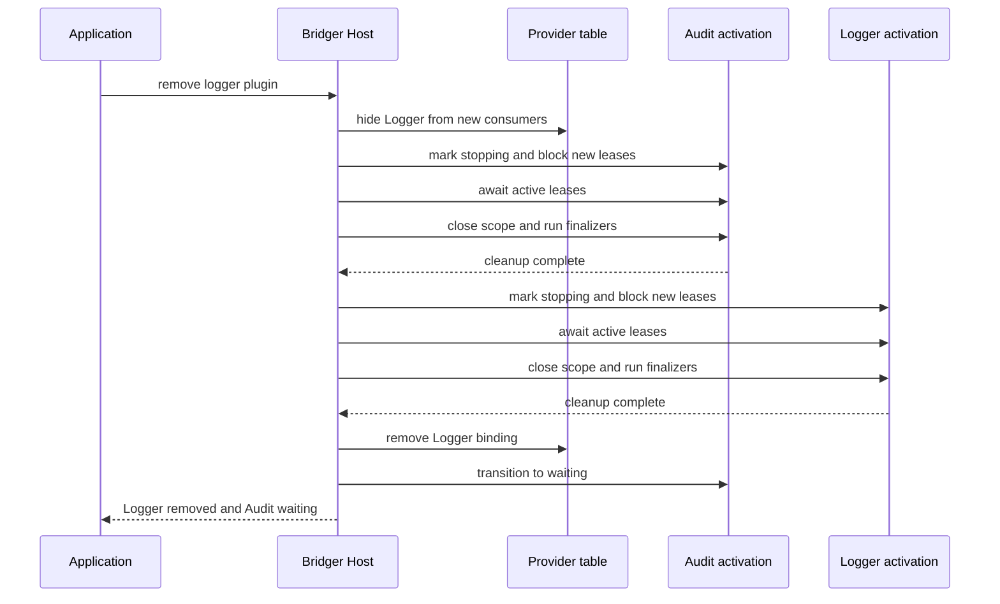

# 06 — Removal

> **Document Control**
>
> | Property       | Value                                                        |
> | -------------- | ------------------------------------------------------------ |
> | Document ID    | BRIDGER-BEH-06                                               |
> | Revision       | 0.6                                                          |
> | Effective Date | — (pending approval)                                         |
> | Status         | Draft                                                        |
> | Author         | Bridger Engineering                                          |
> | Reviewed by    | — (no independent reviewer yet; see PROC-03 §5)              |
> | Approved by    | — (pending; single maintainer, see PROC-03 §5)               |
> | Classification | Functional Specification                                     |
> | Change History | 0.6 (2026-11-11): BEH-BR-045 `DrainTimeout` carries `realm` beside `id` (absent for a `Generation`) and `target` as `{ id, realm }`; BEH-BR-046 `CleanupError` carries `realm` (C2) (SPEC-AUDIT-05) (CCR-BR-037)<br>0.5 (2026-11-10): BEH-BR-045 `WouldDeadlock` carries `id` and `realm` (C1) (CCR-BR-036)<br>0.4 (2026-11-09): BEH-BR-041 and BEH-BR-043 a dependent ends `waiting` (or `starting`) except where its own stop ends otherwise (BEH-BR-039, BEH-BR-046, BEH-BR-033), `dormant` and `stopping` dependents named (C-17); a dependency-loss stop under shutdown ends "gone" (U-01) (CCR-BR-032)<br>0.3 (2026-10-02): `DrainTimeout { id, leases, target? }` for every stopping operation; cascade drain limit runs while waiting, for a build step too; one parking rule; children removed before the parent's scope closes; stops take no `concurrency` slot (CCR-BR-008)<br>0.2 (2026-10-02): DrainTimeout names the plugin whose leases did not drain; cascade ordering cross-referenced (CCR-BR-006)<br>0.1 (2026-10-02): Initial draft (CCR-BR-001)                 |

---

This file specifies `remove` and the stop path every other stopping operation
reuses: hiding a provider from new consumers, stopping dependents before their
provider, the spatial guarantee that a dependent can still use its provider in
its own finalizers, lease draining at the point where it meets removal, and
what happens when cleanup fails — including the settled rule that removing a
plugin whose cleanup failed acknowledges the leak rather than retrying the
cleanup. It converts the `remove` paragraph of the SPEC.md section "Host
interface", rules 4 and 6 and the cleanup-failure paragraph of "State and
lifecycle", and the subsection "Removal ordering". Lease drain, force and
re-entrancy are converted in [09 — Leases](./09-leases.md); shutdown in
[12 — Shutdown and Hosting](./12-shutdown-and-hosting.md). This file owns
BEH-BR-041–048 and uses all eight.

`remove` is a mutating operation. Like every such operation it is attributed,
gated and audited as specified in
[22 — Attributable Operations](../behaviors/22-attributable-operations.md) and
[23 — Audit Sink and Record](../behaviors/23-audit-sink-and-record.md); those
rules are not repeated here.

## BEH-BR-041: remove stops a plugin and unregisters it after cleanup

> **See:** [ADR-BR-006](../decisions/006-one-instance-per-id-per-realm.md)
> **Satisfies:** [URS-BR-002](../urs.md#urs-br-002-remove-or-replace-a-plugin-safely-while-it-is-in-use)
> **Risk:** [RSK-BR-004](../gxp/03-risk-assessment.md#rsk-br-004)

```ts
// illustrative — not type-checked
remove(ref: PluginRef, options?: RemoveOptions):
  Effect.Effect<void,
    | UnknownPlugin | CleanupError | DrainTimeout | WouldDeadlock | HostClosed
    | Unattributed | ReasonRequired | AuditUnavailable | OperationRejected>
```

```
REQUIREMENT: `remove` MUST stop the plugin, if it has a live activation,
             through the stop path of this file, and MUST unregister its
             definition only after its cleanup has completed successfully.
```

```
REQUIREMENT: `remove` MUST complete successfully only once the plugin has no
             snapshot entry. Its provider slots, configuration override and
             ID MUST be released in that same revision, and a
             `plugin-removed` event MUST be emitted.
```

```
REQUIREMENT: Dependents of the removed plugin MUST remain installed, except
             its children, which MUST be removed (14 — Children and Groups,
             BEH-BR-125). Each other dependent that was `starting` or
             `active` MUST end `waiting` with the lost keys in
             `missingServiceIds`, except where its own stop ends otherwise:
             a stale build that failed is recorded `failed`
             (05 — Activation, BEH-BR-039), and a cleanup that fails ends
             `failed` with phase "cleanup" (BEH-BR-046). `dormant`,
             `waiting`, `failed` and `disabled` dependents MUST keep their
             state; a `stopping` dependent ends as 08 — Operation Legality,
             BEH-BR-079, gives.
```

```
REQUIREMENT: The outcome of `remove` in each state, and against an operation
             already in flight, MUST be as given by the tables of
             08 — Operation Legality.
```

A dependent is not removed with its provider: it was installed independently,
may be configured independently, and will start again by itself when another
provider of the key is installed
([05 — Activation](./05-activation.md)). Removal releases the ID, so the same
ID can be installed again at once.

From a state with no live scope — `waiting`, `failed` (other than phase
"cleanup") or `disabled` — removal has nothing to stop and unregisters at
once. From `starting`, the plugin passes through `stopping`: a running build
settles first and its result is discarded
([05 — Activation](./05-activation.md), BEH-BR-039), and a plugin still
queued for a build slot has nothing to close, so its stop completes at once
([04 — States and Snapshots](./04-states-and-snapshots.md)).

## BEH-BR-042: A provider is hidden from new consumers as soon as removal begins

> **Invariant:** [INV-BR-006](../invariants.md#inv-br-006-a-leased-provider-does-not-close-under-its-lease)
> **Satisfies:** [URS-BR-005](../urs.md#urs-br-005-never-lose-a-provider-in-the-middle-of-a-call)
> **Risk:** [RSK-BR-001](../gxp/03-risk-assessment.md#rsk-br-001)

```
REQUIREMENT: In the revision in which a removal begins, the plugin MUST
             become `stopping` and its provided services MUST become
             unavailable to new consumers: they leave `availableServiceIds`,
             new leases on them fail with `ServiceUnavailable`, and no
             plugin may begin a build that captures them.
```

```
REQUIREMENT: Leases admitted before the removal began, and the captured
             bindings of existing dependents, MUST remain usable until they
             are released through the steps of BEH-BR-043.
```

Hiding first is what makes the removal finite: from that revision on, the set
of things holding the provider can only shrink. A provider still visible to new
consumers while it waits for old ones to finish could be held open
indefinitely by a steady stream of new calls.

## BEH-BR-043: Dependents stop before their provider

> **Invariant:** [INV-BR-005](../invariants.md#inv-br-005-dependents-stop-before-their-providers), [INV-BR-006](../invariants.md#inv-br-006-a-leased-provider-does-not-close-under-its-lease)
> **Satisfies:** [URS-BR-002](../urs.md#urs-br-002-remove-or-replace-a-plugin-safely-while-it-is-in-use), [URS-BR-005](../urs.md#urs-br-005-never-lose-a-provider-in-the-middle-of-a-call)
> **Risk:** [RSK-BR-001](../gxp/03-risk-assessment.md#rsk-br-001)



```
REQUIREMENT: Before a provider's activation scope begins to close, the host
             MUST stop every live dependent of it — every plugin that
             captured one of its services, every child plugin, which is
             removed as a dependent (14 — Children and Groups, BEH-BR-125),
             and every `whenAvailable` block that holds one of its services
             (15 — Optional and Reactive Dependencies) — transitively, in
             reverse dependency order.
```

```
REQUIREMENT: Stopping one plugin MUST consist of: becoming `stopping` and
             blocking new leases and dependents; waiting for its leases to
             drain (09 — Leases); closing its activation scope, which runs
             its finalizers last-in-first-out. A provider's scope MUST NOT
             begin to close until every dependent's scope has closed and
             every lease on the provider has ended or been revoked.
```

```
REQUIREMENT: Stops of independent subtrees MAY run concurrently, without
             limit; stops along one dependency path MUST NOT. A stop MUST
             NOT take or wait for a `concurrency` slot, which bounds builds
             only (05 — Activation, BEH-BR-034; 08 — Operation Legality,
             BEH-BR-078).
```

```
REQUIREMENT: Each dependent stopped because its provider is leaving MUST
             show `stopping` with `reason` "dependency-loss", and MUST then
             go to `waiting`, or to `starting` when a replacement provider
             is already available (07 — Replacement and Reactivation),
             except where its stop ends otherwise: a stale build that
             failed is recorded `failed` (05 — Activation, BEH-BR-039), a
             cleanup that fails ends `failed` with phase "cleanup"
             (BEH-BR-046), and a move into `starting` that a wired
             `RefusalList` refuses ends `disabled` with reason
             "refused-digest" (05 — Activation, BEH-BR-033). A child of the
             leaving provider MUST instead be removed, whatever services it
             holds (14 — Children and Groups, BEH-BR-125). Under shutdown
             every such stop ends "gone" instead (12 — Shutdown and
             Hosting, BEH-BR-105).
```

Closing a provider first would leave each dependent holding a captured
service whose resources are gone, and the dependent's own finalizers — which
often need that service, to flush a buffer or deregister — would fail or,
worse, act on a closed resource. Dependents-first is Cordis's guarded
withdrawal, made bounded by the drain limit.

A child plugin removed because its parent stops is a consequence of the
parent's activation, not an operator decision: it is audited as a
`system-stop` whose `causationId` is the cascade root's record, as
[22 — Attributable Operations](../behaviors/22-attributable-operations.md)
(BEH-BR-190) gives it — when the parent was stopped directly by an operator
call, that call's `requested` record. Children are removed as dependents,
before the parent's scope begins to close, never by the parent's own
finalizers.

## BEH-BR-044: The spatial guarantee

> **Invariant:** [INV-BR-005](../invariants.md#inv-br-005-dependents-stop-before-their-providers)
> **Satisfies:** [URS-BR-005](../urs.md#urs-br-005-never-lose-a-provider-in-the-middle-of-a-call)
> **Risk:** [RSK-BR-001](../gxp/03-risk-assessment.md#rsk-br-001)

```
REQUIREMENT: A dependent MUST be able to use the provider services it
             captured from within its own finalizers, and every such use
             MUST observe the provider's scope still open.
```

```
REQUIREMENT: The provider's binding MUST be removed from the provider table
             only after the provider's own cleanup has completed.
```

This is the guarantee the ordering exists for: in the example, `Audit` can
write a final record through its committed `Logger` binding while it closes,
and `Logger` closes only after `Audit` has released it. Within each scope,
finalizers run in last-in-first-out order, so a plugin's own resources are
also released in the reverse of the order it acquired them.

## BEH-BR-045: A drain that times out leaves the plugin stopping

> **Invariant:** [INV-BR-017](../invariants.md#inv-br-017-every-drain-is-bounded-unless-declared-forever)
> **See:** [ADR-BR-015](../decisions/015-leases-one-primitive.md)
> **Satisfies:** [URS-BR-010](../urs.md#urs-br-010-detect-a-plugin-that-waits-forever)
> **Risk:** [RSK-BR-015](../gxp/03-risk-assessment.md#rsk-br-015)

```
REQUIREMENT: When the lease drain of a removal exceeds `drain` (default
             `BridgerOptions.drainTimeout`) and `force` is not set, `remove`
             MUST fail with `DrainTimeout { id, realm?, leases, target? }`,
             and the plugin MUST stay `stopping`, hidden from new
             consumers, with its stop parked (08 — Operation Legality,
             BEH-BR-074). It MUST NOT
             be republished. The same MUST hold for every operation that
             stops a plugin — `replace`, `restart`, `reconfigure` and
             `disable`.
```

```
REQUIREMENT: When a call fails with `DrainTimeout`, every stop it drives that
             has not settled — its own stop and every dependency-loss stop
             it started, at any depth — MUST park in the same revision
             (08 — Operation Legality, BEH-BR-079). Only the call under whose
             options the drain ran MUST fail; another cascade waiting on that
             stop MUST then find it parked and resume it under its own
             options (BEH-BR-080).
```

```
REQUIREMENT: A `remove` that would wait for a lease held by its own fiber,
             or by a fiber that inherited the held-plugin reference, MUST
             fail at once with `WouldDeadlock { id, realm }` and change nothing
             (09 — Leases).
```

```
REQUIREMENT: The `id` of that `DrainTimeout` MUST name the plugin (or the
             `Generation`) whose leases did not drain, or whose running
             transition step the call was waiting for; it is a dependent of
             the named plugin when the drain or step was the dependent's
             (08 — Operation Legality, BEH-BR-079, BEH-BR-080). `realm`
             MUST be that plugin's realm, and MUST be absent exactly when
             `id` names a `Generation` (CCR-BR-037). `target` MUST name the
             plugin the call named, as the record `{ id, realm }`
             (17 — Realms and Interception, BEH-BR-147), and MUST be
             present exactly when it differs from the plugin `id` and
             `realm` name. `leases` MUST be the number of leases
             still held on that plugin, and 0 when the call was waiting for
             a build step.
```

```
REQUIREMENT: While a stopping operation waits for a dependent's running
             transition step — a build or a stop (08 — Operation Legality,
             BEH-BR-079) — its own `drain` limit MUST run. When it expires
             without `force`, the call MUST fail with `DrainTimeout` naming
             that dependent (`leases` 0 when the step is a build), and every
             stop it drives that has not settled MUST park as the previous
             requirement states; the dependent's step continues under its
             owner's options. With `force`, the dependent's remaining leases
             MUST be revoked (09 — Leases, BEH-BR-086); when the step is a
             build there is nothing to revoke, and the wait MUST continue
             under `buildTimeout`. For a cascade with no
             caller at its root, an expiry while it waits for a build step
             MUST continue the wait under `buildTimeout`.
```

How the stop of a dependent is ordered against an operation already in flight
on that dependent is specified in
[08 — Operation Legality](./08-operation-legality.md) (BEH-BR-079, BEH-BR-080).
A cascading call's total wait is therefore bounded by its own drain limit for
the plugin it named and for each plugin on the dependency path below it, plus
`buildTimeout` for each build step it waits for; it is not the sum of another
call's limits, since its own limit runs while it waits. Finalizer running time
is not bounded by the core ([12 — Shutdown and
Hosting](./12-shutdown-and-hosting.md), BEH-BR-107), so the bound assumes
finalizers that return.
What happens to the pending removal after a `DrainTimeout`, and how a
repeated call resumes it, is specified in
[08 — Operation Legality](./08-operation-legality.md); how `force` revokes
leases, and why that is reported and audited, in [09 — Leases](./09-leases.md).
`force` interrupts work that may be mid-write (RSK-BR-015), which is why it is
never the default.

**Settled here.** `DrainTimeout` names, in `id`, the plugin whose leases did
not drain, and, in `target`, the plugin the call named when the two differ
(CCR-BR-008). A caller that removed `Logger` and is told `Audit` did not drain
can see both without parsing a message. The cascading call's own drain limit
runs while it waits for a dependent's step, so a dependent's `drain: "forever"`
operation cannot hold another operator's call without bound; when the step is
a build, `leases` is 0, since nothing was left to drain. When the call fails,
every stop it was driving parks with it: a dependency-loss stop it started
that stayed running with no call driving it could otherwise wait for a step
that nobody would ever resume.

## BEH-BR-046: A cleanup failure is reported, never hidden

> **Invariant:** [INV-BR-007](../invariants.md#inv-br-007-failure-is-sticky)
> **Satisfies:** [URS-BR-006](../urs.md#urs-br-006-recover-from-failure-explicitly-and-never-silently)
> **Risk:** [RSK-BR-009](../gxp/03-risk-assessment.md#rsk-br-009)

```
REQUIREMENT: When closing a plugin's activation scope fails, the host MUST
             still treat the scope as closed and the plugin's services as
             unpublished, MUST record the plugin `failed` with phase
             "cleanup" and a message, and MUST keep it registered.
```

```
REQUIREMENT: A `remove` whose own target's cleanup failed MUST fail with
             `CleanupError { id, realm, message }` and MUST NOT unregister the
             plugin.
```

```
REQUIREMENT: The host MUST NOT claim, in any snapshot, event, log or audit
             record, that a resource whose finalizer failed has been
             released or recovered.
```

```
REQUIREMENT: When a dependent's cleanup fails during the removal of its
             provider, the dependent MUST be recorded `failed` with phase
             "cleanup", and the removal of the provider MUST continue. The
             provider's `remove` MUST NOT fail because of the dependent.
```

Effect runs every finalizer of a scope even when one fails, so after a failed
close nothing more can be released through the scope: the services are gone,
and whatever the failing finalizer was responsible for may have leaked. The
plugin stays registered in phase "cleanup" so that the leak stays visible and
its provider slot stays reserved — a replacement that would reacquire the same
external resource is withheld until the application has dealt with it
([08 — Operation Legality](./08-operation-legality.md)).

**Settled here.** SPEC.md does not say what a provider's `remove` reports when
a *dependent's* cleanup fails. The dependent's scope has closed (all its
finalizers ran), so the provider is no longer used by it and may close; the
failure belongs to the dependent and is recorded on it as sticky state and as
its own `system-stop` audit record. Failing the provider's `remove` would tell
the caller their removal had not happened when it had.

## BEH-BR-047: Removing a plugin whose cleanup failed acknowledges the leak

> **Invariant:** [INV-BR-011](../invariants.md#inv-br-011-every-state-and-operation-pair-has-a-defined-outcome)
> **See:** [ADR-BR-013](../decisions/013-total-operation-legality.md)
> **Satisfies:** [URS-BR-006](../urs.md#urs-br-006-recover-from-failure-explicitly-and-never-silently)
> **Risk:** [RSK-BR-009](../gxp/03-risk-assessment.md#rsk-br-009)

```
REQUIREMENT: `remove` of a plugin in `failed` with phase "cleanup" MUST
             unregister it and MUST NOT attempt to run its cleanup again.
```

```
REQUIREMENT: Such a removal MUST be reported as an acknowledgement of a
             leak, never as a successful cleanup: the host MUST log at
             warning level that the leak recorded for that plugin was
             acknowledged by this removal, with the original cleanup message.
```

```
REQUIREMENT: Until it is removed, a plugin in `failed` with phase "cleanup"
             MUST refuse every other operation that names it, as given in
             08 — Operation Legality.
```

The scope was closed when its cleanup failed; Effect cannot re-run a closed
scope's finalizers, and the core never held a second handle on the resource.
"Retrying the cleanup" therefore has no meaning the host could implement
honestly. What the operator can do is resolve the external resource by
application means and then tell the host so. `remove` is that statement: it
frees the ID and slots, and the audit record of the call — who removed it, when
and why ([23 — Audit Sink and Record](../behaviors/23-audit-sink-and-record.md))
— is the record that the leak was acknowledged.

**Settled here.** SPEC.md's race table says that for a phase-"cleanup"
failure "`remove` retries the cleanup". That is not possible with Effect's
scope model and would claim a recovery that did not happen. This
specification replaces it: `remove` unregisters and records the leak as
acknowledged, and does not re-run cleanup.

## BEH-BR-048: Removal releases behaviour, not imported code

> **See:** [ADR-BR-027](../decisions/027-core-exclusions.md)
> **Risk:** [RSK-BR-017](../gxp/03-risk-assessment.md#rsk-br-017)

```
REQUIREMENT: Removal MUST release the plugin's tracked resources and
             registrations (its activation scope, its contributions and its
             listeners). Documentation MUST state that removal does not
             reclaim imported code and does not compensate emissions already
             made — messages sent, transactions committed, writes seen by
             another process.
```

Scope cleanup concerns what the scope tracked. A message already sent cannot
be unsent by a finalizer, and compensation for such emissions is
application-defined. Saying so in the removal contract keeps anyone from reading
"removed" as "undone".

---

_Previous: [05 — Activation](./05-activation.md)_ · _Next: [07 — Replacement and Reactivation](./07-replacement-and-reactivation.md)_
